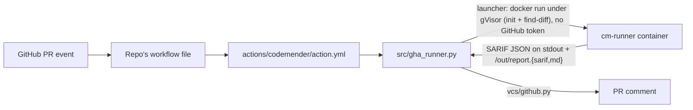

# CodeMender GitHub Actions Integration (Workstream 2)

A GitHub Action that runs CodeMender (`cm-runner`) on pull requests and reports
the results back on the PR.

> **Status: M2 (`init` + `find-diff` + `fix`).** On every pull request the
> action authenticates to Google Cloud via Workload Identity Federation (WIF),
> runs `cm-runner init` and `cm-runner find-diff` in a `docker run` container
> under gVisor, uploads `report.sarif` and `report.md` as workflow artifacts,
> and posts a top-level Markdown PR comment with any vulnerabilities found. It
> then runs `cm-runner fix` for every finding at once and posts each fix on the
> PR, next to the code it changes (see [Fixes](#fixes)). `verify` comes next
> (see [Roadmap](#roadmap)).

## How it fits together



- **cm-runner** (`packages/codemender/`) is environment-agnostic. It runs
  CodeMender and never talks to GitHub (ADR-0008).
- **launcher** (`packages/launcher/`) owns the outer container/sandbox boundary
  (`launcher.local`, `launcher.cloudrun`) and never passes the GitHub token into
  `cm-runner`.
- **This action** orchestrates the PR scan and fixes via `packages/launcher/`,
  and it's the only part that holds the GitHub token and posts to the PR.

## Directory structure

Follows the `.github/` convention: workflows in `workflows/`, actions in
`actions/<name>/` (GitHub requires the file to be named `action.yml`). The
action's source lives with the action, while shared workspace packages live
under `packages/{codemender,launcher}/` (ADR-0008).

```text
.github/
├── actions/
│   └── codemender/
│       ├── action.yml             # Composite action: installs gVisor, pulls the image, runs src/gha_runner.py
│       ├── requirements.txt       # Dependencies of this action (not of cm-runner)
│       ├── src/
│       │   ├── gha_runner.py      # Entry point: reads the GitHub event, runs cm-runner scan + parallel fixes, posts results
│       │   ├── fix_comments.py    # Deduplicates findings and routes patches to PR suggestions or fallback patch comments
│       │   └── vcs/
│       │       └── github.py      # GitHub REST API: sticky comment, PR reviews, inline/file patch comments
│       └── tests/                 # Unit tests (no network, no Docker needed)
└── workflows/
    └── cm-merge-scan.yml          # Workflow template to copy into a repo's .github/workflows/
```

## Distribution model

`codemender-runner` is a private repository, so customer repositories can't
reference this action (`uses: cloud-gtm/codemender-runner/...`), and we can't
change settings on their behalf. Instead, we **send customers a tarball of this
directory**; they copy it into their repository and run it from there. Nothing
in the action depends on access to this repository.

A published, versioned action may follow later (see [Roadmap](#roadmap)).

## Packaging for a customer (maintainers)

Build the package from a committed ref so only tracked files and the shared
`packages/codemender` and `packages/launcher` libraries are included:

```bash
# From the root of codemender-runner
STAGE=$(mktemp -d)
git archive HEAD:.github | tar -x -C "$STAGE"
mkdir -p "$STAGE/actions/codemender/packages/codemender/src/codemender"/{sarif,vcs}
cp packages/codemender/pyproject.toml "$STAGE/actions/codemender/packages/codemender/"
cp packages/codemender/src/codemender/{__init__.py,cm.py} "$STAGE/actions/codemender/packages/codemender/src/codemender/"
cp packages/codemender/src/codemender/sarif/__init__.py "$STAGE/actions/codemender/packages/codemender/src/codemender/sarif/"
cp packages/codemender/src/codemender/vcs/{__init__.py,git.py} "$STAGE/actions/codemender/packages/codemender/src/codemender/vcs/"
mkdir -p "$STAGE/actions/codemender/packages/launcher/src/launcher"/{local,cloudrun}
cp packages/launcher/pyproject.toml "$STAGE/actions/codemender/packages/launcher/"
cp packages/launcher/src/launcher/{__init__.py,base.py} "$STAGE/actions/codemender/packages/launcher/src/launcher/"
cp packages/launcher/src/launcher/local/{__init__.py,local_docker.py} "$STAGE/actions/codemender/packages/launcher/src/launcher/local/"
cp packages/launcher/src/launcher/cloudrun/{__init__.py,cloud_run.py} "$STAGE/actions/codemender/packages/launcher/src/launcher/cloudrun/"
tar -czf codemender-action.tar.gz -C "$STAGE" --transform='s,^\.,codemender-action,' .
rm -rf "$STAGE"
```

The package mirrors a repository's `.github/` directory:

| Path                                                                                                           | Copy to                               | Needed at runtime?                      |
| :------------------------------------------------------------------------------------------------------------- | :------------------------------------ | :-------------------------------------- |
| `actions/codemender/` (`action.yml`, `requirements.txt`, `src/`, `packages/codemender/`, `packages/launcher/`) | `.github/actions/codemender/`         | Yes: this is the action                 |
| `actions/codemender/tests/`                                                                                    | —                                     | No: included for transparency           |
| `workflows/cm-merge-scan.yml`                                                                                  | `.github/workflows/cm-merge-scan.yml` | Yes: the workflow that calls the action |
| `README.md`                                                                                                    | —                                     | Setup only: these instructions          |

The customer also needs a **cm-runner image they can pull** (see step 3 below).
The image is not part of the tarball.

## Using it in a repository (customers)

### 1. Copy the action into your repository

Extract the package and copy the action to `.github/actions/codemender/`:

```bash
tar -xzf codemender-action.tar.gz          # creates ./codemender-action/

# From the root of your repository
mkdir -p .github/actions/codemender
rsync -a --delete --exclude tests --exclude __pycache__ \
  /path/to/codemender-action/actions/codemender/ .github/actions/codemender/
```

Result:

```text
.github/actions/codemender/
├── action.yml
├── requirements.txt
├── packages/
│   ├── codemender/src/codemender/
│   │   ├── cm.py
│   │   ├── sarif/__init__.py
│   │   └── vcs/git.py
│   └── launcher/src/launcher/
│       ├── __init__.py
│       ├── base.py
│       ├── cloudrun/
│       │   ├── __init__.py
│       │   └── cloud_run.py
│       └── local/
│           ├── __init__.py
│           └── local_docker.py
└── src/
    ├── gha_runner.py
    ├── fix_comments.py
    └── vcs/
        ├── __init__.py
        └── github.py
```

To upgrade, extract the new package, re-run the same command, and commit.

### 2. Add the workflow

```bash
mkdir -p .github/workflows
cp /path/to/codemender-action/workflows/cm-merge-scan.yml .github/workflows/
```

It checks out the repository at the PR head
(`ref: ${{ github.event.pull_request.head.sha }}`) and then runs
`uses: ./.github/actions/codemender`. It runs only on PRs targeting `main` or
`master`; edit `branches:` if your default branch is named differently.

### 3. Configure the cm-runner image and Google Cloud (WIF)

Set the required inputs in `.github/workflows/cm-merge-scan.yml`:

- **`runner_image`**: Set to the **Universal Runner Image** (which comes
  pre-baked with Python 3.11, Node 22 + `npm`/`yarn`/`pnpm`, Java 17 +
  `mvn`/`gradle`, Go 1.22, and C/C++ `build-essential`) or a
  **Bring-Your-Own-Image (BYOI)** built
  `FROM <registry>/codemender-runner:<sha>` with your repository's third-party
  dependencies pre-installed. Pin to a commit SHA tag (not `:latest`). The
  action uses the workflow's automatic token (scoped by `permissions:`) to pull
  the image and to post the comment as `github-actions[bot]`. Only if the image
  is in a registry the repository's token can't read (e.g. another org), pass a
  token with `registry_token: ${{ secrets.<NAME> }}`. It is used only for
  `docker pull`.
- **`gcp_project_id`**, **`gcp_workload_identity_provider`**, and
  **`gcp_service_account`**: `cm` calls Vertex AI during `init`, `find-diff` and
  `fix`. The action authenticates via `google-github-actions/auth@v2` using
  keyless Workload Identity Federation (`id-token: write`) and mounts the
  short-lived ADC file read-only into the container.

### 4. Open a pull request

A **CodeMender** comment appears on the PR with either a clean scan message or a
summary table of vulnerabilities found in the diff (with links to the affected
lines and collapsible analysis details). When `fix` is enabled (the default),
CodeMender then generates a fix for each finding in parallel and updates the
sticky comment's **Fix** column as each container finishes. `report.sarif`,
`report.md`, `findings/*.sarif`, and `fixes/*.diff` are uploaded as a workflow
artifact (`codemender-report-pr-<N>`).

## Fixes

- **On by default (`fix: 'true'`):** After `find-diff` reports findings, the
  action runs `cm-runner fix` once per finding in isolated gVisor containers (up
  to `max_parallel_fixes: '4'` at a time). Each fix usually takes 10 minutes or
  more. Set `fix: false` in the workflow `with:` block to run only the scan.
- **How fixes are posted:**
  - **One-click suggestions (`✅ Suggested`):** When every line changed by a
    patch lies inside the PR diff's hunks (and does not touch `.github/`), the
    action posts a PR review with ```` ```suggestion ```` blocks that can be
    committed directly on GitHub (or batched via *Add suggestion to batch*).
  - **Patch comments (`📎 Patch`):** When a patch changes lines outside the PR
    diff (such as adding an import at the top of a file) or touches `.github/`,
    the action posts a collapsed `diff` block on the flagged line (or file) with
    `git apply` instructions.
- **What each value in the `Fix` column means:**
  | Value          | Meaning                                                                                                                      |
  | :------------- | :--------------------------------------------------------------------------------------------------------------------------- |
  | `⏳ Working`   | `cm-runner fix` is currently running for this finding.                                                                       |
  | `✅ Suggested` | Links to a PR review with one-click ```` ```suggestion ```` block(s).                                                        |
  | `📎 Patch`     | Links to a line/file review comment with a unified diff (or to the workflow run artifacts if GitHub rejected both comments). |
  | `❌ No fix`    | `cm-runner fix` finished with exit code 3 (CodeMender could not produce or verify a fix). Does not fail the job.             |
  | `⚠️ Failed`    | The fix container failed or timed out. Does not fail the job; see the collapsible `::group::` in the job log.                |
- **Builds, dependencies, and testing (Universal Image & BYOI):**
  - When `cm fix` generates a candidate patch, it runs your project's build/test
    command to verify that the fix compiles and passes tests (`cm` rejects the
    patch and reports `No fix` if the build command fails).
  - Because `cm`'s inner sandbox runs with no network access
    (`permissive-closed`) and the action does not install dependencies on the
    GitHub Actions host, builds work in one of three ways:
    1. **Universal Runner Image (default):** `codemender-runner` comes pre-baked
       with standard language toolchains (Python 3.11, Node.js 22 with
       `npm`/`yarn`/`pnpm`, OpenJDK 17 with `mvn`/`gradle`, Go 1.22, and C/C++
       `gcc`/`g++`/`make`/`cmake`). Projects that only rely on standard library
       or pre-baked tools build and test out of the box.
    1. **Bring-Your-Own-Image (BYOI) via `runner_image`:** For repositories that
       need third-party packages (e.g. `pytest`, `flask`, `jest`) or custom
       toolchains (e.g. Rust, PHP), build a thin image extending
       `codemender-runner` with those dependencies pre-installed and pass it via
       `runner_image`:
    ```dockerfile
    FROM <registry>/codemender-runner:<commit-sha>
    # Pre-install project dependencies so cm fix can build/test offline
    # without opening the sandbox network or pre-installing on the GHA host:
    COPY requirements.txt /tmp/requirements.txt
    RUN pip install --no-cache-dir -r /tmp/requirements.txt pytest
    ```
    With a BYOI image, you do **not** need to open the sandbox network or
    pre-install dependencies in your GitHub Actions workflow before calling
    CodeMender. 3. **`.codemender.yaml`:** You can override the command
    `cm-runner init` configures via `build.command` in `.codemender.yaml` (for
    example, to run a lightweight compile/syntax check like
    `python3 -m py_compile ...` when using the base image without third-party
    test dependencies).
- **Responsibility warning (`--bypass-warning`):**
  - `cm` normally prompts interactively before modifying files or running
    commands: *"The CodeMender agent may modify files or execute commands on
    your system. It is highly recommended to run this CLI in a safe sandboxed
    environment or isolated VM."*
  - Because the action runs unattended in CI, `cm-runner fix` passes
    `--bypass-warning` on the client's behalf inside the ephemeral gVisor
    container. Nothing is ever committed or pushed automatically—a human
    reviewer must explicitly commit any suggested change or apply a patch.

### Inputs

| Input                            | Default            | Description                                                                                                                                                                                           |
| :------------------------------- | :----------------- | :---------------------------------------------------------------------------------------------------------------------------------------------------------------------------------------------------- |
| `runner_image`                   | — (**required**)   | Universal `codemender-runner` image or custom Bring-Your-Own-Image (BYOI) built `FROM codemender-runner` with project dependencies pre-installed. Pin a commit SHA tag, not `:latest`.                |
| `gcp_project_id`                 | — (**required**)   | Google Cloud project ID used by `cm` for Vertex AI API calls.                                                                                                                                         |
| `gcp_workload_identity_provider` | — (**required**)   | Full Workload Identity Provider resource name (`projects/<num>/locations/global/workloadIdentityPools/<pool>/providers/<provider>`).                                                                  |
| `gcp_service_account`            | — (**required**)   | Service account email that Workload Identity Federation impersonates (needs `roles/aiplatform.user`).                                                                                                 |
| `registry_token`                 | *(workflow token)* | Optional. Used **only** to pull the image, when the repository's token can't read it.                                                                                                                 |
| `log_level`                      | `info`             | cm-runner log level. Logs appear in the job log.                                                                                                                                                      |
| `container_runtime`              | `runsc`            | `runsc` runs cm-runner under gVisor, which `cm`'s sandbox needs (see [Security model](#security-model)). `runc` is an explicit opt-out: plain Docker, where `cm`'s sandbox can't start.               |
| `gvisor_release`                 | `20260921.0`       | gVisor release installed when `container_runtime` is `runsc`: `yyyymmdd` or `yyyymmdd.N` ([versions](https://gvisor.dev/docs/user_guide/install/#versions)). Pinned so every run uses the same build. |
| `diff_workers`                   | `'8'`              | Number of concurrent workers for `cm-runner find-diff` (1..16).                                                                                                                                       |
| `fix`                            | `'true'`           | Run `cm-runner fix` for each finding and post suggestions/patches on the PR. Set to `'false'` to scan only.                                                                                           |
| `max_parallel_fixes`             | `'4'`              | Maximum number of `cm-runner fix` containers to run concurrently.                                                                                                                                     |
| `artifact_retention_days`        | `'3'`              | Days to retain the uploaded `codemender-report-pr-<N>` artifact (`report.sarif`, `report.md`, `findings/*.sarif`, `fixes/*.diff`).                                                                    |

### Required workflow permissions

| Permission             | Why                                                                                          |
| :--------------------- | :------------------------------------------------------------------------------------------- |
| `contents: read`       | Check out the repository (`fetch-depth: 0` so the PR base commit is present for `find-diff`) |
| `id-token: write`      | Request a GitHub OIDC token for Google Cloud Workload Identity Federation                    |
| `packages: read`       | Pull the cm-runner image from GHCR with the workflow token                                   |
| `pull-requests: write` | Post / update the CodeMender comment                                                         |

## Internal testing (cloud-gtm)

To test with the upstream development image from a repository that can't read
`cloud-gtm` packages (e.g. a personal sandbox):

1. Set `runner_image` to a commit tag of `ghcr.io/cloud-gtm/codemender-runner`
   that has been published, e.g.
   `ghcr.io/cloud-gtm/codemender-runner:d1bc34c...`.
1. Create a classic PAT with only the `read:packages` scope and authorize it for
   `cloud-gtm` SSO (Settings → Developer settings → Tokens (classic) → Configure
   SSO).
1. Save it as a repository secret (e.g. `CM_REGISTRY_TOKEN`) and add
   `registry_token: ${{ secrets.CM_REGISTRY_TOKEN }}` to the workflow.

## Security model

There are two sandbox layers:

| Layer                                                 | Owner                       | Protects against                                                        |
| :---------------------------------------------------- | :-------------------------- | :---------------------------------------------------------------------- |
| **Outer**: the container (`docker run`, under gVisor) | This action (the launcher)  | cm-runner reaching the GitHub token, the host, or other jobs            |
| **Inner**: `cm`'s own process sandbox                 | cm-runner (configures `cm`) | The agent's tool calls (builds, PoCs) escaping the workspace or network |

- `docker run` never receives `GITHUB_TOKEN`, `--env-file`, or bare `-e KEY`
  passthroughs. Only explicit, non-GitHub environment variables
  (`GOOGLE_APPLICATION_CREDENTIALS`, `GOOGLE_CLOUD_PROJECT`, and Git
  `safe.directory` config for `/workspace`) are passed into the container, along
  with isolated staging bind mounts (`/workspace`, `/root/.codemender`, `/out`,
  and read-only `/creds/adc.json`).
- The GitHub token is used only on the host: to pull the image (followed by
  `docker logout`) and to post the comment.
- cm-runner output is treated as untrusted. Values are escaped before being
  rendered, and comments are truncated to GitHub's limit.
- Fork PRs run only if the repository allows it (see below).

### Why gVisor

`cm`'s inner sandbox creates Linux namespaces. Docker's default profile blocks
that, so under plain `docker run` the sandbox fails with
`failed to create sandbox box: ... operation not permitted`.

The action therefore installs [gVisor](https://gvisor.dev) (a pinned release,
checked against its sha512) and the launcher runs the container with:

```text
docker run --rm --runtime=runsc --cap-add SYS_ADMIN <image> ...
```

- **`SYS_ADMIN` is granted by gVisor only.** Under `runsc`, the container's
  system calls are handled by gVisor's user-space kernel, so the capability
  applies inside gVisor, not to the runner VM's real kernel. That's what lets
  `cm` create its namespaces safely.
- **Never used:** `--privileged`, or `--security-opt seccomp=unconfined` /
  `apparmor=unconfined`. Those would hand the same capability to the real
  kernel.
- **`runc` opt-out:** `container_runtime: runc` skips gVisor and adds no
  capabilities. Only the outer container then protects the runner, and `cm`'s
  sandbox can't start.
- **Cost:** the install step downloads ~130 MB and logs how long it took.

### Sandbox network: closed by default

cm-runner sets `cm`'s sandbox network profile from
`CODEMENDER_SANDBOX_NETWORK_PROFILE`. The default is `permissive-closed`: the
agent's commands (builds, tests, PoCs during `verify`/`fix`) get no network.
`permissive-open` gives them full network access and must be set explicitly,
e.g. for projects whose build or tests download dependencies. `find` is
unaffected, as its agent has no network tools.

### Known limitation: violations aren't reported under gVisor

Under gVisor, `cm`'s "Sandbox violations detected" output is **always empty**.
`cm` collects violations with `SECCOMP_FILTER_FLAG_NEW_LISTENER`, which gVisor
doesn't support. Blocking still works: network, out-of-workspace reads, and
out-of-workspace writes are denied; they just aren't listed.

### Fork pull requests

By default, GitHub gives fork PR workflows a read-only token and no secrets, so
the image pull or the PR comment fails. For **private or internal**
repositories, an org (or repo) admin can allow them:

Settings → Actions → General → *Fork pull request workflows in private
repositories*, then tick:

- Run workflows from fork pull requests
- Send write tokens to workflows from pull requests
- Send secrets and variables to workflows from pull requests
- (Optional) Require approval for fork pull request workflows

Without these settings, the job fails and the log names the setting to enable.

- **Trust:** a fork author can edit the workflow or the copied action, and it
  runs with the write token and secrets. This is fine only when forks come from
  trusted people (for example, employees in a corporate org).
- **Public repositories** don't have these settings. They would need a
  `pull_request` + `workflow_run` split (see [Roadmap](#roadmap)). Don't use
  `pull_request_target` with a checkout of the fork's code.
- **To check at M1:** whether GCP Workload Identity Federation tokens are issued
  to fork workflows under these settings.

## Running the tests

```bash
pip install ./packages/*
cd .github/actions/codemender
python3 -m unittest discover -s tests -v
```

## Roadmap

| Milestone     | What it adds                                                                                                                       | Blocked on                                                           |
| :------------ | :--------------------------------------------------------------------------------------------------------------------------------- | :------------------------------------------------------------------- |
| M0            | `cm-runner version` via `docker run` under gVisor, PR comment                                                                      | —                                                                    |
| M1            | Real findings posted to the PR (`init` + `find-diff`), SARIF/Markdown artifacts, GCP auth (WIF)                                    | —                                                                    |
| **M2** (this) | Parallel `cm-runner fix` runs, one-click fix suggestions & fallback patch comments on the PR, sticky comment Fix column            | —                                                                    |
| M3            | `@codemender verify <id>` and the Security Gate status check                                                                       | `cm-runner verify`                                                   |
| Later         | Cloud Run / GKE launchers                                                                                                          | Workstream 3                                                         |
| Later         | Official release as a published, versioned action (`uses: <org>/<action>@v1`) instead of copying the code in                       | A public home for the action; the copy-in version working end to end |
| Later         | Fork PRs in **public** repos: split into an unprivileged `pull_request` job and a privileged `workflow_run` job that posts results | A customer need for public repos                                     |
