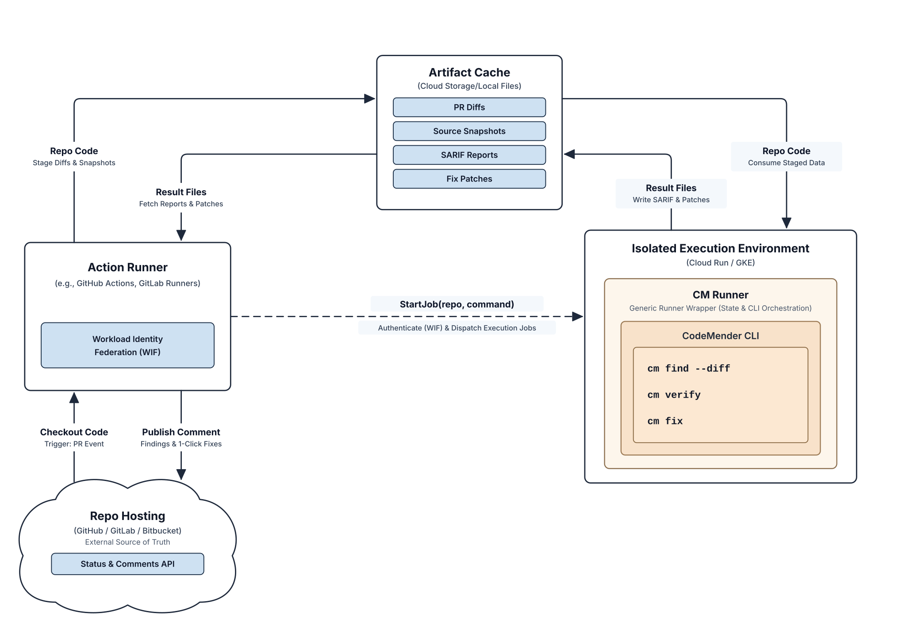

# CodeMender Runner

CodeMender Runner is an orchestrator for
[CodeMender](https://cloud.google.com/security/codemender) for integrating
CodeMender's advanced AI security scanning in headless, scaled environments such
as in CI/CD pipelines. This orchestration provides:

1. **Predefined, customizable Workflows:** Turnkey integration for common use
   cases.
   - Provides default workflows for common use cases such as scanning pull
     requests.
   - Easy setup via provided terraform configurations.
   - See [Supported Workflows](#supported-workflows) for this list of currently
     provided workflows.
   - See [Supported Environments](#supported-environments) for the environments
     currently supported.
1. **Building blocks for custom solutions:** Provide the toolkit for rapid
   adaptation to unique scenarios.
   - Provides modular components that can be adapted to each unique use case.
   - See [Component Overview](#component-overview) and
     [Supported Environments](#supported-environments) for more information.
1. **Stateless, ephemeral execution:** Manage the `cm` state so `find`, `fix`,
   and `verify` can run independently.
   - Supports horizontal scale & long timeouts to allow parallel `fix` or
     `verify`.
   - Enables multi-turn state across ephemeral runs so that `fix` or `verify`
     can be triggered asynchronously hours or even days after `find`.
1. **Defense-in-depth sandboxing:** Contain the powerful agent at multiple
   layers.
   - Utilize CodeMender’s native sandbox as a first line of isolation.
   - Strengthen this sandboxing with architecture support (e.g. VPC, gVisor) and
     environment isolation (dedicated projects, permission isolation).
   - Even if the agent escapes one layer of sandboxing, the impact is contained.

## How It Works

CodeMender Runner separates the lightweight orchestration plane (usually the
CI/CD runner) from sandboxed code execution. When the orchestration starts a
CodeMender job--e.g. on a Pull Request--the orchestrator packages the repository
checkout, dispatches the `cm-runner` container inside an isolated sandbox, and
posts the resulting findings and candidate patches to the appropriate location.

This is illustrated in the [Component Overview](#component-overview) section
below with the currently supported environments and workflows discussed in their
respective sections below.

### Component Overview

CodeMender Runner uses four main components to keep repository credentials in
your CI control plane while isolating code execution inside an ephemeral
sandbox:

1. **Repo Hosting:** Your source control platform (e.g., GitHub, GitLab,
   Bitbucket). Pull/Merge Request events trigger CI runs, and the host's Status
   & Comments API surfaces scan summaries, commit statuses, and 1-click fix
   suggestions.
1. **Action Runner:** The lightweight orchestrator running inside your CI/CD
   pipeline (e.g., GitHub Actions, GitLab Runners). It checks out code,
   authenticates via Workload Identity Federation (WIF), stages inputs to the
   Artifact Cache, dispatches sandbox jobs, and publishes results back to the
   repository host.
1. **Artifact Cache:** Shared storage (Cloud Storage or local files) that passes
   **PR Diffs**, **Source Snapshots**, **SARIF Reports**, and **Fix Patches**
   between the Action Runner and the sandbox so `find`, `fix`, and `verify` can
   share state across independent runs.
1. **Isolated Execution Environment:** An ephemeral sandbox container (e.g.,
   Cloud Run, GKE, or local Docker + gVisor) that runs with zero repository
   credentials. Inside the container, **CM Runner** reads staged inputs from the
   Artifact Cache, runs the **CodeMender CLI** (`cm find --diff`, `cm verify`,
   `cm fix`), and writes reports and patches back to the cache.

### Supported Environments

CodeMender Runner pairs your CI/CD orchestration platform with your preferred
sandboxed execution environment:

- **Orchestration Platforms (CI/CD):**
  - **[GitHub Actions](.github/README.md):** Turnkey reusable workflows and
    composite actions for pull request scanning, patching, and verification.
  - **[GitLab CI](gitlab-ci/README.md) _(In Development)_:** Merge request
    pipeline integration for automated diff scanning and reporting.
  - **[Custom CI & CLI](packages/codemender/README.md):** Modular CLI and
    library building blocks
    ([`packages/launcher/`](packages/launcher/README.md),
    [`packages/repohost/`](packages/repohost/README.md)) for integrating with
    other CI systems or custom automation.
- **Sandboxed Execution Environments:**
  - **[Google Cloud Run Jobs](docs/user-guides/cloud-run.md):** Serverless,
    horizontally scalable container execution backed by Cloud Storage (`gs://`)
    and keyless Workload Identity Federation (WIF) via
    [Terraform](terraform/README.md).
  - **[Local Docker + gVisor](docs/user-guides/local-gvisor.md):** Runs the
    sandbox container directly on a dedicated CI runner VM using the gVisor
    (`runsc`) kernel and a local file cache (`file://`).
  - **[Custom Container Runtimes](docker/README.md):** Standard worker image
    portable to GKE or other container platforms.

### Supported Workflows

CodeMender Runner provides two turnkey Pull/Merge Request workflows out of the
box, along with modular building blocks for custom workflows:

- **Pull Request Scan & Fix (`find --diff` + `fix`):** On a pull request, scans
  the changed code against the base branch (`find --diff`), updates the PR
  summary comment and commit status check, and (when enabled) launches parallel
  sandbox jobs (`fix`)—one per finding—to generate a candidate patch and post a
  1-click PR review suggestion.
- **On-Demand Verification (`@cm-runner verify`):** Triggered asynchronously
  when a reviewer comments `@cm-runner verify` on a finding—even hours or days
  after the initial scan. Runs an exploitability check against the cached
  snapshot in the sandbox, replies on the review thread, and automatically
  dismisses false positives.
- **[Custom Workflows](docs/guides/calling_cm_runner.md):** Compose the
  standalone `cm-runner` stages (`find`, `fix`, `verify`) and
  [`packages/launcher/`](packages/launcher/README.md) building blocks to build
  custom scanning, triage, or remediation pipelines.

## Getting Started

### Quickstart (Terraform)

All workflows and supported environments are configurable via Terraform. Follow
our [Terraform Instructions](terraform/README.md) to quickly get started.

### Step-by-Step Guided Setup

There are three steps for setting up CodeMender Runner, listed below. Each step
has its own dedicated guide linked to below. To follow the install steps, simply
follow the correct links for your particular environment. The setup steps are:

1. **Setup orchestration platform (CI/CD platform):** First we select and
   configure the control plane for our integration. This is normally your
   existing CI/CD platform.
1. **Provision your sandboxed execution environment:** Then we configure the
   sandboxed environment the `cm` binary executes in. This includes the
   authentication and authorization methods as well as setting up the
   ArtifactCache so that the orchestrator and the execution environment can
   communicate.
1. **Enable workflows on your repositories:** Finally, we tie it all together
   and enable our desired workflows.

### Step 1: Choose Your Orchestration Platform

Select your CI/CD platform or CLI workflow below to begin:

- [**GitHub Actions**](.github/README.md)
- [**GitLab CI** _(In Development)_](gitlab-ci/README.md)
- [**Custom CI**](packages/codemender/README.md)

## Component Reference

Looking for standalone component references? Jump directly to:

- **Execution Environment Guides:**
  - [Google Cloud Run Jobs](docs/user-guides/cloud-run.md)
  - [Local Docker + gVisor](docs/user-guides/local-gvisor.md)
- **Infrastructure & Container References:**
  - [Terraform Modules (`terraform/README.md`)](terraform/README.md)
  - [Container Packaging (`docker/README.md`)](docker/README.md)
- **Workspace Package Guides:**
  - [`packages/codemender/README.md`](packages/codemender/README.md) (and
    [`docs/guides/calling_cm_runner.md`](docs/guides/calling_cm_runner.md))
  - [`packages/launcher/README.md`](packages/launcher/README.md)
  - [`packages/repohost/README.md`](packages/repohost/README.md)
