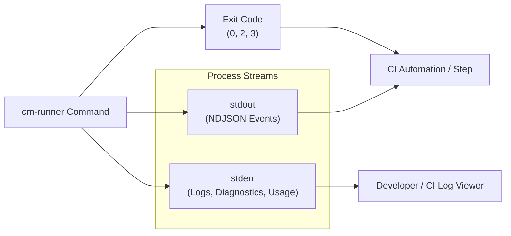

# ADR-0001: Machine-Readable Output Contract for cm-runner CLI

*   **Status:** accepted (implemented in PR #6; amended 2026-09-30: `--output text` removed)
*   **Date:** 2026-09-24
*   **Decision Makers:** nasirmohammad@google.com, cledoux@google.com, yileil@google.com

## Context and Problem Statement

The orchestrator is being given a command-line interface (`cm-runner`) so CI workflows can drive it via flags instead of roughly fifty environment variables.

Automated CI jobs need to inspect execution results programmatically without fragile text parsing, while human developers inspecting CI logs still need readable diagnostics.

How should `cm-runner` structure its output and exit codes so automation can branch reliably and developers can diagnose failures?

## Decision Drivers

*   **Automation Friendliness:** CI steps and scripts must branch on structured output without regular-expression matching on prose.
*   **GitHub Actions Exit Code Constraint:** GitHub Actions does not expose a step's numeric exit code to later steps (only `success`, `failure`, `cancelled`). Exit code semantics must therefore be high-level, while detailed error reasons travel inside the structured payload.
*   **Log Streaming:** Actions like `init` and `find-diff` execute subprocesses taking tens of seconds. Output must be streamed to avoid appearing stalled or hitting CI idle timeouts.
*   **Accidental Stream Pollution:** Existing internal helpers in this repository write banners and child output directly to standard output (`sys.stdout`). The contract must isolate and defend machine-readable streams from log leakage.
*   **Downstream Stability:** Other workstreams and future commands (`find-diff`, `fix`, `verify`) consume this contract. Breaking changes become expensive once dependent workflows are deployed.

## Considered Options

*   **Option 1: Human-readable text on standard output.** (Legacy behavior of `main.py`).
*   **Option 2: Single JSON document printed at process termination.**
*   **Option 3: Newline-delimited JSON (NDJSON) streamed on stdout, human logs on stderr, coarse exit codes.**

## Decision Outcome

Chosen option: **"Option 3: Newline-delimited JSON on stdout, human logs on stderr, coarse exit codes"**.

### Output Rules

1.  **stdout is JSON only:** stdout carries newline-delimited JSON and nothing else. Exactly one JSON object per line. There is no human-readable mode for stdout.
2.  **stderr is for humans:** All operational logs, diagnostics, progress indicators, tracebacks, and CLI usage help messages route to `stderr`.
3.  **Coarse exit codes:**
    *   `0`: Success.
    *   `2`: Command-line usage error (invalid flags, missing arguments).
    *   `3`: Execution failure (check failed, process error).
    Exit codes stay coarse on purpose. What failed is reported in the command's own events where it has them (for example a `check` event with `"status": "fail"`), and in the logs on stderr.

### Event Schema Specification

Every emitted JSON line contains standard discriminator fields:
*   `ts` (string, ISO 8601 UTC timestamp)
*   `event` (string, identifying the payload type)

#### 1. Version Event (`version`)
Emitted by `cm-runner version`:
```json
{
  "ts": "2026-09-24T02:33:44Z",
  "event": "version",
  "orchestrator": "0.1.0",
  "cm": {
    "found": true,
    "version": "0.9.0",
    "path": "/usr/local/bin/cm"
  },
  "contract": "cm-0.9.x"
}
```

#### 2. Check Event (`check`)
Emitted incrementally by `cm-runner init`:
```json
{
  "ts": "2026-09-24T02:35:10Z",
  "event": "check",
  "name": "cm_binary",
  "status": "pass",
  "message": "cm 0.9.0 available at /usr/local/bin/cm"
}
```

### One Event Type per Command

Each command writes only one kind of line to stdout: `version` writes one `version` event, `init` writes one `check` event per check, and `find-diff` will write one `finding` event per finding. There is **no trailing summary event**.

This makes every stdout line one unit of work. A workflow that runs `find-diff` and then starts one `fix` per finding can fan out over the lines directly, without checking what kind of line each one is. Whether the command succeeded comes from the exit code, and error messages go to stderr, so a failed run never puts a line on stdout that looks like work.

### Reviewer Notes & Discussion: Terminal Summary Event
A trailing `result` summary event was originally planned for multi-event commands. Charles LeDoux questioned its value in review of PR #6, and in review of PR #7 pointed out that it complicates fan-out: consumers would have to reason about the type of each line. It was dropped in favour of exit codes plus one event type per command. Error messages go to stderr, not stdout (confirmed in the same review thread).

### Reviewer Notes & Discussion: Human Text Mode
The first version had a fourth rule: `--output text` printed a human-readable layout on stdout instead of JSON. Charles LeDoux asked in review of PR #19 whether it was needed. It was removed on 2026-09-30, before any caller used it:
*   No CI caller uses it; CI always reads JSON.
*   Every command needed its own text layout and tests, on a path CI never exercises.
*   `find-diff` gives humans a `report.md` file (E2), which is where a readable view of findings belongs.
*   It matches codemender-connect, whose ADR-0001 keeps stdout machine-readable and gives humans stderr.

Adding a text mode back later would not break any caller; removing it later could have.

### Forward Compatibility & Evolution Policy
*   **Event types are fixed per command:** Adding a new event type to an existing command is a breaking change, because consumers fan out over every line.
*   **Consumers must be lenient about fields:** Consumers must ignore fields they don't recognise.
*   **Producers must be additive:** New fields may be added to events; existing fields must not change types or semantic meanings.
*   **Exit code stability:** Exit codes `0`, `2`, and `3` are frozen. New numeric exit codes may be introduced in the future for specific categories, but existing codes cannot be altered.

### Consequences

*   **Good:** CI workflows can parse single-event or multi-event output reliably using standard tools (`jq`, Python).
*   **Good:** Long-running processes stream events in real time without hanging CI log viewers.
*   **Good:** Logging verbosity (e.g. `--log-level debug`) does not pollute stdout or break downstream JSON decoders.
*   **Bad:** CLI subcommands cannot use the repository's existing `utils.run_command` helper because it writes child output to stdout. CLI commands must isolate subprocess execution to stderr.
*   **Bad:** Plain NDJSON is less friendly for ad-hoc human terminal reading. People read stderr, or pipe stdout through `python3 -m json.tool --json-lines` or `jq`.

### Confirmation & Testing Strategy

Enforced via unit tests in `codemender-runner/tests/test_cli.py`:
*   `TestStdoutPurity`: Asserts stdout is valid JSON with zero extraneous lines across normal execution, missing binaries, debug logging, and noisy subprocesses.
*   `TestExitCodes`: Validates numeric exit code constants `0`, `2`, and `3`.
*   `TestImportIsolation`: Verifies that importing `cli` does not load `main.py` (which attaches an unisolated stdout logging handler at import time).

*(Note: Test execution in GitHub Actions CI requires updating `.github/workflows/ci.yml`, which currently contains a placeholder script).*

## Architecture Diagram



## References
*   Initial Implementation: Pull Request #6 (`cloud-gtm/codemender-runner#6`).
*   Model followed: [codemender-connect ADR-0001](https://github.com/cloud-ai-fde/codemender-connect/blob/main/adrs/ADR-0001.md) (structured stdout, humans read stderr).
*   Related Roadmap Items: `docs/future_work.md` (Modular Service Layer & `CLIExecutionService`).
