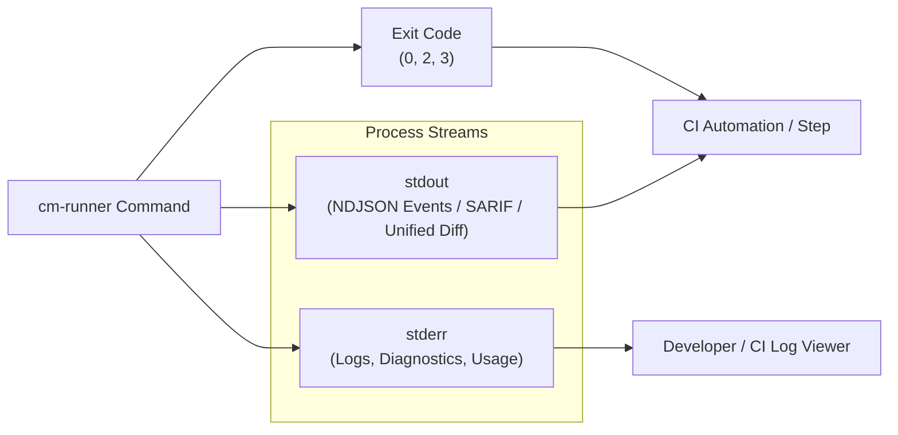

# ADR-0001: Machine-Readable Output Contract for cm-runner CLI

*   **Status:** accepted
*   **Date:** 2026-09-24
*   **Decision Makers:** nasirmohammad@google.com, cledoux@google.com, yileil@google.com

## Context and Problem Statement

The orchestrator is being given a command-line interface (`cm-runner`) so CI workflows can drive it via flags instead of roughly fifty environment variables.

Automated CI jobs need to inspect execution results programmatically without fragile text parsing, while human developers inspecting CI logs still need readable diagnostics.

How should `cm-runner` structure its output and exit codes so automation can branch reliably and developers can diagnose failures?

## Decision Drivers

*   **Automation Friendliness:** CI steps and scripts must branch on structured output without regular-expression matching on prose.
*   **GitHub Actions Exit Code Constraint:** GitHub Actions does not expose a step's numeric exit code to later steps (only `success`, `failure`, `cancelled`). Exit code semantics must therefore be high-level, while detailed error reasons travel inside the structured payload.
*   **Log Streaming:** Actions like `init` and `find-diff` execute subprocesses taking tens of seconds. Output must be streamed to avoid appearing stalled or hitting CI idle timeouts.
*   **Accidental Stream Pollution:** Existing internal helpers in this repository write banners and child output directly to standard output (`sys.stdout`). The contract must isolate and defend machine-readable streams from log leakage.
*   **Downstream Stability:** Other workstreams and commands (`find-diff`, `fix`, `verify`) consume this contract. Breaking changes become expensive once dependent workflows are deployed.

## Considered Options

*   **Option 1: Human-readable text on standard output.** (Legacy behavior of `main.py`).
*   **Option 2: Single JSON document printed at process termination.**
*   **Option 3: Machine-readable output on stdout (NDJSON events or standard command formats), human logs on stderr, coarse exit codes.**

## Decision Outcome

Chosen option: **"Option 3: Machine-readable output on stdout (NDJSON events or standard command formats), human logs on stderr, coarse exit codes"**.

### Output Rules

1.  **stdout carries the command's result in its standard format, and nothing else:** There is no human-readable mode for stdout.
    *   **Event-streaming commands (`version`, `init`):** Emit newline-delimited JSON (NDJSON), with one JSON object per line and no trailing summary event.
    *   **Artifact-producing commands (`find-diff`, `fix`):** Emit their result in its standard format with no wrapper: `find-diff` writes one SARIF 2.1.0 document ([SPEC-FIND-DIFF](../openspec/specs/find-diff/spec.md)), and `fix` writes a unified diff, byte for byte as `git diff` produced it ([SPEC-FIX design, Decision 2](../openspec/specs/fix/design.md#decision-2)).
2.  **stderr is for humans:** All operational logs, diagnostics, progress indicators, tracebacks, and CLI usage help messages route to `stderr`.
3.  **Coarse exit codes:**
    *   `0`: Success.
    *   `2`: Command-line usage error (invalid flags, missing arguments).
    *   `3`: Execution failure (check failed, process error).
    Exit codes stay coarse on purpose. What failed is reported in the command's own events where it has them (for example a `check` event with `"status": "fail"`), and in the logs on stderr.

### NDJSON Event Schema (`version` and `init`)

Each event-streaming command writes only one kind of JSON line to stdout (`version` writes one `version` event; `init` writes one `check` event per check), with **no trailing summary event**. Whether the command succeeded comes from the exit code, and error messages go to stderr, so a failed run never puts a line on stdout that looks like work.

Every emitted JSON line contains standard discriminator fields:
*   `ts` (string, ISO 8601 UTC timestamp)
*   `event` (string, identifying the payload type)

#### 1. Version Event (`version`)
Emitted by `cm-runner version`:
```json
{
  "ts": "2026-09-24T02:33:44Z",
  "event": "version",
  "orchestrator": "0.1.0",
  "cm": {
    "found": true,
    "version": "0.9.0",
    "path": "/usr/local/bin/cm"
  },
  "contract": "cm-0.9.x"
}
```

#### 2. Check Event (`check`)
Emitted incrementally by `cm-runner init`:
```json
{
  "ts": "2026-09-24T02:35:10Z",
  "event": "check",
  "name": "cm_binary",
  "status": "pass",
  "message": "cm 0.9.0 available at /usr/local/bin/cm"
}
```

### Standard-Format Results (`find-diff` and `fix`)

Commands whose primary output is a standard interchange format write that format directly to stdout (and to `--out` when given):

*   **Caller format awareness:** A caller knows which format each command writes. The GitHub Action's launcher returns raw stdout without command-specific parsing, and callers parse `find-diff` output with `SarifDocument` or read `fix` output from `--out` ([SPEC-GHA-FIX REQ-0003](../openspec/specs/github-actions-fix/spec.md#req-0003)).
*   **Byte preservation for diffs:** Callers must not decode `fix`'s stdout as text, which would turn `\r\n` into `\n`.
*   **Cross-boundary file output (`--out`):** Where a command has an `--out` option, callers that pass results between machines or containers read the file written to `--out` (for example `report.sarif`, `report.md`, and `<finding>.diff`), because files are how results cross between backends ([SPEC-GHA REQ-0008](../openspec/specs/github-actions/spec.md#req-0008)).

### Forward Compatibility & Evolution Policy
*   **Output format is fixed per command:** Changing a command's stdout format or adding a second event type to an existing event-streaming command is a breaking change.
*   **Consumers must be lenient about fields:** JSON consumers must ignore fields they don't recognise.
*   **Producers must be additive:** New fields may be added to events; existing fields must not change types or semantic meanings.
*   **Exit code stability:** Exit codes `0`, `2`, and `3` are frozen. New numeric exit codes may be introduced in the future for specific categories, but existing codes cannot be altered.

### Consequences

*   **Good:** CI workflows and callers can consume output directly using standard tools (`jq`, SARIF parsers, `git apply`, Python).
*   **Good:** Long-running processes stream events and stderr logs in real time without hanging CI log viewers.
*   **Good:** Logging verbosity (e.g. `--log-level debug`) does not pollute stdout or break downstream parsers.
*   **Bad:** CLI subcommands cannot use the repository's existing `utils.run_command` helper because it writes child output to stdout. CLI commands must isolate subprocess execution to stderr.
*   **Bad:** Machine-readable stdout is less friendly for ad-hoc human terminal reading. Humans read stderr, `report.md` (for `find-diff`), or pipe NDJSON stdout through `jq`.

### Confirmation & Testing Strategy

Enforced via unit tests in `codemender-runner/tests/test_cli.py`:
*   `TestStdoutPurity`: Asserts stdout contains only the command's machine-readable output with zero extraneous log lines across normal execution, missing binaries, debug logging, and noisy subprocesses.
*   `TestExitCodes`: Validates numeric exit code constants `0`, `2`, and `3`.
*   `TestImportIsolation`: Verifies that importing `cli` does not load `main.py` (which attaches an unisolated stdout logging handler at import time).

*(Note: Test execution in GitHub Actions CI requires updating `.github/workflows/ci.yml`, which currently contains a placeholder script).*

## Architecture Diagram



## References
*   Initial Implementation: Pull Request #6 (`cloud-gtm/codemender-runner#6`).
*   Model followed: [codemender-connect ADR-0001](https://github.com/cloud-ai-fde/codemender-connect/blob/main/adrs/ADR-0001.md) (structured stdout, humans read stderr).
*   Related Roadmap Items: `docs/future_work.md` (Modular Service Layer & `CLIExecutionService`).

