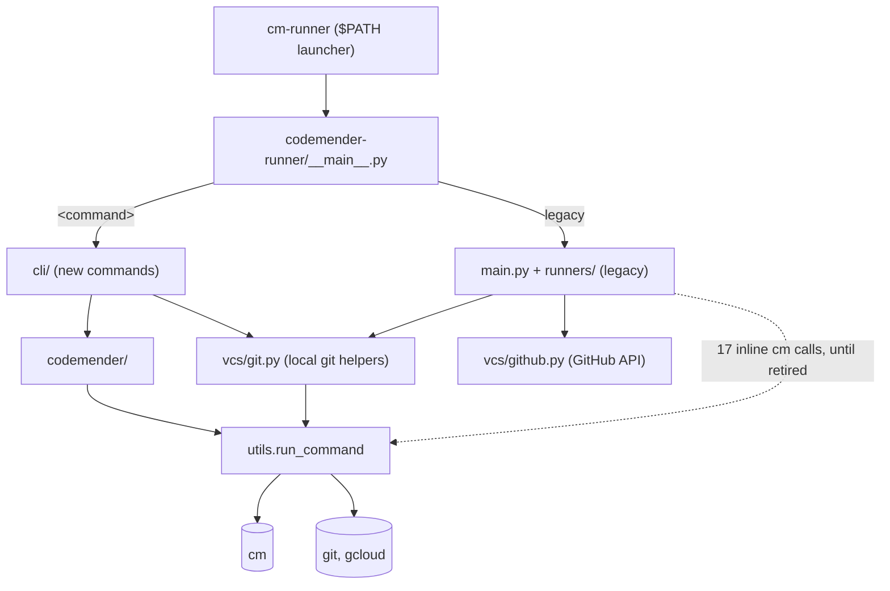

# ADR-0002: Runner Layout, Build, and How to Call It

*   **Status:** proposed
*   **Date:** 2026-09-25
*   **Decision Makers:** nasirmohammad@google.com, yileil@google.com

**Shortlink:** none yet

## Context and Problem Statement

The GitHub Actions and Cloud Run integrations need to start calling the
runner, but it has two entry points (`main.py` and the new `cli/`), `cm` is run
from several places, and the image cannot run `cli/` at all. How should a CI
pipeline call the runner, where should each piece of code live, and how is the
runner built and run?

## Decision Drivers

*   The GitHub Actions and Cloud Run integrations need a stable way to call
    the runner now, before every command exists.
*   stdout stays clean by construction. It must not rely on every helper
    author remembering ADR-0001.
*   The process that runs `cm` never talks to the repo host. The overall
    design (go/scaling-codemender-cicd) leaves that to the CI job, so an agent
    that escapes its sandbox cannot reach the repo.
*   Do not break what runs today.
*   Small diffs. The GitHub Actions and Cloud Run integrations are being built
    in this repository at the same time.

## Considered Options

1.  Leave it as is.
2.  One job per folder; new `cm` calls only through `codemender/cm.py`.
3.  Restructure now into `src/cm_runner/`.

## Decision Outcome

Chosen option: "One job per folder; new `cm` calls only through
`codemender/cm.py`", because it gives new commands one safe way to run `cm`
without touching the legacy pipeline or the paths today's GitHub Actions
workflow and Cloud Run jobs depend on.

### How to call it

```
cm-runner [--output json|text] [--cm-binary PATH] [--log-level LEVEL] <command> [flags]
```

*   **Inputs** are command-line flags. A command may also read one input from
    standard input when given `-`.
*   **Outputs** follow ADR-0001: one JSON object per line on stdout, logs on
    stderr, exit code `0` did its job, `2` bad command line, `3` failed.
*   **Files** a command writes go to a folder the caller names with `--out`.
*   **Commands run on their own.** A command does not rely on state left behind
    by an earlier one. Anything passed between commands is a file.

`version` works today:

```
$ cm-runner version
{"ts": "2026-09-25T00:43:23Z", "event": "version", "orchestrator": "0.1.0", "cm": {"found": true, "version": "0.9.0", "path": "/usr/local/bin/cm"}, "contract": "cm-0.9.x"}
```

`init`, `find-diff`, `fix`, and `verify` follow. The flags and outputs of
`find-diff`, `fix`, and `verify` get their own ADRs.

### What goes where

| Path | Job | Rules |
| :--- | :--- | :--- |
| `cli/` | Command layer. Reads flags, formats events, writes JSON to stdout, sets the exit code. | Never starts a process itself. |
| `cli/commands/<name>.py` | One file per command. | Thin. |
| `codemender/` | Abstraction layer for interacting directly with the `cm` binary (argument building, invocation, error extraction). | The only module that executes `cm`. Takes settings as arguments, not environment variables. |
| `codemender/db.py` | Reads `cm`'s state database. | Unchanged. |
| `vcs/git.py` | `git` helpers. | New commands may use the local helpers, not `push_branch_to_remote`. |
| `vcs/github.py` | GitHub API. | Legacy only. Posting to the repo host is the CI job's work. |
| `storage.py` | Cloud and local storage helpers. | Clean. |
| `utils.py` | Legacy shared helpers, including `run_command`. | Transitional. New code must not add helpers here. |
| `config.py`, `main.py`, `runners/` | Legacy pipeline. | Kept working, not extended. |
| `__main__.py` | Package execution entry point. Dispatches between legacy pipeline and new CLI subcommands. | Native Python entrypoint; enables running with `python3 codemender-runner <command>`. |
| `bin/cm-runner` | Thin launcher for `$PATH` convenience in container / CI. | Simple wrapper delegating to `python3 <pkg>`; will be superseded by `pyproject.toml` console scripts. |

*   **The "one place" rule covers new code only.** The legacy pipeline's 17
    `cm` calls stay. It will be replaced by the new commands, not upgraded.
*   **Codemender abstraction.** Direct interaction with the `cm` binary is isolated in
    `codemender/` (the existing `codemender/cli.py` is renamed `cm.py` to avoid name collision
    with the `cli/` package, and unused adapter classes are removed).
*   **No new utilities in `utils.py` ([go/no-utils](http://goto.google.com/no-utils)).** `utils.py` is existing legacy debt.
    New code must not add generic utility functions here. Subprocess execution (`run_command`)
    will be migrated into a dedicated process execution module as the legacy pipeline is retired.
*   **Keeping stdout clean.** `utils.run_command` gets a process-wide setting
    for where child output goes. It stays `stdout` for the legacy pipeline.
    `cli/__main__.py` switches it to `stderr` at startup, so every helper a
    `cli/` command calls writes to stderr.

This changes one rule in ADR-0001: *"CLI subcommands cannot use
`utils.run_command`"* becomes *"`cli/` switches `run_command` output to stderr
at startup. New code starts `cm` only through `codemender/`, and other
programs through `vcs/git.py` or `utils.run_command`."*

### How it is built and run

*   **Build.** The Dockerfile downloads `cm` itself through two build
    arguments: `CM_VERSION` (default `0.9.0`, from Google's public Artifact
    Registry, no credentials) and an optional `CM_URL` override. `COPY cm`
    goes, so `docker build` works from a clean checkout. `build_runner_image.yml`
    and `cloudbuild.yaml` pass the build arguments instead of downloading `cm`.
    The image copies the package, creates `codemender-runner/__main__.py`,
    and links `/usr/local/bin/cm-runner`.
*   **Paths that must not change**, because GitHub Actions calls them directly:
    `/opt/codemender/venv/bin/python3`,
    `/opt/codemender/codemender-runner/main.py`, and the
    `/opt/codemender/orchestrator.py` link.
*   **Run.**
    - **Native Python Execution:** `codemender-runner/__main__.py` provides standard
      directory execution (`python3 codemender-runner <command>`) for host machines
      and local virtualenvs. It routes `legacy` to `main.py` and any other subcommand
      to `cli/__main__.main()`.
    - **Container Execution:**

      ```dockerfile
      ENTRYPOINT ["cm-runner"]
      CMD ["legacy"]
      ```

      With no arguments the image runs `legacy` (`main.py`) exactly as today, so neither
      Cloud Run job changes. `/usr/local/bin/cm-runner` delegates to
      `python3 /opt/codemender/codemender-runner "$@"` and starts Python with `exec` so
      signals and exit codes pass straight through.

### Consequences

*   Good, because the GitHub Actions and Cloud Run integrations can build
    against `cm-runner <command>` and the ADR-0001 output rules today.
*   Good, because stdout stays clean for any helper a `cli/` command calls,
    without every author having to remember ADR-0001.
*   Bad, because two entry points coexist until the legacy pipeline is retired.
*   Bad, because the stdout/stderr switch is global state, so tests must reset
    it.
*   Bad, because `CM_VERSION` is bumped by hand.

### Confirmation

*   **Unit tests** (in `ci.yml`, on every pull request):
    *   An AST check fails if any `cli/` module imports `subprocess` or
        `vcs.github`, or calls `run_command`, `build_cm_command`, or
        `push_branch_to_remote` directly.
    *   A `cli/` command that calls a `vcs/git.py` helper against a fake `git`
        leaves stdout as JSON only.
    *   `TestStdoutPurity` and `TestImportIsolation` still pass.
*   **Image checks** (in `build_runner_image.yml`, on pull requests):
    *   A clean-checkout build succeeds.
    *   `docker run <image> version` prints one JSON line and exits `0`.
    *   `docker inspect` shows `Entrypoint ["cm-runner"]`, `Cmd ["legacy"]`.

## Pros and Cons of the Options

### Leave it as is

*   Good, because it costs nothing now.
*   Bad, because every new command adds another way of calling `cm`.
*   Bad, because the image still cannot run `cli/`.

### One job per folder; new `cm` calls only through `codemender/cm.py`

*   Good, because the diff is small: one rename, one switch in `run_command`,
    and Dockerfile changes.
*   Good, because no existing pipeline, path, or log changes.
*   Bad, because the legacy pipeline keeps its own 17 `cm` calls and gets none
    of the improvements.

### Restructure now into `src/cm_runner/`

*   Good, because it is the cleanest layout and makes the package installable
    with `pip` (`docs/future_work.md` §1).
*   Bad, because it touches nearly every file, test, and workflow while the
    GitHub Actions and Cloud Run integrations are being built.
*   Bad, because it spends effort upgrading a legacy pipeline we plan to
    replace.

## Architecture Diagram

Calls flow downward only.



## More Information

*   Amends [ADR-0001](ADR-0001-machine-readable-output-contract.md).
*   How to call the runner: [Calling cm-runner](../guides/calling_cm_runner.md).
*   Overall design: [go/scaling-codemender-cicd](http://goto.google.com/scaling-codemender-cicd).
*   Consulted: cledoux@google.com. This ADR answers his review questions:

    > Can you share the intended way for other code to call this entrypoint so
    > others can start integrating with it?

    > [...] propose two things:
    > Overall structure of this directory, i.e. what goes where.
    > How this runner is built and run.
    > [...] Current structure puts all the codemender calls in the codemender
    > package, the recent PR is rebuilding under cli package.

*   The code on `main` as of 2026-09-24:

    | Area | Fact |
    | :--- | :--- |
    | Entry points | `main.py` (legacy, four modes chosen by environment variable) and `cli/` (`python -m cli`, only `version` so far). |
    | Who runs `cm` | Rarely `codemender/`. `runners/` builds 17 `cm` calls inline. `cli/commands/version.py` runs `cm` on its own. |
    | Name clash | `codemender/cli.py` (old `cm` helpers) sits beside the new `cli/` package. |
    | Child-process output | `utils.run_command` writes child output to stdout, which breaks ADR-0001. Every `git` call in `vcs/` uses it. |
    | Repo host access | `vcs/github.py` calls the GitHub API; only `runners/` uses it. `vcs/git.py` is mostly local, but `push_branch_to_remote` pushes with a token. |
    | Image | Does not copy `cli/`. `ENTRYPOINT` runs `main.py`. `COPY cm` needs a binary in the build folder. The build workflows fetch an unpinned `cm:stable`. |
    | Cloud Run | Two jobs. They change environment variables only and rely on the default entrypoint. |
    | GitHub Actions | `codemender_parallel.yml` runs `main.py` by full path, so the entrypoint does not affect it. |
