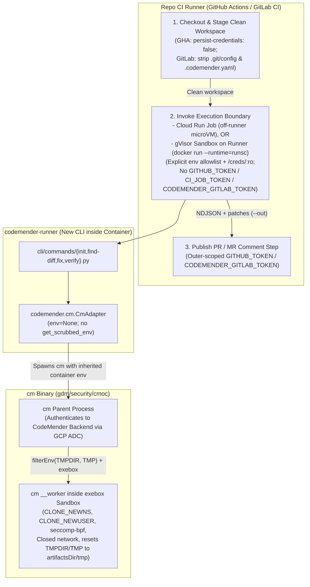

# ADR-0003: Environment Variable Scrubbing When Running `cm`

- **Status:** proposed
- **Date:** 2026-09-30
- **Decision Makers:** cledoux@google.com, nasirmohammad@google.com,
  yileil@google.com

**Shortlink:** none yet

## Context and Problem Statement

The legacy orchestrator (`config.py` lines 28–38 and 337–368) defines a 9-entry
denylist (`SENSITIVE_ENV_VARS`) and a helper `get_scrubbed_env(repo_dir)` that
does two things before the legacy runners (`runners/scan.py`,
`runners/worker.py`, `runners/sequential.py`) spawn `cm`:

1. **Credential Denylisting:** Strips nine specific environment variables from a
   copy of `os.environ` (`GITHUB_APP_TOKEN`, `GITHUB_PAT`, `GITHUB_TOKEN`,
   `GH_TOKEN`, `GITHUB_SECRET`, `INPUT_GITHUB_TOKEN`, `GCP_SA_KEY`,
   `GOOGLE_APPLICATION_CREDENTIALS_JSON`, and `GOOGLE_CREDENTIALS`).
1. **Temp and Cache Redirection:** Creates
   `<repo_dir>/.codemender_cache/{tmp,npm,pip}` on disk and overrides
   `XDG_CACHE_HOME`, `npm_config_cache`, `TMPDIR`, `TEMP`, `TMP`, and
   `PIP_CACHE_DIR` to point inside the target repository.

As we build the new `cm-runner` subcommands (`init`, `find-diff`, `fix`,
`verify`) on top of `codemender/cm.py` (`CmAdapter`, per
[ADR-0008](ADR-0008-repository-layout-and-package-structure.md)), `CmAdapter.run()` currently
passes `env=None`, inheriting the caller's environment without calling
`get_scrubbed_env()`.

Should `cm-runner` (`CmAdapter` and `cli/`) carry forward or expand environment
variable scrubbing when spawning `cm`, or should we omit environment scrubbing
from the new CLI and retire `get_scrubbed_env()` along with the legacy pipeline?

## Decision Drivers

- **Permission Split Between Orchestration and `cm` Execution
  ([go/scaling-codemender-cicd](http://goto.google.com/scaling-codemender-cicd),
  [ADR-0008](ADR-0008-repository-layout-and-package-structure.md)):** Unlike legacy `main.py`
  (which both ran `cm` and called the GitHub API to open PRs from the same
  Python process, forcing `main.py` to hold `GITHUB_TOKEN` in its own
  environment), the new `cm-runner` CLI never talks to the repository host.
- **Security Across All Three Target Execution Modes:** We must evaluate how
  environment variables and sandbox escapes behave across all three ways
  `cm-runner` can be deployed:
  1. **Cloud Run Jobs:** Off-runner microVM fed via GCS, with zero repo-host
     credentials in the container environment.
  1. **gVisor (`runsc`) Container on the Repo Runner (Current On-Runner Plan):**
     Invoked on the CI runner via `docker run --runtime=runsc` (GitHub Actions),
     which isolates both the kernel syscall surface and the container
     environment (only explicitly allowlisted variables enter the container).
  1. **Direct Execution on the Repo Runner:** Invoked directly as a bare CI
     runner step (or a standard GitHub Actions `container:` job) without a
     separate `docker run` / gVisor boundary.
- **Native `cm` Sandboxing
  ([go/codemender-sandbox](http://goto.google.com/codemender-sandbox)):** The
  `cm` binary (`//depot/google3/gdm/security/cmoc/client/sandbox/client.go`)
  uses a split parent-worker architecture: the parent `cm` process authenticates
  to the CodeMender backend over gRPC, while agent tool execution (`bash`, file
  edits, build/test commands) runs inside an `exebox` Linux namespace and
  seccomp-bpf sandbox (`CLONE_NEWNS`, `CLONE_NEWUSER`, closed network by
  default, restricted writable mounts).
- **Avoiding False Security ("Security Theater"):** A hardcoded 9-variable
  denylist in Python gives a false sense of security while missing real
  credential vectors (`ACTIONS_RUNTIME_TOKEN`, `ACTIONS_ID_TOKEN_REQUEST_TOKEN`,
  `GITLAB_TOKEN`, `CI_JOB_TOKEN`, `AWS_*`, custom repository secrets, and
  file-based credentials like `.git/config` auth headers or
  `GOOGLE_APPLICATION_CREDENTIALS` files).
- **Toolchain Compatibility During `fix` and `verify`:** When `cm` runs build
  and test commands inside the target repository (`npm`, `mvn`, `gradle`,
  `cargo`, `go`, `pytest`, `bazel`), those toolchains rely on standard host
  environment variables (`PATH`, `HOME`, `JAVA_HOME`, language SDK paths,
  compiler flags).
- **Simplicity and Low Maintenance
  ([ADR-0008](ADR-0008-repository-layout-and-package-structure.md)):** Avoid carrying over
  fragile legacy code and tests (`test_config.py`) into `CmAdapter` when it
  neither solves bare-runner isolation nor fits our container/sandbox
  boundaries.

## Considered Options

1. **Option 1: Do not scrub environment variables in `cm-runner` (`CmAdapter` /
   `cli/`); leave `get_scrubbed_env()` in `config.py` for legacy `runners/` only
   and delete it when legacy is retired.**
1. **Option 2: Port and expand denylist environment scrubbing
   (`get_scrubbed_env()`) into `CmAdapter` for all `cm` invocations.**
1. **Option 3: Enforce a strict environment variable allowlist in `CmAdapter`
   when spawning `cm`.**

## Decision Outcome

Chosen option: **"Option 1: Do not scrub environment variables in `cm-runner`
(`CmAdapter` / `cli/`); leave `get_scrubbed_env()` in `config.py` for legacy
`runners/` only and delete it when legacy is retired."**

### Why Environment Scrubbing in `codemender-runner` Is Not Worth Keeping

Evaluating `get_scrubbed_env()` against our CI/CD execution modes
([go/scaling-codemender-cicd](http://goto.google.com/scaling-codemender-cicd))
and the `cm` sandbox design
([go/codemender-sandbox](http://goto.google.com/codemender-sandbox)) shows why
legacy `main.py` had this code and why both halves of `get_scrubbed_env()` are
either redundant, ineffective, or actively counterproductive for `cm-runner`:

1. **Why legacy `main.py` needed `get_scrubbed_env()`, and why `cm-runner` does
   not:**
   - Legacy `main.py` (`runners/scan.py`, `runners/worker.py`,
     `runners/sequential.py`) was a monolithic script that both executed `cm`
     *and* called the GitHub REST API (`vcs/github.py`) and `git push` from the
     same Python process. Because `main.py` required `GITHUB_TOKEN` in its own
     `os.environ`, it had to strip `GITHUB_TOKEN` when spawning `cm`.
   - Under [ADR-0008](ADR-0008-repository-layout-and-package-structure.md), `cm-runner` (`init`,
     `find-diff`, `fix`, `verify`) never talks to the repository host. Even when
     running on the repo runner, the step or container invoking `cm-runner` has
     no reason to receive `GITHUB_TOKEN` at all; only the subsequent publishing
     step receives `GITHUB_TOKEN`.
1. **How environment isolation works across all three execution modes:**
   - **Mode A — Cloud Run Jobs:** The CI runner stages source to GCS and starts
     a Cloud Run Job. The Cloud Run container has zero repo-host tokens or CI
     runner tokens in its environment.
   - **Mode B — gVisor (`runsc`) Container on the Repo Runner (Current On-Runner
     Plan):**
     - In **GitHub Actions**, `docker run --runtime=runsc` starts a separate
       container from the host VM and natively drops the host's environment—only
       variables explicitly passed via `-e` (such as `GOOGLE_CLOUD_PROJECT`,
       `GOOGLE_APPLICATION_CREDENTIALS`, and `CODEMENDER_*`) enter the
       container, blocking ambient runner tokens (`ACTIONS_RUNTIME_TOKEN`,
       `ACTIONS_ID_TOKEN_REQUEST_TOKEN`, `GITHUB_ENV`) at the `docker run`
       boundary.
   - **Mode C — Direct Execution on the Repo Runner (Bare Step or GHA
     `container:` Job):** What if a customer runs `cm-runner` directly on the
     repo runner without a `docker run --runtime=runsc` boundary?
     - *Against an `exebox` sandbox escape:* Scrubbing `os.environ` in Python
       (`CmAdapter`) provides **zero protection**. On a bare runner, `cm-runner`
       and `cm` run as the same OS user (`runner`); an agent that escapes
       `exebox` can read `/proc/<ppid>/environ`, runner temp files
       (`/home/runner/work/_temp/`), or `.git/config` directly from the host.
       Protecting the runner against sandbox escape requires an external
       container/VM boundary (Mode A or Mode B), not Python dict filtering.
     - *Inside the `exebox` sandbox (no escape):* `exebox` isolates the
       filesystem (`CLONE_NEWNS` only mounts the workspace, `artifactsDir`, and
       the `cm` binary directory, blocking writes to `GITHUB_ENV` /
       `GITHUB_PATH` runner command files), *but* `cm`'s `workerCmdConfig`
       currently passes `os.Environ()` into `cm __worker`. On a bare GitHub
       Actions step, even when `GITHUB_TOKEN` is omitted from the step's `env:`,
       GitHub Actions automatically injects `ACTIONS_RUNTIME_TOKEN` and
       `ACTIONS_ID_TOKEN_REQUEST_TOKEN` into every step—neither of which is in
       `SENSITIVE_ENV_VARS`.
1. **`cm` requires GCP credentials in its parent process (wrong layer for
   parent-to-worker filtering):**
   - `SENSITIVE_ENV_VARS` strips `GCP_SA_KEY`,
     `GOOGLE_APPLICATION_CREDENTIALS_JSON`, and `GOOGLE_CREDENTIALS` (raw JSON
     strings used by older GitHub Actions auth setups), but leaves
     `GOOGLE_APPLICATION_CREDENTIALS` (the file path to the active Workload
     Identity Federation / Service Account credential) intact because the parent
     `cm` binary needs it to authenticate to the CodeMender cloud backend over
     gRPC.
   - Because `cm` is the process boundary between the authenticated gRPC client
     (parent `cm`) and the untrusted agent tool worker (`cm __worker` inside
     `exebox`), `codemender-runner` sits *above* parent `cm` and cannot strip
     the credentials `cm` needs to operate. Today, `cm` isolates `cm __worker`
     via `exebox` filesystem mount namespaces (`ReadOnlyPaths` /
     `ReadWritePaths`) and a closed network namespace by default; if
     parent-to-worker environment variable scrubbing (for example, stripping
     `ACTIONS_*`, `GITHUB_*`, `GITLAB_*`, and `GOOGLE_APPLICATION_CREDENTIALS`)
     is desired for bare-runner defense-in-depth, `cm`
     (`//depot/google3/gdm/security/cmoc/client/sandbox/client.go:workerCmdConfig`)
     is the only architectural boundary positioned to enforce it.
1. **`TMPDIR` and `.codemender_cache` redirection in `get_scrubbed_env()`
   actively conflicts with `cm`'s `exebox` sandbox:**
   - `get_scrubbed_env(repo_dir)` creates `<repo_dir>/.codemender_cache/tmp` and
     sets `TMPDIR`, `TMP`, and `TEMP` to that path.
   - In `cm` (`//depot/google3/gdm/security/cmoc/client/sandbox/client.go`),
     `sandboxDeniedPaths()` reads `os.TempDir()`—which resolves to the caller's
     `$TMPDIR`—and adds it to `exeboxCfg.DeniedPaths` so the sandboxed worker
     cannot access the host's temp directory.
   - Immediately afterward, `workerCmdConfig()` strips `TMPDIR` and `TMP` from
     the worker environment
     (`filterEnv(os.Environ(), "TMPDIR", "TMP", "GOOGLE_LOGTOSTDERR")`) and
     resets `TMPDIR=<artifactsDir>/tmp` and `TMP=<artifactsDir>/tmp` inside
     `cm`'s own writable artifacts directory, while leaving a dangling
     `TEMP=<repo_dir>/.codemender_cache/tmp` pointing directly at a directory
     that `sandboxDeniedPaths()` just added to `exeboxCfg.DeniedPaths`!
   - Similarly, redirecting `XDG_CACHE_HOME`, `npm_config_cache`, and
     `PIP_CACHE_DIR` into `<repo_dir>/.codemender_cache/{npm,pip}` pollutes the
     checked-out repository working tree with untracked files during `fix` and
     `verify` (risking dirty `git status` or accidental inclusion in generated
     patches). If sandboxed toolchains need writable cache directories inside
     `exebox`, `cm`'s `workerCmdConfig` can point them at `<artifactsDir>`
     (which `exebox` mounts read-write outside the repo worktree) rather than
     `codemender-runner` mutating `<repo_dir>`.

### Normative Rules

- `CmAdapter` (`codemender/cm.py`) and `cli/` commands **MUST NOT** import or
  call `config.get_scrubbed_env()` or maintain an environment variable denylist
  (`SENSITIVE_ENV_VARS`).
- `CmAdapter` **MUST** pass the process environment through to `cm` (`env=None`
  by default), allowing `cm` to authenticate to the CodeMender backend and
  manage its own `exebox` worker environment and `TMPDIR`.
- In accordance with [ADR-0008](ADR-0008-repository-layout-and-package-structure.md) ("Kept
  working, not extended"), `SENSITIVE_ENV_VARS` and `get_scrubbed_env()` in
  `config.py` **SHOULD** remain untouched while the legacy `runners/` pipeline
  is still active, and **MUST** be deleted alongside `config.py` and `runners/`
  once the legacy pipeline is retired.
- Outer CI adapters **MUST** enforce workspace, environment, and sandbox
  isolation before invoking `cm-runner` (see
  [SPEC-GHA](../openspec/specs/github-actions/spec.md) and
  [SPEC-GITLAB-CI](../openspec/specs/gitlab-ci/spec.md)):

| Boundary Responsibility | GitHub Actions (`github-actions/`) | GitLab CI (`gitlab-ci/`) |
| :--- | :--- | :--- |
| **Runner Starting Point** | Host VM with step-scoped `env:` blocks and local `dockerd`. | Inside the slim `codemender-gitlab-runner` job container (`entrypoint: [""]`) with no `dockerd` and globally injected CI variables. |
| **Checkout & Workspace Staging** | Set `persist-credentials: false` on `actions/checkout` and stage `$GITHUB_WORKSPACE` to an isolated directory. | Stage `$CI_PROJECT_DIR` to an isolated directory and strip embedded `.git/config` credentials, `.git/hooks`, and `.codemender.yaml` overrides (fail-closed). |
| **Repo-Host & Runner Tokens** | Scope `GITHUB_TOKEN` to outer steps; pass only an explicit `-e` allowlist into the launcher. | Scrub ambient `CI_JOB_TOKEN`, `CODEMENDER_GITLAB_TOKEN`, and OIDC secrets from `os.environ`, pass only an explicit allowlist to local `git` commands, and pass zero environment variables to Cloud Run Job executions (per-task settings travel in `RunManifest`). |
| **On-Runner Sandbox & WIF Mount** | `docker run --runtime=runsc` with WIF credentials mounted read-only at `/creds/`. | None: `cm` runs only in Cloud Run Jobs. |

### Consequences

- **Good**, because `CmAdapter` and `cli/` remain simple, dependency-free, and
  aligned with [ADR-0008](ADR-0008-repository-layout-and-package-structure.md) without carrying
  forward ~40 lines of brittle denylist and `.codemender_cache` setup logic and
  ~100 lines of unit tests.
- **Good**, because `cm-runner` no longer creates an untracked
  `.codemender_cache/` directory inside the target repository working tree or
  causes `cm`'s `sandboxDeniedPaths()` to block `TEMP` inside `exebox`.
- **Good**, because security responsibilities are placed at the boundaries that
  can actually enforce them: Cloud Run Jobs or `docker run --runtime=runsc`
  (gVisor) for container/environment isolation on the
  runner
  ([go/scaling-codemender-cicd](http://goto.google.com/scaling-codemender-cicd)),
  and `cm`'s `exebox` sandbox for agent tool execution
  ([go/codemender-sandbox](http://goto.google.com/codemender-sandbox)).
- **Bad**, because if a caller runs `cm-runner` directly on a bare CI runner
  (without a `docker run --runtime=runsc` container boundary) or in a local
  developer shell, `cm`'s `workerCmdConfig` currently passes environment
  variables other than `TMPDIR`, `TMP`, and `GOOGLE_LOGTOSTDERR` through to
  `cm __worker`. Any ambient secrets in that bare shell
  (`ACTIONS_RUNTIME_TOKEN`, or job-level `GITHUB_TOKEN`) are visible to
  `cm __worker` inside `exebox` and could be leaked via generated patches, build
  logs, or `permissive-open` network calls. We mitigate this by running
  on-runner jobs inside a gVisor container with explicit allowlisted pass-through,
  scoping repo-host tokens to publishing steps only, and recommending that any
  future worker environment filtering be added directly to `cm`'s
  `workerCmdConfig`.

### Confirmation

- **AST Architecture Check (`tests/test_cli.py`):** Extend
  `TestCliArchitectureRules` so the AST check fails if any `cli/` or
  `codemender/` module imports or references `get_scrubbed_env` or
  `SENSITIVE_ENV_VARS`.
- **Working Tree Cleanliness:** Running `cm-runner init`, `find-diff`, `fix`, or
  `verify` against a target repository does not create a `.codemender_cache/`
  directory inside the target repository.
- **Workflow Audit:** Official GitHub Actions, GitLab CI, and Cloud Run Job
  definitions run `cm-runner` without passing repo-host tokens
  (`GITHUB_TOKEN` / `GH_TOKEN` / `CODEMENDER_GITLAB_TOKEN` / `CI_JOB_TOKEN`),
  use an explicit allowlist when invoking gVisor (`docker run --runtime=runsc`),
  and strip checkout credentials from the staged
  workspace.

## Pros and Cons of the Options

### Option 1: Do not scrub environment variables in `cm-runner` (`CmAdapter` / `cli/`); retire `get_scrubbed_env()` with legacy

- **Good**, because it eliminates security theater and avoids maintaining an
  ever-growing denylist of secret variable names across CI providers.
- **Good**, because it avoids polluting the target repo with
  `.codemender_cache/` and conflicting with `cm`'s native `exebox` `DeniedPaths`
  and `TMPDIR` isolation.
- **Good**, because leaving `get_scrubbed_env()` untouched in `config.py` until
  legacy `runners/` is removed satisfies
  [ADR-0008](ADR-0008-repository-layout-and-package-structure.md)'s "do not break what runs
  today; small diffs" rule.
- **Bad**, because legacy `config.py` retains dead-end code until the legacy
  pipeline is deleted.

### Option 2: Port and expand denylist environment scrubbing (`get_scrubbed_env()`) into `CmAdapter`

- **Good**, because on bare-runner or local-shell executions (without a
  `docker run --runtime=runsc` boundary), it catches the specific variable names
  in the denylist before they reach `cm __worker`.
- **Bad**, because a denylist is inherently incomplete: it misses unknown custom
  repository secrets (`SONAR_TOKEN`, `NPM_TOKEN`, `AWS_*`), file-based
  credentials (`GOOGLE_APPLICATION_CREDENTIALS`, `.git/config`), and provides
  zero protection if the agent escapes `exebox` on a bare runner (where
  `/proc/<ppid>/environ` is readable).
- **Bad**, because creating `<repo_dir>/.codemender_cache` dirties the target
  repository (affecting `git diff` / patch generation) and conflicts with `cm`'s
  `exebox` `DeniedPaths` and `TMPDIR` handling.

### Option 3: Enforce a strict environment variable allowlist in `CmAdapter`

- **Good**, because an allowlist is the only sound way to prevent unknown
  ambient secret environment variables from reaching a subprocess on a bare
  runner.
- **Bad**, because `codemender-runner` sits *above* the parent `cm` process
  (which needs GCP auth variables, proxy configs, and system certs) and *above*
  arbitrary repository build/test toolchains (`JAVA_HOME`, `GOPATH`,
  `CARGO_HOME`, `NVM_DIR`, `CC`, `CXX`, `PYTHONPATH`, custom project env vars)
  invoked during `fix` and `verify`. An allowlist in `CmAdapter` would cause
  frequent false-positive build breakages across diverse repositories, whereas
  `docker run --runtime=runsc` already provides container-level env isolation
  when running on the CI runner.
- **Bad**, because if parent-to-worker environment allowlisting/filtering is
  needed for bare-runner execution, it belongs inside `cm`
  (`//depot/google3/gdm/security/cmoc/client/sandbox/client.go:workerCmdConfig`)
  between the authenticated `cm` parent and the sandboxed `cm __worker`, not
  above the `cm` parent in `codemender-runner`.

## Architecture Diagram

## More Information

- Related ADRs:
  - [ADR-0002: Machine-Readable Output Contract for cm-runner CLI](ADR-0002.md)
  - [ADR-0008: Repository Layout, Three-Package Workspace, and Runtime Architecture](ADR-0008-repository-layout-and-package-structure.md)
- System & Sandbox Design Documents:
  - [Scaling CodeMender in the CI/CD Pipeline (go/scaling-codemender-cicd)](http://goto.google.com/scaling-codemender-cicd)
  - [CodeMender Sandbox (go/codemender-sandbox / go/codemender-rfc-6)](http://goto.google.com/codemender-sandbox)
- `cm` Sandbox Implementation:
  `//depot/google3/gdm/security/cmoc/client/sandbox/client.go` (`setupSandbox`,
  `sandboxDeniedPaths`, `workerCmdConfig`, `filterEnv`).
