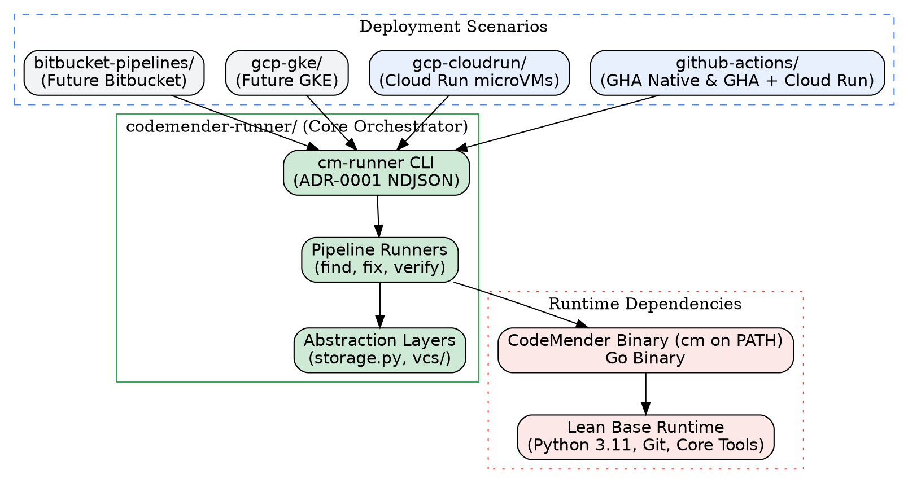

# ADR-0004: Project Tech Stack & Scenario-Decoupled Monorepo Architecture

*   **Status:** proposed
*   **Date:** 2026-09-26
*   **Decision Makers:** brentcollier@google.com, ledoux@google.com, nasirmohammad@google.com, pjiyer@google.com

**Shortlink:** go/cm-runner-adr-0004

## Context and Problem Statement

CodeMender CI/CD integrations must support heterogeneous enterprise deployment environments—ranging from native GitHub Actions runners with zero external cloud dependencies to security-hardened enterprise environments running inside Google Cloud Platform (Cloud Run microVMs) or Kubernetes (GKE). At the same time, the core multi-stage orchestration logic (scanning diffs, finding vulnerabilities, synthesising patches with `cm`, verifying fixes, and generating SARIF reports) must remain consistent, testable, and reusable without duplicating code across different CI/CD platforms.

How should the repository organize its core orchestration logic and scenario-specific deployment manifests, and what foundational technology stack should govern the implementation?

## Decision Drivers

*   **Reusability & Scenario Independence:** The core orchestrator must remain scenario-agnostic, usable across GitHub Actions, Cloud Run, and future CI systems (Bitbucket, GitLab).
*   **Clean Separation of Concerns:** Platform-specific automation (workflows, Terraform modules, container wrappers) must not pollute the scenario-independent engine.
*   **Lean Base Runtime & Extensible Toolchains:** Initial runner packaging should be lean and stripped down strictly to orchestrator and CodeMender requirements (Python runtime, git, `cm` binary), deferring language-specific compiler suites to post-launch modular container strategies.
*   **Maintainability & Test Coverage:** Orchestrator logic must maintain modular unit test coverage (>90%) with fast local testing and minimal external mock complexity.

## Considered Options

*   **Option 1: Monolithic scenario-coupled repository.** All CI workflows and Cloud Run logic directly coupled with orchestrator scripts at root.
*   **Option 2: Multi-repository distribution.** Separate repositories for `codemender-core`, `codemender-github-actions`, and `codemender-gcp-cloudrun`.
*   **Option 3: Scenario-decoupled monorepo with Python 3.11 core orchestrator and modular scenario directories.** (Chosen option).

## Decision Outcome

Chosen option: **"Option 3: Scenario-decoupled monorepo with Python 3.11 core orchestrator and modular scenario directories"**, because it provides a single canonical source of truth for CodeMender CI/CD deployment scenarios while strictly decoupling the core engine from environment-specific execution harnesses.

### Repo Directory Structure

```
cloud-gtm/codemender-runner
├── codemender-runner/      # Scenario-independent core orchestrator package (Python 3.11 + cm CLI)
├── github-actions/         # Deployment scenario: GitHub Actions orchestration (supports running entirely in GHA as well as GHA + Cloud Run)
├── gcp-cloudrun/           # Deployment scenario: Cloud Run microVM sandboxing (GCP infrastructure)
├── gcp-gke/                # (Future) Deployment scenario: GKE sandboxing
├── bitbucket-pipelines/    # (Future) Deployment scenario: Bitbucket pipelines
├── docs/                   # ADRs, OpenSpecs, architecture designs, and guides
└── terraform/              # Infrastructure-as-code modules (gha_wif, gcp)
```

### Tech Stack Standards

*   **Core Orchestrator Runtime:** Python 3.11 with an isolated virtual environment (`/opt/codemender/venv`). Lightweight standard library focus; minimal external dependencies (`requests`, `pyyaml`, `google-cloud-storage`).
*   **CodeMender Binary:** Native Go binary (`cm`) discovered via `PATH` (or configurable via `CM_PATH`), avoiding fragile concrete path assumptions that drift out of sync.
*   **Container Strategy (Lean Base Image):** Minimal base container packaging strictly what is needed for orchestration and CodeMender execution (Python 3.11, Git, basic system tools, and the `cm` binary). Monolithic multi-language compiler suites (Node.js, Java, Go) are omitted from the initial image, with custom/bring-your-own-runtime containers evaluated post-launch.
*   **Infrastructure Automation:** HashiCorp Terraform 1.5+ for GCP WIF, Cloud Run Jobs, Cloud Workflows, and GCS buckets.
*   **Testing:** Python standard `unittest` framework with hermetic mock CLI executables and structured mock fixtures.

### Consequences

*   **Good:** Core orchestrator updates (`cm-runner` CLI, pipeline runners, SARIF generator) instantly benefit all deployment scenarios without version drift across repositories.
*   **Good:** Customers can inspect the exact scenario that fits their security posture (`github-actions` for native GHA or hybrid orchestration, `gcp-cloudrun` for strict microVM isolation).
*   **Good:** High testability: core logic is validated locally with unit tests without needing live cloud infrastructure.
*   **Bad:** Monorepo requires clear directory ownership and conventions to ensure developers do not introduce platform-specific imports into `codemender-runner/`.

### Confirmation

*   **Import Isolation Tests:** Automated tests in `codemender-runner/tests/test_cli.py` assert that `cli` and `runners` do not depend on scenario-specific or cloud provider packages unless gated behind abstract storage adapters.
*   **Unit Test Suite:** All core changes must pass `python3 -m unittest discover -s codemender-runner/tests` with >=90% test coverage.
*   **Terraform Validation:** Modules in `terraform/` must validate via `terraform test`.

## Pros and Cons of the Options

### Option 1: Monolithic Scenario-Coupled Repository

*   Good, because simple initial development with everything in a single directory.
*   Bad, because platform-specific assumptions (e.g. GitHub Actions environment variables) leak into core logic, breaking reusability for Cloud Run or Bitbucket.
*   Bad, because confusing for customers who only want a specific deployment scenario.

### Option 2: Multi-Repository Distribution

*   Good, because maximum physical decoupling between components.
*   Bad, because severe maintenance friction when updating cross-cutting features (e.g., updating SARIF formatting requires coordinated PRs across multiple repos).
*   Bad, because difficult to maintain a single authoritative documentation source and unified versioning.

### Option 3: Scenario-Decoupled Monorepo (Chosen)

*   Good, because provides a single canonical repo for all CodeMender CI/CD deployment models.
*   Good, because enables clean dependency boundaries via `storage.py` and `vcs/` abstraction layers.
*   Good, because aligns with the Project Plan structure (`go/cm-ci-cd-project-plan`).
*   Bad, because requires discipline in CI checks to prevent cross-scenario boundary leakage.

## Architecture Diagram



## More Information

*   [CM CI/CD Project Plan](https://docs.google.com/document/d/1Vv2o5C2UD3wYY9RQpq00dYst_5apT9-PO0CVoAV5wLU/edit)
*   [Scaling CodeMender in the CI/CD Pipeline (go/scaling-codemender-cicd)](https://docs.google.com/document/d/1dAzVngHN409VYC2Z7Dgx01GJGCudij5gDW9kPhmZf2U)
*   [ADR-0001: Machine-Readable Output Contract for cm-runner CLI](ADR-0001-machine-readable-output-contract.md)
