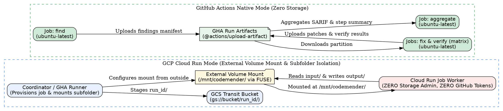

# ADR-0005: Multi-Platform Transit Storage & Sandboxed Isolation Model

*   **Status:** proposed
*   **Date:** 2026-09-26
*   **Decision Makers:** brentcollier@google.com, ledoux@google.com, nasirmohammad@google.com, pjiyer@google.com

**Shortlink:** go/cm-runner-adr-0005

## Context and Problem Statement

CodeMender executes in three discrete orchestration stages (`find`/`find-diff`, `fix`, and `verify`). Between these stages, intermediate state must travel safely: repository code snapshots, findings manifests, generated patches, verification results, and execution receipts.

However, CodeMender workers execute untrusted code and potential exploit payloads. If a worker container is compromised, it must not possess privileges to access other workers' data, read sibling PRs, modify the source Git repository, or access long-lived cloud credentials. Furthermore, signed URLs—commonly considered for ephemeral object transfer—act as **bearer tokens**: anyone who obtains or intercepts the URL can access the resource, creating significant leakage risks if untrusted processes read environment variables or log files. How should intermediate transit storage and execution isolation be structured across both Google Cloud (Cloud Run Jobs) and GitHub Actions?

## Decision Drivers

*   **Least Privilege & Blast Radius Containment:** Workers running `cm verify` and `cm fix` must possess zero repository write credentials and zero blanket cloud storage access.
*   **Perimeter Security & Non-Bearer Protection:** Storage access mechanisms must avoid bearer-token leakage risks. Signed URLs can be replayed by any party that intercepts them; storage access should ideally be identity-bound or attached via external volume mounts rather than exposed as bearer tokens inside untrusted containers.
*   **External Mount Perimeter Enforcement:** If Cloud Storage volume mounts (Cloud Storage FUSE) are used, mounts must be configured strictly from outside the container (coordinator / job definition) targeting run-specific subfolders (`<run_id>/`). Untrusted container processes must lack privileges to remount or access paths outside their designated subfolder.
*   **Self-Contained Onboarding for GitHub:** Workflows running strictly in GitHub Actions must not require provisioning or paying for external Google Cloud Storage (GCS) buckets.
*   **Tamper Resistance & Cross-Task Isolation:** Parallel workers must only access their designated partition and write only their designated output, preventing race conditions or cross-worker state corruption.
*   **Performance & Scalability:** State transfer must handle 100+ parallel workers without storage bottlenecks or GitHub API rate exhaustion.

## Considered Options

*   **Option 1: Mandatory External Cloud Storage (GCS) for all environments.** Force all workflows (including native GitHub Actions) to configure GCS buckets and IAM.
*   **Option 2: Git-backed state tracking.** Push intermediate database shards and receipts to ephemeral Git branches.
*   **Option 3: Abstracted Dual-Mode Transit Storage with Valet Key Pattern (Signed URLs).** Ephemeral signed V4 PUT/GET URLs for Cloud Run; native GHA run artifacts for GitHub.
*   **Option 4: Abstracted Dual-Mode Transit Storage with Identity-Bound Isolation & External Volume Mounts (Chosen option).** Storage access decoupled via `TransitStorageAdapter`: Cloud Run leverages identity-bound bucket access or externally-configured Cloud Storage volume mounts (Cloud Storage FUSE) mapped to run-specific subfolders (`gs://<bucket>/<run_id>/`), while GitHub Actions leverages native run artifacts.

## Decision Outcome

Chosen option: **"Option 4: Abstracted Dual-Mode Transit Storage with Identity-Bound Isolation & External Volume Mounts"**, implemented via `TransitStorageAdapter` in `codemender-runner/storage.py`.

### Architecture & Security Controls

1.  **GCP Cloud Run Mode (`storage_mode: gcs`)**:
    *   **External Volume Mounts (Cloud Storage FUSE):** Rather than passing signed URLs (bearer tokens) to untrusted containers, Cloud Run Jobs utilize Cloud Storage volume mounts configured **strictly from outside the container** during job definition or execution launch (`--add-volume`).
    *   **Subfolder / Run ID Path Isolation:** Creating a new GCS bucket per PR is cost-prohibitive and slow. Instead, the storage mount maps a dedicated execution subfolder (`gs://<bucket>/<run_id>/`) to a local mount path (e.g., `/mnt/codemender/`).
    *   **Perimeter Enforcement & Identity Scoping:**
        - Untrusted code executing inside the container cannot alter mount configuration, add new volume mounts, or modify host mount namespaces.
        - The container's runtime service account is explicitly restricted: it possesses no broad `storage.admin` or bucket enumeration permissions, preventing untrusted processes from using the GCS API to reach beyond the mounted subfolder.
        - Where volume mounts are not feasible, temporary access is strictly restricted to the job's authenticated Workload Identity rather than unauthenticated signed URLs.
    *   **Zero Repo Credentials:** Cloud Run containers never receive GitHub tokens or git push access. All feedback travels back through GCS receipts to the CI runner.
2.  **GitHub Actions Native Mode (`storage_mode: github_actions`)**:
    *   Intermediate files are written to `.codemender_transit/base/` and `.codemender_transit/partitions/worker_<id>/`.
    *   State is passed between workflow stages using native `@actions/upload-artifact` and `@actions/download-artifact` with temporary retention policies (default: 3 days).
    *   Zero external cloud bucket configuration required.
3.  **Local Development Mode (`storage_mode: local`)**:
    *   State is preserved in local filesystem directories for testing and offline CLI debugging.

### Consequences

*   **Good:** Eliminates the bearer-token vulnerability of signed URLs; compromised worker code cannot leak reusable URLs that allow external data access.
*   **Good:** External volume mounts prevent container processes from escaping their designated run-specific subfolder boundary.
*   **Good:** GitHub Actions native users enjoy zero-setup adoption without provisioning GCP infrastructure.
*   **Good:** Clean, testable abstraction in `codemender-runner/storage.py` allows swapping transit providers (e.g. S3 in future).
*   **Bad:** Volume mount support requires Cloud Run volume features and requires coordinator automation to mount run-specific subfolder prefixes.

### Confirmation

*   **Storage Unit Tests:** Verified via `codemender-runner/tests/test_storage.py` validating upload/download mocking and volume path mapping.
*   **IAM Policy Audit:** Automated Terraform tests in `terraform/gcp/tests/` verify that the worker service account has no blanket `storage.objects.*` roles on the bucket.

## Pros and Cons of the Options

### Option 1: Mandatory External Cloud Storage (GCS)

*   Good, because uniform storage backend for all environments.
*   Bad, because adds massive onboarding friction for GitHub-native teams who do not have GCP access.
*   Bad, because violates the self-contained requirement of Deliverable 1 in the project plan.

### Option 2: Git-Backed State Tracking

*   Good, because uses existing repository infrastructure.
*   Bad, because pushing dozens of worker commits creates Git lock contention, non-fast-forward push rejections, and repository bloat.
*   Bad, because gives workers Git write credentials, violating least privilege.

### Option 3: Valet Key Pattern via Signed URLs

*   Good, because worker service account requires zero IAM permissions to Cloud Storage.
*   Bad, because signed URLs are **bearer tokens**: anyone who obtains the URL (via environment leak, network interception, or compromised worker logs) can read and write to the bucket path.

### Option 4: Identity-Bound Isolation & External Volume Mounts (Chosen)

*   Good, because eliminates bearer-token leakage risks by binding access to the job identity and externally configured volume mounts.
*   Good, because subfolder mounting confines the container's filesystem view to `gs://<bucket>/<run_id>/` without requiring per-PR buckets.
*   Good, because maintains clean code decoupling through `storage.py`.
*   Bad, because requires coordinator orchestration to attach volume mounts at execution launch time.

## Architecture Diagram

## More Information

*   [Implementation Guardrails & Design (docs/architecture/guardrails.md)](../architecture/guardrails.md)
*   [GCP Parallelization Design Specification (docs/architecture/parallelization_design.md)](../architecture/parallelization_design.md)
*   [ADR-0004: Project Tech Stack & Scenario-Decoupled Monorepo Architecture](ADR-0004-project-tech-stack-and-repo-architecture.md)
