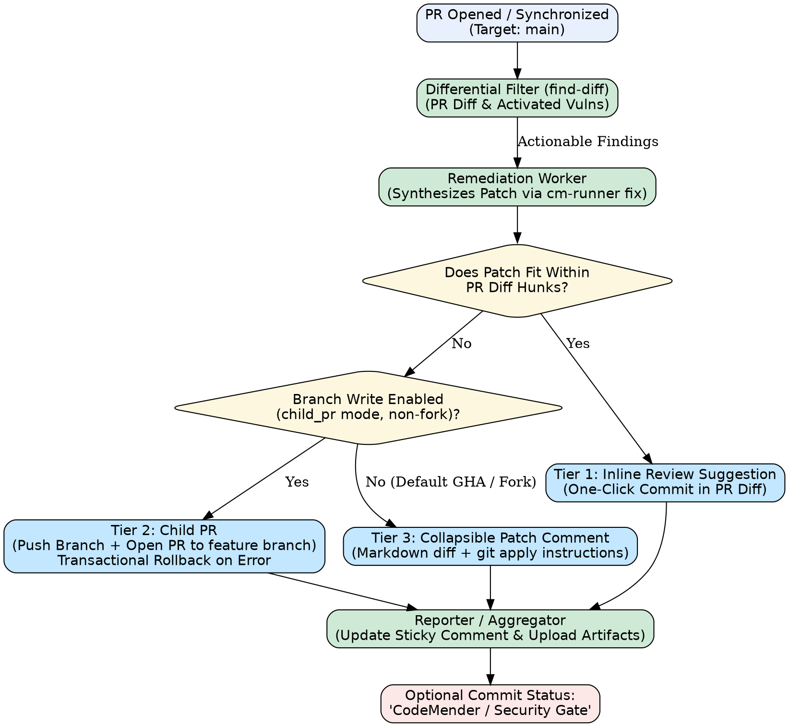

# ADR-0006: Pull Request Remediation Routing & Security Quality Gate

*   **Status:** proposed
*   **Date:** 2026-09-26
*   **Decision Makers:** brentcollier@google.com, ledoux@google.com, nasirmohammad@google.com, pjiyer@google.com

**Shortlink:** go/cm-runner-adr-0006

## Context and Problem Statement

When CodeMender scans Pull Requests during CI/CD, how should automated remediations be delivered to developers, and how should security quality gates enforce compliance? Pushing code directly to developers' feature branches causes merge conflicts and race conditions when parallel workers finish simultaneously. Furthermore, exposing pre-existing repository vulnerabilities on unrelated PRs causes alert fatigue and developer friction, while cross-repository fork PRs lack write permissions to push branches.

How should the orchestrator route remediations and enforce merge criteria across diverse Pull Request contexts?

## Decision Drivers

*   **Developer Friction & "Clean as You Code":** Developers must only be alerted to actionable vulnerabilities introduced, modified, or activated by their PR changes (`origin/base...HEAD`). There is critical nuance: a vulnerability may reside in code or an existing dependency the developer did not write, but the PR's code opens up, activates, or introduces an unsafe usage pattern (e.g. calling an existing library in an insecure manner). In such cases, `cm fix` should synthesize remediations such as upgrading the unsafe library or refactoring to a safe API pattern, while purely pre-existing, dormant vulnerabilities in untouched code paths remain suppressed.
*   **One-Click Remediation Experience:** Suggested fixes should be actionable directly in the GitHub PR UI with a single click.
*   **Zero Branch Collisions & Concurrency Safety:** Parallel workers must never race to push commits to the same branch or clobber developer checkouts.
*   **Fork PR Compatibility:** The workflow must execute cleanly on PRs submitted from external repository forks without failing on permission-denied git pushes.
*   **Enforceable Quality Gating:** Security teams must be able to block PR merges when critical vulnerabilities remain unaddressed without terminating CI workflows prematurely before reports are uploaded.

## Considered Options

*   **Option 1: Direct commits pushed to the PR feature branch.** Workers commit directly to `origin/<pr_head_ref>`.
*   **Option 2: Mandatory top-level PRs targeting `main`.** Every finding results in an independent PR against `main`, regardless of whether it was triggered by a PR.
*   **Option 3: Tiered Remediation Routing & Dedicated Commit Status Gate.** (Chosen option: One-click inline review suggestions $\rightarrow$ Child PR fallback with transactional rollback $\rightarrow$ Fork Markdown patch comment; blocking `CodeMender / Security Gate` status check).

## Decision Outcome

Chosen option: **"Option 3: Tiered Remediation Routing & Dedicated Commit Status Gate"**, implemented in the GitHub Action (`github-actions/actions/codemender/`, [SPEC-GHA-FIX](../openspec/specs/github-actions-fix/spec.md)) and the legacy runner pipeline (`codemender-runner/runners/worker.py`, `vcs/github.py`, and `runners/aggregate.py`).

### Remediation Routing Rules

1.  **Differential PR Filtering & Dependency Exposure (`find-diff --base <PR base SHA>`)**:
    *   On PR scans, discovered findings are evaluated against the PR changes (`git diff -U0 <pr_base_sha>...HEAD` on a checkout of the PR head).
    *   Findings are considered actionable if they either:
        a. Directly modify or introduce vulnerable code lines within the PR diff, or
        b. Introduce code paths, call sites, or configurations that open up, activate, or insecurely utilize existing code or dependencies. For example, if newly introduced code calls a vulnerable API in an existing library, `cm fix` can suggest updating the dependency in package manifests or adapting the call site.
    *   Untouched, dormant legacy findings are excluded from remediation tasks, keeping PR reviews noise-free.
2.  **Tier 1 (Default): One-Click Inline Review Suggestions**:
    *   When a patch touches a single file, does not modify `.github/`, and all of its hunks fall within the PR diff, it is parsed into contiguous diff line ranges and posted as ` ```suggestion ` blocks in a single GitHub PR review per finding (`event: COMMENT` with an empty review `body: ""`, all-or-nothing per patch).
    *   Developers can accept the fix with a single click in GitHub without pulling branches locally.
    *   Each PR scan run deletes earlier bot-authored CodeMender inline review comments (`DELETE /repos/{repo}/pulls/comments/{comment_id}`) before posting new results so each run starts from a clean slate without stale or duplicated review comments. Each fix comment embeds an invisible HTML marker `<!-- codemender-finding:<fingerprint> -->` (where `<fingerprint>` is the SARIF result's `fingerprints` or `partialFingerprints` value, or else a hash of the file path, rule ID, start line, and message; never `cm`'s internal finding ID, which changes on every run, nor a value from the result's `properties` bag) for intra-run deduplication and on-demand `@cm-runner verify` correlation.
3.  **Tier 2: Child Pull Requests with Transactional Rollback (When Branch Write Access Is Enabled)**:
    *   In environments configured with repository branch-push permissions (`contents: write` and `pr_remediation_mode == "child_pr"`), if a patch touches lines outside the PR diff or adds new binary files, the worker pushes `codemender/fix-<vuln>-<hash>` and opens a **Child PR** targeting the developer's feature branch (`pr_head_ref`).
    *   **Transactional Rollback:** If PR creation fails or is rejected, the worker automatically deletes the remote branch via `git push origin --delete` to prevent branch clutter.
    *   In the default least-privilege GitHub Action workflow (`contents: read`, `pull-requests: write`), child PRs are not opened and patches that cannot be inline suggestions route directly to Tier 3.
4.  **Tier 3 (Fallback): Collapsible Patch Comment**:
    *   Whenever a patch cannot be posted as an inline suggestion (for example when it touches lines outside the PR diff, spans multiple files, touches `.github/`, or runs on a fork PR or read-only checkout without branch-push access), the action posts a structured Markdown review comment on the flagged line (or PR comment) containing the unified diff collapsed in `<details>` and local `git apply` instructions.

### Security Quality Gate Contract

*   Findings and failed fixes never fail the CI workflow execution itself (`exit 0`), ensuring SARIF reports, Markdown summaries, and generated `.diff` patches are always uploaded as workflow artifacts.
*   When security gating is enabled in the aggregator (`fail_on_findings == true`), a dedicated GitHub Commit Status check (`CodeMender / Security Gate`) is posted and marked `failure` when actionable, un-remediated vulnerabilities remain on the PR diff.

### Consequences

*   **Good:** Clean as You Code: Developers are never blocked by pre-existing legacy issues they did not touch.
*   **Good:** Zero git push race conditions across parallel workers.
*   **Good:** Universal support for internal and fork PRs with graceful fallbacks and least-privilege `contents: read` operation.
*   **Good:** Clear separation between workflow execution status (did the CI job run?) and security policy status (did the code pass security audit?).
*   **Bad:** Inline suggestions cannot span files or lines not already modified in the PR diff (handled cleanly by Tier 2 / Tier 3 fallback).

### Confirmation

*   **GitHub Action Fix & Suggestion Unit Tests:** Verified via `github-actions/actions/codemender/tests/test_fix_comments.py`, `test_launcher.py`, and `test_gha_runner.py`.
*   **Legacy Runner PR Review & Security Gate Tests:** Verified via `codemender-runner/tests/test_pr_review_suggestions.py`, `test_vcs_github.py`, and `test_runners_aggregate.py:test_security_gate_commit_status`.

## Pros and Cons of the Options

### Option 1: Direct Commits Pushed to PR Feature Branch

*   Good, because patches appear directly in developer branch.
*   Bad, because simultaneous parallel workers cause non-fast-forward push rejections.
*   Bad, because mutates developer branch while they are actively coding locally.
*   Bad, because completely impossible on fork PRs (HTTP 403 Forbidden).

### Option 2: Mandatory Top-Level PRs Targeting `main`

*   Good, because simple, uniform routing.
*   Bad, because opening top-level PRs against `main` for an unmerged feature PR causes race conditions and git conflicts.
*   Bad, because creates massive PR backlog spam.

### Option 3: Tiered Remediation Routing (Chosen)

*   Good, because provides modern 1-click developer review experience.
*   Good, because eliminates push collisions and orphan branches via transactional rollback.
*   Good, because 100% compliant with fork security boundaries.
*   Bad, because multi-tier fallback logic is more complex to maintain.

## Architecture Diagram



## More Information

*   [SPEC-GHA-FIX: GitHub Actions PR Fix Specification & Design](../openspec/specs/github-actions-fix/spec.md)
*   [GitHub Actions Orchestration & Execution Backends Design (docs/openspec/specs/github-actions/design.md)](../openspec/specs/github-actions/design.md)
*   [ADR-0002: Machine-Readable Output Contract for cm-runner CLI](ADR-0002.md)
*   [ADR-0008: Repository Layout, Three-Package Workspace, and Runtime Architecture](ADR-0008-repository-layout-and-package-structure.md)
