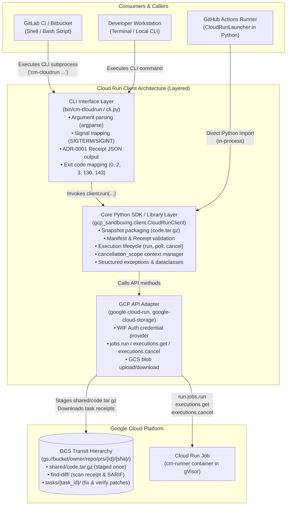

# ADR-0007: Cloud Run Job Invocation Interface: CLI vs. Python Library

*   **Status:** proposed
*   **Date:** 2026-10-02
*   **Decision Makers:** brentcollier@google.com, ledoux@google.com, nasirmohammad@google.com, pjiyer@google.com

**Shortlink:** go/cm-runner-adr-0007

## Context and Problem Statement

Workstream 2 (GitHub Actions Integration) and Workstream 3 (Cloud Run Sandboxing) require a mechanism for CI/CD environments to offload untrusted CodeMender tasks (`find-diff`, `fix`, `verify`) to Google Cloud Run Jobs. As established in [ADR-0002](ADR-0002-runner-layout-and-build.md) and [ADR-0005](ADR-0005-multi-platform-transit-storage-and-isolation.md), the CI runner acts as the trusted coordinator, while Cloud Run Jobs execute in an isolated microVM sandbox (gVisor) with zero repository write credentials and zero long-lived cloud keys.

To coordinate these Cloud Run executions, the CI runner must authenticate via Workload Identity Federation (WIF), stage repository snapshot archives (`code.tar.gz`) and manifests to Google Cloud Storage (GCS) transit buckets, dispatch job executions with parameter overrides, monitor execution lifecycles, handle cancellation signals, and retrieve execution receipts and output artifacts.

> [!NOTE]
> *Transit Storage Protocol Optimization:* While ADR-0005 originally envisioned Cloud Storage FUSE mounts, operational evaluation in the [vcs-cloudrun-comms Proposal](../openspec/proposals/vcs-cloudrun-comms/proposal.md) demonstrated that GCS FUSE introduces severe POSIX file-stat latency penalties during code compilation and differential scanning. Consequently, this architecture standardizes on bounded-history diff-capable repository archive transit (`code.tar.gz` containing `HEAD`, `base_ref`, and merge-base commit history) unpacked onto local ephemeral container disk, guaranteeing sub-millisecond local filesystem performance, multi-tenant repository isolation, and commit-anchored artifact sharing (`gs://<bucket>/<owner>/<repo>/[prs/<pr_number>|branches/<branch_name>]/<commit_sha>/`).

Should the client interface consumed by CI runners (e.g., GitHub Actions, GitLab CI, Bitbucket) be implemented as a **pure CLI executable**, a **pure Python library/SDK**, or a **layered dual-interface (core Python library with a thin CLI wrapper)**?

## Decision Drivers

*   **Hermetic Unit Testability:** The coordinator orchestration logic (archive staging, parameter encoding, execution polling, timeout enforcement, receipt validation) must be 100% testable locally via mocked GCP API clients without requiring live cloud resources or slow subprocess orchestration in test suites.
*   **Cross-Platform Portability & Interoperability:** The interface must integrate seamlessly with diverse CI/CD platforms—including GitHub Actions composite actions, GitLab CI bash scripts, Bitbucket Pipelines, and local developer shells.
*   **Process Isolation & Signal Safety:** Long-running executions must handle CI cancellation signals (`SIGTERM`, `SIGINT`) gracefully, cleanly propagating cancellation (`jobs.executions.cancel`) to Cloud Run to conserve Vertex AI quota without leaving orphaned background jobs.
*   **Strict Machine-Readable Output Purity:** Execution outcomes, errors, and events must strictly adhere to the project's established split-stream CLI output contract ([ADR-0001](ADR-0001-machine-readable-output-contract.md)).
*   **Maintainability & Ergonomics:** Python-based callers (such as `CloudRunLauncher` in `github-actions/`) should benefit from rich typing, structured dataclasses, and standard Python exception handling without fragile string parsing of subprocess stdout.
*   **Runner Startup & Dependency Overhead:** Minimizing container cold-start and package installation latency on ephemeral CI runners.

## Considered Options

*   **Option 1: Pure Standalone CLI Executable (`cm-cloudrun`).** Provide only a CLI command/script (e.g., in `gcp-sandboxing/bin/cm-cloudrun`). All callers—including Python workflows—must invoke it as an external subprocess and parse text/NDJSON output.
*   **Option 2: Pure Python Library / SDK (`codemender_cloudrun`).** Provide only an importable Python library with structured classes and methods. Callers must write Python scripts to interact with Cloud Run.
*   **Option 3: Layered Architecture: Core Python Library with Thin CLI Wrapper (Chosen option).** Implement the core orchestration engine as a modular, typed Python library (`gcp-sandboxing/client/`), and provide a thin CLI entrypoint (`bin/cm-cloudrun` / `python3 -m gcp_sandboxing.client`) that wraps the library, parses flags, formats NDJSON output per ADR-0001, and maps exceptions to standard exit codes.

## Decision Outcome

Chosen option: **"Option 3: Layered Architecture: Core Python Library with Thin CLI Wrapper"**, because it provides the optimal balance of developer ergonomics, rich in-process Python testability, and universal cross-CI portability.

### Architecture & Design

> [!NOTE]
> *Directory Structure Alignment:* Per [ADR-0004](ADR-0004-project-tech-stack-and-repo-architecture.md), the working directory for Workstream 3 on disk is `gcp-sandboxing/` (superseding the provisional `gcp-cloudrun/` name).

1.  **Core Library Layer (`gcp-sandboxing/client/`):**
    *   **`CloudRunClient`**: Exposes high-level programmatic methods:
        *   `stage_snapshot(commit_path, repo_path, manifest) -> str`: Packages a diff-capable repository snapshot (including `HEAD`, `base_ref`, and merge-base commits) into `code.tar.gz` and uploads once to `gs://<bucket>/<owner>/<repo>/[prs/<id>|branches/<sanitized_name>]/<commit_sha>/shared/`.
        *   `sanitize_branch_name(branch) -> str`: Deterministically transforms raw Git branch names into safe, single-segment GCS path components (`slug[:40]-hash[:8]`), preventing path-depth variation, URL-encoding bugs, and collisions.
        *   `trigger_job(commit_path, task_id, command, parameters) -> ExecutionHandle`: Dispatches Cloud Run Job via `google.cloud.run_v2.JobsClient.run_job`, referencing the shared code archive and setting output destination to `tasks/<task_id>/output/` (or `find-diff/`).
        *   `poll_execution(execution_handle, timeout_seconds) -> ExecutionStatus`: Polls execution status with exponential backoff and emits heartbeat callbacks.
        *   `cancel_execution(execution_handle) -> bool`: Calls `JobsClient.cancel_execution`.
        *   `fetch_receipt(commit_path, task_id) -> ExecutionReceipt`: Downloads and parses `receipt.json` from the task's output directory in GCS.
        *   `fetch_logs(commit_path, task_id) -> str`: Downloads `output/runner.log` from GCS on execution failure.
        *   `cancellation_scope(execution_handle, auto_trap_signals=True)`: Context manager ensuring that in-process Python callers propagate cancellation upon workflow step abort.
        *   `run(commit_path, task_id, command, repo_path, parameters, timeout) -> ExecutionReceipt`: High-level convenience orchestrator executing the full lifecycle.
    *   **Domain Models (`models.py`)**: Strongly-typed dataclasses for `CloudRunConfig`, `RunManifest`, `ExecutionReceipt`, and `ExecutionStatus`.
    *   **Custom Exception Hierarchy (`exceptions.py`)**: `CloudRunError`, `CloudRunTimeoutError`, `CloudRunExecutionFailedError`, `TransitStorageError`.
    *   **Isolated GCP API Adapter (`gcp_adapter.py`)**: Wraps `google-cloud-run` and `google-cloud-storage`, allowing direct dependency injection and mock substitutions in unit tests.

2.  **Thin CLI Wrapper Layer (`bin/cm-cloudrun` / `cli.py`):**
    *   Parses command-line arguments using `argparse` (`--project`, `--region`, `--job-name`, `--bucket`, `--command`, `--diff-context`, `--cancel-on-abort`, `--output`).
    *   Instantiates `CloudRunClient` and invokes `run(...)`.
    *   **Signal Trapping**: Traps `SIGTERM` and `SIGINT`. If `--cancel-on-abort` is enabled (default: `true`), invokes `client.cancel_execution()` and exits with code `143` (`SIGTERM`) or `130` (`SIGINT`).
    *   **Console Heartbeats**: Emits periodic progress updates to `stderr` every 10 seconds (e.g., `[00:20] Cloud Run execution 'run-xyz' is RUNNING...`).
    *   **ADR-0001 Output Stream Purity**:
        *   `stdout` emits **exactly one compact JSON document** representing the serialized `ExecutionReceipt` (or streams inner runner events when `--passthrough` is requested).
        *   `stderr` receives all human-readable logs, heartbeats, and failure diagnostics.
    *   **Failure-Spill Log Strategy**: If the Cloud Run job fails (`exit_code != 0`), the CLI automatically downloads `output/runner.log` from GCS and flushes the trailing failure diagnostics to `stderr` so developers immediately see the root cause in CI logs without needing `roles/logging.viewer` IAM permissions.
    *   **Exit Code Mapping (Strict ADR-0001 & ADR-0006 Compliance)**:
        *   `0`: Job completed successfully (`status: SUCCESS`, runner `exit_code: 0`, regardless of finding count).
        *   `2`: CLI argument or configuration error (invalid flags, missing required parameters).
        *   `3`: Execution or infrastructure failure (runner `exit_code != 0`, WIF authentication failure, GCS upload error, Cloud Run API failure, or execution timeout).
        *   `130`: Execution aborted via `SIGINT` (Ctrl+C).
        *   `143`: Execution aborted via `SIGTERM` (CI cancellation).

3.  **Packaging & Distribution Strategy**:
    *   **Published Wheel Package**: The `gcp-sandboxing/` client is packaged as a standard Python package (`pip install -e gcp-sandboxing`), allowing direct import in Python environments.
    *   **Pre-Baked Coordinator Container Image**: For non-Python CI environments (GitLab CI, Bitbucket Pipelines), a lightweight coordinator container image (`ghcr.io/cloud-gtm/codemender-cloudrun-client:latest`) is published, eliminating 20–45s runner cold-start dependency installation times.

4.  **Integration with GitHub Actions (`CloudRunLauncher`):**
    *   The GitHub Actions integration (`github-actions/actions/codemender/`) can consume either layer:
        *   **Direct Library Import**: For internal unit tests and Python runners (`gha_runner.py`), avoiding subprocess overhead.
        *   **CLI Subprocess Mode**: When running inside composite action steps or bash workflows, providing strict process boundaries.

### Consequences

*   **Good:** Python test suites (`test_client.py`) can test 100% of staging, dispatch, polling, timeout, and receipt parsing logic in memory with mock Google Cloud clients without subprocess piping.
*   **Good:** Python callers (`CloudRunLauncher`) obtain typed `ExecutionReceipt` objects directly, eliminating fragile string regex or stdout JSON parsing.
*   **Good:** Non-Python CI environments (GitLab CI shell, Bitbucket pipelines, local developer bash) can use the CLI tool seamlessly without writing custom Python harnesses.
*   **Good:** Subprocess CLI execution guarantees process boundary isolation and clean signal trapping for `SIGTERM`/`SIGINT` abort handling.
*   **Good:** Strict alignment with ADR-0001, ADR-0002, and ADR-0006 guarantees CI steps do not erroneously crash on findings and preserve NDJSON output stream purity.
*   **Bad:** Maintaining both a library API and a CLI argument parser requires keeping CLI flags synchronized with library configuration options (mitigated by dataclass introspection and thin CLI delegation).

### Confirmation & Verification Strategy

1.  **Hermetic Unit Tests (`gcp-sandboxing/tests/test_client.py`):**
    *   Execute via: `python3 -m unittest discover -s gcp-sandboxing/tests -t gcp-sandboxing`
    *   Verify `CloudRunClient` behavior using `unittest.mock` against simulated `google.cloud.run_v2` and `google.cloud.storage` clients.
    *   `test_wif_auth_failure`: Asserts graceful handling of rejected or expired WIF credentials (maps to exit code `3`).
    *   `test_gcs_upload_failure`: Asserts rollback/cleanup if `code.tar.gz` upload is interrupted.
    *   `test_polling_timeout_escalation`: Asserts that reaching `timeout_seconds` triggers `cancel_execution()` and raises `CloudRunTimeoutError`.
    *   `test_missing_receipt_recovery`: Asserts fallback behavior when Cloud Run terminates unexpectedly without generating `receipt.json`.
    *   `test_failure_spill_logs`: Asserts that `runner.log` is fetched from GCS and emitted to `stderr` only on execution failure.
    *   `test_branch_name_sanitization`: Asserts that branches with forward slashes (`feat/login`), special characters (`#`, `?`), unicode, and collision-prone counterparts (`feat-login` vs `feat/login`) map deterministically to distinct, single-segment safe paths.
2.  **CLI Tests (`gcp-sandboxing/tests/test_cli.py`):**
    *   Verify CLI argument parsing, help output, and exit code propagation (`0`, `2`, `3`, `130`, `143`).
    *   Assert that stdout conforms to ADR-0001 single-receipt JSON format and stderr contains human-readable progress logs.
    *   Verify signal handling using isolated subprocess execution tests (`subprocess.Popen` with `os.kill(proc.pid, signal.SIGTERM)`).
3.  **Launcher Contract Verification (`github-actions/actions/codemender/tests/test_launcher.py`):**
    *   Verify that `CloudRunLauncher` in `github-actions/` correctly implements `launcher.base.Launcher` and returns a valid `RunResult` compatible with `gha_runner.py`.

## Pros and Cons of the Options

### Option 1: Pure Standalone CLI Executable

*   Good, because provides universal compatibility with any shell, Makefile, or CI tool.
*   Good, because isolates execution in a separate OS process with clean signal boundaries.
*   Bad, because Python callers (like `CloudRunLauncher` in `github-actions/`) must spawn subprocesses, serialize arguments, and parse JSON from stdout.
*   Bad, because testing requires subprocess orchestration or external shell harness mocking, increasing test complexity and latency.

### Option 2: Pure Python Library / SDK

*   Good, because provides native, typed Python dataclasses, structured exceptions, and IDE code completion.
*   Good, because allows fast, hermetic in-memory unit testing using `unittest.mock`.
*   Bad, because non-Python CI pipelines (GitLab CI, Bitbucket, Jenkins, shell scripts) cannot invoke the client without authoring dedicated Python wrapper scripts.
*   Bad, because library execution shares the host process memory and runtime environment, complicating cancellation signal trapping in shell runners.

### Option 3: Layered Architecture (Library + CLI Wrapper)

*   Good, because provides typed Python APIs for programmatic callers and testing while offering a standard CLI for shell and multi-CI invocations.
*   Good, because unit tests can isolate and thoroughly test the library logic without subprocess overhead.
*   Good, because the CLI layer strictly enforces [ADR-0001](ADR-0001-machine-readable-output-contract.md) output conventions and standard UNIX exit codes.
*   Bad, because requires a small amount of additional code (~80 lines) to define the CLI argument parser and map exceptions to exit codes.

## Architecture Diagram

## More Information

*   [ADR-0001: Machine-Readable Output Contract for cm-runner CLI](ADR-0001-machine-readable-output-contract.md)
*   [ADR-0002: Runner Layout, Build, and How to Call It](ADR-0002-runner-layout-and-build.md)
*   [ADR-0004: Project Tech Stack & Scenario-Decoupled Monorepo Architecture](ADR-0004-project-tech-stack-and-repo-architecture.md)
*   [ADR-0005: Multi-Platform Transit Storage & Sandboxed Isolation Model](ADR-0005-multi-platform-transit-storage-and-isolation.md)
*   [ADR-0006: Pull Request Remediation Routing & Security Quality Gate](ADR-0006-pr-remediation-routing-and-security-gate.md)
*   [Proposal: VCS to Cloud Run Communication Architecture](../openspec/proposals/vcs-cloudrun-comms/proposal.md)
