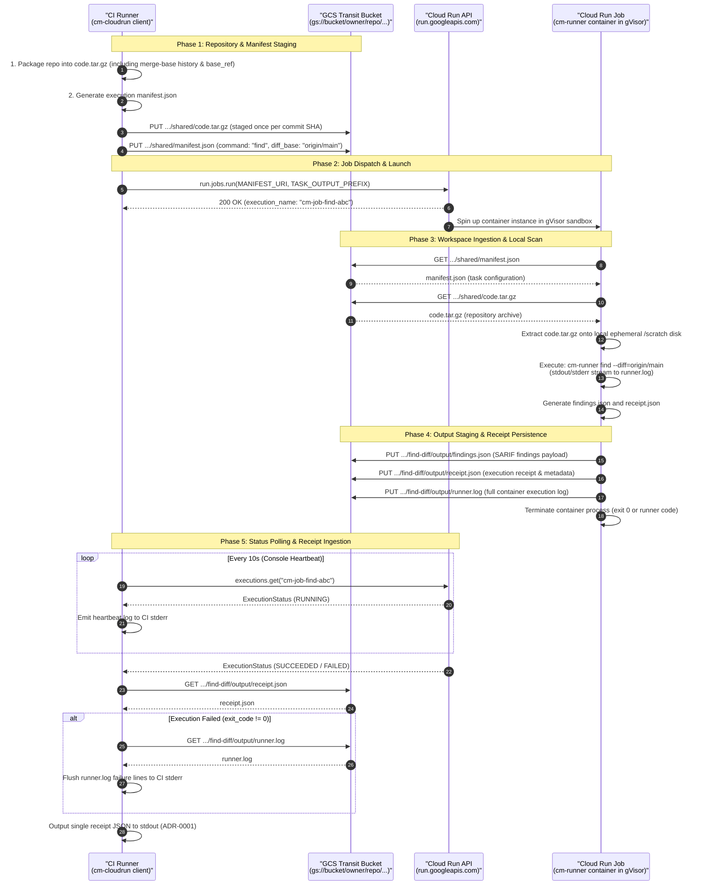

# Proposal: VCS to Cloud Run Communication Architecture & Client Contract

**Change ID:** `vcs-cloudrun-comms` \
**Status:** Draft \
**Author:** Brent Collier (brentcollier@google.com) \
**Target Spec:** [SPEC-ARTIFACT-CACHE](../../specs/artifact-cache/spec.md), [SPEC-WORKER](../../specs/worker/spec.md) \
**Bug/Epic:** go/cm-ci-cd-project-plan (Workstream 3: Cloud Run)

## Why
VCS platforms (such as GitHub Actions, GitLab CI, and Bitbucket Pipelines) require a secure, sandboxed execution environment to run untrusted code and execute dynamic exploit verifications without risking host CI runner compromise or exceeding execution budgets. Establishing a standardized Python client CLI and transit storage protocol defines how VCS platforms interact with Cloud Run Jobs while enforcing strict perimeter isolation (zero VCS write tokens in GCP) and providing optimal compiler/scanner I/O performance.

## What Changes
- **Python Client CLI (`cm-cloudrun`)**: Introduce a modular Python CLI and client SDK that CI runners invoke to manage the complete Cloud Run Job lifecycle: staging repo snapshots to GCS transit storage, triggering job executions with parameter overrides, monitoring progress via heartbeats, handling workflow cancellations, and downloading execution receipts. Designed for 100% hermetic unit testability via mocked GCP clients.
- **Bounded-History Diff-Capable Transit Protocol**: Standardize input transit on compressed repository archives (`code.tar.gz`) unpacked onto Cloud Run's local ephemeral scratch disk rather than Cloud Storage FUSE mounts. To support `cm-runner find-diff`, the archive packaging MUST NOT use naive single-commit shallow clones (`--depth 1`), which omit the base branch and commit history. Instead, the coordinator packages a diff-capable repository snapshot containing both `HEAD` and the target `base_ref` (including commit objects back to their common `git merge-base`), or a Git bundle (`code.bundle`). This allows `cm find --diff=<base>` and `git.ref_exists` to resolve the base reference and compute differential code hunks in the sandboxed container without network access to the VCS host, while avoiding full-history repository bloat and GCS FUSE POSIX latency penalties.
- **Hierarchical Multi-Tenant & Fan-Out Transit Storage Contract**: Replace flat run-centric paths with a scoped 4-tier hierarchy: `gs://<bucket>/<owner>/<repo>/[prs/<pr_number>|branches/<sanitized_branch>]/<commit_sha>/`. The coordinator stages `code.tar.gz` and `manifest.json` once into `shared/`. Subsequent executions—including Stage 1 differential scanning (`find-diff/`) and $N$ parallel remediation workers (`tasks/fix-<finding_id>/` and `tasks/verify-<finding_id>/`)—reuse the staged `shared/` archive, eliminating redundant multi-megabyte uploads. Multi-tenant repository namespacing guarantees zero collision across repositories sharing an organization transit bucket, while commit SHA scoping ensures immutable caching and isolates subsequent PR commits.
  - **Deterministic Branch Sanitization**: Git branch names used in GCS paths MUST be sanitized into a single path segment via `sanitize_branch_name(branch) = f"{slug[:40]}-{sha256(raw_branch)[:8]}"` (where slashes and characters outside `[a-zA-Z0-9_.-]` are replaced with `-`). This guarantees a uniform 5-segment prefix depth before `shared/` or task outputs, prevents path-depth variance and URL encoding hazards caused by branch slashes (e.g. `feat/login`), and prevents collision between distinct branches (e.g., `feat/login` vs `feat-login`).
- **Standardized Manifest & Receipt Contracts**: Formalize the `shared/manifest.json` and task-level `output/receipt.json` data plane contracts complying with [ADR-0002](../../../adr/ADR-0002.md) and the [Distributed Execution and Transit System Specification](../../specs/tech/systems/distributed-execution-and-transit/spec.md#req-0004), ensuring predictable status signaling, exit code propagation, and structured artifact discovery.
- **Configurable Execution Cancellation**: Implement configurable cancellation handling (`--cancel-on-abort`, default `true` in PR workflows), allowing the client to trap `SIGTERM`/`SIGINT` or CI cancellation signals and call the Cloud Run API (`jobs.executions.cancel`) to immediately terminate orphaned executions and conserve Vertex AI LLM quota.
- **Heartbeat Status & Failure-Spill Log Strategy**: Mitigate Cloud Logging API read quotas and permission bloat by using periodic execution status polling for CI console heartbeats. Cloud Run container entrypoint writes full execution logs to `output/runner.log` in GCS, which the client automatically fetches and outputs to the CI console only upon job failure.
- **Strict Perimeter IAM Boundary**: Enforce a Dual-Service-Account security model: the **Coordinator SA** (assumed by CI runners via Workload Identity Federation) manages transit staging and Cloud Run job execution; the **Worker SA** (used by the Cloud Run container) possesses Vertex AI inference permissions and scoped bucket access, but zero repository write tokens or VCS credentials.

## End-to-End Execution Flow (`cm find`)

The following sequence diagram illustrates the lifecycle interactions, file I/O operations, and network boundaries across the **CI Coordinator Client** (`cm-cloudrun`), **Google Cloud Storage (GCS)**, the **Cloud Run API**, and the sandboxed **Cloud Run Job Container** (`cm-runner`) during a `cm find` (or `cm find-diff`) scan.

### File I/O Lifecycle Summary

| Lifecycle Phase | Component | Action | Target GCS / Local Path | Description |
| :--- | :--- | :--- | :--- | :--- |
| **Phase 1: Staging** | Client (`cm-cloudrun`) | **WRITE (PUT)** | `.../<commit_sha>/shared/code.tar.gz` | Bounded-history repo archive back to common merge-base. Staged once and reused across all subsequent tasks. |
| **Phase 1: Staging** | Client (`cm-cloudrun`) | **WRITE (PUT)** | `.../<commit_sha>/shared/manifest.json` | Execution task metadata specifying command (`find`), diff base, parameters, and output paths. |
| **Phase 3: Ingestion** | Worker Container | **READ (GET)** | `.../<commit_sha>/shared/manifest.json` | Reads parameters to configure local runner command line. |
| **Phase 3: Ingestion** | Worker Container | **READ (GET)** | `.../<commit_sha>/shared/code.tar.gz` | Downloads archive to ephemeral scratch disk (`/scratch/repo`). |
| **Phase 3: Execution** | Worker Container | **LOCAL I/O** | `/scratch/output/` | Scanner writes internal logs to `runner.log`, findings to `findings.json`, and final metadata to `receipt.json`. |
| **Phase 4: Output** | Worker Container | **WRITE (PUT)** | `.../<commit_sha>/find-diff/output/findings.json` | Scanned vulnerabilities/findings in JSON/SARIF format. |
| **Phase 4: Output** | Worker Container | **WRITE (PUT)** | `.../<commit_sha>/find-diff/output/receipt.json` | Machine-readable receipt with exit code, timing, and finding counts. |
| **Phase 4: Output** | Worker Container | **WRITE (PUT)** | `.../<commit_sha>/find-diff/output/runner.log` | Complete stdout/stderr log stream from `cm-runner`. |
| **Phase 5: Retrieval** | Client (`cm-cloudrun`) | **READ (GET)** | `.../<commit_sha>/find-diff/output/receipt.json` | Downloads receipt to determine success/failure and emit ADR-0001 JSON to stdout. |
| **Phase 5: Log Spill** | Client (`cm-cloudrun`) | **READ (GET)** *(Conditional)* | `.../<commit_sha>/find-diff/output/runner.log` | Fetched only when `exit_code != 0` to spill error diagnostics directly to CI stderr. |

## Capabilities (The Core Contract)
### New Capabilities
- `vcs-cloudrun-coordinator-client`: Python CLI client and SDK providing WIF authentication, snapshot archive staging, Cloud Run job invocation, progress heartbeats, cancellation handling, and receipt extraction. Maps to `docs/openspec/specs/cloudrun-communication/spec.md#req-0001`.
- `transit-storage-protocol`: Scoped multi-tenant GCS folder hierarchy (`<owner>/<repo>/[prs/<id>|branches/<sanitized_branch>]/<commit_sha>/`) separating one-time staged code (`shared/`) from per-stage outputs (`find-diff/` and `tasks/<task_id>/output/`), with deterministic branch sanitization (`slug[:40]-hash[:8]`) and schema validation for `manifest.json` and `receipt.json`. Maps to `docs/openspec/specs/cloudrun-communication/spec.md#req-0002`.
- `cloudrun-job-entrypoint`: Container orchestration wrapper that unpacks the input repository archive, invokes the `cm-runner` CLI according to manifest parameters, captures execution logs, and writes output artifacts and receipts. Maps to `docs/openspec/specs/cloudrun-communication/spec.md#req-0003`.
- `execution-lifecycle-and-cancellation`: Signal trapping, timeout enforcement, and execution cancellation via `jobs.executions.cancel`. Maps to `docs/openspec/specs/cloudrun-communication/spec.md#req-0004`.

- `multi-platform-transit-storage`: Formalized in the [Distributed Execution and Transit System Design](../../specs/tech/systems/distributed-execution-and-transit/design.md) specifying bounded-history repository archive upload (`code.tar.gz` with merge-base commit history and `base_ref`) over ephemeral extraction as the primary data transfer mechanism for Cloud Run Jobs, avoiding GCS FUSE POSIX latency bottlenecks while enabling `cm-runner find-diff` execution. Maps to `docs/openspec/specs/cloudrun-communication/spec.md#req-0005`.

## Impact
- **Affected Code & Paths:**
  - `gcp-sandboxing/`: Python client CLI implementation, unit tests, and Cloud Run container entrypoint.
  - `terraform/gcp/` & `terraform/gha_wif/`: IAM bindings for Coordinator SA (`roles/run.developer`, `roles/storage.objectAdmin`, `roles/iam.serviceAccountUser`) and Worker SA (`roles/aiplatform.user`, scoped storage).
  - `github-actions/`: Integration via `CloudRunLauncher` to delegate to `cm-cloudrun`.
- **Dependencies:**
  - `google-cloud-run` and `google-cloud-storage` Python client libraries.
- **Breaking Changes:**
  - None. Preserves compatibility with existing local Docker runner workflows and ADR-0001 output formatting.
