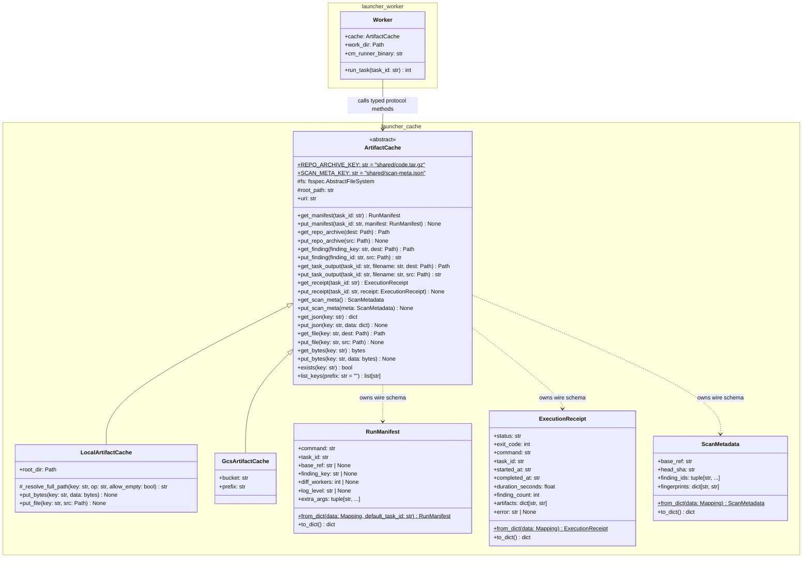
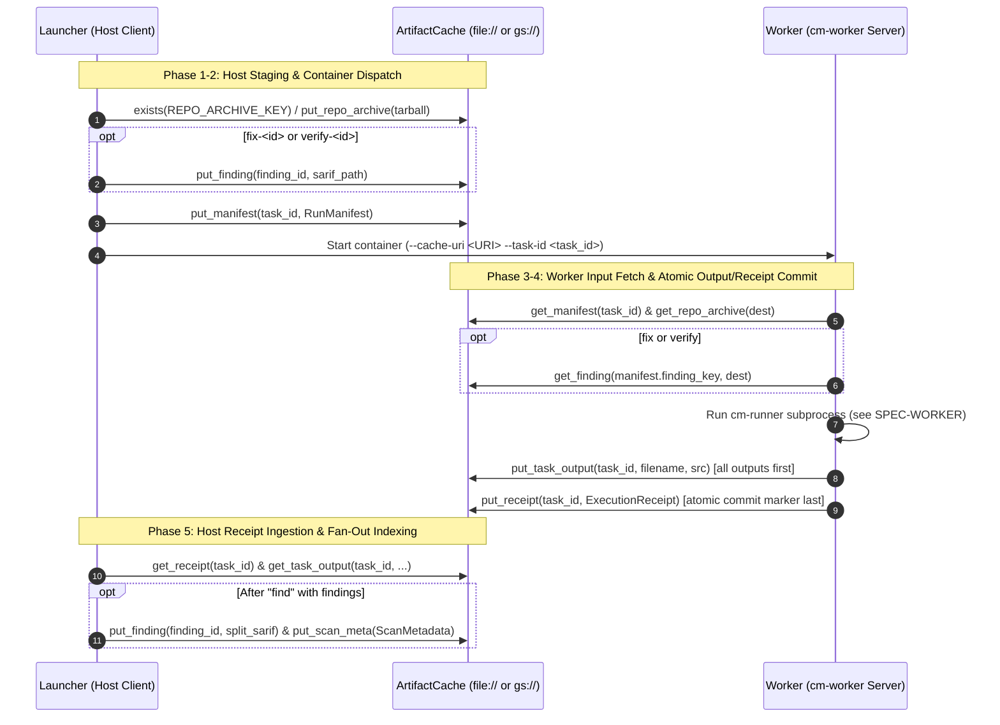

<!--
sdd_spec_id: SPEC-ARTIFACT-CACHE
sdd_implements: None
sdd_extends: None
sdd_level: COMPONENT
sdd_archetype: LIBRARY
sdd_cujspec_product: codemender-runner
-->

<!--*
freshness: { owner: 'codemender-maintainers', reviewed: '2026-10-22' }
*-->

# Design: `ArtifactCache` Implementation Using `fsspec` (`launcher.cache`)

- **Status:** Draft
- **Date:** 2026-10-22
- **Governing Spec:** [SPEC-ARTIFACT-CACHE (`spec.md`)](spec.md)
- **Related Specs & Proposals:**
  - [SPEC-WORKER: Sandbox Container Worker (`launcher.worker` / `cm-worker`) — PR #73](https://github.com/cloud-gtm/codemender-runner/pull/73)
  - [SPEC-FIND-DIFF: Differential Scan (`cm-runner find-diff`)](../find-diff/spec.md)
  - [SPEC-FIX: Patch Synthesis (`cm-runner fix`)](../fix/spec.md)
  - [SPEC-VERIFY: Finding Verification (`cm-runner verify`)](../verify/spec.md)
  - [SPEC-GHA: GitHub Actions Differential Scan Workflow](../github-actions/spec.md)
  - [SPEC-GHA-FIX: GitHub Actions Interactive `/codemender` Remediation](../github-actions-fix/spec.md)
  - [SPEC-GITLAB-CI: GitLab CI Integration](../gitlab-ci/spec.md)
  - [SPEC-0003: Lean Runner Base Container & Modular BYOI Packaging](../runner-container-packaging/spec.md)
  - [SPEC-WIF: Unified Terraform Root & Composable Mode-Aware WIF Module](../wif/spec.md)
  - [Proposal: VCS to Cloud Run Communication Architecture (`vcs-cloudrun-comms`)](../../proposals/vcs-cloudrun-comms/proposal.md)
  - [Proposal: Cloud Run Jobs Container Bootstrapper (`cloudrun-job-bootstrapper`)](../../proposals/cloudrun-job-bootstrapper/proposal.md)
- **Governing ADRs:**
  - [ADR-0009: Abstraction Layers, Dependency Injection, and Asynchronous Workflows](../../../adr/ADR-0009-abstraction-layers-and-dependency-injection.md)
  - [ADR-0008: Repository Layout, Three-Package Workspace, and Runtime Architecture](../../../adr/ADR-0008-repository-layout-and-package-structure.md)
  - [ADR-0007: Cloud Run Job Invocation Interface: CLI vs. Python Library](../../../adr/ADR-0007-cloud-run-job-invocation-interface-cli-vs-python-library.md)
  - [ADR-0005: Multi-Platform Transit Storage & Sandboxed Isolation Model](../../../adr/ADR-0005-multi-platform-transit-storage-and-isolation.md)
  - [ADR-0001: Machine-Readable Output Contract](../../../adr/ADR-0001-machine-readable-output-contract.md)

---

## 1. Context & Problem Statement

Per [ADR-0009](../../../adr/ADR-0009-abstraction-layers-and-dependency-injection.md) and [SPEC-WORKER (PR #73)](https://github.com/cloud-gtm/codemender-runner/pull/73), `Launcher` (on the trusted outer CI host) and `Worker` (`cm-worker`, inside the untrusted sandbox container) form the client and server halves of a unified container execution protocol. Because this protocol is 100% file/object-based over `ArtifactCache`, a single universal worker container image (`docker/runner.Dockerfile` with `ENTRYPOINT ["cm-worker"]`) executes identically across local Docker/gVisor (`file://`), Google Cloud Run Jobs (`gs://`), and Google Kubernetes Engine / GKE (`gs://`), while standalone local runs outside CI/CD can still invoke `cm-runner` directly by overriding `--entrypoint cm-runner`. Both components live in `packages/launcher` and communicate exclusively through `ArtifactCache` (`packages/launcher/src/launcher/cache/`) in an acyclic hub-and-spoke dependency graph:

```text
Launcher (host client)  -->  ArtifactCache (launcher.cache)  <--  Worker (cm-worker server)
```

Rather than introducing a separate protocol wrapper above `ArtifactCache`, the scope of `ArtifactCache` encompasses two cleanly layered responsibilities:

1. **Storage Transport & Atomic File I/O Layer (Powered by `fsspec`):**
   - Wraps [`fsspec`](https://filesystem-spec.readthedocs.io/) (`filesystem-spec`) to support local disk (`file://` via built-in `LocalFileSystem`), Google Cloud Storage (`gs://` via plugin `gcsfs.GCSFileSystem`), and hermetic in-memory testing (`memory://` via built-in `MemoryFileSystem`), with straightforward extensibility to `s3://` or `az://`.
   - Guarantees **atomic reads and writes** across all operations (`get_file`, `put_file`, `get_bytes`, `put_bytes`, `get_json`, `put_json`) so neither `Launcher` nor `Worker` ever observes a half-written manifest, truncated repository archive, or partial receipt.
   - Enforces [ADR-0009](../../../adr/ADR-0009-abstraction-layers-and-dependency-injection.md)'s **Two-Way Door lazy-import invariant**: local `file://` executions never import `gcsfs` or `google.cloud`.
2. **Typed Client–Worker Communication Protocol (`vcs-cloudrun-comms` Domain Layer):**
   - Owns the wire schemas (`RunManifest`, `ExecutionReceipt`, `ScanMetadata`), `<cache_root>` URI & branch-sanitization helpers (`sanitize_branch_name`, `build_gcs_cache_uri`), and encapsulates the conflict-free relative directory layout (`shared/code.tar.gz`, `shared/scan-meta.json`, `findings/<finding_id>.sarif`, `tasks/<task_id>/input/manifest.json`, `tasks/<task_id>/output/{receipt.json, runner.log, ...}`).
   - Exposes all typed domain methods required by `Worker` and `Launcher` (`get_manifest`, `put_manifest`, `get_repo_archive`, `put_repo_archive`, `get_finding`, `put_finding`, `get_task_output`, `put_task_output`, `get_receipt`, `put_receipt`, `get_scan_meta`, `put_scan_meta`) alongside the low-level primitives (`get_json`, `put_json`, `get_file`, `put_file`, `exists`, `get_bytes`, `put_bytes`, `list_keys`).

This design is split into two phases:
- **Phase 1 (In Scope):** Implement the `launcher.cache` package (`ArtifactCache`, `LocalArtifactCache`, `GcsArtifactCache`, `open_artifact_cache`, `sanitize_branch_name`, `build_gcs_cache_uri`, `RunManifest`, `ExecutionReceipt`, `ScanMetadata`, typed protocol methods, atomic `fsspec` primitives, and `ArtifactCacheError` hierarchy) plus GCS transit bucket TTL lifecycle and IAM configuration in Terraform.
- **Phase 2 (TODO — Pending `Launcher` & `Worker` Implementation):** Migrate legacy hardcoded paths and transit storage scripts (`github-actions/`, `cloud-run-jobs/`, `codemender-runner/storage.py`) to `ArtifactCache`.

---

### 1.1 Why `fsspec` + `ArtifactCache`?

[`fsspec`](https://filesystem-spec.readthedocs.io/) (`filesystem-spec`) is an open-source Python filesystem abstraction providing a uniform `fsspec.AbstractFileSystem` interface across local and cloud storage backends:
- Built-in `LocalFileSystem` (`file://`) for local disk I/O with zero third-party dependencies.
- Built-in `MemoryFileSystem` (`memory://`) for fast, 100% hermetic in-memory contract tests without bespoke cloud SDK mocks.
- Plugin `gcsfs.GCSFileSystem` (`gs://`) for Google Cloud Storage, handling Application Default Credentials (ADC) / Workload Identity Federation (WIF), multipart streaming uploads/downloads, HTTP connection pooling, and transient retry/backoff.

#### Value Added by `ArtifactCache` Over Raw `fsspec`

Raw `fsspec.AbstractFileSystem` is an un-chrooted, general-purpose filesystem API that writes local files in-place and leaks backend-specific exceptions. `ArtifactCache` wraps `self._fs: fsspec.AbstractFileSystem` bound to a single `<cache_root>` (`self._root_path`) and adds six concrete guarantees:

| Concern | Raw `fsspec.AbstractFileSystem` Behavior | Value Added by `ArtifactCache` |
| :--- | :--- | :--- |
| **1. Root-Scoped Sandboxing & Path Traversal Protection** | Operates on global paths (`fs.cat_file("/etc/passwd")` or `fs.cat_file("bucket/other-repo/...")`); does not jail keys to a root prefix or block `..` / symlink escapes. | Binds the instance to a single `<cache_root>` URI and accepts only relative logical keys (`"shared/code.tar.gz"`). Rejects `..`, leading slashes, Windows drive prefixes, and symlinks inside `<cache_root>` resolving outside `self.root_dir` (`InvalidCacheKeyError`). |
| **2. Atomic Reads, Atomic Writes & Cross-Process Visibility** | `LocalFileSystem` writes files in-place (`"wb"`) and `get_file()` writes directly to the target path (exposing truncated files on crash or concurrent access); `gcsfs` caches directory listings in local memory (`dircache`) by default. | Stages all local writes (`put_bytes`, `put_file`) and all local file downloads (`get_file`) via unique sibling `.tmp.<uuid>.<name>` files + atomic POSIX `os.replace()`; performs single-operation `cat_file` reads without TOCTOU races; filters `.tmp.*` out of `list_keys()`; and sets `GCSFileSystem(cache_timeout=0, retries=3)` for immediate cross-container visibility. |
| **3. Two-Way Door Lazy-Import Isolation** | Importing `gcsfs` at module load time pulls in `google-auth`, `google-cloud-storage`, and `aiohttp`. | `open_artifact_cache(uri)` lazily imports `GcsArtifactCache` (`gcsfs`) only when `uri.startswith("gs://")`, keeping `file://` runs 100% free of cloud SDK imports. |
| **4. Uniform Exception Hierarchy & Exit-Code Mapping** | Raises backend-specific exceptions (`gcsfs.retry.HttpError`, `google.auth.exceptions.DefaultCredentialsError`, `aiohttp.ClientError`, raw `OSError`). | Translates all backend errors into a single typed hierarchy (`ArtifactNotFoundError`, `InvalidCacheKeyError`, `ArtifactIntegrityError`, `CacheConfigurationError`, `CachePermissionError`, `CacheTransientError`) with `op`, `uri`, and `key` context that maps deterministically to `Worker` and `Launcher` exit codes (`2` vs. `3`). |
| **5. Deterministic JSON Serialization & Integrity Checks** | Only reads/writes raw bytes or files; callers must manually serialize/deserialize JSON and handle corrupt/truncated payloads. | Provides `put_json(key, data: dict)` (`sort_keys=True`, UTF-8) and `get_json(key) -> dict` (validating UTF-8, JSON syntax, and top-level `dict` type, raising `ArtifactIntegrityError` on corruption). |
| **6. Typed `vcs-cloudrun-comms` Protocol & Encapsulated Layout** | Callers must hardcode relative paths (`"tasks/<id>/input/manifest.json"`, `"shared/code.tar.gz"`) and manually validate dictionaries. | Owns `RunManifest`, `ExecutionReceipt`, and `ScanMetadata` plus typed domain methods (`get/put_manifest`, `get/put_receipt`, `get/put_repo_archive`, `get/put_scan_meta`, `get/put_finding`, `get/put_task_output`) and URI builders (`sanitize_branch_name`, `build_gcs_cache_uri`) so neither `Launcher` nor `Worker` hardcodes cache paths or imports the other. |

### 1.2 Alternative Considered: Native `pathlib` + `google-cloud-storage` SDK (Without `fsspec`)

| Dimension | Option A: `fsspec` + `gcsfs` *(Selected)* | Option B: Native `pathlib` + `google-cloud-storage` *(Rejected)* |
| :--- | :--- | :--- |
| **Shared I/O Implementation** | **Single shared implementation in `ArtifactCache` (`base.py`):** `get_bytes`, `get_file`, `exists`, `list_keys`, `get_json`, `put_json`, and all 12 typed protocol methods are implemented once against `self._fs: fsspec.AbstractFileSystem`. | **Duplicated per backend:** `LocalArtifactCache` (`pathlib`/`shutil`) and `GcsArtifactCache` (`storage.Client`/`Blob`) must implement all storage primitives, prefix stripping, and directory filtering independently. |
| **Hermetic Unit Testing (`GcsArtifactCache`)** | **Built-in `MemoryFileSystem` (`fsspec.filesystem("memory")`):** `GcsArtifactCache` runs the exact same stateful contract test suite as `LocalArtifactCache` in `pytest` without network access or custom mocks. | **Requires bespoke `Client` / `Bucket` / `Blob` mocks:** Must maintain fake classes (like `DummyStorage` in legacy `codemender-runner/storage.py`) that fail to catch real state/prefix bugs. |
| **Directory vs. Object Semantics in `exists()` & `list_keys()`** | **Handled uniformly by `fsspec`:** `self._fs.isfile(path)` and `self._fs.find(path, withdirs=False)` automatically distinguish regular files from virtual directory prefixes on both local disk and GCS. | **Manual per-backend edge cases:** On GCS, `list_blobs()` returns 0-byte directory placeholder blobs (`"tasks/find/"`) that must be manually filtered out alongside prefix boundary checks. |
| **Future Multi-Cloud Extensibility** | **Plug-and-play via `fsspec` ecosystem:** Adding S3 (`s3fs`) or Azure Blob Storage (`adlfs`) requires a ~20-line subclass. | **Full rewrite per provider:** Every new backend requires a new storage adapter, retry policy, and mock harness. |

---

## 2. Goals & Non-Goals

### Goals
- **Provide All Functions Required by `Worker` ([SPEC-WORKER / PR #73](https://github.com/cloud-gtm/codemender-runner/pull/73)) and `Launcher`:**
  - Typed protocol methods: `get_manifest`, `put_manifest`, `get_repo_archive`, `put_repo_archive`, `get_finding`, `put_finding`, `get_task_output`, `put_task_output`, `get_receipt`, `put_receipt`, `get_scan_meta`, `put_scan_meta`.
  - Low-level storage primitives: `get_json`, `put_json`, `get_file`, `put_file`, `exists`, `get_bytes`, `put_bytes`, `list_keys`.
  - `<cache_root>` URI & branch-sanitization helpers: `open_artifact_cache`, `sanitize_branch_name`, `build_gcs_cache_uri`.
- **Guarantee Atomic Reading and Writing Across All Operations:** Ensure every file download (`get_file`), local write (`put_bytes`, `put_file`), GCS object write, in-memory byte/JSON read (`get_bytes`, `get_json`), and multi-artifact task commit follows strict atomicity invariants with automatic `.tmp.*` cleanup on failure.
- **Own the Shared Wire Schemas (`launcher.cache.models`):** Define `RunManifest`, `ExecutionReceipt`, and `ScanMetadata` with deterministic `to_dict()` / `from_dict()` validation so `Launcher` and `Worker` depend downward on `launcher.cache`.
- **Enforce Two-Way Door Lazy-Import Isolation:** Keep `fsspec` in `packages/launcher` base dependencies while isolating `gcsfs` under `[project.optional-dependencies] cloudrun` and importing it only inside `open_artifact_cache()` when `uri.startswith("gs://")`.
- **Enforce Sandbox Boundary & Path-Traversal Security:** Reject `..`, leading slashes, Windows drive prefixes, multi-segment `task_id`/`finding_id`/`filename` arguments, reserved `.tmp.` prefixes, and symlinks inside `<cache_root>`.
- **Configure GCS Transit Bucket Lifecycle & Scoped IAM:** Configure `google_storage_bucket.reports` in `terraform/modules/gcp/` with `var.artifact_cache_ttl_days` (default `3` days), 1-day `AbortIncompleteMultipartUpload`, disabled versioning, zero soft-delete retention, and `roles/storage.objectUser` for both WIF caller and Cloud Run runtime Service Accounts.

### Non-Goals
- Migrating existing hardcoded paths in `github-actions/`, `cloud-run-jobs/`, and `codemender-runner/storage.py` (deferred to Phase 2 until `Launcher` and `Worker` implementations land).
- Long-term cross-run persistence (`ArtifactStore` in `packages/store`, deferred per ADR-0009 Section 4).
- Cloud Storage FUSE mounts inside Cloud Run containers (rejected in ADR-0007 and ADR-0009 due to POSIX `stat` latency during compilation and Git operations).
- Tar-slip inspection or repository extraction (`unpack_tar_gz_preserving_permissions` and `flatten_repo_if_nested` belong to `Worker` in `SPEC-WORKER`, while `ArtifactCache` atomically transfers the raw `shared/code.tar.gz` archive).

---

## 3. Architecture & Class Design (`packages/launcher/src/launcher/cache/`)

### 3.1 Package Layout & Dependencies

Per [ADR-0008](../../../adr/ADR-0008-repository-layout-and-package-structure.md), [ADR-0009](../../../adr/ADR-0009-abstraction-layers-and-dependency-injection.md), and [SPEC-WORKER (PR #73)](https://github.com/cloud-gtm/codemender-runner/pull/73), `ArtifactCache` lives in `packages/launcher/src/launcher/cache/`:

```text
packages/launcher/
├── pyproject.toml
└── src/
    └── launcher/
        ├── cache/
        │   ├── __init__.py      # Exports ArtifactCache, LocalArtifactCache, GcsArtifactCache, open_artifact_cache, sanitize_branch_name, build_gcs_cache_uri, models, errors
        │   ├── models.py        # Wire schemas: RunManifest, ExecutionReceipt, ScanMetadata
        │   ├── errors.py        # Typed exception hierarchy & fsspec error translation
        │   ├── base.py          # ArtifactCache ABC (atomic fsspec primitives + typed protocol methods + URI/branch helpers)
        │   ├── local.py         # LocalArtifactCache (file:// via LocalFileSystem + atomic os.replace writes)
        │   ├── gcs.py           # GcsArtifactCache (gs:// via gcsfs.GCSFileSystem, lazily imported)
        │   └── test_cache.py    # Co-located hermetic unit tests (contract, atomicity, models, security)
        └── worker.py            # Inside-container Worker server (SPEC-WORKER, imports from launcher.cache)
```

#### `packages/launcher/pyproject.toml`

```toml
[project]
name = "codemender-launcher"
version = "0.1.0"
requires-python = ">=3.11"
dependencies = [
    "codemender",
    "fsspec>=2024.2.0",
]

[project.optional-dependencies]
cloudrun = [
    "gcsfs>=2024.2.0",
    "google-cloud-run>=0.10.0",
    "google-cloud-storage>=2.14.0",  # Retained through Phase 1 for legacy callers; removable in Phase 2
]

[project.scripts]
cm-worker = "launcher.worker:main"
```

---

### 3.2 Component Class Diagram (Aligned with [PR #73 / `SPEC-WORKER`](https://github.com/cloud-gtm/codemender-runner/pull/73))



---

### 3.3 Atomic Reading, Writing, and Path-Resolution Design

Because `Launcher` (on the CI host) and `Worker` (`cm-worker` inside the container, potentially interrupted by `SIGTERM`/`SIGINT` preemption or running in parallel across `fix-<id>` / `verify-<id>` tasks) share `<cache_root>`, **every read and write operation in `ArtifactCache` is designed to be atomic and confined within `<cache_root>`**:

| Direction & Scope | Potential Hazard in Raw `fsspec` / OS Paths | Mechanism in `ArtifactCache` |
| :--- | :--- | :--- |
| **1. Local Cache Writes**<br/>(`LocalArtifactCache.put_bytes`, `put_file`, `put_json`, `put_*`) | `LocalFileSystem.pipe_file()` and `put_file()` open the target path in-place with `"wb"`. A concurrent reader or mid-write crash/preemption exposes a truncated file. | **Sibling Temp File + POSIX `os.replace()`:** Writes are staged into `target_path.parent / f".tmp.{uuid4().hex}.{target_path.name}"` on the same filesystem, then atomically committed via `os.replace(tmp_path, target_path)` (`rename(2)`). On any exception, `tmp_path.unlink(missing_ok=True)` cleans up the staging file. |
| **2. GCS & `MemoryFileSystem` Cache Writes**<br/>(`GcsArtifactCache.put_bytes`, `put_file`, `put_json`, `put_*`) | Multipart or streaming uploads in progress could fail mid-flight; client-side directory caching (`dircache`) in `gcsfs` can hide newly written objects from other processes; and `MemoryFileSystem.put_file()` in unit tests writes directly to the target key if an error occurs mid-copy. | **GCS Object-Generation Atomicity + `cache_timeout=0` + `pipe_file(bytes)`:** On GCS, single-call `self._fs.pipe_file(full_path, payload)` and finalized `put_file()` uploads are invisible until object generation completion, and `GCSFileSystem(cache_timeout=0, retries=3)` disables stale local `dircache` metadata so `Launcher` immediately sees objects written by `Worker`. In `base.py`, `put_file(key, src)` reads `src` after verifying `src.is_file()` and writes via `self._fs.put_file(src.as_posix(), full_path)` (preserving any pre-existing target object if `src` is unreadable or `put_file` fails before commit). |
| **3. Local Destination Materialization on Reads**<br/>(`ArtifactCache.get_file`, `get_repo_archive`, `get_finding`, `get_task_output`) | Calling `self._fs.get_file(full_path, dest)` directly writes in-place to `dest` on the caller's disk (`Worker`'s `/tmp/work/inputs/` or `Launcher`'s workspace). A network drop or `SIGTERM` leaves a corrupt/partial `code.tar.gz` or `.sarif` at `dest`. | **Sibling Temp Download + POSIX `os.replace()`:** `ArtifactCache.get_file(key, dest)` downloads from `self._fs` into `dest.parent / f".tmp.{uuid4().hex}.{dest.name}"`, verifies `tmp_dest.is_file()`, and atomically renames `os.replace(tmp_dest, dest)`. Any failure unlinks `tmp_dest`, leaving any prior file at `dest` untouched. |
| **4. In-Memory Byte & JSON Reads**<br/>(`ArtifactCache.get_bytes`, `get_json`, `get_manifest`, `get_receipt`, `get_scan_meta`) | Performing a pre-flight `self._fs.isfile(full_path)` check before `self._fs.cat_file(full_path)` introduces a Time-Of-Check to Time-Of-Use (TOCTOU) race and costs two RPC round-trips on GCS. | **Single-Operation `cat_file` Snapshot:** `get_bytes(key)` executes a single `self._fs.cat_file(full_path)` call (translating `FileNotFoundError` and `IsADirectoryError` into `ArtifactNotFoundError`). Paired with `os.replace()` on POSIX and generation immutability on GCS, `cat_file()` always returns a complete point-in-time payload snapshot, which `get_json()` validates as UTF-8 JSON `dict` before returning. |
| **5. Multi-Artifact Task Commit Ordering**<br/>(`Worker` Step 4: `put_task_output` $\rightarrow$ `put_receipt`) | If `receipt.json` were written before `runner.log`, `report.sarif`, or `<finding>.diff`, a reader polling or reading `receipt.json` could observe a completed receipt whose referenced `receipt.artifacts` keys do not exist yet. | **Write-Ahead Artifact Upload + Final Atomic Receipt Commit:** `Worker` uploads all output files (`put_task_output`) first and calls `put_receipt(task_id, receipt)` **last**. Because `put_receipt` delegates to `put_json` $\rightarrow$ `put_bytes` (atomic `os.replace` / atomic GCS object finalize), `tasks/<task_id>/output/receipt.json` serves as the atomic commit marker for the entire task. |
| **6. In-Flight `.tmp.*` & Symlink Escape Isolation** | Concurrent `list_keys()` could observe `.tmp.<uuid>.*` staging files; symlinks inside `LocalArtifactCache.root_dir` could escape `<cache_root>`, whereas OS-level symlinks *above* `root_dir` (e.g., macOS `/tmp` $\rightarrow$ `/private/tmp` or `/var` $\rightarrow$ `/private/var`) must work normally. | `normalize_cache_key()` rejects any path segment starting with `.tmp.` (`InvalidCacheKeyError`) and `list_keys()` filters out `.tmp.*` entries. `LocalArtifactCache.__init__` canonicalizes `self.root_dir = Path(root_dir).expanduser().resolve()` once at initialization (permitting OS symlinks in parent directories above `root_dir`), and `_resolve_full_path()` inspects each relative segment *inside* `self.root_dir` via `cur.is_symlink()` and verifies `resolved.is_relative_to(self.root_dir)`. |

---

### 3.4 Method Reference Tables

#### Typed Protocol Methods (`vcs-cloudrun-comms` Domain Layer on `ArtifactCache`)

| Method Signature | Encapsulated Cache Key | Semantics & Delegation |
| :--- | :--- | :--- |
| **`get_manifest(task_id: str) -> RunManifest`** | `"tasks/<task_id>/input/manifest.json"` | Validates `task_id` as a single safe path segment (`InvalidCacheKeyError`), atomically reads JSON via `self.get_json(key)`, parses `RunManifest.from_dict(raw, default_task_id=task_id)`, and verifies `manifest.task_id == task_id`. Translates schema validation or `task_id` payload mismatch errors (`ValueError`, `TypeError`) into `ArtifactIntegrityError`. |
| **`put_manifest(task_id: str, manifest: RunManifest) -> None`** | `"tasks/<task_id>/input/manifest.json"` | Validates `task_id` as a single safe path segment (`InvalidCacheKeyError`), verifies `manifest.task_id == task_id` when `manifest.task_id` is set (raising `InvalidCacheKeyError` on caller mismatch), and atomically writes `manifest.to_dict()` via `self.put_json(key, manifest.to_dict())`. |
| **`get_repo_archive(dest: Path) -> Path`** | `"shared/code.tar.gz"` | Atomically downloads `"shared/code.tar.gz"` to `dest` (e.g., `work_dir / "inputs" / "code.tar.gz"`) via `self.get_file(self.REPO_ARCHIVE_KEY, dest)` and returns `Path(dest)`. |
| **`put_repo_archive(src: Path) -> None`** | `"shared/code.tar.gz"` | Atomically uploads the scrubbed bounded-history Git repository tarball `src` to `"shared/code.tar.gz"` via `self.put_file(self.REPO_ARCHIVE_KEY, src)`. |
| **`get_finding(finding_key: str, dest: Path) -> Path`** | `"findings/<finding_id>.sarif"` | Accepts either a full relative finding key (`"findings/finding-001.sarif"`, as stored in `RunManifest.finding_key`) or a bare finding ID (`"finding-001"`, resolved to `"findings/finding-001.sarif"`), verifies the key is a direct child under `"findings/"` ending in `".sarif"` (`InvalidCacheKeyError`), atomically downloads it to `dest` via `self.get_file(key, dest)`, and returns `Path(dest)`. |
| **`put_finding(finding_id: str, src: Path) -> str`** | `"findings/<finding_id>.sarif"` | Validates `finding_id` (stripping an optional `.sarif` suffix if present) as a single safe path segment (`InvalidCacheKeyError`), atomically uploads `src` via `self.put_file(key, src)`, and returns `"findings/<finding_id>.sarif"` (for `RunManifest.finding_key`). |
| **`get_task_output(task_id: str, filename: str, dest: Path) -> Path`** | `"tasks/<task_id>/output/<filename>"` | Validates both `task_id` and `filename` as single safe path segments (`InvalidCacheKeyError`), atomically downloads `"tasks/<task_id>/output/<filename>"` to `dest` via `self.get_file(key, dest)`, and returns `Path(dest)`. |
| **`put_task_output(task_id: str, filename: str, src: Path) -> str`** | `"tasks/<task_id>/output/<filename>"` | Validates both `task_id` and `filename` as single safe path segments (`InvalidCacheKeyError`), atomically uploads `src` as raw bytes via `self.put_file(key, src)` (preserving `\r\n` and binary diff hunks per [SPEC-WORKER / PR #73](https://github.com/cloud-gtm/codemender-runner/pull/73) `REQ-0006.1`), and returns `"tasks/<task_id>/output/<filename>"` (for `ExecutionReceipt.artifacts`). |
| **`get_receipt(task_id: str) -> ExecutionReceipt`** | `"tasks/<task_id>/output/receipt.json"` | Validates `task_id` as a single safe path segment (`InvalidCacheKeyError`), atomically reads `f"tasks/{task_id}/output/receipt.json"` via `self.get_json(key)`, parses `ExecutionReceipt.from_dict(raw)`, and verifies `receipt.task_id == task_id`. Translates validation or `task_id` payload mismatch errors (`ValueError`, `TypeError`) into `ArtifactIntegrityError`. |
| **`put_receipt(task_id: str, receipt: ExecutionReceipt) -> None`** | `"tasks/<task_id>/output/receipt.json"` | Validates `task_id` as a single safe path segment (`InvalidCacheKeyError`), verifies `receipt.task_id == task_id` (raising `InvalidCacheKeyError` on caller mismatch), and atomically writes `receipt.to_dict()` via `self.put_json(f"tasks/{task_id}/output/receipt.json", receipt.to_dict())`. |
| **`get_scan_meta() -> ScanMetadata`** | `"shared/scan-meta.json"` | Atomically reads `"shared/scan-meta.json"` via `self.get_json(self.SCAN_META_KEY)` and parses `ScanMetadata.from_dict(raw)`, translating validation errors into `ArtifactIntegrityError`. |
| **`put_scan_meta(meta: ScanMetadata) -> None`** | `"shared/scan-meta.json"` | Atomically writes `meta.to_dict()` to `"shared/scan-meta.json"` via `self.put_json(self.SCAN_META_KEY, meta.to_dict())`. |

#### Low-Level Storage Primitives (`ArtifactCache`) & Module Helpers (`launcher.cache`)

| Method / Function Signature | Semantics & Atomic `fsspec` Implementation |
| :--- | :--- |
| **`get_json(key: str) -> dict[str, Any]`** | Reads raw bytes atomically via `self.get_bytes(key)`, decodes as UTF-8, parses via `json.loads()`, and verifies the parsed root is a `dict`. Raises `ArtifactIntegrityError` if UTF-8 decoding fails, JSON is malformed/truncated, or the top-level JSON value is not an object (`dict`). |
| **`put_json(key: str, data: dict[str, Any]) -> None`** | Verifies `isinstance(data, Mapping)`, serializes deterministically via `json.dumps(dict(data), indent=2, sort_keys=True) + "\n"`, encodes as UTF-8, and delegates to `self.put_bytes(key, payload)`. Raises `ArtifactIntegrityError` if `data` is not a mapping or is not JSON-serializable. |
| **`get_file(key: str, dest: Path) -> Path`** | Validates `key` and checks that `dest` is not an existing directory (`ArtifactCacheError`). Creates `dest.parent`, downloads `full_path` via `self._fs.get_file(full_path, tmp_dest.as_posix())` to a sibling temp file `<dest.parent>/.tmp.<uuid>.<dest.name>`, verifies `tmp_dest.is_file()`, and atomically renames `tmp_dest` to `dest` via `os.replace()`. Cleans up `tmp_dest` on failure and raises `ArtifactNotFoundError` if `key` is missing or is a directory. Returns `Path(dest)`. |
| **`put_file(key: str, src: Path) -> None`** | Validates `key` and checks `Path(src).is_file()` (raising `ArtifactNotFoundError` if `src` is missing or a directory). On `LocalArtifactCache`, copies `src` via `self._fs.put_file()` into a sibling temp file `<target.parent>/.tmp.<uuid>.<target.name>` and atomically renames via `os.replace()`. On `GcsArtifactCache` (and `ArtifactCache` base), streams `src` via `self._fs.put_file(src.as_posix(), full_path)` (atomic on GCS object completion; in `MemoryFileSystem` tests, if `put_file` fails mid-operation, any partial write is rolled back or avoided so prior target content is preserved). |
| **`exists(key: str) -> bool`** | Validates `key` and returns `bool(self._fs.isfile(full_path))`. Using `isfile()` rather than `exists()` guarantees intermediate virtual directory prefixes (`"tasks"`, `"tasks/find"`) return `False` while regular artifact files return `True`. |
| **`get_bytes(key: str) -> bytes`** | Validates `key` and performs a single atomic `bytes(self._fs.cat_file(full_path))` call without a pre-flight `isfile()` TOCTOU race. Raises `ArtifactNotFoundError` if `key` does not exist or refers to a directory/prefix. |
| **`put_bytes(key: str) -> None`** | Validates `key` and writes `bytes(data)`. On `LocalArtifactCache`, writes to `<target.parent>/.tmp.<uuid>.<target.name>` via `self._fs.pipe_file()` and atomically commits via `os.replace()`. On `GcsArtifactCache`, calls `self._fs.pipe_file(full_path, bytes(data))`. |
| **`list_keys(prefix: str = "") -> list[str]`** | Normalizes `prefix` (allowing `""` for root listing), calls `self._fs.find(search_path, withdirs=False)`, strips `self._root_path` to produce relative `/`-separated keys, filters out any hidden `.tmp.*` staging files, and returns a deterministically sorted `list[str]` (or `[]` if `prefix` does not exist). |
| **`open_artifact_cache(uri: str \| Path) -> ArtifactCache`** | Accepts `pathlib.Path`, native POSIX/Windows paths, `file://` URIs (returning `LocalArtifactCache`), and `gs://<bucket>[/<prefix>]` URIs (lazily importing `GcsArtifactCache`). Raises `InvalidCacheKeyError` on empty/unsupported URIs and `CacheConfigurationError` if `gcsfs` is not installed for `gs://`. |
| **`sanitize_branch_name(branch: str) -> str`** | Sanitizes a Git branch ref (stripping leading `refs/heads/` if present) into a deterministic single path segment `f"{slug[:40]}-{sha256(raw_branch.encode('utf-8')).hexdigest()[:8]}"` where characters outside `[a-zA-Z0-9_.-]` are replaced with `-` and leading/trailing `-` or `.` are stripped ([Proposal: `vcs-cloudrun-comms`](../../proposals/vcs-cloudrun-comms/proposal.md)). Raises `InvalidCacheKeyError` if `branch` is empty. |
| **`build_gcs_cache_uri(bucket: str, owner: str, repo: str, commit_sha: str, *, pr_number: int \| None = None, branch: str \| None = None) -> str`** | Constructs the canonical 4-tier GCS `<cache_root>` URI `gs://<bucket>/<owner>/<repo>/prs/<pr_number>/<commit_sha>` (when `pr_number` is provided) or `gs://<bucket>/<owner>/<repo>/branches/<sanitize_branch_name(branch)>/<commit_sha>` (when `branch` is provided), validating `bucket`, `owner`, `repo`, and `commit_sha` as single safe segments and requiring exactly one of `pr_number` ($\ge 1$) or `branch` (`InvalidCacheKeyError`). |

---

### 3.5 Concise Class Skeleton & Representative Atomic I/O Example

The snippet below illustrates the high-level `ArtifactCache` class structure over `fsspec`, showing one representative low-level atomic primitive (`get_file` with sibling `.tmp` staging and `os.replace`), one typed domain method pair (`get_manifest` / `put_manifest` with `task_id` validation delegating to `get_json` / `put_json`), and the subclass/factory wiring:

```python
class ArtifactCache(ABC):
    """Root-scoped transit cache and typed client-worker communication protocol over fsspec."""

    REPO_ARCHIVE_KEY = "shared/code.tar.gz"
    SCAN_META_KEY = "shared/scan-meta.json"

    def __init__(self, *, fs: fsspec.AbstractFileSystem, root_path: str, uri: str) -> None:
        self._fs = fs
        self._root_path = root_path.rstrip("/")
        self.uri = uri

    # --- Representative Atomic Low-Level Primitive (get_file) ---
    def get_file(self, key: str, dest: Path) -> Path:
        full_path = self._resolve_full_path(key, op="get_file")
        dest_path = Path(dest)
        if dest_path.exists() and dest_path.is_dir():
            raise ArtifactCacheError(f"Destination is an existing directory: {dest_path}", op="get_file", uri=self.uri, key=key)
        tmp_dest = dest_path.parent / f".tmp.{uuid4().hex}.{dest_path.name}"
        try:
            dest_path.parent.mkdir(parents=True, exist_ok=True)
            self._fs.get_file(full_path, tmp_dest.as_posix())
            if not tmp_dest.is_file():
                raise ArtifactNotFoundError(f"Missing or non-file key: {key}", op="get_file", uri=self.uri, key=key)
            os.replace(tmp_dest, dest_path)  # Atomic POSIX rename into final destination
            return dest_path
        except Exception as exc:
            tmp_dest.unlink(missing_ok=True)
            raise translate_fs_error(exc, op="get_file", uri=self.uri, key=key) from exc

    # Other low-level primitives (implemented once against self._fs):
    def put_file(self, key: str, src: Path) -> None: ...
    def get_bytes(self, key: str) -> bytes: ...
    def put_bytes(self, key: str, data: bytes) -> None: ...
    def exists(self, key: str) -> bool: ...
    def list_keys(self, prefix: str = "") -> list[str]: ...
    def get_json(self, key: str) -> dict[str, Any]: ...
    def put_json(self, key: str, data: dict[str, Any]) -> None: ...

    # --- Representative Typed Protocol Pair (get_manifest / put_manifest) ---
    def get_manifest(self, task_id: str) -> RunManifest:
        safe_id = validate_single_segment(task_id, field="task_id", uri=self.uri, op="get_manifest")
        key = f"tasks/{safe_id}/input/manifest.json"
        raw = self.get_json(key)
        try:
            manifest = RunManifest.from_dict(raw, default_task_id=safe_id)
            if manifest.task_id != safe_id:
                raise ValueError(f"Manifest task_id {manifest.task_id!r} does not match requested task_id {safe_id!r}")
            return manifest
        except (ValueError, TypeError) as exc:
            raise ArtifactIntegrityError(str(exc), op="get_manifest", uri=self.uri, key=key) from exc

    def put_manifest(self, task_id: str, manifest: RunManifest) -> None:
        safe_id = validate_single_segment(task_id, field="task_id", uri=self.uri, op="put_manifest")
        if manifest.task_id and manifest.task_id != safe_id:
            raise InvalidCacheKeyError(
                f"manifest.task_id {manifest.task_id!r} does not match task_id {safe_id!r}",
                op="put_manifest", uri=self.uri, key=f"tasks/{safe_id}/input/manifest.json",
            )
        self.put_json(f"tasks/{safe_id}/input/manifest.json", manifest.to_dict())

    # Remaining typed protocol methods (all delegate to get_file/put_file or get_json/put_json):
    def get_repo_archive(self, dest: Path) -> Path: ...
    def put_repo_archive(self, src: Path) -> None: ...
    def get_finding(self, finding_key: str, dest: Path) -> Path: ...
    def put_finding(self, finding_id: str, src: Path) -> str: ...
    def get_task_output(self, task_id: str, filename: str, dest: Path) -> Path: ...
    def put_task_output(self, task_id: str, filename: str, src: Path) -> str: ...
    def get_receipt(self, task_id: str) -> ExecutionReceipt: ...
    def put_receipt(self, task_id: str, receipt: ExecutionReceipt) -> None: ...
    def get_scan_meta() -> ScanMetadata: ...
    def put_scan_meta(self, meta: ScanMetadata) -> None: ...


class LocalArtifactCache(ArtifactCache):
    """file:// backend via fsspec.filesystem('file'); canonicalizes root_dir once and stages writes via .tmp + os.replace()."""

    def __init__(self, root_dir: str | Path, *, uri: str | None = None) -> None:
        self.root_dir = Path(root_dir).expanduser().resolve()
        self.root_dir.mkdir(parents=True, exist_ok=True)
        super().__init__(fs=fsspec.filesystem("file"), root_path=self.root_dir.as_posix(), uri=uri or self.root_dir.as_uri())

    def put_bytes(self, key: str, data: bytes) -> None:
        target = Path(self._resolve_full_path(key, op="put_bytes"))
        tmp = target.parent / f".tmp.{uuid4().hex}.{target.name}"
        try:
            target.parent.mkdir(parents=True, exist_ok=True)
            self._fs.pipe_file(tmp.as_posix(), bytes(data))
            os.replace(tmp, target)  # Atomic POSIX directory-entry swap
        except Exception as exc:
            tmp.unlink(missing_ok=True)
            raise translate_fs_error(exc, op="put_bytes", uri=self.uri, key=key) from exc


class GcsArtifactCache(ArtifactCache):
    """gs:// backend via gcsfs.GCSFileSystem(cache_timeout=0, retries=3); lazily imported by open_artifact_cache()."""
```

---

## 4. Data-Plane Protocol & Key Layout (Aligned with [PR #73 / `SPEC-WORKER`](https://github.com/cloud-gtm/codemender-runner/pull/73))

Per [SPEC-WORKER (PR #73)](https://github.com/cloud-gtm/codemender-runner/pull/73) and [ADR-0009](../../../adr/ADR-0009-abstraction-layers-and-dependency-injection.md) (Decision 2 & Section 4), `Launcher` handles the container **control plane** while `ArtifactCache` handles the **data plane** across all 5 phases of [Proposal: `vcs-cloudrun-comms`](../../proposals/vcs-cloudrun-comms/proposal.md).

### 4.1 Encapsulated `<cache_root>` Key Layout & Multi-Tenant URI Scoping

On Cloud Run/GKE, `Launcher` constructs the 4-tier `<cache_root>` URI via `build_gcs_cache_uri(...)`:
- **Pull / Merge Requests:** `gs://<bucket>/<owner>/<repo>/prs/<pr_number>/<commit_sha>`
- **Branches / Non-PR Runs:** `gs://<bucket>/<owner>/<repo>/branches/<sanitize_branch_name(branch)>/<commit_sha>` (where `sanitize_branch_name("feat/login")` produces `"feat-login-a1b2c3d4"`)
- **Local Docker / gVisor:** `file:///cache` inside the container (bind-mounted from `<host_cache_dir>`)

Within `<cache_root>`, `ArtifactCache` encapsulates the relative key hierarchy:

```text
<cache_root>/
├── shared/
│   ├── code.tar.gz                     # put_repo_archive / get_repo_archive
│   └── scan-meta.json                  # put_scan_meta / get_scan_meta (ScanMetadata)
├── findings/
│   └── <finding_id>.sarif              # put_finding / get_finding (1-finding SARIF 2.1.0)
└── tasks/
    └── <task_id>/                      # "init", "find", "fix-<id>", or "verify-<id>"
        ├── input/
        │   └── manifest.json           # put_manifest / get_manifest (RunManifest)
        └── output/
            ├── runner.log              # put_task_output / get_task_output ("log")
            ├── <artifact>              # report.sarif, report.md, <id>.diff, or <id>.sarif
            └── receipt.json            # put_receipt / get_receipt (ExecutionReceipt, written LAST)
```

### 4.2 Client–Worker Data-Plane Sequence (`Launcher` $\leftrightarrow$ `ArtifactCache` $\leftrightarrow$ `Worker`)

For `Worker` internal scratch setup (`/tmp/work`), tar-slip-safe extraction, `cm-runner` subprocess execution, signal handling, and fallback log spill, see [SPEC-WORKER (PR #73)](https://github.com/cloud-gtm/codemender-runner/pull/73). The `ArtifactCache` data-plane calls are:



---

## 5. Wire Schemas & Error Mapping Specification (`launcher.cache.models` & `errors`)

Because `launcher.cache.models` is the canonical owner of the wire schemas shared between `Launcher` and `Worker`, this section specifies the complete field-by-field definitions, defaults, and validation invariants enforced by `RunManifest`, `ExecutionReceipt`, `ScanMetadata`, and `launcher.cache.errors`:

### 5.1 `RunManifest` (`tasks/<task_id>/input/manifest.json`)

```python
VALID_MANIFEST_COMMANDS = frozenset({"init", "find-diff", "fix", "verify"})

@dataclass(frozen=True)
class RunManifest:
    command: str                          # Canonical command: "init", "find-diff", "fix", or "verify" ("find" normalized -> "find-diff")
    task_id: str = ""                     # Single safe path segment (defaults to get_manifest's task_id argument when omitted in JSON)
    base_ref: str | None = None           # Required non-empty str when command == "find-diff" (also accepts JSON alias "diff_base")
    finding_key: str | None = None        # Required "findings/<id>.sarif" key (or bare "<id>" normalized to "findings/<id>.sarif") when command in {"fix", "verify"}
    diff_workers: int | None = None       # Optional int in 1..16 (inclusive) per SPEC-FIND-DIFF REQ-0002 (boolean values rejected)
    log_level: str | None = None          # Optional log level (e.g., "DEBUG", "INFO", "WARNING", "ERROR")
    extra_args: tuple[str, ...] = ()      # Optional tuple of non-empty string CLI flags/arguments
```

- **Validation Rules (`__post_init__` & `from_dict`):**
  1. `command`: Must be a non-empty `str`; `"find"` is normalized to `"find-diff"`. Any value outside `{"init", "find-diff", "fix", "verify"}` raises `ValueError`.
  2. `task_id`: Validated as a single safe path segment when non-empty; `from_dict(data, default_task_id=...)` populates `task_id` from `data.get("task_id") or default_task_id` and requires a non-empty single segment.
  3. `base_ref`: `from_dict` accepts either `"base_ref"` or `"diff_base"`. Must be a non-empty `str` when `command == "find-diff"`, and `str | None` otherwise.
  4. `finding_key`: Must be provided when `command in {"fix", "verify"}`. If provided as a bare finding ID (`"finding-001"`), normalizes to `"findings/finding-001.sarif"` and validates `<id>` as a single safe segment ending in `.sarif`.
  5. `diff_workers`: When not `None`, must be an `int` (not `bool`) satisfying `1 <= diff_workers <= 16` ([SPEC-FIND-DIFF](../find-diff/spec.md) `REQ-0002`).

### 5.2 `ExecutionReceipt` (`tasks/<task_id>/output/receipt.json`)

```python
VALID_RECEIPT_STATUSES = frozenset({"succeeded", "failed", "cancelled", "no_fix", "error"})

@dataclass(frozen=True)
class ExecutionReceipt:
    status: str                           # One of: "succeeded", "failed", "cancelled", "no_fix", "error"
    exit_code: int                        # Process/runner integer exit code (boolean values rejected)
    command: str                          # Canonical command ("init", "find-diff", "fix", "verify")
    task_id: str                          # Single safe path segment matching tasks/<task_id>/output/receipt.json
    started_at: str                       # Non-empty ISO-8601 UTC timestamp string
    completed_at: str                     # Non-empty ISO-8601 UTC timestamp string
    duration_seconds: float               # Non-negative float/int (>= 0.0)
    finding_count: int = 0                # Non-negative int (>= 0; non-dismissed finding count per SPEC-VERIFY REQ-0005)
    artifacts: dict[str, str] = field(default_factory=dict)  # Logical name ("sarif", "diff", "log", "markdown") -> relative cache key
    error: str | None = None              # Optional diagnostic message; preserved as None on exit_code == 0 and normal exit 3 ("no_fix")
```

- **Validation Rules (`__post_init__` & `from_dict`):**
  1. `status` must be in `VALID_RECEIPT_STATUSES`; `command` is normalized (`"find"` $\rightarrow$ `"find-diff"`) and must be in `VALID_MANIFEST_COMMANDS`.
  2. `task_id` must be a non-empty single safe path segment.
  3. `exit_code` and `finding_count` must be `int` (not `bool`) with `finding_count >= 0`; `duration_seconds` must be `int | float` (not `bool`) with `duration_seconds >= 0.0`.
  4. Every value in `artifacts` must be a valid normalized relative cache key (`normalize_cache_key`).
  5. Preserves `error=None` on `exit_code == 0` and normal `cm-runner fix` exit `3` (`status="no_fix"` per [SPEC-FIX](../fix/spec.md) `REQ-0007` and [SPEC-GHA-FIX](../github-actions-fix/spec.md) `REQ-0005.5`).

### 5.3 `ScanMetadata` (`shared/scan-meta.json`)

```python
@dataclass(frozen=True)
class ScanMetadata:
    base_ref: str                         # Non-empty base Git ref or SHA
    head_sha: str                         # Non-empty head commit SHA
    finding_ids: tuple[str, ...] = ()     # Deterministically sorted tuple of single-segment finding IDs ("finding-001", ...)
    fingerprints: dict[str, str] = field(default_factory=dict)  # Map of finding_id -> deterministic fingerprint string
```

- **Validation Rules (`__post_init__` & `from_dict`):**
  1. `base_ref` and `head_sha` must be non-empty strings.
  2. Each entry in `finding_ids` and each key in `fingerprints` is validated as a single safe path segment ([SPEC-GHA-FIX](../github-actions-fix/spec.md) `REQ-0004`, `REQ-0009`).

### 5.4 `ArtifactCacheError` Hierarchy & Exit-Code Mapping (`launcher.cache.errors`)

| Exception Class | Base Classes | Trigger Conditions & `Worker` / `Launcher` Exit-Code Mapping |
| :--- | :--- | :--- |
| **`InvalidCacheKeyError`** | `(ArtifactCacheError, ValueError)` | Invalid/empty key, `..`, leading `/`, Windows drive prefix, `.tmp.` segment, symlink inside `root_dir`, multi-segment `task_id`/`finding_id`/`filename`, `put_manifest`/`put_receipt` argument mismatch against `manifest.task_id`/`receipt.task_id`, or unsupported URI scheme. Mapped to exit **`2`** on CLI/input validation. |
| **`ArtifactNotFoundError`** | `(ArtifactCacheError, FileNotFoundError)` | Missing cache key, directory/prefix key passed to `get_bytes`/`get_file`, or missing/directory local `src` path passed to `put_file`. Mapped to exit **`2`** on missing worker inputs (`manifest.json`, `code.tar.gz`, `finding.sarif`) or exit **`3`** on missing worker output `receipt.json`. |
| **`ArtifactIntegrityError`** | `(ArtifactCacheError, ValueError)` | Invalid UTF-8, malformed/truncated JSON, non-`dict` JSON root, non-mapping or unserializable `put_json` input, wire schema validation failure in `get_manifest`/`get_receipt`/`get_scan_meta`, or on-disk `task_id` mismatch against the requested `task_id` path. Mapped to exit **`2`** on corrupt worker inputs or exit **`3`** on corrupt worker receipts. |
| **`CacheConfigurationError`** | `(ArtifactCacheError)` | Missing `gcsfs` installation when opening `gs://` or missing/invalid cloud credentials (`DefaultCredentialsError`). Mapped to exit **`3`**. |
| **`CachePermissionError`** | `(ArtifactCacheError, PermissionError)` | Cloud HTTP `401`/`403` or POSIX `EACCES`/`EPERM`. Mapped to exit **`3`**. |
| **`CacheTransientError`** | `(ArtifactCacheError, OSError)` | Cloud HTTP `408`/`429`/`500`/`502`/`503`/`504`, `TimeoutError`, `ConnectionError` after retries, or local `ENOSPC`. Mapped to exit **`3`**. |

---

## 6. GCS Backend Bucket Setup, TTL Lifecycle & IAM Security (`terraform/modules/gcp/`)

In [`terraform/modules/gcp/storage.tf`](../../../../terraform/modules/gcp/storage.tf) and [`SPEC-WIF`](../wif/spec.md), the GCS transit bucket is provisioned as `google_storage_bucket.reports` (wired into `module.wif` as `gcs_transit_bucket_name = module.gcp[0].reports_bucket_name` in [`terraform/gcp_override.tf`](../../../../terraform/gcp_override.tf)). `GcsArtifactCache` uses `google_storage_bucket.reports` with the following lifecycle and IAM settings:

1. **Configurable TTL (`var.artifact_cache_ttl_days = 3` Default):**
   - `terraform/modules/gcp/variables.tf` defines `var.artifact_cache_ttl_days` (`number`, `default = 3`, validated as an integer $\ge 1$).
   - `google_storage_bucket.reports` configures a `Delete` lifecycle rule with `condition { age = var.artifact_cache_ttl_days }` and an `AbortIncompleteMultipartUpload` lifecycle rule with `condition { age = 1 }`.
2. **Immediate Expiration Without Versioning or Soft-Delete Retention:**
   - Sets `uniform_bucket_level_access = true`, `public_access_prevention = "enforced"`, `versioning { enabled = false }`, and `soft_delete_policy { retention_duration_seconds = 0 }` so expired or overwritten transit objects are purged immediately without accumulating noncurrent versions.
3. **Scoped Bucket IAM Across `Launcher` (WIF SA) and `Worker` (Cloud Run Runtime SA):**
   - **Host-Side `Launcher`:** Uses the WIF Service Account in `terraform/modules/wif/iam.tf` (`google_service_account.runner_sa`), granted `roles/storage.objectUser` on `google_storage_bucket.reports` via `google_storage_bucket_iam_member.transit_bucket_access` ([`SPEC-WIF` REQ-0004](../wif/spec.md)).
   - **Inside-Container `Worker` (`cm-worker`):** Runs under the Cloud Run runtime Service Account in `terraform/modules/gcp/iam.tf` (`google_service_account.runner_sa`), which is granted `roles/storage.objectUser` on `google_storage_bucket.reports` (`runner_reports_admin`).

### 6.1 Concrete Terraform Delta Against Current `terraform/modules/gcp/`

| File | Current State | Phase 1 Target State |
| :--- | :--- | :--- |
| [`terraform/modules/gcp/variables.tf`](../../../../terraform/modules/gcp/variables.tf) | No TTL variable defined (`age = 1` hardcoded in `storage.tf`). | Add `variable "artifact_cache_ttl_days"` (`type = number`, `default = 3`, `validation` enforcing integer $\ge 1$). |
| [`terraform/modules/gcp/storage.tf`](../../../../terraform/modules/gcp/storage.tf) | `versioning { enabled = true }`, `Delete` rule with `age = 1`, no `public_access_prevention`, no `soft_delete_policy`, and no `AbortIncompleteMultipartUpload` rule. | Set `public_access_prevention = "enforced"`, `versioning { enabled = false }`, `soft_delete_policy { retention_duration_seconds = 0 }`, `Delete` rule with `age = var.artifact_cache_ttl_days`, and `AbortIncompleteMultipartUpload` rule with `age = 1`. |

---

## 7. Testing & Verification Strategy

All Phase 1 tests run hermetically under `make test` (`pytest`) without network access or live GCP credentials:

### 7.1 Unit & Contract Tests (`packages/launcher/src/launcher/cache/test_cache.py`)

1. **Parametrized Contract & Atomicity Suite (`LocalArtifactCache` + `GcsArtifactCache` over `MemoryFileSystem`):**
   - Run the full suite against both `LocalArtifactCache(tmp_path)` and `GcsArtifactCache("gs://test-bucket/org/repo/prs/42/abc1234", fs=fsspec.filesystem("memory"))`.
   - **Atomic Write Verification:** Verify `put_bytes` and `put_file` stage via `.tmp.<uuid>.<name>` + `os.replace()` on `LocalArtifactCache`, and verify across both `LocalArtifactCache` and `GcsArtifactCache` that simulated mid-write `fsspec` exceptions leave any prior target file/object intact and clean up all `.tmp.*` files.
   - **Atomic Read Verification (`get_file`):** Verify `get_file`, `get_repo_archive`, `get_finding`, and `get_task_output` stage downloads to `<dest.parent>/.tmp.<uuid>.<dest.name>` + `os.replace()`, create missing parent directories, preserve existing destination files if a download fails mid-flight, and clean up `.tmp.*` files on error.
   - **Single-Operation `get_bytes` & `get_json` Verification:** Verify `get_bytes` and `get_json` round-trip payloads cleanly, reject directory keys with `ArtifactNotFoundError`, and raise `ArtifactIntegrityError` on invalid UTF-8, truncated JSON, or non-`dict` JSON roots (e.g., JSON arrays or primitives).
   - **`exists()` & `list_keys()` Verification:** Verify `exists()` returns `True` for regular files and `False` for missing keys or intermediate virtual directories (`"tasks"`, `"tasks/find"`), and `list_keys()` returns sorted relative keys while excluding `.tmp.*` files.
2. **Typed `vcs-cloudrun-comms` Protocol & Wire Schema Suite:**
   - Test `RunManifest`, `ExecutionReceipt`, and `ScanMetadata` `from_dict` / `to_dict` round-trips, `"find"` $\rightarrow$ `"find-diff"` normalization, `"diff_base"` $\rightarrow$ `"base_ref"` alias resolution, `default_task_id` fallback, `ExecutionReceipt.error=None` preservation on exit code `3` (`no_fix`), `InvalidCacheKeyError` on caller `task_id` mismatch in `put_manifest` / `put_receipt`, and `ArtifactIntegrityError` on stored `task_id` mismatch or invalid schemas in `get_manifest` / `get_receipt` / `get_scan_meta`.
   - Test all 12 typed protocol methods (`get/put_manifest`, `get/put_repo_archive`, `get/put_finding` with both bare ID and `"findings/<id>.sarif"`, `get/put_task_output` with raw binary `\r\n` diff hunks, `get/put_receipt`, `get/put_scan_meta`).
3. **Path Traversal, Cross-Platform Paths, Branch Sanitization & Symlink Escape Suite:**
   - Verify backslash normalization (`a\b` $\rightarrow$ `a/b`), Windows `file:///C:/...` / `C:\...` path parsing in `open_artifact_cache`, `sanitize_branch_name` (`"feat/login"` $\rightarrow$ `"feat-login-<8hex>"`), and `build_gcs_cache_uri` for PRs and branches.
   - Verify that `LocalArtifactCache` permits OS symlinks in parent directories *above* `root_dir` (e.g., macOS `/tmp` $\rightarrow$ `/private/tmp`), while asserting `InvalidCacheKeyError` on `../secret`, `/abs/path`, `C:/abs`, `""`, `.tmp.staging`, symlink segments *inside* `LocalArtifactCache.root_dir`, and multi-segment `task_id` / `finding_id` / `filename` arguments (`get_manifest("../escape")`, `put_task_output("find", "../escape.diff", src)`).
4. **Two-Way Door Lazy-Import Isolation Suite:**
   - Block `gcsfs` and `google.cloud` in `sys.modules` (`monkeypatch.setitem(sys.modules, "gcsfs", None)`) and verify `open_artifact_cache(f"file://{tmp_path}")` and all `LocalArtifactCache` methods succeed, while `open_artifact_cache("gs://bucket/prefix")` raises `CacheConfigurationError`.
5. **Error Translation Suite:**
   - Inject stub `fsspec` filesystems raising `FileNotFoundError`, `IsADirectoryError`, `PermissionError`, HTTP `401`/`403`, HTTP `404`, and HTTP `429`/`503` to verify deterministic translation into `ArtifactNotFoundError`, `CachePermissionError`, and `CacheTransientError`.

### 7.2 Terraform Bucket TTL & IAM Tests (`terraform/modules/gcp/tests/storage_test.tftest.hcl`)

- Verify `google_storage_bucket.reports` sets `uniform_bucket_level_access == true`, `public_access_prevention == "enforced"`, `versioning[0].enabled == false`, `soft_delete_policy[0].retention_duration_seconds == 0`, a `Delete` rule with `condition.age == 3` by default (and `7` when `artifact_cache_ttl_days = 7`), a 1-day `AbortIncompleteMultipartUpload` rule, and a `roles/storage.objectUser` binding for `google_service_account.runner_sa`.
