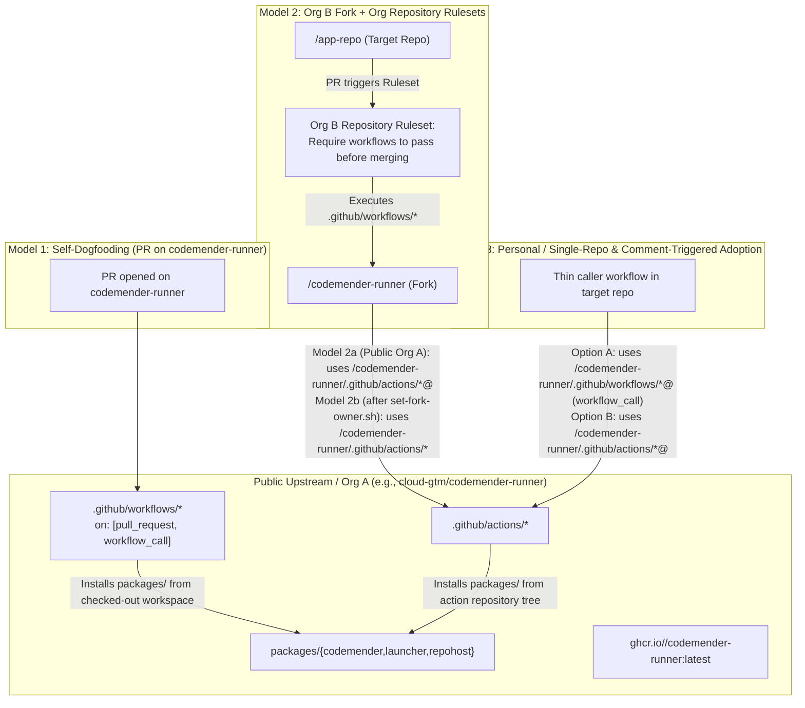

<!--*
freshness: { owner: 'codemender-maintainers', reviewed: '2026-10-20' }
*-->

<!--
sdd_spec_id: SPEC-DIST
sdd_implements: None
sdd_extends: None
sdd_level: COMPONENT
sdd_archetype: CI_CD_WORKFLOW
sdd_cujspec_product: codemender-runner
-->

# Design: Customer Repository Distribution, GitHub Deployment Models & Cross-Repo Action Resolution

## Context

`codemender-runner` is structured as a single shared monorepo ([ADR-0008](../../../adr/ADR-0008-repository-layout-and-package-structure.md)) containing:
- Three PEP 621 Python workspace packages under `packages/{codemender,launcher,repohost}`
- Root GitHub Actions workflows (`.github/workflows/*`) and composite actions (`.github/actions/*`)
- Root Terraform infrastructure automation (`terraform/` and `terraform/modules/{wif,gcp}`, governed by [SPEC-WIF](../wif/spec.md))

This design details how `codemender-runner` supports Self-Dogfooding, Organization-Wide Policy Enforcement (via GitHub Organization Repository Rulesets and Public Cross-Org Action Reuse), and Personal Account / Single-Repository Adoption (`workflow_call` and direct composite action `uses:`) directly from the canonical repository layout without copying files into target repositories.

Governed by [SPEC-DIST](spec.md), [SPEC-GHA](../github-actions/spec.md), [SPEC-GHA-FIX](../github-actions-fix/spec.md), [SPEC-WIF](../wif/spec.md), [ADR-0002](../../../adr/ADR-0002.md), [ADR-0003](../../../adr/ADR-0003-environment-scrubbing.md), [ADR-0008](../../../adr/ADR-0008-repository-layout-and-package-structure.md), and the [CodeMender Runner System Design](../tech/systems/codemender-runner/design.md).

---

## Goals / Non-Goals

### Goals
- Support **four GitHub consumption patterns** from a single repository layout:
  1. **Self-Dogfooding (`pull_request` on `codemender-runner`):** Test PR branch changes to `packages/{codemender,launcher,repohost}` and `.github/actions/*` live on every PR.
  2. **Organization Fork + GitHub Organization Repository Rulesets:** Allow an organization to fork `codemender-runner` into `<org>/codemender-runner` and enforce customer-facing workflows in `.github/workflows/*` across selected repositories in `<org>` via an Organization Repository Ruleset (*"Require workflows to pass before merging"*) with zero workflow files added to downstream repositories for `pull_request` scans (`find-diff`) and automatic inline fix suggestions (`fix`).
  3. **Public Cross-Org Consumption (`Org A -> Org B`), Version Pinning & Fork Ownership Configuration:** Allow `<org-B>` to consume public composite actions (`.github/actions/*`) and public GHCR runner images from `<org-A>/codemender-runner` with zero edits (or pinned to a release tag/SHA), while providing a lightweight helper (`./scripts/set-fork-owner.sh <org-B>` / `make init-fork`) for private/internal forks or organizations that want fork-isolated action and package updates.
  4. **Personal Account, Single-Repository & Comment-Triggered Adoption (`workflow_call` & Direct Action `uses:`):** Allow personal user repositories (where Organization Rulesets are unavailable), individual team repositories, or repositories requiring PR-comment-triggered verification (`@cm-runner verify` on `pull_request_review_comment` / `issue_comment`, which GitHub Organization Rulesets do not trigger) to call workflows in `.github/workflows/*` via `workflow_call` (`secrets: inherit`) or invoke composite actions in `.github/actions/*` directly in a thin caller workflow step without copying `.github/actions/*` or `packages/`.
- Ensure composite actions in `.github/actions/*` automatically locate `packages/{codemender,launcher,repohost}` whether invoked on `codemender-runner` itself (where `packages/` is present in the checked-out workspace) or on an external target repository (where `packages/` is absent from the target repository workspace).
- Automatically resolve default `runner_image` tags across organizations via `ghcr.io/${{ github.action_repository || github.repository }}:latest`.

### Non-Goals
- Mutating tracked `.github/workflows/*` files via Terraform `github_repository_file` resources.

---

## Architecture & Deployment Topology



### 1.1 Deployment Model Comparison Matrix

| Deployment Model | Where `.github/workflows/*` Lives | How Target Repos Trigger CodeMender | Supported Event Scope | Where `.github/actions/*` & `packages/` Are Loaded From | Package Resolution Source |
| :--- | :--- | :--- | :--- | :--- | :--- |
| **1. Self-Dogfooding** (`cloud-gtm/codemender-runner`) | `.github/workflows/*` in `codemender-runner` | Native `on: pull_request` on `codemender-runner` | All events defined in `.github/workflows/*` | Action definition from `<owner>/codemender-runner@main`; Python packages from PR checkout | Checked-out workspace (`${GITHUB_WORKSPACE}/packages`, testing PR code changes live) |
| **2a. Org Fork + Org Ruleset (Public Cross-Org `Org A -> Org B`)** | `.github/workflows/*` in `<org-B>/codemender-runner` | GitHub Org Repository Ruleset in `Org B` (*Require workflows to pass*) — **0 files in target repos** | `pull_request` / `push` / `merge_group` (**`find-diff` & `fix`**; does **not** trigger on PR comments for **`@cm-runner verify`**) | `<org-A>/codemender-runner/.github/actions/*@main` (live upstream `@main`, or pinned `@<tag/sha>`) | Action repository tree (`${ACTION_PATH}/../../../packages`) |
| **2b. Org Fork + Org Ruleset (Fork-Isolated or Private Fork in `Org B`)** | `.github/workflows/*` in `<org-B>/codemender-runner` (after `./scripts/set-fork-owner.sh <org-B>`) | GitHub Org Repository Ruleset in `Org B` (*Require workflows to pass*) — **0 files in target repos** | `pull_request` / `push` / `merge_group` (**`find-diff` & `fix`**; does **not** trigger on PR comments for **`@cm-runner verify`**) | `<org-B>/codemender-runner/.github/actions/*@main` (isolated to `Org B`'s fork; requires Org Actions sharing if private/internal) | Action repository tree (`${ACTION_PATH}/../../../packages`) |
| **3. Per-Repository Caller Workflow (`workflow_call` or Direct Action `uses:`)** | Thin caller workflow in target repo (`.github/workflows/codemender.yml`) | `uses: <owner>/codemender-runner/.github/workflows/*@<ref>` (`workflow_call`) **or** direct step `uses: <owner>/codemender-runner/.github/actions/*@<ref>` | `pull_request` (**`find-diff` & `fix`**) **and** `pull_request_review_comment` / `issue_comment` (**`@cm-runner verify`**) | `<owner>/codemender-runner/.github/actions/*@<ref>` (centralized; never copied into target repo) | Action repository tree (`${ACTION_PATH}/../../../packages`) |

### 1.2 Model 2: Organization Fork + Repository Rulesets (Event Scope & Upstream `@main` Trade-Offs)

1. **Organization Repository Ruleset Event Scope (`pull_request` Scanning & Fixes vs. PR-Comment `@cm-runner verify`):**
   - GitHub Organization Repository Rulesets (*"Require workflows to pass before merging"*) only trigger required workflows on branch and merge-gate events (`pull_request`, `push`, `merge_group`).
   - **What works with zero workflow files in target repositories:** Both **`find-diff` PR scanning** and **automatic `fix` generation (posting inline PR review suggestions/comments and sticky summary comments)** execute during the `pull_request` (`opened`, `synchronize`, `reopened`) event and authenticate using the workflow's `GITHUB_TOKEN` (`pull-requests: write`). Therefore, `find-diff` and `fix` work out of the box with **zero files** added to target repositories under Model 2.
   - **What cannot be triggered by an Organization Repository Ruleset alone:** On-demand verification triggered by replying to a PR comment (**`@cm-runner verify`**) relies on `pull_request_review_comment` / `issue_comment` events, which GitHub Organization Repository Rulesets ignore. If an organization wants PR-comment-triggered verification (`@cm-runner verify`), target repositories must either include a thin caller workflow file in `.github/workflows/` (Model 3) that triggers on `pull_request_review_comment` (and/or `pull_request`) and delegates to the central composite action (`uses: <owner>/codemender-runner/.github/actions/codemender@<ref>`) or reusable workflow (`workflow_call`), or use an organization-level GitHub App / webhook to dispatch workflow runs. Even when a thin caller workflow is present in the target repository for comment triggers, `.github/actions/*` and `packages/{codemender,launcher,repohost}` remain centralized in `codemender-runner` and are never copied into target repositories.
2. **Model 2a Live `@main` Action Reference vs. Version Pinning / Model 2b Fork Isolation:**
   - Under **Model 2a**, if `Org B` forks `<org-A>/codemender-runner` without editing `.github/workflows/*`, the workflow retains `uses: <org-A>/codemender-runner/.github/actions/codemender@main`. Because GitHub resolves `@main` against the upstream `<org-A>` repository live on every workflow run, any breaking change merged to `<org-A>`'s `main` branch immediately affects `Org B`'s runs even if `Org B` has never synced its fork of `.github/workflows/*`.
   - Organizations that require change isolation and explicit version control over composite action and Python package updates should either:
     1. Pin the action reference to a specific release tag or commit SHA (e.g., `uses: <org-A>/codemender-runner/.github/actions/codemender@v1.0.0`), or
     2. Use **Model 2b** by running `./scripts/set-fork-owner.sh <org-B>` (or `make init-fork`) so `.github/workflows/*` points to `<org-B>/codemender-runner/.github/actions/codemender@main`, which only updates when `Org B` explicitly syncs its fork.

### 1.3 Model 3: Per-Repository Caller Workflows (`workflow_call` & Direct Action `uses:`)

- Used in three scenarios:
  1. **Personal GitHub accounts**, where GitHub Organization Repository Rulesets are unavailable.
  2. **Single-repository adoption**, where a team wants to adopt CodeMender in an individual repository without org-wide rulesets.
  3. **PR-comment-triggered workflows (`@cm-runner verify`)**, where a target repository needs `on: pull_request_review_comment` / `issue_comment` triggers that GitHub Organization Repository Rulesets do not fire.
- In all three cases, the target repository only contains a thin `.github/workflows/codemender.yml` caller file; the composite actions (`.github/actions/*`) and Python workspace packages (`packages/{codemender,launcher,repohost}`) are resolved directly from `<owner>/codemender-runner`.

---

## Core Design Decisions

### Decision 1: Direct Repository Forking, Organization Rulesets, and `workflow_call` {#decision-1}

- **Choice:** Distribute `codemender-runner` directly via GitHub repository forking, Organization Repository Rulesets, `workflow_call` reusable workflows, and cross-repository composite actions in `.github/actions/*`.
- **Alternatives Considered:**
  - *Copying `.github/` files and rewriting `packages/` paths into downstream repositories:* Requires running sync utilities on every release, creates divergent directory structures between the source monorepo and customer repositories, and duplicates maintenance across target repositories.
- **Rationale:**
  - In [ADR-0008](../../../adr/ADR-0008-repository-layout-and-package-structure.md), `.github/` and `packages/{codemender,launcher,repohost}` live at root paths with co-located `test_*.py` excluded from package builds (`[tool.setuptools.packages.find] exclude`) and container images (`.dockerignore`).
  - When a workflow in any repository executes `uses: <owner>/codemender-runner/.github/actions/<action>@<ref>`, the composite action has direct access to `packages/{codemender,launcher,repohost}` in its own repository tree without requiring `packages/` to exist in the target repository.

### Decision 2: Explicit Cross-Repo Action References (`uses: <owner>/codemender-runner/.github/actions/*`) Over Relative `./.github/actions/*` in `.github/workflows/*` {#decision-2}

- **Choice:** Reference composite actions in customer-facing `.github/workflows/*` via full `<owner>/codemender-runner/.github/actions/<action>@main` coordinates rather than workspace-relative `./.github/actions/<action>`.
- **Alternatives Considered:**
  - *Workspace-relative path (`uses: ./.github/actions/<action>`):* Works only when `.github/actions/<action>` exists inside the repository checked out into `$GITHUB_WORKSPACE`.
- **Rationale:**
  1. **Why Relative `./.github/actions/*` Fails Under Organization Rulesets & `workflow_call`:**
     - When an Organization Repository Ruleset (or `workflow_call`) triggers a workflow in `.github/workflows/*` on a downstream application repository (`<org>/app-repo`), `actions/checkout` checks out `<org>/app-repo` into `$GITHUB_WORKSPACE`.
     - If the workflow subsequently runs `uses: ./.github/actions/<action>`, the runner looks for `.github/actions/<action>/action.yml` inside `<org>/app-repo`—which does not exist—and fails before the action can start.
     - Moreover, GitHub's Organization Repository Ruleset parser rejects required workflows that reference relative local actions unless checked out from the workflow repository.
  2. **Public Cross-Org Consumption (`Org A -> Org B`) & Version Isolation Options:**
     - When `Org A`'s repository (`<org-A>/codemender-runner`) is **Public**, GitHub allows workflows running in `Org B` (or personal accounts) to execute `uses: <org-A>/codemender-runner/.github/actions/<action>@<ref>` directly.
     - Keep in mind that if `<ref>` is left as `@main` pointing at `<org-A>/codemender-runner`, GitHub resolves `<org-A>`'s `main` branch live on every run. To isolate `Org B` from unreviewed upstream changes on `<org-A>`'s `main`, `Org B` should either pin `@<ref>` to a release tag/commit SHA or run `./scripts/set-fork-owner.sh <org-B>` (`make init-fork`, Model 2b) so `.github/workflows/*` resolves actions and `packages/` from `<org-B>/codemender-runner` (which only updates when `Org B` syncs its fork).

### Decision 3: Dual-Mode Package Resolution (Checked-Out Workspace vs. Action Repository Tree) {#decision-3}

- **Choice:** In `.github/actions/*`, check whether `packages/repohost` exists in `${GITHUB_WORKSPACE}` first and fall back to `${ACTION_PATH}/../../../packages`:
  ```bash
  set -euo pipefail
  if [[ -d "${GITHUB_WORKSPACE}/packages/repohost" ]]; then
    PKG_DIR="${GITHUB_WORKSPACE}/packages"
  else
    PKG_DIR="$(cd "${ACTION_PATH}/../../../packages" && pwd)"
  fi
  ```
- **Alternatives Considered:**
  - *Always installing from `${ACTION_PATH}/../../../packages`:* Because `.github/workflows/*` references `uses: <owner>/codemender-runner/.github/actions/<action>@main`, `${ACTION_PATH}` points to the `@main` snapshot of the action repository. If a pull request on `codemender-runner` modifies Python code under `packages/`, installing from `${ACTION_PATH}/../../../packages` would test `main`'s Python code instead of the PR branch's changes.
- **Rationale:**
  - Checking `[[ -d "${GITHUB_WORKSPACE}/packages/repohost" ]]` first guarantees that **Model 1 (Self-Dogfooding PRs on `codemender-runner`)** always installs `packages/{codemender,launcher,repohost}` from the PR's checked-out workspace, while **Models 2 & 3 (External Target Repositories)**—which do not have `packages/` in their workspace—install from `${ACTION_PATH}/../../../packages`.

### Decision 4: `scripts/set-fork-owner.sh` (`make init-fork`) for Fork Isolation & Private Forks vs. Rejecting Terraform `github_repository_file` {#decision-4}

- **Choice:** Provide a standalone helper script `scripts/set-fork-owner.sh` (and `make init-fork`) for re-pointing `.github/workflows/*` action references to a fork (`<org>/codemender-runner`), and do not mutate tracked `.github/workflows/*` files via Terraform `github_repository_file`.
- **Alternatives Considered:**
  - *Using Terraform's `github_repository_file` resource (`overwrite_on_create = true`) in `terraform/modules/wif/github.tf` to rewrite `.github/workflows/*` during `terraform apply`:* Rejected for three reasons:
    1. **Fails on Protected Branches:** Enterprise organizations typically protect `main` with branch protection rules or Repository Rulesets requiring pull request reviews or status checks, causing direct API commits from `github_repository_file` to fail with `403`/`422`.
    2. **Requires Privileged `workflow` Token Scope:** GitHub rejects commits touching `.github/workflows/*` unless the token/App explicitly holds the `workflow` permission scope, expanding the blast radius of the Terraform management token.
    3. **Tracked Git State Drift & Fork Sync Conflicts:** Mutating a Git-tracked file via the GitHub Contents API behind local Git's back leaves the operator's local clone out of sync and causes merge conflicts when syncing the fork with upstream.
- **Rationale:**
  - Running `./scripts/set-fork-owner.sh <org>` (or `make init-fork`) in a fork clone updates `.github/workflows/*` to reference `<org>/codemender-runner/.github/actions/*`. This serves both **private/internal forks** (which must also enable *Settings $\rightarrow$ Actions $\rightarrow$ General $\rightarrow$ Access $\rightarrow$ Accessible from repositories in the `<org>` organization*) and **public forks that want version isolation** from live upstream `@main` changes. The helper is explicit, works cleanly with branch protection PR workflows, and requires zero extra Terraform token privileges.

### Decision 5: Cross-Org Default `runner_image` via `github.action_repository || github.repository` & `cm-github` Entrypoint Bridge {#decision-5}

- **Choice:**
  1. Default `runner_image` in local mode to `ghcr.io/${{ github.action_repository || github.repository }}:latest` (lowercased before `docker pull`).
  2. Expose `cm-github` under `[project.scripts]` in `packages/repohost/pyproject.toml`.
- **Rationale:**
  - Using `github.action_repository || github.repository` rather than `github.repository_owner` ensures that when `Org B` calls `Org A`'s public composite action (`<org-A>/codemender-runner/.github/actions/<action>@main`), the action defaults to pulling `Org A`'s published GHCR image (`ghcr.io/<org-a>/codemender-runner:latest`) rather than looking for a non-existent `ghcr.io/<org-b>/codemender-runner:latest` package.
  - Exposing `cm-github` via `[project.scripts]` in `packages/repohost/pyproject.toml` bridges the installed `repohost` wheel directly to `PATH` so composite actions in `.github/actions/*` can invoke `cm-github` without hardcoding relative script paths.

---

## Risks and Mitigations

| Risk | Severity | Mitigation |
| :--- | :--- | :--- |
| **Upstream `@main` breaking changes affect Model 2a forks that keep `<org-A>/codemender-runner/.github/actions/*@main`** | Medium | Document that `@main` resolves live against `<org-A>` on every run; operators wanting version isolation should run `./scripts/set-fork-owner.sh <org-B>` (`make init-fork`, Model 2b) so actions resolve from `<org-B>`'s fork, or pin `@<ref>` to a release tag/commit SHA. |
| **Organization Repository Rulesets do not trigger on `pull_request_review_comment` / `issue_comment` (`@cm-runner verify`)** | Medium | Document that Organization Rulesets cover `pull_request` scans (`find-diff`) and automatic inline fix comments (`fix`) with zero files in target repos, whereas PR-comment-triggered verification (`@cm-runner verify`) requires a thin caller workflow in the target repo (Model 3) or an org-level GitHub App / webhook dispatcher. |
| **Private fork in `Org B` fails to load internal composite action across repos** | Medium | Document in `.github/SETUP.md` and `scripts/set-fork-owner.sh` output that private/internal forks must enable *Settings $\rightarrow$ Actions $\rightarrow$ General $\rightarrow$ Access $\rightarrow$ Accessible from repositories in the organization*. |
| **Unconfigured repositories in an org blocked when Org Ruleset is enabled org-wide** | High | Customer-facing workflows in `.github/workflows/*` run a pre-flight configuration check that verifies required cloud credentials, emitting a notice and exiting `0` when unconfigured. |
| **Mixed-case GitHub organization/user names rejected by `docker pull`** | Low | Normalize image references to lowercase prior to `docker login` and `docker pull`. |

---

## Testing & Verification Plan

1. **Dual-Mode Package Resolution:**
   - Verify that when `packages/` exists in the checked-out repository workspace, composite actions in `.github/actions/*` install from the workspace.
   - Verify that when `packages/` does not exist in the checked-out repository workspace, composite actions in `.github/actions/*` install from the action's repository tree.
2. **`scripts/set-fork-owner.sh` Verification:**
   - Verify `./scripts/set-fork-owner.sh acme-corp` updates `<owner>/codemender-runner/.github/actions/*` references in `.github/workflows/*` to `acme-corp/codemender-runner/.github/actions/*` and is idempotent on repeat runs.
   - Verify invalid owner names exit with a non-zero status code.
3. **End-to-End Deployment Models:**
   - **Model 1 (Self-Dogfooding):** Trigger `.github/workflows/*` via `pull_request` on `codemender-runner`.
   - **Model 2 (Org Fork + Ruleset):** Trigger `.github/workflows/*` via an Organization Repository Ruleset on a downstream repository.
   - **Model 3 (`workflow_call` / Direct Action):** Trigger `.github/workflows/*` via `workflow_call` or `.github/actions/*` from a personal/single repository.
