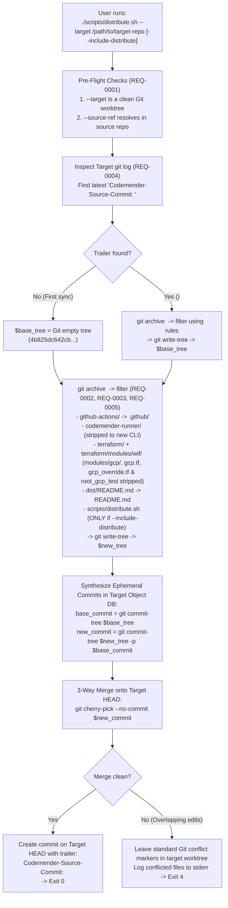
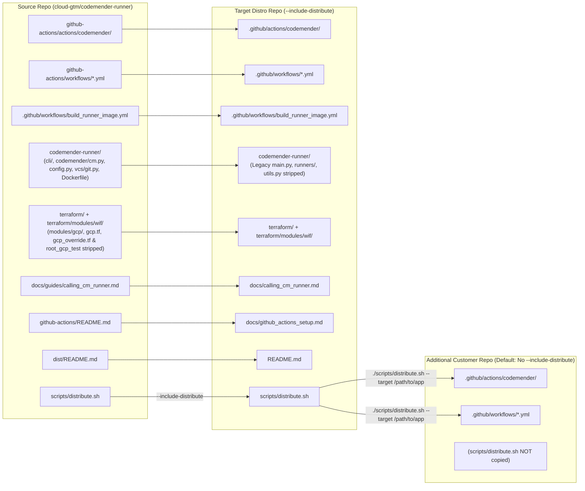

<!--*
freshness: { owner: 'codemender-maintainers', reviewed: '2026-10-02' }
*-->

<!--
sdd_spec_id: SPEC-DIST
sdd_implements: None
sdd_extends: None
sdd_level: COMPONENT
sdd_archetype: CLI_TOOL_BATCH_JOB
sdd_cujspec_product: codemender-runner
-->

# Design: Customer Repository Distribution & Incremental Sync (`scripts/distribute.sh`)

## Context

`cloud-gtm/codemender-runner` is an active internal development monorepo
containing multiple parallel workstreams, legacy orchestration pipelines
(`main.py`, `runners/`, `.github/workflows/codemender_parallel.yml`), internal
Architecture Decision Records (`docs/adr/`), OpenSpec specifications
(`docs/openspec/`), and in-progress Cloud Run components
(`terraform/modules/gcp/`, `terraform/gcp.tf`, `terraform/gcp_override.tf`,
`terraform/tests/root_gcp_test.tftest.hcl`).

Sharing this internal repository directly with customers exposes unstable
work-in-progress changes and legacy code paths. Instead, we need a repeatable
distribution mechanism that extracts a clean, production-ready subset of the
repository—starting with the GitHub Actions runner layout today and expanding to
include Cloud Run in future syncs—and pushes updates into a standalone,
customer-facing Git repository without clobbering target repository changes.

Governed by [SPEC-DIST](spec.md), [SPEC-WIF](../wif/spec.md),
[ADR-0001](../../../adr/ADR-0001-machine-readable-output-contract.md),
[ADR-0002](../../../adr/ADR-0002-runner-layout-and-build.md),
[ADR-0003](../../../adr/ADR-0003-environment-scrubbing.md), and
[ADR-0004](../../../adr/ADR-0004-project-tech-stack-and-repo-architecture.md).

## Goals / Non-Goals

### Goals

- Provide a simple, maintainer-operated Bash script (`scripts/distribute.sh`)
  that extracts a curated subset of `codemender-runner` from a committed Git ref
  (`git archive`) and synchronizes it into a standalone customer Git repository.
- Support repeatable incremental updates across two Git repositories **without
  shared commit history** and **without checking a `.dist.json` manifest file**
  into the customer repository.
- Structure the target distribution repository so it simultaneously works out of
  the box as a **live example repository** (with `.github/actions/codemender/`
  and `.github/workflows/cm-merge-scan.yml` active in place) and, when populated
  with `--include-distribute`, includes `scripts/distribute.sh` so customers can
  run `./scripts/distribute.sh --target /path/to/repo` (where
  `--include-distribute` is off by default) to set up additional repositories
  without copying the distribution script itself.
- Strip all legacy pipeline modules (`main.py`, `runners/`, `storage.py`,
  `utils.py`, `codemender/db.py`, `vcs/github.py`) so only the new `cm-runner`
  CLI (`cli/`, including `version`, `init`, `find-diff`, and additional
  subcommands such as `fix` as they land in the existing layout) is shipped.
- Ship the root `terraform/` entrypoint (`main.tf`, `variables.tf`,
  `outputs.tf`, `provider.tf`, `terraform.tfvars.example`,
  `.terraform.lock.hcl`, `tests/root_test.tftest.hcl`) and
  `terraform/modules/wif/` while stripping `terraform/modules/gcp/`,
  `terraform/gcp.tf`, `terraform/gcp_override.tf`, and
  `terraform/tests/root_gcp_test.tftest.hcl` until Cloud Run is ready for
  distribution.
- Allow new top-level components (such as Cloud Run) to be added to
  `scripts/distribute.sh` in future commits without needing profile flags.

### Non-Goals

- Cross-platform Windows/macOS portability for `scripts/distribute.sh` itself
  (it is run in Linux environments).
- Modifying `github-actions/actions/codemender/` implementation logic (handled
  by Workstream 2).
- Shipping Cloud Run infrastructure (`terraform/modules/gcp/`,
  `terraform/gcp.tf`, `terraform/gcp_override.tf`,
  `terraform/tests/root_gcp_test.tftest.hcl`, `gcp-cloudrun/`) in the initial
  sync (it will be added directly to `scripts/distribute.sh` when ready).

## Decisions

### Decision 1: Pure Bash (`scripts/distribute.sh`) Over Python {#decision-1}

- **Choice:** Implement `scripts/distribute.sh` as a standalone Bash script
  (`#!/usr/bin/env bash`, `set -euo pipefail`) using standard `git` plumbing and
  POSIX coreutils (`tar`, `mv`, `cp`, `rm`, `mktemp`).
- **Alternatives Considered:**
  - *Python CLI script (`scripts/distribute.py`):* Adds `subprocess.run`
    wrappers, argument parsing boilerplate, and temporary file management in
    Python for operations that are natively 1-line `git` and shell commands.
- **Rationale:** Every step of the distribution pipeline—`git archive`,
  directory mapping, `git write-tree`, `git commit-tree`, and
  `git cherry-pick --no-commit`—is a first-class shell and Git operation,
  keeping the script concise (~150–200 lines), zero-dependency, and easy to
  inspect.

### Decision 2: Stateless 3-Way Git Merge via Commit Trailer & Ephemeral `commit-tree` (No `.dist.json`) {#decision-2}

- **Choice:** Track the last-synced source commit via a single Git commit
  trailer (`Codemender-Source-Commit: <sha>`) in the target repository's commit
  log, and apply updates by synthesizing an ephemeral parent/child commit pair
  (`git commit-tree`) in the target repository's object database and running
  `git cherry-pick --no-commit`.
- **Alternatives Considered:**
  - *Checked-in `.codemender-dist.json` manifest with SHA-256 file hashes:*
    Clutters the customer repository root with internal sync metadata and
    requires custom conflict-detection and file-deletion logic.
  - *`rsync --delete` overwrite:* Wipes out any files added directly in the
    target repository (e.g., `CODEOWNERS`, custom workflows, or `runner_image:`
    edits) and silently clobbers target-side changes.
  - *`git subtree` / shared Git history:* Requires either grafting unrelated
    histories or maintaining a persistent tracking branch across clones.
- **Rationale:**
  1. When `scripts/distribute.sh` runs against `$TARGET_REPO`, it queries:
     ```bash
     prev_sha=$(git -C "$TARGET_REPO" log --grep="^Codemender-Source-Commit:" -n 1 \
       --format="%(trailers:key=Codemender-Source-Commit,valueonly)" | tr -d '[:space:]')
     ```
     *(Even when a sync PR in the target repo is squash-merged on GitHub, GitHub
     preserves commit trailers in the squash commit message body.)*
  1. Using `git archive "$prev_sha"` (or Git's empty tree
     `4b825dc642cb6eb9a060e54bf8d69288fbee4904` on first sync) and
     `git archive "$source_ref"`, the script builds two filtered staging
     directories and writes both trees into `$TARGET_REPO`'s object store via a
     temporary index file
     (`GIT_INDEX_FILE="$tmp_idx" git -C "$TARGET_REPO" add -A` followed by
     `git write-tree`), yielding `$base_tree` and `$new_tree`.
  1. It then creates two ephemeral commits inside `$TARGET_REPO`'s object store
     (touching zero branch refs):
     ```bash
     base_commit=$(git -C "$TARGET_REPO" commit-tree "$base_tree" -m "dist-base")
     new_commit=$(git -C "$TARGET_REPO" commit-tree "$new_tree" -p "$base_commit" -m "dist-new")
     git -C "$TARGET_REPO" cherry-pick --no-commit "$new_commit"
     ```
  1. Because `git cherry-pick` performs a full 3-way `ort` merge using
     `$base_commit` as the merge base, `HEAD` as "ours", and `$new_commit` as
     "theirs":
     - Files added only in `$TARGET_REPO` are **never touched**.
     - Files removed upstream between `$prev_sha` and `$source_ref` are
       **cleanly deleted** in `$TARGET_REPO`.
     - Files edited in *both* repos are **merged line-by-line**, raising
       standard Git conflict markers only if overlapping lines were modified.
     - `$TARGET_REPO`'s commit history remains 100% linear with no foreign
       parent commits or `.dist.json` files.
     - Once the 3-way merge completes cleanly, `scripts/distribute.sh`
       automatically commits the staged changes in `$TARGET_REPO` with the
       `Codemender-Source-Commit: <sha>` trailer.

### Decision 3: Single Unified Script (`scripts/distribute.sh`) With Off-by-Default `--include-distribute` {#decision-3}

- **Choice:** Use a single `scripts/distribute.sh` script for both maintainer
  distribution (into the customer distribution repo) and customer repo setup
  (into additional customer repos), with an off-by-default
  `--include-distribute` flag controlling whether `scripts/distribute.sh` copies
  itself into `--target`.
- **Alternatives Considered:**
  - *Separate `scripts/distribute.sh` and `dist/scripts/install.sh` scripts:*
    Duplicates file-copying and validation logic across two scripts and forces
    maintainers to keep two scripts in sync.
  - *Always copying `scripts/distribute.sh` into every target repo:* Clutters
    downstream application repositories that only want the CodeMender workflow
    setup, not the distribution script itself.
- **Rationale:**
  - By default (`--include-distribute` omitted), `scripts/distribute.sh` only
    sets up the target repository (`.github/actions/codemender/`,
    `.github/workflows/`, etc.) without copying `scripts/distribute.sh`.
  - When the maintainer populates the customer distribution repository, passing
    `--include-distribute` copies `scripts/distribute.sh` into the distribution
    repository (and keeps it updated on repeat syncs).
  - Because `scripts/distribute.sh` recognizes both the internal monorepo layout
    (`github-actions/...`, `dist/README.md`) and the already-distributed layout
    (`.github/...`, `README.md`), customers can run
    `./scripts/distribute.sh --target /path/to/app-repo` directly from the
    distribution repository to set up additional repositories without copying
    `scripts/distribute.sh` into them.

### Decision 4: Stripping the Legacy Pipeline & Decoupling Unit Tests from `utils.py` / `main.py` {#decision-4}

- **Choice:** Exclude all legacy modules (`main.py`, `runners/`, `storage.py`,
  `utils.py`, `codemender/db.py`, `vcs/github.py`, `tests/cm`) when staging
  `codemender-runner/`, and decouple the retained module and unit test files so
  they have zero import-time or test-time dependencies on excluded files:
  1. Move `from utils import retry_on_exception` in
     `codemender-runner/vcs/git.py` inside the two legacy functions that use it
     (`clone_repository` and `push_branch_to_remote`).
  1. Guard legacy-only test cases in `test_vcs_git.py`
     (`test_filter_stageable_files`) and `test_cli.py`
     (`test_git_helper_inside_command_leaves_stdout_clean`,
     `test_script_runs_legacy`, `test_package_directory_runs_legacy`) with
     `@unittest.skipUnless` when `utils.py` or `main.py` is absent, and replace
     `_FAKE_CM` (`tests/cm`) in
     `test_binary_present_but_version_unreadable_fails` with an inline
     `_write_fake_cm` stub.
- **Rationale:** `cm-runner` subcommands (`find-diff`, `fix`, etc.) import
  `vcs.git` only for modern helpers (`is_git_repository`, `ref_exists`), neither
  of which uses `utils.py`. Lazy importing `utils` inside the legacy functions
  (matching the pattern established in `codemender/cm.py` under
  [ADR-0002](../../../adr/ADR-0002-runner-layout-and-build.md)) and guarding
  legacy-only tests allows the stripped `codemender-runner/` package in the
  distribution repository to run and pass its entire unit test suite without
  shipping `utils.py`, `main.py`, or `requests`.

### Decision 5: No Profiles — Evolving the Distribution Set Over Time {#decision-5}

- **Choice:** Omit `--profile` flags and `Codemender-Dist-Profiles` trailers
  entirely; define a single canonical distribution staging function in
  `scripts/distribute.sh`, and when reconstructing `$base_tree` for
  `<prev_source_sha>`, invoke `<prev_source_sha>`'s own `scripts/distribute.sh`
  (if present in `<prev_source_sha>`) to stage the historical base tree.
- **Alternatives Considered:**
  - *Named `--profile` flags (`--profile gha-direct`, `--profile cloud-run`) and
    a `Codemender-Dist-Profiles:` commit trailer:* Adds unnecessary CLI and
    state complexity when there is only a single distribution repository whose
    contents naturally grow as features mature.
- **Rationale:**
  - For the initial sync, `scripts/distribute.sh` includes the GitHub Actions
    layout, stripped `codemender-runner/` CLI, the root `terraform/` files
    (`main.tf`, `variables.tf`, `outputs.tf`, `provider.tf`,
    `terraform.tfvars.example`, `.terraform.lock.hcl`,
    `tests/root_test.tftest.hcl`) plus `terraform/modules/wif/` (with
    `terraform/modules/gcp/`, `terraform/gcp.tf`, `terraform/gcp_override.tf`,
    and `terraform/tests/root_gcp_test.tftest.hcl` stripped), and customer
    documentation.
  - As new subcommands (`fix`, `verify`) land in `codemender-runner/cli/` or new
    workflows land in `github-actions/workflows/`, they are picked up
    automatically with zero changes to `scripts/distribute.sh`.
  - When Cloud Run is ready to distribute in a later commit, we simply retain
    `terraform/modules/gcp/`, `terraform/gcp.tf`, `terraform/gcp_override.tf`,
    and `terraform/tests/root_gcp_test.tftest.hcl` in `scripts/distribute.sh`
    in that commit. Because `$base_tree` is built using `<prev_source_sha>`'s
    version of `scripts/distribute.sh` (which stripped Cloud Run) and
    `$new_tree` is built using the new version of `scripts/distribute.sh` (which
    retains Cloud Run), the 3-way merge cleanly adds all Cloud Run files on the
    next sync.

## Architecture

### Incremental Distribution & 3-Way Sync Flow



### Target Distribution Repository Layout vs. Downstream Customer Repo Mapping



### Module & File Inventory

| Source Path                                                                                                                                      | Target Distro Path                                           | Responsibility                                                                                                                                                                                        |
| :----------------------------------------------------------------------------------------------------------------------------------------------- | :----------------------------------------------------------- | :---------------------------------------------------------------------------------------------------------------------------------------------------------------------------------------------------- |
| `scripts/distribute.sh`                                                                                                                          | `scripts/distribute.sh` *(only with `--include-distribute`)* | Extracts `git archive`, applies layout transformations, writes Git trees, and runs 3-way `cherry-pick --no-commit` sync into `--target`.                                                              |
| `dist/README.md`                                                                                                                                 | `README.md`                                                  | Customer-facing landing page explaining the live example repo, image build, WIF setup (`cd terraform`), and `./scripts/distribute.sh --target <dir>`.                                                 |
| `github-actions/actions/codemender/`                                                                                                             | `.github/actions/codemender/`                                | Composite GitHub Action and unit tests.                                                                                                                                                               |
| `github-actions/workflows/*.yml`                                                                                                                 | `.github/workflows/*.yml`                                    | GitHub Actions workflow templates (e.g. `cm-merge-scan.yml`, active in the distro repo and synced into downstream repos).                                                                             |
| `.github/workflows/build_runner_image.yml`                                                                                                       | `.github/workflows/build_runner_image.yml`                   | Builds `codemender-runner/Dockerfile` and publishes the image to GHCR.                                                                                                                                |
| `codemender-runner/{Dockerfile,.dockerignore,requirements.txt,__main__.py,bin/,cli/,codemender/cm.py,config.py,vcs/git.py,tests/}`               | `codemender-runner/...`                                      | Stripped `cm-runner` CLI (`cli/`, including `version`, `init`, `find-diff`, and `fix` as added) and hermetic unit tests.                                                                              |
| `terraform/{main.tf,variables.tf,outputs.tf,provider.tf,terraform.tfvars.example,.terraform.lock.hcl,tests/root_test.tftest.hcl,modules/wif/}`   | `terraform/...`                                              | Root Terraform configuration and `terraform/modules/wif/` child module for GCP Workload Identity Federation (with `terraform/modules/gcp/`, `gcp.tf`, `gcp_override.tf`, and `root_gcp_test` stripped). |
| `docs/guides/calling_cm_runner.md`                                                                                                               | `docs/calling_cm_runner.md`                                  | CLI reference for `cm-runner`.                                                                                                                                                                        |
| `github-actions/README.md`                                                                                                                       | `docs/github_actions_setup.md`                               | Detailed setup and security architecture guide for the GitHub Action.                                                                                                                                 |

## Risks / Trade-offs

- **Previous Sync Commit GC'd or Force-Pushed Away in Source Repo** → If the
  `<prev_source_sha>` recorded in the target repo's trailer was from an unmerged
  local commit that was later garbage-collected in the source repo,
  `git archive <prev_sha>` cannot reconstruct `$base_tree`.
  - *Mitigation:* Always run `scripts/distribute.sh` from committed `main`
    revisions. If `<prev_source_sha>` is not present in the source repo
    (`git cat-file -e "${prev_source_sha}^{commit}"`), `scripts/distribute.sh`
    logs a clear error message to `stderr` and exits with code `2` rather than
    falling back to a destructive 2-way overwrite.
- **Legacy References in `codemender-runner/Dockerfile` and `__main__.py`** →
  `codemender-runner/Dockerfile` currently creates a symlink to `main.py`
  (`ln -s .../main.py /opt/codemender/orchestrator.py`) and sets
  `CMD ["legacy"]`.
  - *Mitigation:* During staging, `scripts/distribute.sh` strips the `main.py`
    symlink and sets `CMD ["version"]` in the distributed `Dockerfile` and
    `build_runner_image.yml`, and replaces `codemender-runner/__main__.py`'s
    `legacy` branch with direct dispatch to `cli.__main__`.

## Deployment & Rollback

- **Deployment:** Add `scripts/distribute.sh` and `dist/README.md`, decouple
  `codemender-runner/vcs/git.py`, `test_vcs_git.py`, and `test_cli.py` from
  excluded legacy modules, and add automated integration tests in
  `codemender-runner/tests/test_distribute.py` exercising initial sync, repeat
  3-way sync, target-only file preservation, upstream deletion propagation,
  conflict detection, and `--include-distribute` vs. default downstream setup.
- **Verification:** Run
  `python3 -m unittest discover -s codemender-runner/tests -t codemender-runner -v`.
- **Rollback:** Revert the distribution script commit(s).

## Open Questions

- None at this stage; Cloud Run directories will be added directly to
  `scripts/distribute.sh`'s staging rules once Workstream 3 is finalized on
  `main`.
