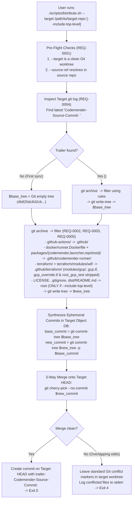
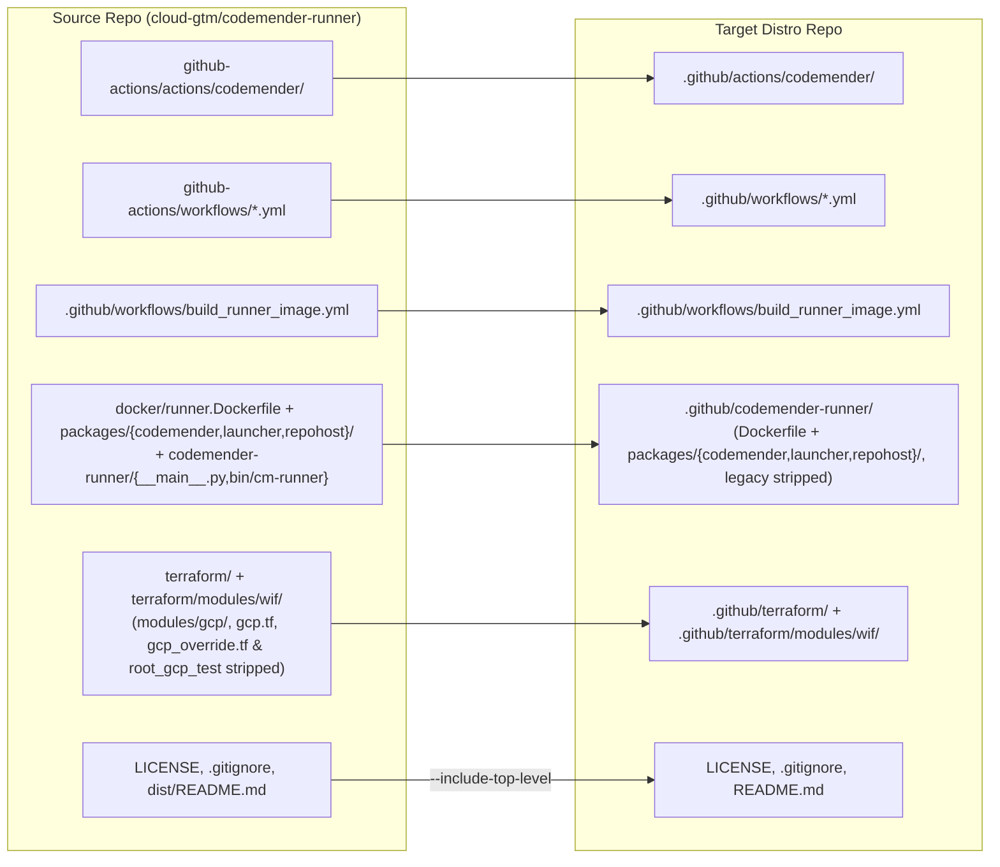

<!--*
freshness: { owner: 'codemender-maintainers', reviewed: '2026-10-02' }
*-->

<!--
sdd_spec_id: SPEC-DIST
sdd_implements: None
sdd_extends: None
sdd_level: COMPONENT
sdd_archetype: CLI_TOOL_BATCH_JOB
sdd_cujspec_product: codemender-runner
-->

# Design: Customer Repository Distribution & Incremental Sync (`scripts/distribute.sh`)

## Context

`cloud-gtm/codemender-runner` is an active internal development monorepo
containing multiple parallel workstreams, legacy orchestration pipelines
(`main.py`, `runners/`, `.github/workflows/codemender_parallel.yml`), internal
Architecture Decision Records (`docs/adr/`), OpenSpec specifications
(`docs/openspec/`), and in-progress Cloud Run components
(`terraform/modules/gcp/`, `terraform/gcp.tf`, `terraform/gcp_override.tf`,
`terraform/tests/root_gcp_test.tftest.hcl`).

Sharing this internal repository directly with customers exposes unstable
work-in-progress changes and legacy code paths. Instead, we need a repeatable
distribution mechanism that extracts a clean, production-ready subset of the
repository—starting with the GitHub Actions runner layout today and expanding to
include Cloud Run in future syncs—and pushes updates into a standalone,
customer-facing Git repository without clobbering target repository changes.

Governed by [SPEC-DIST](spec.md), [SPEC-WIF](../wif/spec.md),
[ADR-0001](../../adr/ADR-0001-machine-readable-output-contract.md),
[ADR-0003](../../adr/ADR-0003-environment-scrubbing.md), and
[ADR-0008](../../adr/ADR-0008-repository-layout-and-package-structure.md).

## Goals / Non-Goals

### Goals

- Provide a simple, maintainer-operated Bash script (`scripts/distribute.sh`)
  that extracts a curated subset of `codemender-runner` from a committed Git ref
  (`git archive`) and synchronizes it into a standalone customer Git repository.
- Support repeatable incremental updates across two Git repositories **without
  shared commit history** and **without checking a `.dist.json` manifest file**
  into the customer repository.
- Structure the target distribution repository so all distributed CodeMender
  assets live cleanly under `.github/` (`.github/actions/codemender/`,
  `.github/workflows/`, `.github/codemender-runner/`, `.github/terraform/` and
  `.github/terraform/modules/wif/`), and—when populated with
  `--include-top-level`—include `LICENSE`, `.gitignore`, and `dist/README.md`
  (mapped to `README.md`) at the repository root.
- Strip all legacy pipeline modules (`main.py`, `runners/`, `storage.py`,
  `utils.py`, `codemender/db.py`, `vcs/github.py`) so only the new `cm-runner`
  CLI (`packages/codemender`, including `version`, `init`, `find-diff`,
  `verify`, and `fix`) is shipped.
- Ship the root `terraform/` entrypoint (`main.tf`, `variables.tf`,
  `outputs.tf`, `provider.tf`, `terraform.tfvars.example`,
  `.terraform.lock.hcl`, `tests/root_test.tftest.hcl`) and
  `terraform/modules/wif/` under `.github/terraform/` while stripping
  `terraform/modules/gcp/`, `terraform/gcp.tf`, `terraform/gcp_override.tf`, and
  `terraform/tests/root_gcp_test.tftest.hcl` until Cloud Run is ready for
  distribution.
- Allow new components (such as Cloud Run) to be added to
  `scripts/distribute.sh` in future commits without needing profile flags.

### Non-Goals

- Cross-platform Windows/macOS portability for `scripts/distribute.sh` itself
  (it is run in Linux environments).
- Modifying `github-actions/actions/codemender/` implementation logic (handled
  by Workstream 2).
- Shipping Cloud Run infrastructure (`terraform/modules/gcp/`,
  `terraform/gcp.tf`, `terraform/gcp_override.tf`,
  `terraform/tests/root_gcp_test.tftest.hcl`, `gcp-cloudrun/`) in the initial
  sync (it will be added directly to `scripts/distribute.sh` when ready).

## Decisions

### Decision 1: Pure Bash (`scripts/distribute.sh`) Over Python {#decision-1}

- **Choice:** Implement `scripts/distribute.sh` as a standalone Bash script
  (`#!/usr/bin/env bash`, `set -euo pipefail`) using standard `git` plumbing and
  POSIX coreutils (`tar`, `mv`, `cp`, `rm`, `mktemp`).
- **Alternatives Considered:**
  - *Python CLI script (`scripts/distribute.py`):* Adds `subprocess.run`
    wrappers, argument parsing boilerplate, and temporary file management in
    Python for operations that are natively 1-line `git` and shell commands.
- **Rationale:** Every step of the distribution pipeline—`git archive`,
  directory mapping, `git write-tree`, `git commit-tree`, and
  `git cherry-pick --no-commit`—is a first-class shell and Git operation,
  keeping the script concise (~150–200 lines), zero-dependency, and easy to
  inspect.

### Decision 2: Stateless 3-Way Git Merge via Commit Trailer & Ephemeral `commit-tree` (No `.dist.json`) {#decision-2}

- **Choice:** Track the last-synced source commit via a single Git commit
  trailer (`Codemender-Source-Commit: <sha>`) in the target repository's commit
  log, and apply updates by synthesizing an ephemeral parent/child commit pair
  (`git commit-tree`) in the target repository's object database and running
  `git cherry-pick --no-commit`.
- **Alternatives Considered:**
  - *Checked-in `.codemender-dist.json` manifest with SHA-256 file hashes:*
    Clutters the customer repository root with internal sync metadata and
    requires custom conflict-detection and file-deletion logic.
  - *`rsync --delete` overwrite:* Wipes out any files added directly in the
    target repository (e.g., `CODEOWNERS`, custom workflows, or `runner_image:`
    edits) and silently clobbers target-side changes.
  - *`git subtree` / shared Git history:* Requires either grafting unrelated
    histories or maintaining a persistent tracking branch across clones.
- **Rationale:**
  1. When `scripts/distribute.sh` runs against `$TARGET_REPO`, it queries:
     ```bash
     prev_sha=$(git -C "$TARGET_REPO" log --grep="^Codemender-Source-Commit:" -n 1 \
       --format="%(trailers:key=Codemender-Source-Commit,valueonly)" | tr -d '[:space:]')
     ```
     *(Even when a sync PR in the target repo is squash-merged on GitHub, GitHub
     preserves commit trailers in the squash commit message body.)*
  1. Using `git archive "$prev_sha"` (or Git's empty tree
     `4b825dc642cb6eb9a060e54bf8d69288fbee4904` on first sync) and
     `git archive "$source_ref"`, the script builds two filtered staging
     directories and writes both trees into `$TARGET_REPO`'s object store via a
     temporary index file
     (`GIT_INDEX_FILE="$tmp_idx" git -C "$TARGET_REPO" add -A` followed by
     `git write-tree`), yielding `$base_tree` and `$new_tree`.
  1. It then creates two ephemeral commits inside `$TARGET_REPO`'s object store
     (touching zero branch refs):
     ```bash
     base_commit=$(git -C "$TARGET_REPO" commit-tree "$base_tree" -m "dist-base")
     new_commit=$(git -C "$TARGET_REPO" commit-tree "$new_tree" -p "$base_commit" -m "dist-new")
     git -C "$TARGET_REPO" cherry-pick --no-commit "$new_commit"
     ```
  1. Because `git cherry-pick` performs a full 3-way `ort` merge using
     `$base_commit` as the merge base, `HEAD` as "ours", and `$new_commit` as
     "theirs":
     - Files added only in `$TARGET_REPO` are **never touched**.
     - Files removed upstream between `$prev_sha` and `$source_ref` are
       **cleanly deleted** in `$TARGET_REPO`.
     - Files edited in *both* repos are **merged line-by-line**, raising
       standard Git conflict markers only if overlapping lines were modified.
     - `$TARGET_REPO`'s commit history remains 100% linear with no foreign
       parent commits or `.dist.json` files.
     - Once the 3-way merge completes cleanly, `scripts/distribute.sh`
       automatically commits the staged changes in `$TARGET_REPO` with the
       `Codemender-Source-Commit: <sha>` trailer.

### Decision 3: `.github/`-Scoped Layout & Off-by-Default `--include-top-level` {#decision-3}

- **Choice:** Place all CodeMender distribution assets inside `.github/`
  (`.github/actions/codemender/`, `.github/workflows/`,
  `.github/codemender-runner/`, `.github/terraform/` and
  `.github/terraform/modules/wif/`), never copy `scripts/distribute.sh` or
  `docs/` into `--target`, and gate root-level files (`LICENSE`, `.gitignore`,
  `dist/README.md` -> `README.md`) behind an off-by-default `--include-top-level`
  flag.
- **Alternatives Considered:**
  - *Always staging `LICENSE`, `.gitignore`, and `README.md` at the root:*
    Overwrites or conflicts with a target repository's existing top-level
    `README.md`, `LICENSE`, or `.gitignore` when syncing into an existing
    repository.
  - *Placing `codemender-runner/`, `terraform/`, and `docs/` at the target
    repository root:* Clutters the target repository root with multiple
    top-level folders.
- **Rationale:**
  - By default (`--include-top-level` omitted), `scripts/distribute.sh` stages
    only `.github/`, leaving any existing top-level files in `--target`
    completely untouched.
  - When populating the standalone customer distribution repository, passing
    `--include-top-level` stages `LICENSE`, `.gitignore`, and `dist/README.md`
    -> `README.md` at the root (and automatically preserves/updates them on
    repeat syncs by checking whether the previous `Codemender-Source-Commit`
    synced `dist/README.md` to `README.md`).
  - `dist/README.md` provides self-contained step-by-step instructions both for
    using the distribution repository directly and for manually onboarding
    additional repositories by copying `.github/actions/codemender/` and
    `.github/workflows/cm-merge-scan.yml`.

### Decision 4: Self-Contained `.github/codemender-runner/` Build Context & Legacy Stripping {#decision-4}

- **Choice:** Stage `docker/runner.Dockerfile` as
  `.github/codemender-runner/Dockerfile`, copy `packages/codemender/` into
  `.github/codemender-runner/packages/codemender/`, `packages/launcher/` into
  `.github/codemender-runner/packages/launcher/`, and `packages/repohost/` into
  `.github/codemender-runner/packages/repohost/` (stripping `test_*.py`,
  `*_test.py`, `testdata/`, and `__pycache__/`), copy
  `codemender-runner/__main__.py` (rewritten to dispatch directly to
  `codemender.runner.__main__`) and `codemender-runner/bin/cm-runner`, and
  exclude all legacy modules (`main.py`, `runners/`, `storage.py`, `utils.py`,
  `codemender/db.py`, `vcs/github.py`, `tests/cm`).
- **Rationale:** Because `docker/runner.Dockerfile` copies
  `packages/codemender/` (`COPY packages/codemender/ ...`) and installs it via
  `/opt/codemender/venv/bin/pip install --no-cache-dir ./packages/codemender`,
  staging `docker/runner.Dockerfile` at `.github/codemender-runner/Dockerfile`
  and `packages/codemender/` at
  `.github/codemender-runner/packages/codemender/` makes
  `.github/codemender-runner` a self-contained Docker build context in the
  distributed repository (`docker build .github/codemender-runner`). In
  addition, staging `packages/launcher/` and `packages/repohost/` at
  `.github/codemender-runner/packages/{launcher,repohost}/` allows
  `.github/actions/codemender/action.yml` and
  `.github/actions/codemender-local/action.yml` to `pip install` those packages
  at runtime in the distributed repository
  (`.github/codemender-runner/packages/{codemender,launcher,repohost}`) and
  allows `.github/actions/codemender/tests` to resolve `codemender.*`,
  `launcher.*`, and `repohost.github.*` in both the source repository
  (`packages/{codemender,launcher,repohost}/src`) and the distributed repository
  (`.github/codemender-runner/packages/{codemender,launcher,repohost}/src`) per
  [ADR-0008](../../adr/ADR-0008-repository-layout-and-package-structure.md).

### Decision 5: No Profiles — Evolving the Distribution Set Over Time {#decision-5}

- **Choice:** Omit `--profile` flags and `Codemender-Dist-Profiles` trailers
  entirely; define a single canonical distribution staging function in
  `scripts/distribute.sh`, and when reconstructing `$base_tree` for
  `<prev_source_sha>`, invoke `<prev_source_sha>`'s own `scripts/distribute.sh`
  (if present in `<prev_source_sha>`) to stage the historical base tree.
- **Alternatives Considered:**
  - *Named `--profile` flags (`--profile gha-direct`, `--profile cloud-run`) and
    a `Codemender-Dist-Profiles:` commit trailer:* Adds unnecessary CLI and
    state complexity when there is only a single distribution repository whose
    contents naturally grow as features mature.
- **Rationale:**
  - For the initial sync, `scripts/distribute.sh` includes the GitHub Actions
    layout, stripped `.github/codemender-runner/` self-contained build context
    (`Dockerfile` from `docker/runner.Dockerfile`, `packages/codemender/`,
    `packages/launcher/`, and `packages/repohost/`),
    the root `terraform/` files (`main.tf`, `variables.tf`, `outputs.tf`,
    `provider.tf`, `terraform.tfvars.example`, `.terraform.lock.hcl`,
    `tests/root_test.tftest.hcl`) plus `terraform/modules/wif/` mapped to
    `.github/terraform/` (with `terraform/modules/gcp/`, `terraform/gcp.tf`,
    `terraform/gcp_override.tf`, and `terraform/tests/root_gcp_test.tftest.hcl`
    stripped), and (when `--include-top-level` is passed) top-level `LICENSE`,
    `.gitignore`, and `README.md`.
  - As new subcommands land in `packages/codemender/src/codemender/runner/` or
    new workflows land in `github-actions/workflows/`, they are picked up
    automatically with zero changes to `scripts/distribute.sh`.
  - When Cloud Run is ready to distribute in a later commit, we simply retain
    `terraform/modules/gcp/`, `terraform/gcp.tf`, `terraform/gcp_override.tf`,
    and `terraform/tests/root_gcp_test.tftest.hcl` in `scripts/distribute.sh`
    in that commit. Because `$base_tree` is built using `<prev_source_sha>`'s
    version of `scripts/distribute.sh` (which stripped Cloud Run) and
    `$new_tree` is built using the new version of `scripts/distribute.sh` (which
    retains Cloud Run), the 3-way merge cleanly adds all Cloud Run files on the
    next sync.

## Architecture

### Incremental Distribution & 3-Way Sync Flow



### Source to Target Distribution Repository Mapping



### Module & File Inventory

| Source Path                                                                                                                                      | Target Distro Path                                                        | Responsibility                                                                                                                                                                                                      |
| :----------------------------------------------------------------------------------------------------------------------------------------------- | :------------------------------------------------------------------------ | :------------------------------------------------------------------------------------------------------------------------------------------------------------------------------------------------------------------ |
| `scripts/distribute.sh`                                                                                                                          | *(not copied into `--target`)*                                            | Extracts `git archive`, applies layout transformations, writes Git trees, and runs 3-way `cherry-pick --no-commit` sync into `--target`.                                                                            |
| `LICENSE`, `.gitignore`, `dist/README.md`                                                                                                        | `LICENSE`, `.gitignore`, `README.md` *(only with `--include-top-level`)*  | Top-level repository files and customer-facing setup/usage guide (including `cd .github/terraform` WIF setup and manual instructions for setting up CodeMender in separate repositories).                           |
| `github-actions/actions/codemender/`                                                                                                             | `.github/actions/codemender/`                                             | Composite GitHub Action (normalizing `ghcr.io/` references to lowercase across pull and execution) and unit tests.                                                                                                   |
| `github-actions/workflows/*.yml`                                                                                                                 | `.github/workflows/*.yml`                                                 | GitHub Actions workflow templates (e.g. `cm-merge-scan.yml`, defaulting `runner_image` to `${{ vars.CODEMENDER_RUNNER_IMAGE || format('ghcr.io/{0}/codemender-runner:latest', github.repository_owner) }}`).          |
| `.github/workflows/build_runner_image.yml`                                                                                                       | `.github/workflows/build_runner_image.yml`                                | Builds `.github/codemender-runner/Dockerfile` and publishes the image to GHCR (`ghcr.io/${OWNER,,}/codemender-runner:latest`, `:${SHA}`, and any `ghcr.io/*` `vars.CODEMENDER_RUNNER_IMAGE` override).                |
| `docker/runner.Dockerfile`, `packages/{codemender,launcher,repohost}/`, `codemender-runner/{.dockerignore,requirements.txt,__main__.py,bin/cm-runner}`    | `.github/codemender-runner/...`                                           | Self-contained Docker build context with `Dockerfile`, `packages/codemender` (`codemender.runner` CLI including `version`, `init`, `find-diff`, `verify`, and `fix`), `packages/launcher`, and `packages/repohost` (`repohost.github`).  |
| `terraform/{main.tf,variables.tf,outputs.tf,provider.tf,terraform.tfvars.example,.terraform.lock.hcl,tests/root_test.tftest.hcl,modules/wif/}`   | `.github/terraform/...`                                                   | Root Terraform configuration and `.github/terraform/modules/wif/` child module for GCP Workload Identity Federation (with `terraform/modules/gcp/`, `gcp.tf`, `gcp_override.tf`, and `root_gcp_test` stripped).     |

## Risks / Trade-offs

- **Previous Sync Commit GC'd or Force-Pushed Away in Source Repo** → If the
  `<prev_source_sha>` recorded in the target repo's trailer was from an unmerged
  local commit that was later garbage-collected in the source repo,
  `git archive <prev_sha>` cannot reconstruct `$base_tree`.
  - *Mitigation:* Always run `scripts/distribute.sh` from committed `main`
    revisions. If `<prev_source_sha>` is not present in the source repo
    (`git cat-file -e "${prev_source_sha}^{commit}"`), `scripts/distribute.sh`
    logs a clear error message to `stderr` and exits with code `2` rather than
    falling back to a destructive 2-way overwrite.
- **Legacy References in `docker/runner.Dockerfile` and `__main__.py`** →
  `docker/runner.Dockerfile` creates a symlink to `main.py`
  (`ln -s .../main.py /opt/codemender/orchestrator.py`) and sets
  `CMD ["legacy"]`.
  - *Mitigation:* During staging, `scripts/distribute.sh` strips the `main.py`
    symlink and sets `CMD ["version"]` in the distributed `Dockerfile` and
    `build_runner_image.yml`, and replaces `codemender-runner/__main__.py`'s
    `legacy` branch with direct dispatch to `codemender.runner.__main__`.

## Deployment & Rollback

- **Deployment:** Maintain `scripts/distribute.sh` and `dist/README.md`, stage
  `docker/runner.Dockerfile` and `packages/codemender/` into
  `.github/codemender-runner/`, and verify automated integration tests in
  `scripts/tests/test_distribute.py` exercising initial sync, repeat
  3-way sync, target-only file preservation, upstream deletion propagation,
  conflict detection, and `--include-top-level` vs. default `.github/`-only
  sync.
- **Verification:** Run
  `python3 -m unittest discover -s scripts/tests -v` and
  `pytest packages`.
- **Rollback:** Revert the distribution script commit(s).

## Open Questions

- None at this stage; Cloud Run directories will be added directly to
  `scripts/distribute.sh`'s staging rules once Workstream 3 is finalized on
  `main`.
