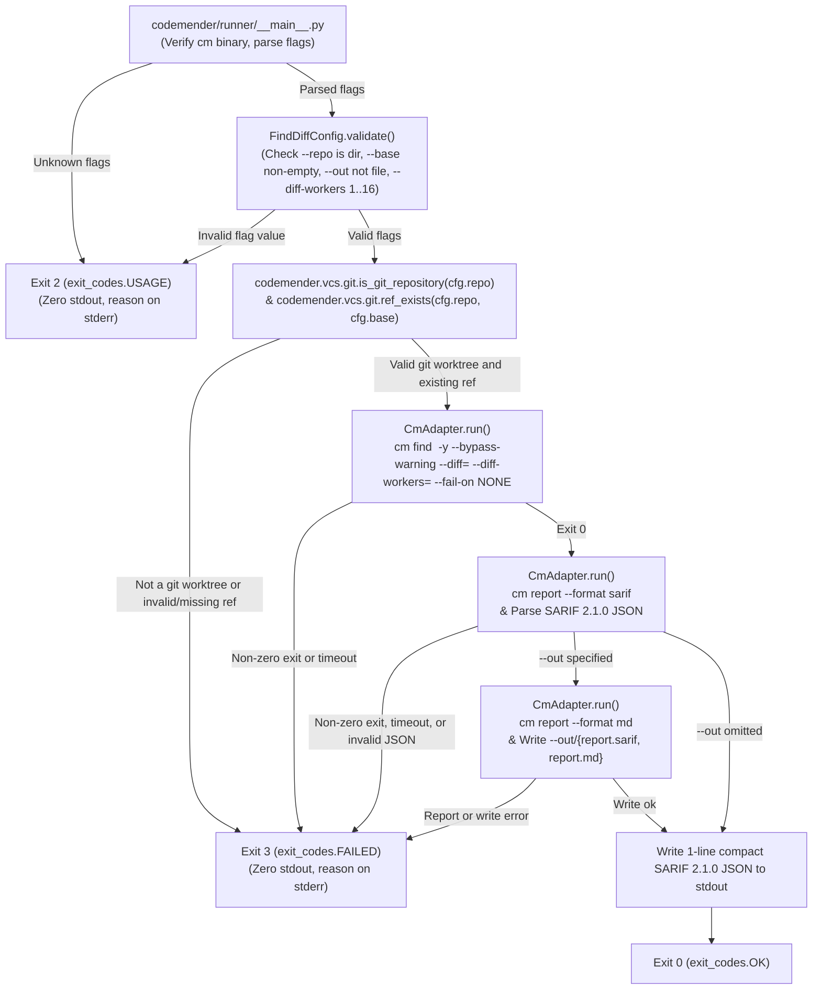
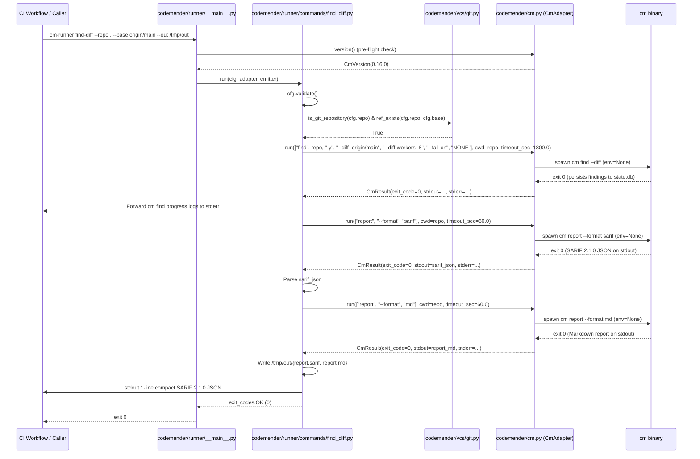

<!--*
freshness: { owner: 'codemender-maintainers', reviewed: '2026-09-30' }
*-->

<!--
sdd_spec_id: SPEC-FIND-DIFF
sdd_implements: None
sdd_extends: None
sdd_level: COMPONENT
sdd_archetype: CLI_TOOL_BATCH_JOB
sdd_cujspec_product: codemender-runner
-->

# Design: Differential Vulnerability Scanning (`cm-runner find-diff`)

## Context

As documented in
[Scaling CodeMender Scan Quality V2 (`go/codemender-rfc-30`)](https://docs.google.com/document/d/1_bB1A-dkDjaILxjohu7rKAndvOSWbR6dHcTghCS6NZ0/edit?tab=t.0#heading=h.rfwep4caowad),
running un-orchestrated full-repository `cm find .` on a repository suffers from
the "single-session agent trap" (attention diffusion across large codebases) and
wastes latency and LLM tokens scanning files unrelated to a pull request.
CodeMender (`cm` v0.9.0+) introduces native **Tier 1: Impact-Aware PR Delta
Scanning** (`cm find <repo> --diff[=<ref>]`), which:

1. Extracts modified files, diff hunks (`-U0`), and modified symbol headers via
   `git diff` (resolving `git merge-base HEAD <ref>` when a target ref is
   supplied).
1. Applies **Tier 0 deterministic heuristic pruning**
   (`discovery.IsPrunableFile`) to skip unit tests, mocks, lockfiles, generated
   code, and static assets at zero token cost.
1. Resolves **1-hop lexical caller/callee neighbors** referencing modified
   symbols (using `cm`'s built-in defaults: depth `1`, up to `10` neighbor
   files).
1. Dispatches bounded parallel per-file `FIND` sessions (using `cm`'s default of
   `4` workers) with 1-indexed file content inlined on Turn 1, a 5-tool-lookup
   cap, and a per-file session timeout (`--diff-job-timeout`, defaulting to
   `10m` and scaling up to `20m` for files `>32 KB`).
1. Filters findings to those relevant to the diff and persists them into
   `~/.codemender/state.db`.
1. Exports the persisted findings as
   [OASIS SARIF v2.1.0](https://docs.oasis-open.org/sarif/sarif/v2.1.0/sarif-v2.1.0.html)
   via `cm report --format sarif` (and as GitHub-Flavored Markdown via
   `cm report --format md`).

Governed by [SPEC-FIND-DIFF](spec.md),
[ADR-0002](../../../adr/ADR-0002.md),
[ADR-0008](../../../adr/ADR-0008-repository-layout-and-package-structure.md), and
[ADR-0003](../../../adr/ADR-0003-environment-scrubbing.md), `cm-runner find-diff`
exposes this native capability as a first-class subcommand of the generic
`cm-runner` orchestrator
(`packages/codemender/src/codemender/runner/commands/find_diff.py`).

## Goals / Non-Goals

### Goals

- Execute differential scanning via a two-step `CmAdapter` flow:
  `cm find <repo> -y --bypass-warning --diff=<base> --diff-workers=<N> --fail-on NONE` followed
  by `cm report --format sarif` (and `cm report --format md` when `--out DIR`
  is specified).
- Keep the CLI surface minimal (`--repo`, `--base`, `--out`, `--diff-workers`),
  relying on `cm`'s built-in defaults for diff relevance filtering, neighbor
  depth, and sandbox isolation, defaulting `--diff-workers` to `8` (callers may
  choose `1` to `16`; see Decision 5), and relying on
  `~/.codemender/config.yaml` (populated by `cm-runner init`) for model
  configuration.
- Emit a single, compact (non-pretty-printed)
  [OASIS SARIF v2.1.0](https://docs.oasis-open.org/sarif/sarif/v2.1.0/sarif-v2.1.0.html)
  JSON document on `stdout`.
- Generate `report.sarif` and `report.md` inside `--out DIR` when requested.
- Preserve a clean repository working tree and `exebox` sandbox compatibility by
  passing `env=None` through `CmAdapter` without calling
  `config.get_scrubbed_env()` or creating `.codemender_cache/`
  ([ADR-0003](../../../adr/ADR-0003-environment-scrubbing.md)).

### Non-Goals

- Exposing the other `cm find --diff` tuning knobs (`--diff-depth`,
  `--diff-max-neighbors`, `--diff-job-timeout`, `--fail-on-truncation`,
  `--staged`, `--unrestricted`)
  until a concrete caller use case requires overriding `cm-runner`'s defaults
  (YAGNI). `--diff-workers` is the exception (see Decision 5).
- Executing vulnerability verification (`cm verify`) or patch synthesis
  (`cm fix`), which belong to the dedicated `cm-runner verify` and
  `cm-runner fix` subcommands.
- Posting GitHub PR comments or uploading SARIF directly to the GitHub API from
  inside `codemender/runner/commands/find_diff.py` (enforced by ADR-0008's
  import boundary).

## Decisions

### Decision 1: Two-Step `cm find --diff` + `cm report --format sarif` Execution via `CmAdapter`

- **Choice:** First invoke
  `cm find <repo> -y --bypass-warning --diff=<base> --diff-workers=<N> --fail-on NONE` through
  `codemender.cm.CmAdapter` using `cm`'s built-in defaults (`1`-hop depth, `10`
  max neighbors, sandbox intact) and `<N>` concurrent workers (default `8`, see
  Decision 5) to scan the diff and persist findings into
  `~/.codemender/state.db`. After `cm find --diff` completes with exit code `0`,
  invoke `cm report --format sarif` via `CmAdapter` to retrieve the SARIF 2.1.0
  JSON document on `CmResult.stdout` (and when `--out DIR` is passed, invoke
  `cm report --format md` via `CmAdapter` to retrieve the Markdown report for
  `<out>/report.md`).
- **Alternatives Considered:**
  - *Full-repo `cm find .` with custom Python diff filtering:* Fails on
    medium/large repositories due to single-session attention diffusion and
    wastes tokens auditing untouched files.
  - *Synthesize SARIF or Markdown reports in Python:* Duplicates report
    rendering logic in Python when `cm report --format sarif` and
    `cm report --format md` already generate SARIF 2.1.0 and GitHub-Flavored
    Markdown natively.
- **Rationale:** `cm find --diff` performs the differential scan and persists
  relevant findings to `~/.codemender/state.db`, while
  `cm report --format sarif` and `cm report --format md` are `cm`'s dedicated
  report commands that write pure SARIF 2.1.0 JSON and Markdown to `stdout`
  (routing session log notices to `stderr`).

### Decision 2: Emit Compact Single-Line SARIF 2.1.0 on `stdout`

- **Choice:** Parse the SARIF 2.1.0 JSON returned by `cm report --format sarif`
  and write it to `stdout` as a single, un-indented JSON line
  (`json.dumps(sarif_doc) + " "`).
- **Alternatives Considered:**
  - *Pretty-printed multi-line SARIF on `stdout`:* Violates ADR-0001's
    single-line-per-JSON-object rule on `stdout`.
  - *Custom per-finding NDJSON wrapper events:* Requires downstream tools to
    unwrap custom envelopes before feeding SARIF into standard tooling or
    `cm report import`.
- **Rationale:** A single compact JSON line on `stdout` is simultaneously valid
  NDJSON (1 line = 1 JSON object) and a valid standalone SARIF 2.1.0 document
  that callers can pipe directly to `jq` (e.g., `jq -c '.runs[0].results[]'`),
  save as a `.sarif` file, or pass to `cm report import`.

### Decision 3: Pass `--fail-on NONE` to Decouple `cm` Exit Gate from `cm-runner` Exit Codes

- **Choice:** Always pass `--fail-on NONE` to `cm find --diff` so `cm` exits `0`
  when vulnerabilities are discovered.
- **Alternatives Considered:**
  - *Keep `cm`'s default `--fail-on CRITICAL,HIGH` and treat exit code `1` as
    success in `cm-runner`:* `cm`'s runtime errors, VCS errors, and session
    timeouts also return exit code `1`. Treating exit code `1` as
    success would mask genuine scan failures.
- **Rationale:** In `cm`'s `find.go` (`parseFailOnSeverities`), `--fail-on NONE`
  cleanly disables the severity gate while keeping non-zero exit codes active
  for VCS errors, API failures, and timeouts. This maps 1-to-1 onto ADR-0001's
  exit code contract (`0` = scan succeeded with SARIF emitted to `stdout`; `3` =
  execution failure with `0` bytes on `stdout`).

### Decision 4: Fixed Outer Timeout Circuit Breakers (`_FIND_DIFF_TIMEOUT_SEC = 1800.0`, `_CM_REPORT_TIMEOUT_SEC = 60.0`)

- **Choice:** Enforce fixed outer timeout constants
  `_FIND_DIFF_TIMEOUT_SEC = 1800.0` on `cm find --diff` and
  `_CM_REPORT_TIMEOUT_SEC = 60.0` on `cm report`, matching the pattern of
  `_FIX_TIMEOUT_SEC = 1800.0` (`fix.py`), `_VERIFY_TIMEOUT_SEC = 1800.0`
  (`verify.py`), and `_CM_INIT_TIMEOUT_SEC = 60.0` (`init.py`).
- **Rationale:** `cm find --diff` enforces a per-file session timeout
  (`--diff-job-timeout`, defaulting to `10m` and scaling up to `20m` for files
  `>32 KB`) and spends up to `3` seconds per active session cancelling server
  LROs on interruption. Setting the outer `CmAdapter` circuit breaker to `1800`
  seconds (30 minutes) gives multi-file diff scans and large files sufficient
  headroom to finish deep triage and cancel remote operations cleanly before
  `subprocess.run` terminates the child process.

### Decision 5: Configurable `--diff-workers` (Default `8`, Range `1..16`)

- **Choice:** Expose `--diff-workers N` on `cm-runner find-diff` with a default
  of `8` (`DEFAULT_DIFF_WORKERS`), and reject values outside `1..16`
  (`MIN_DIFF_WORKERS`..`MAX_DIFF_WORKERS`) in `FindDiffConfig.validate()` with
  exit code `2` before running Git or `cm`. The GitHub Action exposes the same
  setting as its `diff_workers` input.
- **Alternatives Considered:**
  - *Hardcode `16` (`cm`'s maximum):* Fastest on large diffs, but every scan
    runs up to 16 concurrent sessions against the CodeMender backend, which
    raises load and the chance of hitting project quotas, and callers cannot
    lower it.
  - *Omit the flag and use `cm`'s default (`4`):* Lowest load, but slower on
    large diffs, and callers cannot raise it.
- **Rationale:** Worker concurrency trades scan latency against backend load and
  quota, which depend on the caller's project and repository, so callers
  choose it. `8` sits between `cm`'s default and its maximum. Checking the
  `1..16` range in `cm-runner` gives callers a clear usage error instead of
  depending on how `cm` handles out-of-range values.

## Architecture

### Execution Flow



### Component Interaction Sequence



### Module Structure & Boundaries

| Module                                                        | Responsibility                                                                                                                                                                            | Boundary Constraints (ADR-0008 & ADR-0003)                                                                                                                                                     |
| :------------------------------------------------------------ | :---------------------------------------------------------------------------------------------------------------------------------------------------------------------------------------- | :--------------------------------------------------------------------------------------------------------------------------------------------------------------------------------------------- |
| `packages/codemender/src/codemender/runner/__main__.py`       | Registers `find-diff` subparser (`--repo`, `--base`, `--out`, `--diff-workers`), constructs `FindDiffConfig`, and dispatches `find_diff.run(cfg, adapter, emitter)`.                      | Redirects unhandled `stdout` writes to `stderr` via `contextlib.redirect_stdout(sys.stderr)`.                                                                                                  |
| `packages/codemender/src/codemender/runner/commands/find_diff.py` | Implements `FindDiffConfig`, `run(cfg, adapter, emitter)`, `cm find --diff` + `cm report --format sarif`/`md` orchestration, `--out` artifact writers, and compact SARIF `stdout` output. | **MUST NOT** import `subprocess`, `utils`, `vcs.github`, `get_scrubbed_env`, or `SENSITIVE_ENV_VARS`. Calls `cm` exclusively via `CmAdapter` (`env=None`) and Git via `codemender.vcs.git`. |
| `packages/codemender/src/codemender/vcs/git.py`               | Provides `is_git_repository(repo_dir: str) -> bool` and `ref_exists(repo_dir: str, ref: str) -> bool` to verify `--repo` and `--base` during pre-flight without writing to `stdout`.      | Isolates Git subprocess calls; routes any diagnostics to `stderr` / `logger`.                                                                                                                  |

### `stdout` Compact SARIF 2.1.0 Output Format

`cm-runner find-diff` writes a single un-pretty-printed
[OASIS SARIF v2.1.0](https://docs.oasis-open.org/sarif/sarif/v2.1.0/sarif-v2.1.0.html)
JSON line to `stdout`:

```json
{"$schema": "https://raw.githubusercontent.com/oasis-tcs/sarif-spec/main/sarif-2.1/schema/sarif-schema-2.1.0.json", "version": "2.1.0", "runs": [{"tool": {"driver": {"name": "CodeMender", "version": "0.16.0"}}, "results": [{"ruleId": "CWE-89", "level": "error", "message": {"text": "SQL Injection in user lookup query: User-supplied user_id is interpolated directly into the SQL query string without parameterization."}, "locations": [{"physicalLocation": {"artifactLocation": {"uri": "src/db/users.py"}, "region": {"startLine": 42, "endLine": 45}}}]}]}]}
```

## Risks / Trade-offs

- **Shallow Clones in CI Environments** → If a CI job checks out a shallow clone
  (`fetch-depth: 1`) where the `--base` ref (e.g., `origin/main`) is not fetched
  locally, `codemender.vcs.git.ref_exists` during pre-flight (or
  `git merge-base` inside `cm find --diff`) will fail.
  - *Mitigation:* `cm-runner find-diff` verifies `--base` via
    `codemender.vcs.git.ref_exists` during pre-flight, logs an actionable error
    on `stderr`, and exits early with code `3`. Caller documentation
    (`docs/guides/calling_cm_runner.md`) will document fetching the base branch
    (or using `fetch-depth: 0`) prior to running `find-diff --base <ref>`.
- **Stdout Pollution from Internal Helpers** → Calling `utils.run_command` in
  `codemender.vcs.git` prints command banners to `stdout` unless redirected.
  - *Mitigation:* `codemender/runner/__main__.py` wraps command execution in
    `contextlib.redirect_stdout(sys.stderr)`, while `EventEmitter` holds a
    reference to the real `sys.stdout` stream. Unit tests in `test_cli.py`
    (`TestStdoutPurity` and `TestLayoutBoundaries`) enforce this invariant.

## Deployment & Rollback

- **Deployment:** Ship
  `packages/codemender/src/codemender/runner/commands/find_diff.py`, wire the
  `find-diff` subparser in
  `packages/codemender/src/codemender/runner/__main__.py`, update
  `docs/guides/calling_cm_runner.md`, and add hermetic unit tests in
  `packages/codemender/src/codemender/runner/commands/test_find_diff.py`.
- **Verification:** Run `make test`.
- **Rollback:** Revert the `find-diff` commit(s).

## Open Questions

- None at this stage; all `cm find --diff` tuning parameters other than
  `--diff-workers` are deferred to `cm`'s defaults until a concrete caller
  requirement emerges.
