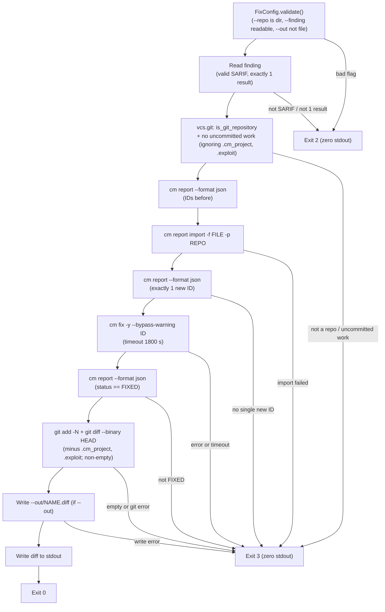

<!--*
freshness: { owner: 'codemender-maintainers', reviewed: '2026-09-30' }
*-->

<!--
sdd_spec_id: SPEC-FIX
sdd_implements: None
sdd_extends: None
sdd_level: COMPONENT
sdd_archetype: CLI_TOOL_BATCH_JOB
sdd_cujspec_product: codemender-runner
-->

# Design: Patch One Finding (`cm-runner fix`)

## Context

`find-diff` (SPEC-FIND-DIFF) writes the findings for a pull request as one
SARIF document. E3 of the project plan asks for the next step: given a
repository and one finding, run `cm fix` and hand back a diff.

`cm fix` does not take a file. It takes the ID of a finding already in `cm`'s
local database (`~/.codemender/state.db`). So `fix` has to get the finding into
that database first, run `cm fix`, check that it worked, and collect the patch.

Governed by [SPEC-FIX](spec.md),
[ADR-0001](../../adr/ADR-0001-machine-readable-output-contract.md),
[ADR-0002](../../adr/ADR-0002-runner-layout-and-build.md), and
[ADR-0003](../../adr/ADR-0003-environment-scrubbing.md).

### Verified `cm` Behaviour

Checked on 2026-09-30 with `cm` 0.11.0 (the current `stable`) on a test VM,
using throwaway `HOME`s and a 10-line Python file with an `os.system` command
injection. Two runs: one finding imported from `cm`'s JSON format, one imported
from `cm`'s SARIF.

| # | Fact | Consequence for `fix` |
| :- | :--- | :--- |
| 1 | `cm fix` accepts only a finding ID. `cm report import -f FILE -p REPO` accepts JSON or SARIF and assigns a **new** ID on every import, but does not print it. | Import, then compare `cm report --format json` before and after to find the new ID. |
| 2 | A finding imported from **SARIF fixed as well as one imported from JSON**, even though the SARIF import loses the title (it becomes `"CWE-78"`) and lowers severity from CRITICAL to HIGH. | SARIF, the format `find-diff` writes, is a sound input. |
| 3 | The default model (`gemini-3.8-flash`) produced a correct patch in both runs, marking the finding `FIXED`. (It failed with server error 13 on `cm` 0.9.0.) | No `--model` flag. |
| 4 | **Each run took 8–9 minutes** (545 s and 479 s, about 40 agent steps), even for a 10-line file. On 0.9.0 it took 19–65 s. | Timeout of 30 minutes. |
| 5 | **`cm fix` first runs `git checkout HEAD -- . && git clean -fd`.** An uncommitted edit was reverted and an untracked file deleted. | Refuse to run on a repository with uncommitted work. |
| 6 | `cm fix` exits `0` either way. The result is the finding's `status` in `cm report --format json`. | Confirm `FIXED` before collecting the patch. |
| 7 | The patch appeared in three identical forms: `git diff HEAD` (minus `.cm_project`), `cm report --patches` (display format), and `cm fix`'s `stdout` (mixed with progress text). It was not staged. `cm fix --export` prints "not yet implemented". | Collect the patch with Git. |
| 8 | `cm` leaves `.cm_project` untracked in the repository. `verify` also leaves `.exploit/`. | Exclude both from the dirty check and from the diff. |
| 9 | `cm report --format sarif` does not include the patch (no `fixes` list) or the `FIXED` status. | `cm` has no SARIF output for a fix to pass through (see Decision 2). |

## Goals / Non-Goals

### Goals

- Fix exactly one finding per run, given as a SARIF file or on `stdin`.
- Use only `cm`'s own commands (`report`, `report import`, `fix`) through
  `CmAdapter`, with `env=None` (ADR-0003).
- Write the patch to `stdout` in a form the caller can apply directly, and
  optionally to `--out DIR`.
- Never destroy uncommitted work in the caller's repository.

### Non-Goals

- Fixing several findings in one run. The caller loops (SPEC-FIX REQ-0008).
- Retrying a failed fix, choosing a model, or passing extra context to the
  agent, until a caller needs it.
- Verifying the patch (`cm-runner verify`, E4), committing it, pushing it, or
  posting it to a pull request (the CI job, per ADR-0002).
- Writing into `cm`'s SQLite database directly.

## Decisions

### Decision 1: Import the Finding with `cm report import`

- **Choice:** Validate that the SARIF holds exactly one result, import it with
  `cm report import`, and find its new ID by comparing
  `cm report --format json` before and after.
- **Alternatives Considered:**
  - *Take a finding ID on the command line:* only works on the machine and in
    the `HOME` where `find-diff` ran, and `find-diff`'s SARIF carries no ID.
  - *Insert the finding into `state.db` with SQL:* ties us to `cm`'s private
    table layout, which can change in any release.
  - *Take `cm`'s JSON format instead of SARIF:* lossless (keeps title and
    severity), but `find-diff` writes SARIF, and fact 2 shows the loss does not
    affect the fix.
- **Rationale:** `cm report import` is `cm`'s supported way in, and the
  before/after comparison works even when the database already holds findings
  from earlier runs.

### Decision 2: Raw Unified Diff on `stdout` (Proposed — Needs a Decision) {#decision-2}

- **Choice (proposed):** Write the patch to `stdout` exactly as
  `git diff --binary HEAD` produced it, and nothing else.
- **Alternatives Considered:**
  - **A. SARIF with a `fixes` list:** return the input finding with SARIF's
    standard `fixes[].artifactChanges[].replacements[]` filled in. It keeps the
    same format as `find-diff`, but `cm` does not produce it (fact 9), so we
    would have to convert the diff into SARIF edits in Python, which
    SPEC-FIND-DIFF's design rejects for reports. Whether GitHub code scanning
    uses `fixes` has not been checked.
  - **C. A JSON event:** `{"ts": ..., "event": "fix", "status": "FIXED", "diff": "..."}`.
    Keeps ADR-0001's event shape, but wraps the result in an envelope, which
    SPEC-FIND-DIFF moved away from.
- **Rationale:** SPEC-FIND-DIFF writes each result in its standard format with
  no wrapper. For findings that format is SARIF. For a patch it is a unified
  diff, which every caller can apply with `git apply` and which `cm` itself
  prints. It needs no conversion code.
- **Consequence:** `stdout` is not JSON for this command. ADR-0001 rule 1
  ("stdout is JSON only") and its event schema need amending. SPEC-FIND-DIFF
  already needs the event schema amended, since its SARIF line has no `ts` or
  `event`. One amendment can cover both: *stdout carries the command's result
  in its standard format, and nothing else.*

### Decision 3: Refuse to Run on Uncommitted Work

- **Choice:** Exit `3` before calling `cm` if `--repo` has any modified, staged,
  or untracked file other than `.cm_project` and `.exploit/`.
- **Alternatives Considered:**
  - *Warn and carry on:* the warning would scroll past in CI logs, and on a
    laptop the work is gone before anyone reads it (fact 5).
  - *Work in a throwaway `git worktree` copy:* protects the caller's folder
    completely, but adds setup and clean-up code that CI does not need, because
    CI checkouts are always clean.
- **Rationale:** One check prevents silent data loss. CI is unaffected, and a
  developer gets a clear message instead of lost work.

### Decision 4: Collect the Patch with Git, After Confirming `FIXED`

- **Choice:** After `cm report --format json` shows `FIXED`, mark untracked
  files intent-to-add (`git add -N`), then run
  `git diff --binary HEAD -- . ':!.cm_project' ':!.exploit'`.
- **Alternatives Considered:**
  - *Parse the diff out of `cm fix`'s `stdout`:* it is mixed with progress text
    and emoji banners.
  - *`cm report --patches`:* a display format, indented and framed.
  - *`cm fix --export`:* not implemented in 0.11.0 (fact 7).
- **Rationale:** Git gives a diff that `git apply` accepts, including new files
  and binary changes, and it matched `cm`'s own patch exactly in both runs.

### Decision 5: One Attempt, 30-Minute Timeout

- **Choice:** `_FIX_TIMEOUT_SEC = 1800.0`; no retries.
- **Rationale:** A 10-line file took 8–9 minutes (fact 4), so real repositories
  need a generous limit. Both test runs succeeded first time. A caller that
  wants retries can rerun the command, and CI systems already have retry
  settings.

## Architecture

### Execution Flow

### Module Structure & Boundaries

| Module | Responsibility | Boundary Constraints |
| :--- | :--- | :--- |
| `cli/__main__.py` | Registers `fix` (`--finding`, `--repo`, `--out`), builds `FixConfig`, calls `fix.run(cfg, adapter, emitter)`. | Already redirects stray `stdout` writes to `stderr` while a command runs. |
| `cli/commands/fix.py` | `FixConfig`, `validate()`, the steps above as one private function each, writing the diff. | **MUST NOT** import `subprocess`, `utils`, `vcs.github`, or `get_scrubbed_env`. `cm` only through `CmAdapter` (`env=None`). |
| `codemender/cm.py` | A shared helper that imports one finding and returns its new ID, plus reading a finding's status from `cm report --format json`. | Shared with `cm-runner verify` (E4), so both commands take findings the same way. |
| `vcs/git.py` | `is_git_repository` (shared with SPEC-FIND-DIFF), a helper listing uncommitted files with exclusions, and a helper returning the diff. | Git subprocesses stay here. Diagnostics go to `stderr`. |

## Risks / Trade-offs

- **Slow runs** → 8–9 minutes for a trivial file. Running one `fix` per
  finding one after another can make a CI job take a long time.
  - *Mitigation:* each `fix` is independent, so callers can run them in
    parallel in separate checkouts or containers. The caller guide says so.
- **Different patch each run** → two runs on the same finding gave different,
  equally correct patches (`shlex.quote` vs `subprocess.run([...])`).
  - *Mitigation:* none needed in `fix`. Callers must not compare patches by
    text. `cm-runner verify` (E4) is the check that a patch works.
- **`stdout` is not JSON** (Decision 2) → any tool that assumes every
  `cm-runner` command writes JSON will break on `fix`.
  - *Mitigation:* amend ADR-0001 alongside SPEC-FIND-DIFF. No caller exists yet.
- **The responsibility warning is accepted automatically** (`--bypass-warning`),
  as the existing pipeline does.
  - *Mitigation:* listed under Open Questions for a product decision.

## Deployment & Rollback

- **Deployment:** add `codemender-runner/cli/commands/fix.py`, register it in
  `cli/__main__.py`, add the helpers to `codemender/cm.py` and `vcs/git.py`,
  update `docs/guides/calling_cm_runner.md`, and add unit tests in
  `codemender-runner/tests/test_cli_fix.py` using stub `cm` binaries.
- **`cm` version:** relies on `cm` 0.11.0 behaviour. The Docker image and
  `cloudbuild.yaml` currently pin 0.9.0 and must be moved to at least 0.11.0,
  which SPEC-FIND-DIFF also needs (`cm find --diff` arrived in 0.10.0).
- **Verification:**
  `python3 -m unittest discover -s codemender-runner/tests -t codemender-runner -v`,
  plus one live run on the test VM.
- **Rollback:** revert the `fix` commit(s).

## Open Questions

1. **Output format (Decision 2):** raw unified diff (proposed), SARIF with
   `fixes` (A), or a JSON event (C)? Owner: cledoux@.
1. **Shared finding import with `verify`:** both commands take a one-finding
   SARIF file. The import helper in `codemender/cm.py` should be written once
   and used by both. Owners: nasirmohammad@, yileil@.
1. **Responsibility warning:** is it acceptable for `cm-runner` to pass
   `--bypass-warning` on every run, as the existing pipeline does, or should the
   caller have to opt in? Product decision.
1. **Sandbox network:** `cm-runner init` writes `permissive-open` (network on)
   by default. Both test runs used `cm`'s own default (network off) and fixed
   successfully. Should `init`'s default change? Out of scope for this spec,
   but it affects what the `fix` agent can reach.
