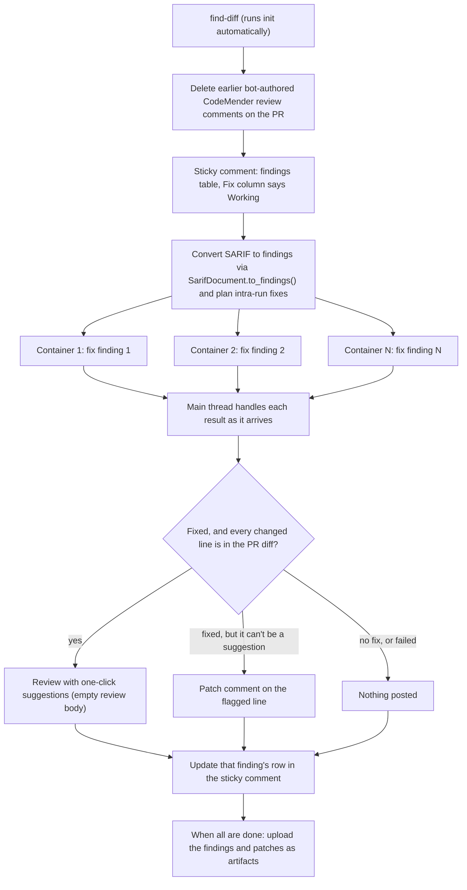

<!--*
freshness: { owner: 'codemender-maintainers', reviewed: '2026-10-31' }
*-->

<!--
sdd_spec_id: SPEC-GHA-FIX
sdd_implements: None
sdd_extends: SPEC-GHA
sdd_level: COMPONENT
sdd_archetype: CI_CD_WORKFLOW
sdd_cujspec_product: codemender-runner
-->

# Design: Fixes on Pull Requests (GitHub Action, M2)

## Context

The CodeMender GitHub Actions (`.github/actions/codemender/` and
`.github/actions/codemender-local/`) run on pull requests via the `cm-github`
orchestrator (`packages/repohost/src/repohost/github/`). Milestone 1 (M1) runs
`cm-runner init` and `cm-runner find-diff` and posts one PR comment, the *sticky
comment*: a table of the findings in the PR's changes, with a drill-down. It
edits that comment on every push.

M2 adds fixes. For each finding, the action runs `cm-runner fix`
([SPEC-FIX](../fix/spec.md)) and puts the patch on the PR, next to the code it
changes.

This document covers the fix half and records what we decided and why. The
find half is in [SPEC-GHA's design](../github-actions/design.md). A combined
find + fix architecture doc can link to both instead of repeating them.

Who owns what:

- `cm-runner fix` belongs to the cm-runner team. It fixes exactly one finding
  per call and doesn't post anything.
- Everything in this document belongs to the action: running `fix` once per
  finding, keeping the runs apart, and posting the results.

Governed by [SPEC-GHA-FIX](spec.md), [SPEC-GHA](../github-actions/spec.md),
[SPEC-FIX](../fix/spec.md),
[ADR-0002](../../../adr/ADR-0002.md),
[ADR-0008](../../../adr/ADR-0008-repository-layout-and-package-structure.md),
[ADR-0003](../../../adr/ADR-0003-environment-scrubbing.md) and
[ADR-0006](../../../adr/ADR-0006-pr-remediation-routing-and-security-gate.md).

### What We Checked

| # | Fact | Source | What it means for the action |
| :- | :--- | :--- | :--- |
| 1 | `fix` handles one finding per call. Running several, in parallel or not, is the caller's job. | [SPEC-FIX design](../fix/design.md), non-goals | The loop is ours. |
| 2 | `fix` writes the patch to stdout as a raw unified diff, not JSON. It also writes it to `<finding>.diff` in `--out`. | SPEC-FIX REQ-0005, REQ-0006 | The launcher can't parse `fix`'s stdout as NDJSON. We read the file. |
| 3 | `cm fix` starts with `git checkout HEAD -- . && git clean -fd`, and `fix` refuses to run on a tree with uncommitted work. | SPEC-FIX REQ-0003 | Each fix needs a clean checkout of its own. |
| 4 | `fix` finds the ID of the finding it imported by comparing `cm report` before and after the import. | [`fix.py`](../../../../packages/codemender/src/codemender/runner/commands/fix.py) | Two fixes sharing a `cm` home would each see two new IDs and fail. |
| 5 | The legacy parallel design found that the CodeMender server allows one active session per project ID. `cm` stores that ID in a `.cm_project` file inside the repository. | `parallelization_design.md` | Each fix starts from the original checkout, never from the scan's copy, which has a `.cm_project`. Not yet confirmed on `cm` 0.11.0. |
| 6 | A fix to a 10-line file took 8–9 minutes, and `fix` enforces a per-finding timeout (`_FIX_TIMEOUT_SEC`). | SPEC-FIX design, fact 4 | Fixes one after another would take hours. They have to run at the same time. |
| 7 | For pull requests, `actions/checkout` puts a temporary merge commit on disk by default, not the PR's head. | [GitHub docs](https://github.com/actions/checkout) | Line numbers from the scan wouldn't match the PR's *Files changed* view, where suggestions attach. |
| 8 | `cm` gives a finding a new ID on every import. | SPEC-FIX REQ-0004 | IDs can't tell us that an earlier run already posted a fix. |
| 9 | cm-runner has no limit on tokens, cost or number of fixes, only time limits. | `fix.py`, `find_diff.py` | No "budget" input. |
| 10 | cm-runner sets `build.command` only when explicitly configured via `.codemender.yaml` or `CODEMENDER_BUILD_COMMAND`; it does not guess a build command from repository files. | [`config.py`](../../../../packages/codemender/src/codemender/runner/config.py) `inject_codemender_config` | Unconfigured repositories leave `build.command` unset, so `cm fix` skips `validateFixBuild` instead of failing on a guessed command whose dependencies aren't installed. |
| 11 | When `cm` has a build command, it runs it after the agent finishes. If it fails, `cm` leaves the finding open, so `fix` exits 3 (no fix). This is in `cm` since cl/987005678 (2026-09-23). | `gdm/security/cmoc/client/cmd/fix.go` | A project whose build can't run here gets "No fix", not an untested fix. Not yet confirmed on `cm` 0.11.0. |
| 12 | `cm` runs that last build in its main process, not in its sandbox. In our container, that process has network access and can read the Google credentials file. | Same file, `validateFixBuild` | The project's build and tests run with network access, next to the credentials. See [Security](#security). |

## Goals / Non-Goals

### Goals

- Try a fix for every finding `find-diff` reports, unless the repository turns
  fixes off.
- Put each fix next to the code it changes: a one-click suggestion when GitHub
  allows it, otherwise a collapsed patch on the flagged line.
- Keep the sticky comment a short overview of the PR's health.
- Keep the PR's GitHub token out of every container
  ([ADR-0008](../../../adr/ADR-0008-repository-layout-and-package-structure.md)).
- Finish in about the time of the slowest fix, within one job.

### Non-Goals

- Child PRs or pushing branches (ADR-0006 Tier 2). They need write access to
  the repository's contents.
- A security gate status check (ADR-0006).
- Installing dependencies or opening the network so fixes can be built and
  tested ([Decision 7](#decision-7)).
- Limits on cost, time or the number of fixes ([Decision 6](#decision-6)).
- Verifying fixes with `cm-runner verify` (covered by SPEC-GHA-VERIFY, M3).

## Decisions

### Decision 1: Run All Fixes at Once, One Container per Finding {#decision-1}

- **Choice:** One thread per finding. Each thread runs one gVisor container
  (`docker run --runtime=runsc`) on the job's VM. Each fix gets its own copy of
  the checkout, its own empty `cm` home and its own output folder. Only the
  main thread talks to GitHub, and it handles results in the order they finish.
- **Alternatives Considered:**
  - *One fix after another:* the simplest code, but each fix takes about 10
    minutes, so five findings would take most of an hour.
  - *One VM per fix (a matrix job):* no faster than containers on one VM, and
    it costs more. Every VM repeats the checkout, gVisor install, image pull
    and Google sign-in. Private repositories pay for every VM's minutes. The
    client's workflow grows to three jobs. We keep it as the fallback if one VM
    turns out to be too small ([Risks](#risks--trade-offs)).
- **Rationale:** Almost all of a fix's time is spent waiting on the CodeMender
  agent, so running fixes side by side brings the total down to about the
  slowest fix. Separate folders and `cm` homes mean the runs share no files
  (facts 3–5), so nothing needs locking or resetting.

### Decision 2: Action Inputs (`fix`, `max_parallel_fixes`) {#decision-2}

- **Choice:**
  - `fix` defaults to `'true'`. `false`, `0` and `no` turn fixes off. Anything
    else, including an empty value, leaves them on.
  - `max_parallel_fixes` defaults to `'4'` (positive integer bounding concurrent
    fix containers).
  - The workflow template shows `# fix: false` and `# max_parallel_fixes: '4'`
    commented out.
- **Alternatives Considered:**
  - *Off by default:* fewer surprises about time and cost, but most clients
    would never see a fix.
  - *More settings* (a severity filter, a token/cost budget): see
    [Decision 6](#decision-6).
- **Rationale:** Fixes are the point of M2, and a single boolean switch is easy
  to explain. An admin who wants to turn fixes off without editing the workflow
  file can write `fix: ${{ vars.CODEMENDER_FIX || 'true' }}` and use a
  repository variable.

### Decision 3: Fixes Go Next to the Code; the Sticky Comment Stays an Overview {#decision-3}

- **Choice:**
  - If every line a patch changes is in the PR diff, post a review with
    one-click suggestions. One review per finding.
  - Otherwise, post a *patch comment*: a review comment on the flagged line
    that says in one sentence why it can't be a suggestion, with the diff
    collapsed under *Show the fix*. If GitHub won't accept a comment on that
    line, post it on the file instead. If that fails too, the sticky comment
    links to the patch in the run's artifacts.
  - A patch that touches `.github/` always gets a patch comment, so a person
    looks at any CI change an AI agent proposes.
  - The sticky comment gets a Fix column: ⏳ Working, ✅ Suggested, 📎 Patch,
    ❌ No fix or ⚠️ Failed. Patches never go in the sticky comment.
- **Alternatives Considered:**
  - *Patches in the sticky comment:* one place to look, but it grows with every
    finding and stops being an overview.
  - *Child PRs for patches that can't be suggestions* (ADR-0006 Tier 2): easier
    to apply, but the job would need write access and would push branches.
    Later.
  - *Suggest only the parts GitHub allows:* the developer could commit half a
    fix without noticing. It's the whole patch or none of it, as in the legacy
    code (rejected alternative 13).
- **Rationale:** A reviewer sees the fix where the problem is, in *Files
  changed*. Suggestions can only replace lines shown in the PR diff, and many
  real fixes touch other lines (an import at the top of the file is common), so
  the fallback has to work well too.

### Decision 4: Check Out the PR Head {#decision-4}

- **Choice:** `ref: ${{ github.event.pull_request.head.sha }}` in the
  template's `actions/checkout` step, with `fetch-depth: 0`.
- **Rationale:** `fix` takes its line numbers from the code on disk, and
  suggestions attach to the PR head. With the merge commit on disk (fact 7),
  they disagree whenever main has moved since the PR branched. `find-diff
  --base <base.sha>` still scans exactly the PR's changes, because `cm`
  compares the head with the merge base. This also fixes M1's location links,
  and it's what the legacy pipeline does.
- **Trade-off:** The scan doesn't see changes that landed on main after the PR
  branched.

### Decision 5: Two Fixes That Change the Same Lines: Post Both, With a Note {#decision-5}

- **Choice:** Before posting, compare the line ranges of the patches. If two
  overlap, both comments say: "This fix changes the same lines as the fix for
  #N. Commit one; CodeMender checks the other again on the next push."
- **Alternatives Considered:** post only one (we would have to guess which), or
  merge the two patches (code the agent never checked).
- **Rationale:** Each fix is made on its own, from the PR head. Committing a
  suggestion is a push, which runs the workflow again, which fixes the other
  finding again if it's still there.

### Decision 6: Bounded Concurrency (`max_parallel_fixes`), No Cost Budget {#decision-6}

- **Choice:** Bound concurrent fix containers to `max_parallel_fixes` (default
  `4`), stage each finding's workspace copy only when its worker starts, and
  delete its folder as soon as its patch is saved. No cost or token budget or
  severity filter: every finding gets a fix attempt. cm-runner's own timeout
  per fix (`_FIX_TIMEOUT_SEC`, with a slightly longer outer container timeout
  `FIX_TIMEOUT_SECONDS`) bounds each container, and the workflow template sets
  a job-level timeout ceiling.
- **Rationale:** Standard GitHub-hosted runners have 2 vCPUs, 8 GB RAM and
  14 GB free disk. Bounding concurrency to 4 prevents OOM and disk exhaustion
  when a PR has many findings, while customers on larger runners can raise
  `max_parallel_fixes`.

### Decision 7: Universal Runner Image, BYOI (`runner_image`) & `.codemender.yaml` {#decision-7}

- **Choice:** `cm`'s sandbox keeps its network closed (cm-runner's default,
  `permissive-closed`), and the action installs no project dependencies on the
  GHA host. Instead, builds are supported through three mechanisms:
  1. **Universal Runner Image:** `codemender-runner` pre-installs standard
     toolchains (Python 3.11, Node 22 + `npm`/`yarn`/`pnpm`, OpenJDK 17 +
     `mvn`/`gradle`, Go 1.22, C/C++ `build-essential`).
  2. **Bring-Your-Own-Image (BYOI) via `runner_image`:** Repositories requiring
     third-party packages or custom toolchains can extend `FROM
     codemender-runner:<sha>` with their dependencies pre-installed and supply
     that image via `runner_image`. With BYOI, customers do not need to open the
     sandbox network or pre-install dependencies in the GHA workflow before
     calling CodeMender.
  3. **Explicit `.codemender.yaml` (`build.command`):** `cm-runner init` reads
     `build.command` from `.codemender.yaml` (or `CODEMENDER_BUILD_COMMAND`)
     when explicitly configured, and leaves it unset otherwise (fact 10).
- **Alternatives Considered:**
  - *Open the sandbox network*
    (`CODEMENDER_SANDBOX_NETWORK_PROFILE=permissive-open`): the agent's commands
    and the project's tests get full internet access. Needs a security review.
  - *Install dependencies on the host first:* in a separate container that has
    network access, writing into the workspace copy. Each language then needs
    its own install step and offline build flags.
- **What actually happens:** `cm-runner init` honours `.codemender.yaml` (fact
  10), and `cm` runs `build.command` after the agent finishes when one is
  configured (skipping post-fix build verification when unset). When
  dependencies are pre-baked via BYOI (`runner_image`) or the project uses
  standard library / lightweight checks via `.codemender.yaml`, `cm fix` builds
  and verifies patches completely offline inside the container.

### Decision 8: The Responsibility Warning Gets a README Note {#decision-8}

- **Choice:** cm-runner passes `--bypass-warning` to `cm fix`, as the legacy
  pipeline does, and the README says so.
- **Context:** Without the flag, `cm` asks for a yes before its agent changes a
  file or runs a command: "The CodeMender agent may modify files or execute
  commands on your system. It is highly recommended to run this CLI in a safe
  sandboxed environment or isolated VM." In the action, the agent runs in a
  gVisor container on a GitHub runner VM that is deleted after the job, and
  nothing is committed until a person commits it.
- **Rationale:** With fixes on by default, no client answers that prompt
  themselves. SPEC-FIX left it as a product decision (open question 3). A plain
  note is enough at the demo stage.

### Decision 9: Wipe Earlier CodeMender Review Comments on Every Run {#decision-9}

- **Choice:** Every suggestion and patch comment carries a hidden tag,
  `<!-- codemender-finding:<fingerprint> -->`. `SarifDocument.to_findings()`
  uses each result's first non-empty SARIF `fingerprints` value, else its first
  non-empty `partialFingerprints` value (falling back to a 12-hex SHA-256 of
  normalized file path + rule ID + start line + message) as
  `Finding.finding_id`. It never reads the result's `properties` bag. On every
  PR scan run (`run_pr`), the action lists the PR's review comments and deletes
  all earlier bot-authored CodeMender review comments
  (`DELETE /repos/{repo}/pulls/comments/{comment_id}` for finding,
  verification, and overlap-reply comments), even if the scan finds `0`
  vulnerabilities or `fix: false`. Suggestion reviews are posted with an empty
  review wrapper body (`"body": ""`) so deleting their inline comments leaves no
  empty review header banner in the PR timeline. Every finding from the current
  scan is fixed fresh; two findings with the same `finding_id` in one run are
  fixed once (`plan_fixes`).
- **Alternatives Considered:**
  - *`cm`'s internal database ID:* changes on every import (fact 8).
  - *Strings in the result's `properties` bag:* not identifiers. `cm` writes
    `security-severity` on every result, so every finding of one severity
    would share one ID, get one fix, and block the others' verification.
  - *Cross-run fingerprint deduplication:* skipping findings whose fingerprint
    matched a non-outdated comment from an earlier run proved brittle when LLM
    findings or rule/line hashes shifted across runs, leaving duplicate or stale
    comments on the PR.
- **Rationale:** Treating each PR scan run as a clean slate for inline review
  comments (while updating the sticky summary comment in place) guarantees the
  PR never accumulates duplicate or stale CodeMender comments across pushes. The
  `<!-- codemender-finding:<fingerprint> -->` tag remains on each new fix
  comment for intra-run deduplication and on-demand `@cm-runner verify`
  ([SPEC-GHA-VERIFY](../github-actions-verify/spec.md)).

### Decision 10: The Launcher Runs Parallel Containers and Hands Patches Over as Files {#decision-10}

- **Choice:** `run(command, args=(), log_path=None)` and `run_parallel(tasks, *, src_workspace, temp_root, timeout_seconds, max_workers)`.
  - `RunResult` carries `stdout` and `stderr` as raw bytes without
    command-specific parsing, and the action reads `fix` patches from `--out`.
  - Every container gets a unique name. The launcher runs `docker kill` on it
    when its timeout fires or `stop()` is called on job cancellation.
  - Each fix writes its stderr to its own log file. The action prints the log
    in a collapsible group when that fix ends.
- **Rationale:**
  - SPEC-GHA REQ-0008 makes files the way results cross between backends. The
    Cloud Run client will write the same paths.
  - Reading stdout as text would turn `\r\n` into `\n`, which SPEC-FIX REQ-0005
    forbids.
  - When a `subprocess` timeout kills the `docker` command, the container keeps
    running.
  - Several fixes writing to the job log at once would mix their lines
    together.
- **Consequence:** ADR-0001 specifies that `stdout` carries each command's
  result in its standard format (NDJSON events for `version`/`init`, SARIF for
  `find-diff`, and raw unified diff bytes for `fix`).

## Architecture

### Flow



### Folders for One Fix

```text
$RUNNER_TEMP/codemender-fix-finding-001-<rand>/
  workspace/   copy of $GITHUB_WORKSPACE, without gha-creds-*.json, .cm_project and .exploit
  cm-home/     empty; cm-runner's automatic init sets it up
  out/         finding-001.sarif goes in; finding-001.diff comes out
```

The container runs `fix --repo /workspace --finding /out/finding-001.sarif
--out /out`. The action copies `finding-001.diff` to `out_dir/fixes/` for the
artifact upload, then deletes the folder.

### Results

| Result | When | Fix column | Job |
| :--- | :--- | :--- | :--- |
| `fixed` | exit 0 and a non-empty `.diff` | ✅ Suggested or 📎 Patch | passes |
| `no_fix` | exit 3: no patch, a `cm` error, or cm-runner's own fix timeout (`_FIX_TIMEOUT_SEC`) | ❌ No fix | passes |
| `failed` | exit 2, any other exit code, a launcher error, or the outer container timeout (`FIX_TIMEOUT_SECONDS`) | ⚠️ Failed, plus a warning in the log | passes |

Findings and failed fixes never fail the job, the same as findings in M1.

### Code

| File | Change |
| :--- | :--- |
| `packages/codemender/src/codemender/cm.py`, `sarif/__init__.py`, `vcs/git.py` | Shared `Finding` model, `SarifDocument.to_findings()`, and `parse_patch_to_suggestions`. |
| `packages/launcher/src/launcher/base.py`, `packages/launcher/src/launcher/local/local_docker.py` | Raw stdout, `run_parallel()`, per-run log file, container names, `docker kill` on timeout, `stop()`, and `with_dirs()`. |
| `packages/repohost/src/repohost/github/fix_comments.py` | Intra-run finding deduplication (`plan_fixes`) and posting review suggestions or fallback patch comments (`FixPoster`). |
| `packages/repohost/src/repohost/github/client.py` | Reviews (with empty wrapper body), patch comments, the PR diff's line ranges, and deleting earlier CodeMender review comments. |
| `packages/repohost/src/repohost/github/__main__.py` (`cm-github`) | The `fix` and `max_parallel_fixes` inputs, wiping earlier review comments, the parallel runs, posting, and the Fix column. |
| `.github/actions/codemender/action.yml`, `.github/actions/codemender-local/action.yml`, `.github/workflows/cm-merge-scan.yml`, `dist/README.md` | The inputs, the head checkout, the 60-minute timeout, the artifacts and the documentation. |

## Security

- The PR's `GITHUB_TOKEN` never enters a container. Only the main thread on
  the host uses it.
- Containers get only explicit, allowlisted `-e KEY=VALUE` variables
  ([ADR-0003](../../../adr/ADR-0003-environment-scrubbing.md)). They run under
  gVisor, never with `--privileged`.
- Patches and everything `cm` writes are untrusted. Code fences are one
  backtick longer than the longest run of backticks in the patch, table cells
  are escaped, and comment bodies are trimmed to GitHub's limit.
- A patch that touches `.github/` is never a one-click suggestion. Newer `cm`
  versions also stop the agent from editing CI and build files unless the
  finding is in one (cl/993740380); our rule stays as a second check.
- **Known gap (fact 12):** `cm` runs the project's build in its main process,
  outside its own sandbox. In the fix container, that process has network
  access and can read the Google credentials file. In most setups, someone who
  can open a PR from a branch of the repository could already get those
  credentials by changing the workflow file in their PR. The new exposure is to
  a malicious dependency, or to code the agent was tricked into writing. We
  will ask the cm-runner team to take this to the `cm` team: the build should
  run inside `cm`'s sandbox, like the agent's own commands.

## Risks / Trade-offs

- **One VM, many builds.** A private repository's standard runner has 2 CPUs,
  8 GB of memory and 14 GB of disk, and every fix has its own copy of the
  repository. The legacy parallel design dropped side-by-side fixes on one
  machine because builds ran out of memory. If the end-to-end test shows the
  same, we add a limit or move to one VM per fix.
- **Rate limits.** Many fixes at once can hit the CodeMender API's rate limits
  (HTTP 429), as the legacy design warns.
- **Most fixes may come back as "No fix"** on projects whose build can't run
  here ([Decision 7](#decision-7)).
- **Cancelled runs.** A new push cancels the running workflow
  (`cancel-in-progress`), and the job times out after 60 minutes. Each fix is
  posted as soon as it ends, so only the fixes still running are lost.
- **Re-running fixes on every push.** Wiping earlier CodeMender review comments
  and fixing all findings fresh on every push guarantees a clean PR without
  duplicate or stale comments, at the cost of re-running `fix` on unchanged
  findings until cross-run deduplication is revisited (Decision 9).

## Rollout & Rollback

- Clients get M2 by updating their copy of the action and the workflow
  template ([SPEC-DIST](../distribute/spec.md)).
- To roll back, a client sets `fix: false`. The action then does exactly what
  M1 did.

## Open Questions (to Check in the End-to-End Test)

1. Does `cm` 0.11.0 report no fix when the build fails (fact 11)? This decides
   whether most projects get any fixes before the cm-runner follow-up.
2. Memory, disk and time with about five fixes at once on a 2-CPU, 8 GB runner.
3. Does the CodeMender API return HTTP 429 when several fixes run at once?
4. Is there still one active session per project ID on `cm` 0.11.0 (fact 5)?
5. ~~Does `cm`'s SARIF include `partialFingerprints` (Decision 9)?~~ —
   **Resolved:** No. `cm` 0.16.0 writes no `fingerprints` or
   `partialFingerprints`, only `properties["security-severity"]`, so every
   `cm` finding gets the hash ID.
6. Does a PR from a fork work?
7. A workflow with no `fix:` line runs fixes, and `fix: false` turns them off.
