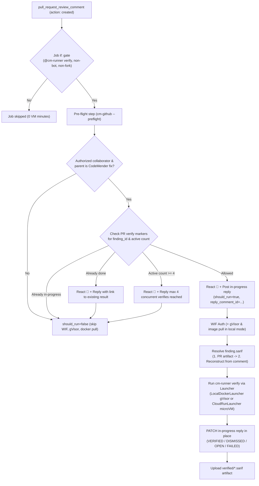

<!--*
freshness: { owner: 'codemender-maintainers', reviewed: '2026-10-16' }
*-->

<!--
sdd_spec_id: SPEC-GHA-VERIFY
sdd_implements: None
sdd_extends: SPEC-GHA, SPEC-GHA-FIX, SPEC-VERIFY
sdd_level: COMPONENT
sdd_archetype: CI_CD_WORKFLOW
sdd_cujspec_product: codemender-runner
-->

# Design: On-Demand Verification on Pull Requests (GitHub Action, M3)

## Context

In M1 ([SPEC-GHA](../github-actions/spec.md)) and M2
([SPEC-GHA-FIX](../github-actions-fix/spec.md)), the CodeMender GitHub Action
scans pull request diffs (`cm-runner find-diff`), posts a sticky summary comment,
and runs `cm-runner fix` in parallel gVisor containers—posting an inline
suggestion review or a fallback patch comment for each finding.

Meanwhile, `packages/codemender` provides `cm-runner verify`
([SPEC-VERIFY](../verify/spec.md)), which imports a single-finding SARIF
document into `cm`, runs `cm verify -y --bypass-warning <id>` to dynamically
test whether the finding is exploitable, resets the working tree, and emits an
updated SARIF 2.1.0 document with `runs[0].results[0].properties.status` set to
`VERIFIED`, `DISMISSED` (with `dismiss_reason`), or `OPEN`.

Running `cm-runner verify` automatically on every finding before `fix` would add
10–30 minutes of latency to every pull request push. Instead, M3 introduces
**on-demand verification**: when a reviewer or developer replies
`@cm-runner verify` under a CodeMender fix comment on a PR, GitHub Actions
triggers a verification run for that specific finding and posts the result directly
under the user's comment in that review thread.

Governed by [SPEC-GHA-VERIFY](spec.md), [SPEC-VERIFY](../verify/spec.md),
[SPEC-GHA-FIX](../github-actions-fix/spec.md),
[ADR-0002](../../../adr/ADR-0002.md),
[ADR-0003](../../../adr/ADR-0003-environment-scrubbing.md), and
[ADR-0008](../../../adr/ADR-0008-repository-layout-and-package-structure.md).

## Goals / Non-Goals

### Goals
- Allow authorized users (`OWNER`, `MEMBER`, `COLLABORATOR`) to trigger
  `cm-runner verify` on demand by replying `@cm-runner verify` in any CodeMender
  fix review comment thread.
- Provide immediate feedback within ~1–2 seconds of the comment via an 👀
  (`eyes`) reaction on the user's comment and an in-progress reply
  (`⏳ Verifying finding...`) that is updated (`PATCH`) in place when
  verification finishes.
- Enforce per-finding deduplication (no duplicate runs if a finding is already
  `in-progress` or `done`) and a PR-wide concurrency cap
  (`MAX_CONCURRENT_VERIFIES = 4`).
- Perform pre-flight validation **before** WIF authentication, gVisor
  installation, and Docker image pull so invalid, unauthorized, or duplicate
  comment events exit in ~1 second without wasting runner compute or GCP tokens.
- Resolve the single-finding SARIF input from the PR's workflow artifact
  (`codemender-report-pr-<N>`), with deterministic reconstruction from the
  parent fix comment as a seamless fallback.

### Non-Goals
- Running `cm-runner verify` automatically on every push before `cm-runner fix`.
- Triggering batch multi-finding verifications from a single top-level PR issue
  comment (`issue_comment`). Each review-thread comment targets the single
  finding of that thread and runs in one isolated gVisor container.
- Executing on-demand verification on cross-repository fork PRs where checking
  out the fork's code under `pull_request_review_comment` would expose base
  repository secrets to untrusted `.github/` workflows.

---

## Decisions

### Decision 1: Trigger via `pull_request_review_comment` in the Fix Thread {#decision-1}

- **Choice:** Trigger on `pull_request_review_comment: types: [created]` when a
  user replies `@cm-runner verify` to a CodeMender fix comment thread.
- **Why:**
  - Every fix posted by M2 (both one-click ` ```suggestion ` reviews and
    fallback patch comments) is a **PR review comment** containing the hidden
    marker `<!-- codemender-finding:<finding_id> -->` and a header line
    `**CodeMender fix for finding N:** <severity> · `<rule_id>` · `<title>``.
  - When a user replies under that fix, GitHub fires
    `pull_request_review_comment` (`action: "created"`) with
    `comment.in_reply_to_id` pointing directly to the root review comment of
    that thread—giving us the exact finding without requiring the user to look
    up or type a finding ID or hash.
  - Unlike `issue_comment`, the `pull_request_review_comment` webhook payload
    natively includes the full `pull_request` object (`number`, `head.sha`,
    `base.sha`, `head.repo.full_name`) alongside `comment.commit_id`.

### Decision 2: Fast Pre-Flight Step Before WIF, gVisor, and `docker pull` {#decision-2}

- **Choice:** Add a two-level gate:
  1. **Workflow Job `if:` Gate (`cm-merge-scan.yml`):** Filters out comments
     that don't contain `@cm-runner verify`, comments by bots, and comments on
     fork PRs before GitHub Actions even allocates a runner VM.
  2. **Composite Action Pre-Flight Step (`action.yml`):** Runs a fast Python
     pre-flight check (`cm-github --preflight`) right after `setup-python`
     and `pip install`, **before** `Authenticate to Google Cloud (WIF)`,
     `Install gVisor`, and `Pull cm-runner image`.
- **Why:** Installing gVisor and pulling the multi-toolchain runner image takes
  45–60 seconds. Running pre-flight first:
  - Rejects unauthorized users (`author_association` not in
    `{"OWNER", "MEMBER", "COLLABORATOR"}`), replies to non-CodeMender comments,
    and duplicate requests in **~1–2 seconds** without minting GCP WIF tokens or
    pulling Docker images.
  - Posts the `<!-- codemender-verify:in-progress finding:<finding_id> -->` lock
    comment immediately (~1–2 seconds after the webhook), shrinking the race
    window between concurrent comments to a minimum.

### Decision 3: Concurrency Cap (`MAX_CONCURRENT_VERIFIES = 4`) & In-Place Comment State Machine {#decision-3}

- **Choice:**
  - Because each `@cm-runner verify` comment is a separate GitHub webhook event,
    each accepted comment runs in its own GitHub Actions workflow run (one
    Runner VM running one gVisor container).
  - At the workflow level, `concurrency.group` is keyed by
    `codemender-${{ github.event.pull_request.number }}-${{ github.event.comment.in_reply_to_id || github.event.comment.id || 'scan' }}`
    with `cancel-in-progress: ${{ github.event_name == 'pull_request' }}`.
    Different findings on the same PR have distinct `in_reply_to_id` values and
    can run in parallel, while rapid duplicate comments on the same thread are
    serialized by GitHub Actions.
  - At the application level, pre-flight inspects all review comments on the PR
    for `<!-- codemender-verify:<state> finding:<finding_id> ... -->`:
    - **`in-progress` (updated within 45 minutes) for the same `<finding_id>`:**
      Skip immediately (`should_run=false`). Keying by `<finding_id>` (rather
      than `in_reply_to_id` alone) also prevents duplicate runs when a user
      replies to "Part 1 of 2" and "Part 2 of 2" of a multi-hunk suggestion for
      the same finding.
    - **`done` (`VERIFIED`, `DISMISSED`, or `OPEN`) for the same `<finding_id>`:**
      React with 👀, reply with a link to the existing verification result
      comment, and skip (`should_run=false`).
    - **`failed` (or stale `in-progress` > 45 minutes) for `<finding_id>`:**
      Allow retry.
    - **Active `in-progress` count across the PR `>= MAX_CONCURRENT_VERIFIES` (`4`):**
      React with 👀, reply that the maximum of 4 concurrent verifications on
      this PR is already running, and skip (`should_run=false`).
  - When pre-flight accepts a request, it reacts with 👀 (`eyes`) on the user's
    comment and posts a reply in the thread with
    `<!-- codemender-verify:in-progress finding:<finding_id> -->`. When the
    container finishes (or is cancelled via `SIGINT`/`SIGTERM`), the main step
    updates (`PATCH`) that exact reply in place with `done` or `failed`.

### Decision 4: Two-Tier SARIF Input Resolution (Artifact Primary, Comment Fallback) {#decision-4}

- **Choice:**
  1. **Primary (PR Workflow Artifact via `ArtifactStore`):** Encapsulated
     within `ArtifactStore.get_finding_sarif(finding_id)` per the [CodeMender Runner System Design](../tech/systems/codemender-runner/design.md).
     Concrete `GitHubActionsArtifactStore` downloads the latest non-expired
     `codemender-report-pr-<pr_number>` artifact via GitHub Actions REST API
     (`GET /repos/{repo}/actions/artifacts?name=codemender-report-pr-<N>`),
     extracts `findings/*.sarif` or `report.sarif`, and selects the
     single-result SARIF document whose `finding_id == <finding_id>`.
  2. **Fallback (Reconstruct from Parent Fix Comment & Sticky Comment):** If the
     artifact has expired (default retention is 3 days) or cannot be fetched
     (`get_finding_sarif()` returns `None`), synthesize a minimal, valid
     single-result SARIF 2.1.0 document from the parent fix comment's
     `finding_id`, `path`, `line` / `original_line`, and header (`rule_id`,
     `severity`, `title`), enriched with the finding's details from the sticky
     summary comment if available.
  3. **Host Runner Cache Hydration:** The host runner resolves the finding
     SARIF using the two tiers above and writes `finding.sarif` into the
     task directory / `ArtifactCache` before invoking the container launcher.
     The sandbox worker reads exclusively from the provided path, preserving
     process isolation.
- **Why:** `cm-runner verify` imports the finding via `cm report import -f FILE`
  ([SPEC-VERIFY](../verify/spec.md)). Using the exact artifact SARIF when
  available preserves all original tool/rule/location metadata, while the
  comment reconstruction fallback ensures `@cm-runner verify` continues to work
  reliably on long-lived PRs after workflow artifacts expire.
- **Artifact Upload Lifecycle & Future Extensions:**
  During the initial PR scan, scan artifacts (`report.sarif`,
  `findings/*.sarif`, `fixes/*.diff`) are emitted to `$CODEMENDER_OUT_DIR` and
  uploaded to the GitHub Actions run by `actions/upload-artifact@v4`.
  Therefore, the initial `ArtifactStore` implementation is read-focused
  (`get_finding_sarif`). Future iterations will extend `ArtifactStore` with
  upload methods (`put_finding_sarif`, `put_report`) to support headless
  runners and non-GHA backends directly.

### Decision 5: Symmetric Backend Execution (`LocalDockerLauncher` & `CloudRunLauncher`) {#decision-5}

- **Choice:** Keep `run_verify()` in `packages/repohost` 100% backend-agnostic by
  configuring the output directory via `launcher.with_dirs(out_dir=out_dir)` and
  invoking `launcher.run("verify", ["--repo", "/workspace", "--finding", "/out/finding.sarif", "--out", "/out"])`.
  - In `LocalDockerLauncher` (`codemender-local`), `/workspace` and `/out` are
    bind-mounted directly into the gVisor container, and `cm-runner verify`
    writes the updated SARIF to `/out/finding.sarif` and `stdout`.
  - In `CloudRunLauncher` (`codemender`), `CloudRunLauncher.run()` rewrites
    `/workspace`, `/out`, and `/out/<file>` arguments to the staged host paths
    (matching `run_isolated()`), allowing `CloudRunClient.run()` to upload
    `finding.sarif` to `gs://<bucket>/<run_tag>/input/finding.sarif`. Once the
    Cloud Run job completes `cm-runner verify`, `CloudRunClient.run()` downloads
    `gs://<bucket>/<run_tag>/output/finding.sarif` back to `out_dir/finding.sarif`
    on the host and populates `ExecutionReceipt.stdout` so `run_verify()` parses
    the result identically to local execution.
- **Why:** Reusing the existing `Launcher` contract avoids any backend-specific
  branching in `repohost` ([SPEC-GHA REQ-0008](../github-actions/spec.md#req-0008))
  and leverages the `CMD == "verify"` handling already present in
  `cloud-run-jobs/entrypoint.py`.

---

## Architecture

### State & Execution Flow


