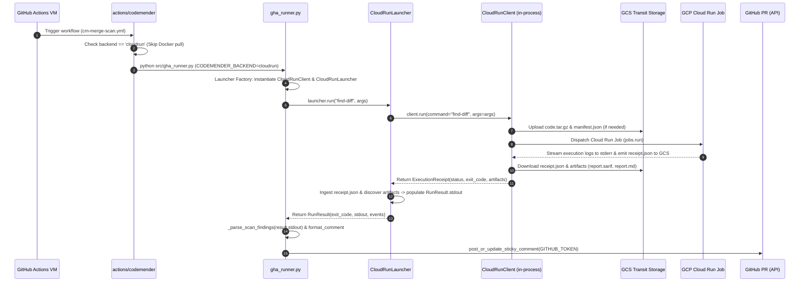

<!--*
freshness: { owner: 'codemender-maintainers', reviewed: '2026-10-14' }
*-->

<!--
sdd_spec_id: SPEC-GHA
sdd_implements: None
sdd_extends: None
sdd_level: COMPONENT
sdd_archetype: CI_CD_WORKFLOW
sdd_cujspec_product: codemender-runner
-->

# Design: GitHub Actions Orchestration & Execution Backends

## Context

The CodeMender GitHub Actions integration (`github-actions/`) provides automated scanning and remediation workflows for pull requests. Currently, M0 implements local execution using `docker run` on the Actions VM via `LocalDockerLauncher`.

However, enterprise environments require strong microVM isolation, execution durations exceeding standard CI runner timeouts, and isolation against malicious exploits during dynamic verification. Workstream 3 of the [CM CI/CD Project Plan](https://docs.google.com/document/d/1Vv2o5C2UD3wYY9RQpq00dYst_5apT9-PO0CVoAV5wLU/edit) is building the Google Cloud infrastructure (Cloud Run Jobs, GCS transit, WIF) and providing a typed Python SDK and client to manage job lifecycle.

Governed by [SPEC-GHA](spec.md), [Proposal: Cloud Run Jobs Container Bootstrapper & Execution Harness](../../proposals/cloudrun-job-bootstrapper/proposal.md), [Proposal: gha-cloudrun-launcher](../../proposals/gha-cloudrun-launcher/proposal.md), [ADR-0001](../../../adr/ADR-0001-machine-readable-output-contract.md), [ADR-0003](../../../adr/ADR-0003-environment-scrubbing.md), [ADR-0005](../../../adr/ADR-0005-multi-platform-transit-storage-and-isolation.md), [ADR-0007](../../../adr/ADR-0007-cloud-run-job-invocation-interface-cli-vs-python-library.md), and [ADR-0008](../../../adr/ADR-0008-repository-layout-and-package-structure.md), this design details how `github-actions/` is extended to support Cloud Run execution via direct in-process Python SDK integration (`gcp_sandboxing.client.CloudRunClient`) while preserving 100% backward compatibility for local Docker runs.

To preserve simplicity while supporting diverse repository configurations, the action input schema allows optional cloud configuration (`gcs_transit_bucket`, `cloud_run_job_name`, `cloud_run_region`) or resolves defaults automatically from ambient environment variables and Workload Identity Federation (WIF).

---

## Goals / Non-Goals

### Goals
- Introduce `CloudRunLauncher` implementing `Launcher(abc.ABC)` to execute commands via direct in-process `CloudRunClient` SDK integration (governed by ADR-0007 Option 3).
- Dispatch a single consolidated `find-diff` remote task in Cloud Run mode that auto-initializes the staged workspace within the container, bypassing redundant remote `init` executions.
- Keep the action interface clean: simplify backend selection to `backend: 'local' | 'cloudrun'` and resolve cloud configuration from ambient environment variables.
- Provide a clean launcher factory in `gha_runner.py` that selects between `LocalDockerLauncher` and `CloudRunLauncher` based on `CODEMENDER_BACKEND`.
- Bypass Docker pull and registry operations completely when running in Cloud Run mode.
- Maintain full compatibility with ADR-0001 NDJSON output contract and existing PR sticky comment reporting.
- Enforce strict host token boundary ([ADR-0003](../../../adr/ADR-0003-environment-scrubbing.md), [ADR-0008](../../../adr/ADR-0008-repository-layout-and-package-structure.md)) where tokens are used only for host PR reporting.
- Enforce symmetric interface and workspace file parity between local Docker and Cloud Run backends, standardizing on file-based communication so downstream actions remain backend-agnostic.
- Ensure 100% hermetic in-memory unit testing with mock clients without needing live cloud infrastructure or subprocess piping.

### Non-Goals
- Implementing the core Cloud Run client SDK itself (owned by Workstream 3 under `gcp-sandboxing/`).
- Multi-task parallel remediation fan-out (`fix` / `verify` parallel worker jobs) is deferred to future workstreams, keeping M1 strictly bounded to differential scanning (`find-diff`).
- GKE or Bitbucket launcher implementations (deferred to future milestones).

---

## Architecture & Data Flow



---

## Detailed Design

### 1. `CloudRunLauncher` (`launcher/cloud_run.py`)

`CloudRunLauncher` bridges the abstract `Launcher` interface directly to the `CloudRunClient` Python SDK (governed by ADR-0007 Option 3), executing tasks in-process on the runner VM without subprocess overhead or JSON string piping.

`CloudRunLauncher` directly aligns with the Cloud Run Job container bootstrapper (`cloud-run-jobs/entrypoint.py`):
1. **Receipt Ingestion**: The bootstrapper writes `output/receipt.json` containing status (`"SUCCESS"` or `"FAILURE"`), integer `exit_code`, `command`, `started_at` and `completed_at` timestamps, `finding_count`, `error` diagnostics, and an `artifacts` mapping (`sarif`, `log`, `report`, `patch`). `CloudRunLauncher` accepts receipts returned as objects or dictionary structures and maps `status`, `exit_code`, and `finding_count` into the launcher execution outcome.
2. **Canonical Finding Artifact & Discovery**: The bootstrapper stages the canonical finding artifact (`report.sarif` conforming to `SPEC-FIND-DIFF`) into the output directory. When `receipt.stdout` is absent or empty, `CloudRunLauncher` inspects `receipt.artifacts` (`sarif`) and candidate output directory paths (`CODEMENDER_OUT_DIR`, `output/report.sarif`, `report.sarif`) to read the staged finding bytes and populate `RunResult.stdout`. This allows `_parse_scan_findings` in `gha_runner.py` to parse SARIF findings seamlessly without backend-specific branching.
3. **Structured Event Fallback**: If stdout is not available from artifacts, `CloudRunLauncher` serializes NDJSON events from `receipt.events` or `receipt.event` per ADR-0001.

```python
import json
import logging
import os
from typing import Any, Sequence

from gcp_sandboxing.client import CloudRunClient, CloudRunError, CloudRunTimeoutError
from launcher.base import Launcher, LauncherError, RunResult

logger = logging.getLogger("codemender-github-actions")

_DEFAULT_TIMEOUT_SECONDS = 60 * 60


class CloudRunLauncher(Launcher):
  """Executes cm-runner tasks in Google Cloud Run via in-process CloudRunClient."""

  def __init__(
      self,
      client: Any,
      log_level: str = "info",
      timeout_seconds: int = _DEFAULT_TIMEOUT_SECONDS,
  ):
    super().__init__()
    if not client:
      raise ValueError("A CloudRunClient instance is required for Cloud Run.")

    self.client = client
    self.log_level = log_level
    self.timeout_seconds = timeout_seconds

  def run(self, command: str, args: Sequence[str] = ()) -> RunResult:
    logger.info("Executing Cloud Run task in-process: command=%s args=%s", command, list(args))

    try:
      receipt = self.client.run(
          command=command,
          args=list(args),
          log_level=self.log_level,
          timeout_seconds=self.timeout_seconds,
      )
    except CloudRunTimeoutError as e:
      raise LauncherError(
          f"Cloud Run command {command!r} timed out after {self.timeout_seconds}s."
      ) from e
    except CloudRunError as e:
      raise LauncherError(
          f"Cloud Run execution failed: {e}"
      ) from e

    # Extract exit code and status per bootstrapper contract
    raw_exit_code = getattr(receipt, "exit_code", None)
    status = getattr(receipt, "status", None)
    if isinstance(raw_exit_code, int):
      exit_code = raw_exit_code
    elif status == "SUCCESS":
      exit_code = 0
    elif status == "FAILURE":
      exit_code = 1
    else:
      exit_code = 0

    # Extract parsed events
    raw_events = getattr(receipt, "events", None)
    events = list(raw_events) if isinstance(raw_events, (list, tuple)) else []

    # Extract raw stdout or fall back to event JSON
    raw_stdout = getattr(receipt, "stdout", None)
    stdout = b""
    if isinstance(raw_stdout, bytes) and raw_stdout:
      stdout = raw_stdout
    elif isinstance(raw_stdout, str) and raw_stdout:
      stdout = raw_stdout.encode("utf-8")
    elif events:
      try:
        stdout = json.dumps(events[0]).encode("utf-8")
      except (TypeError, ValueError):
        stdout = b""

    return RunResult(exit_code=exit_code, stdout=stdout, events=events)
```

---

### 2. Launcher Factory & Entrypoint (`gha_runner.py`)

In `gha_runner.py`, `main()` inspects `CODEMENDER_BACKEND` with normalization and truthy fallback:

```python
# Updated top-level required variable check (runner image check moved to factory)
for required in ("GITHUB_EVENT_PATH", "GITHUB_REPOSITORY", "GITHUB_TOKEN"):
  if not env.get(required):
    print(f"::error::Missing required environment variable {required}.")
    return 1

# Robust backend resolution with truthy fallback and normalization
backend = (env.get("CODEMENDER_BACKEND") or "local").strip().lower()
if backend == "cloud_run":
  backend = "cloudrun"

if backend == "local":
  image = env.get("CODEMENDER_RUNNER_IMAGE", "").strip()
  if not image:
    print("::error::Missing required environment variable CODEMENDER_RUNNER_IMAGE.")
    return 1
  launcher = LocalDockerLauncher(
      image=image,
      log_level=env.get("CODEMENDER_LOG_LEVEL", "info"),
  )
elif backend == "cloudrun":
  from gcp_sandboxing.client import CloudRunClient, CloudRunConfig

  config = CloudRunConfig(
      project=env.get("GOOGLE_CLOUD_PROJECT", "").strip(),
      bucket=env.get("GCS_TRANSIT_BUCKET", "").strip(),
      job_name=env.get("CLOUD_RUN_JOB_NAME", "codemender-runner").strip(),
      region=env.get("CLOUD_RUN_REGION", "us-central1").strip(),
  )
  client = CloudRunClient(config)
  launcher = CloudRunLauncher(
      client=client,
      log_level=env.get("CODEMENDER_LOG_LEVEL", "info"),
  )
else:
  print(f"::error::Unsupported CODEMENDER_BACKEND: {backend!r}.")
  return 1
```

#### Consolidated Execution Flow in `gha_runner.py`
In differential PR scanning mode (`run_pr`):
- When `backend == "local"`: Executes `launcher.run("init", ...)` followed by `launcher.run("find-diff", ...)`.
- When `backend == "cloudrun"`: Bypasses the standalone remote `init` call and directly executes `launcher.run("find-diff", ...)`, as the Cloud Run container unpacks and initializes the workspace automatically from the staged snapshot archive.


---

### 3. Artifact & Receipt Ingestion (Bootstrapper Contract Alignment)

Cloud Run execution delegates task execution to the Cloud Run Job container bootstrapper (`cloud-run-jobs/entrypoint.py`, governed by [Proposal: Cloud Run Jobs Container Bootstrapper & Execution Harness](../../proposals/cloudrun-job-bootstrapper/proposal.md)). This establishes a strict, structured artifact and receipt contract between the Cloud Run microVM and the GitHub Actions runner.

#### 1. Structured `receipt.json` Schema
Upon completion (or during signal trapping/preemption finalization), the bootstrapper emits a deterministic `output/receipt.json` to the output directory detailing:
- `status`: String outcome (`"SUCCESS"` or `"FAILURE"`).
- `exit_code`: Integer exit code returned by the inner CodeMender command (`0` for clean execution, non-zero for scan/tool errors).
- `command`: Dispatched command string (e.g. `"find-diff"`, `"fix"`, `"verify"`).
- `started_at` & `completed_at`: ISO 8601 UTC timestamps marking execution duration.
- `finding_count`: Integer count of detected security findings extracted from the primary SARIF run results.
- `error`: Diagnostic error message string if execution terminated with an error, or `null`.
- `artifacts`: Structured key-value mapping of artifact paths or transit storage URIs:
  - `sarif`: Path/URI to `output/report.sarif`.
  - `log`: Path/URI to `output/runner.log`.
  - `report`: Path/URI to `output/report.md` (if markdown summary was generated).
  - `patch`: Path/URI to `output/fix.patch` or `output/finding.diff` (for remediation runs).

Example `receipt.json`:
```json
{
  "status": "SUCCESS",
  "exit_code": 0,
  "command": "find-diff",
  "started_at": "2026-10-14T12:00:00Z",
  "completed_at": "2026-10-14T12:01:30Z",
  "finding_count": 2,
  "artifacts": {
    "sarif": "output/report.sarif",
    "log": "output/runner.log"
  },
  "error": null
}
```

#### 2. Canonical Finding Artifact (`report.sarif`)
The bootstrapper stages the primary finding artifact in the output directory:
- `output/report.sarif`: Full OASIS SARIF v2.1.0 format conforming to `SPEC-FIND-DIFF`, suitable for GitHub Code Scanning integration.

Standardizing on `report.sarif` provides a single canonical artifact format across all CI/CD platforms and runner backends without maintaining redundant JSON artifact duplicates.

#### 3. Receipt Ingestion & Artifact Discovery in `CloudRunLauncher`
Because Cloud Run Job containers write structured findings to output files rather than streaming unbounded JSON data over standard output, `CloudRunLauncher` bridges this contract to the orchestrator:
1. `CloudRunLauncher.run()` retrieves the `ExecutionReceipt` object from `CloudRunClient`.
2. Exit code resolution maps `receipt.exit_code`, falling back to `0` when `status == "SUCCESS"` and `1` when `status == "FAILURE"`.
3. If `receipt.stdout` is absent or empty, `CloudRunLauncher` performs artifact discovery:
   - It inspects `receipt.artifacts` for `"sarif"` URIs/paths.
   - It probes candidate paths in the runner workspace (`CODEMENDER_OUT_DIR`, `output/report.sarif`, `report.sarif`).
   - It reads the staged artifact file contents and populates `RunResult.stdout`.
4. Downstream processing in `gha_runner.py` invokes `_parse_scan_findings(result.stdout)` against `RunResult.stdout`. Because `CloudRunLauncher` populates `RunResult.stdout` from the discovered SARIF artifact, `gha_runner.py` parses findings and formats PR comments identically for both local Docker and Cloud Run backends without requiring backend-specific branching.

---

### 4. Simplified Composite Action Metadata (`action.yml`)

The `inputs:` block in `action.yml` is streamlined to only what is necessary, removing all cloud infrastructure configuration inputs:

```yaml
inputs:
  backend:
    description: >-
      Target execution backend: 'cloudrun' (default, Cloud Run via in-process
      CloudRunClient SDK) or 'local' (Docker on runner VM). Defaults to 'cloudrun'.
    required: false
    default: 'cloudrun'
  runner_image:
    description: >-
      cm-runner container image pinned to a commit SHA tag. Required when
      backend is 'local'.
    required: false
    default: ''
  registry_token:
    description: >-
      Optional token to pull runner_image from GHCR. Used only when backend is 'local'.
    required: false
    default: ''
  log_level:
    description: cm-runner log level (debug, info, warning, error).
    required: false
    default: info
```

The composite steps conditionally pull the image and pass inputs to `gha_runner.py`:

```yaml
    # Pull step executes ONLY when running locally with Docker
    - name: Pull cm-runner image
      if: inputs.backend == 'local'
      shell: bash
      env:
        IMAGE: ${{ inputs.runner_image }}
        TOKEN: ${{ inputs.registry_token || github.token }}
        ACTOR: ${{ github.actor }}
      run: |
        if [[ -z "$IMAGE" ]]; then
          echo "::error::The 'runner_image' input is required when backend is 'local'."
          exit 1
        fi
        if [[ "$IMAGE" == ghcr.io/* ]]; then
          trap 'docker logout ghcr.io >/dev/null 2>&1 || true' EXIT
          echo "$TOKEN" | docker login ghcr.io -u "$ACTOR" --password-stdin
        fi
        docker pull "$IMAGE"

    - name: Run CodeMender
      shell: bash
      env:
        CODEMENDER_BACKEND: ${{ inputs.backend || 'local' }}
        CODEMENDER_RUNNER_IMAGE: ${{ inputs.runner_image }}
        CODEMENDER_LOG_LEVEL: ${{ inputs.log_level }}
        GITHUB_TOKEN: ${{ github.token }}
      run: python "${{ github.action_path }}/src/gha_runner.py"
```

---

### 5. Reference Workflow Template (`cm-merge-scan.yml`)

The template demonstrates dual configuration with documented comments:

```yaml
    steps:
      - uses: actions/checkout@v4
        with:
          persist-credentials: false

      # Mode 1: Local Docker execution (default)
      - uses: ./.github/actions/codemender
        with:
          runner_image: <your-registry>/codemender-runner:<commit-sha>

      # Mode 2: Cloud Run execution (uncomment to enable)
      # - uses: ./.github/actions/codemender
      #   with:
      #     backend: cloudrun
```

---

### 6. Backend Interface Symmetry & Workspace Artifact Parity

To ensure seamless interchangeability between local and remote execution, interactions across the runner boundary are constrained to mechanisms supportable by both local containers and remote microVMs:

1. **Standardized Communication via Files**:
   Passing files across the boundary is established as the standard exchange medium for all complex data:
   - **Local Docker Mode**: Files are shared directly via bind mounts (`-v "$GITHUB_WORKSPACE:/workspace"`).
   - **Cloud Run Mode**: The `CloudRunClient` SDK manages input staging (`code.tar.gz` and `manifest.json`) to GCS transit before job dispatch and materializes all output files (such as `output/receipt.json`, the canonical finding artifact `output/report.sarif`, generated diff patches, and report files) from GCS transit back into the identical relative workspace paths on the Actions runner VM before exiting.
   - **Staging Context & Cancellation Resolution**: `CloudRunConfig` resolves repository staging context (`repo_path = os.getenv("GITHUB_WORKSPACE", ".")`) and commit path (`owner/repo/prs/<id>/<sha>`) from GitHub Actions ambient event variables. For workflow step cancellation, `CloudRunLauncher` registers signal traps on `SIGTERM`/`SIGINT` or wraps invocation in `client.cancellation_scope()` to call `client.cancel_execution()` and prevent orphaned remote microVM executions.

2. **Backend-Agnostic Downstream Consumers**:
   Because files are placed in identical locations and NDJSON events conform to ADR-0001 regardless of backend:
   - Comment formatters (`format_version_comment`) and PR sticky comment posters operate on the parsed `RunResult` without knowing which backend ran.
   - Any future steps reading output artifacts (e.g. `output/receipt.json`, `output/report.sarif`, or patch diffs) read the exact same path without conditional branching on `inputs.backend`.

---

## Security Model

1. **Host-Only GitHub Token Boundary**:
   - `GITHUB_TOKEN` is used strictly on the host runner by `vcs/github.py` to create/update PR comments.
   - Per ADR-0003, no denylist environment scrubbing is performed by `cm-runner` or launchers.
2. **Client-Managed Authentication & Cloud Config**:
   - The Cloud Run client manages all GCP authentication (ambient ADC/WIF) and cloud resource resolution internally without exposing cloud parameters to the action interface.
3. **Escaped Feedback Display**:
   - Output fields from Cloud Run events are sanitized with Markdown inline escaping (`_inline()`) to prevent Markdown injection in PR comments.

---

## Risks and Mitigations

| Risk | Severity | Mitigation |
| :--- | :--- | :--- |
| **Orphaned Cloud Run Jobs on CI Step Cancellation** | High | If a GitHub Actions workflow is cancelled or timed out by the developer, the runner VM receives `SIGTERM`. In-process callers use `client.cancellation_scope()` or register signal handlers to call `client.cancel_execution()`, immediately terminating the Cloud Run execution to conserve Vertex AI LLM quota. |
| **Runner Cold-Start & SDK Dependency Overhead** | Medium | The `gcp_sandboxing.client` SDK depends strictly on standard Google Cloud client packages (`google-cloud-run`, `google-cloud-storage`). In `gha_runner.py`, imports are lazy-loaded only when `CODEMENDER_BACKEND == 'cloudrun'`, eliminating import overhead during local Docker runs. |
| **Transit Storage Packaging & Upload Latency** | Medium | Naive full-history git uploads are avoided. The SDK packages a bounded-history snapshot (`code.tar.gz` containing only merge-base to `HEAD` and `base_ref`) and stages it once to `gs://<bucket>/<owner>/<repo>/prs/<id>/<sha>/shared/code.tar.gz`. |
| **Cloud Run MicroVM Crash Without Receipt** | Low | If a remote microVM terminates unexpectedly due to an OOM or node eviction without emitting `receipt.json`, `CloudRunClient` detects the failed job status, fetches `output/runner.log` from GCS (or streams Cloud Logging), flushes diagnostics to `stderr`, and raises `CloudRunError` mapped to `LauncherError`. |

---

## Testing & Verification Plan

1. **`test_launcher.py`**:
   - `test_requires_client`: Verify `ValueError` when `client` is `None` or omitted.
   - `test_run_success`: Verify `CloudRunLauncher.run` delegates to `client.run` and correctly transforms `ExecutionReceipt` into `RunResult(ok=True, exit_code=0, events=[...])`.
   - `test_client_error_raises_launcher_error`: Mock `client.run` raising `CloudRunError` and assert it is converted into `LauncherError`.
   - `test_timeout_raises_launcher_error`: Mock `client.run` raising `CloudRunTimeoutError` and assert it is converted into `LauncherError`.
   - `test_run_propagates_failure_exit_code`: Verify non-zero exit codes in `ExecutionReceipt` propagate to `RunResult(ok=False, exit_code=...)`.
2. **`test_gha_runner.py`**:
   - `test_launcher_factory_local_default`: Verify unset backend selects `LocalDockerLauncher`.
   - `test_launcher_factory_cloudrun`: Verify `CODEMENDER_BACKEND="cloudrun"` instantiates `CloudRunLauncher` with `CloudRunClient`.
   - `test_launcher_factory_cloud_run_alias`: Verify `CODEMENDER_BACKEND="cloud_run"` normalizes to `CloudRunLauncher`.
   - `test_cloudrun_consolidated_find_diff`: Verify Cloud Run mode executes `find-diff` directly without an initial remote `init` call.
   - `test_cloudrun_comment_generation_with_no_init`: Verify PR comment formatting and exit code evaluation succeed cleanly when `init_result is None` (validating the consolidated `find-diff` execution path).
   - `test_missing_runner_image_fails_in_local_mode`: Verify exit code `1` when `CODEMENDER_RUNNER_IMAGE` is omitted in `local` mode.
   - `test_unsupported_backend_fails`: Verify exit code `1` on unknown backend.
