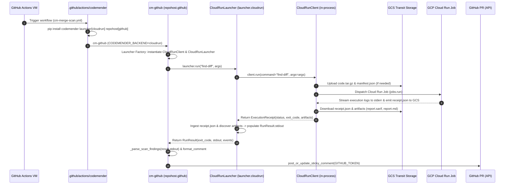

<!--*
freshness: { owner: 'codemender-maintainers', reviewed: '2026-10-21' }
*-->

<!--
sdd_spec_id: SPEC-GHA
sdd_implements: None
sdd_extends: None
sdd_level: COMPONENT
sdd_archetype: CI_CD_WORKFLOW
sdd_cujspec_product: codemender-runner
-->

# Design: GitHub Actions Orchestration & Execution Backends

## Context

The CodeMender GitHub Actions integration (`.github/actions/`, `.github/workflows/`, `packages/repohost`, and `packages/launcher`) provides automated scanning and remediation workflows for pull requests across all GitHub deployment models defined in [SPEC-DIST](../distribute/spec.md). M0/M1 implements local execution using `docker run` on the Actions VM via `LocalDockerLauncher` (`packages/launcher/src/launcher/local/local_docker.py`).

However, enterprise environments require strong microVM isolation, execution durations exceeding standard CI runner timeouts, and isolation against malicious exploits during dynamic verification. Workstream 3 of the [CM CI/CD Project Plan](https://docs.google.com/document/d/1Vv2o5C2UD3wYY9RQpq00dYst_5apT9-PO0CVoAV5wLU/edit) builds the Google Cloud infrastructure (Cloud Run Jobs, GCS transit, WIF) and provides a typed Python SDK and client (`launcher.cloudrun.client.CloudRunClient`) to manage job lifecycle.

Governed by [SPEC-GHA](spec.md), [SPEC-DIST](../distribute/spec.md), the [Distributed Execution and Transit System Design](../tech/systems/distributed-execution-and-transit/design.md), [Proposal: Cloud Run Jobs Container Bootstrapper & Execution Harness](../../proposals/cloudrun-job-bootstrapper/proposal.md), [Proposal: gha-cloudrun-launcher](../../proposals/gha-cloudrun-launcher/proposal.md), [ADR-0002](../../../adr/ADR-0002.md), [ADR-0003](../../../adr/ADR-0003-environment-scrubbing.md), and [ADR-0008](../../../adr/ADR-0008-repository-layout-and-package-structure.md), this design details how the GitHub Actions integration is structured into two pure declarative composite actions—`.github/actions/codemender/action.yml` (Cloud Run Jobs) and `.github/actions/codemender-local/action.yml` (Local Docker + gVisor)—that install `packages/{codemender,launcher,repohost}` and invoke the `cm-github` CLI entrypoint (`repohost.github.__main__:main`), supporting Cloud Run execution via direct in-process Python SDK integration (`launcher.cloudrun.client.CloudRunClient`) while preserving 100% parity for local Docker runs.

To preserve simplicity while supporting diverse repository configurations, `.github/actions/codemender/action.yml` accepts optional cloud configuration (`gcp_region`, `gcs_transit_bucket`, `cloud_run_job_name`) or resolves defaults automatically from ambient environment variables and Workload Identity Federation (WIF).

---

## Goals / Non-Goals

### Goals
- Provide two dedicated, pure-YAML composite actions—`.github/actions/codemender/action.yml` (`CODEMENDER_BACKEND="cloudrun"`, installing `launcher[cloudrun]`) and `.github/actions/codemender-local/action.yml` (`CODEMENDER_BACKEND="local"`, installing base `launcher` + gVisor)—that both invoke the `cm-github` console entrypoint in `packages/repohost`.
- Co-locate `CloudRunClient` (`packages/launcher/src/launcher/cloudrun/client.py`) alongside `CloudRunLauncher` (`packages/launcher/src/launcher/cloudrun/cloud_run.py`) implementing `Launcher(abc.ABC)` via typed in-process SDK dispatch (per the [Distributed Execution and Transit System Design](../tech/systems/distributed-execution-and-transit/design.md) and [ADR-0008](../../../adr/ADR-0008-repository-layout-and-package-structure.md)).
- Dispatch a single consolidated `find-diff` remote task in Cloud Run mode that auto-initializes the staged workspace within the container, bypassing redundant remote `init` executions.
- Provide a clean launcher factory in `packages/repohost/src/repohost/github/` (`cm-github`) that selects between `LocalDockerLauncher` and `CloudRunLauncher` based on `CODEMENDER_BACKEND`.
- Bypass gVisor installation, Docker pull, and registry operations completely when running `.github/actions/codemender` (Cloud Run mode).
- Maintain full compatibility with ADR-0001 NDJSON output contract and existing PR sticky comment reporting.
- Enforce strict host token boundary ([ADR-0003](../../../adr/ADR-0003-environment-scrubbing.md), [ADR-0008](../../../adr/ADR-0008-repository-layout-and-package-structure.md)) where tokens are used only for host PR reporting.
- Enforce symmetric interface and workspace file parity between local Docker and Cloud Run backends, standardizing on file-based communication so downstream steps remain backend-agnostic.
- Ensure 100% hermetic in-memory unit testing with co-located `test_*.py` suites in `packages/launcher` and `packages/repohost`.

### Non-Goals
- Decomposing `cm-github` into the `RepoHost` ABC, `ArtifactCache`, and `cm-worker` container entrypoint (governed by the [CodeMender Runner System Design](../tech/systems/codemender-runner/design.md) and tracked separately).
- GKE or Bitbucket launcher implementations (deferred to future milestones).

---

## Architecture & Data Flow



---

## Detailed Design

### 1. `CloudRunLauncher` & Co-Located `CloudRunClient` (`packages/launcher/src/launcher/cloudrun/`)

`CloudRunLauncher` ([packages/launcher/src/launcher/cloudrun/cloud_run.py](../../../../packages/launcher/src/launcher/cloudrun/cloud_run.py)) bridges the abstract `Launcher` interface directly to the co-located `CloudRunClient` Python SDK ([packages/launcher/src/launcher/cloudrun/client.py](../../../../packages/launcher/src/launcher/cloudrun/client.py), governed by the [Distributed Execution and Transit System Design](../tech/systems/distributed-execution-and-transit/design.md) and [ADR-0008](../../../adr/ADR-0008-repository-layout-and-package-structure.md)), executing tasks in-process on the runner VM without subprocess overhead or JSON string piping.

`CloudRunLauncher` directly aligns with the Cloud Run Job container bootstrapper (`cloud-run-jobs/entrypoint.py`):
1. **Receipt Ingestion**: The bootstrapper writes `output/receipt.json` containing status (`"SUCCESS"` or `"FAILURE"`), integer `exit_code`, `command`, `started_at` and `completed_at` timestamps, `finding_count`, `error` diagnostics, and an `artifacts` mapping (`sarif`, `log`, `report`, `patch`). `CloudRunLauncher` maps `status`, `exit_code`, and `finding_count` into the `RunResult` execution outcome.
2. **Canonical Finding Artifact & Discovery**: The bootstrapper stages the canonical finding artifact (`report.sarif` conforming to `SPEC-FIND-DIFF`) into the output directory. When `receipt.stdout` is absent or empty, `CloudRunLauncher` inspects `receipt.artifacts` (`sarif`) and candidate output directory paths (`CODEMENDER_OUT_DIR`, `output/report.sarif`, `report.sarif`) to read the staged finding bytes and populate `RunResult.stdout`. This allows `_parse_scan_findings` in `repohost.github` to parse SARIF findings seamlessly without backend-specific branching.
3. **Structured Event Fallback**: If stdout is not available from artifacts, `CloudRunLauncher` serializes NDJSON events from `receipt.events` or `receipt.event` per ADR-0001.

---

### 2. Launcher Factory & Entrypoint (`packages/repohost/src/repohost/github/`, `cm-github`)

In `packages/repohost/src/repohost/github/` (invoked via the `cm-github = "repohost.github.__main__:main"` console script entrypoint defined in `packages/repohost/pyproject.toml` and implemented in [gha_runner.py](../../../../packages/repohost/src/repohost/github/gha_runner.py)), `main()` inspects `CODEMENDER_BACKEND` with normalization and truthy fallback to `"cloudrun"` (or `"local"`):
- When `backend == "local"`: Instantiates `LocalDockerLauncher` with `CODEMENDER_RUNNER_IMAGE`, `CODEMENDER_LOG_LEVEL`, and `CODEMENDER_CONTAINER_RUNTIME`.
- When `backend == "cloudrun"`: Lazy-loads `launcher.cloudrun.client.CloudRunClient` and `CloudRunConfig`, populating GCP project, transit bucket, job name, region, and run identifiers from ambient environment variables before instantiating `CloudRunLauncher`.

#### Consolidated Execution Flow in `cm-github` (`repohost.github`)
In differential PR scanning mode (`run_pr`):
- When `backend == "local"`: Executes `launcher.run("init", ...)` followed by `launcher.run("find-diff", ...)`.
- When `backend == "cloudrun"`: Bypasses the standalone remote `init` call and directly executes `launcher.run("find-diff", ...)`, as the Cloud Run container unpacks and initializes the workspace automatically from the staged snapshot archive.


---

### 3. Artifact & Receipt Ingestion (Bootstrapper Contract Alignment)

Cloud Run execution delegates task execution to the Cloud Run Job container bootstrapper (`cloud-run-jobs/entrypoint.py`, governed by [Proposal: Cloud Run Jobs Container Bootstrapper & Execution Harness](../../proposals/cloudrun-job-bootstrapper/proposal.md)). This establishes a strict, structured artifact and receipt contract between the Cloud Run microVM and the GitHub Actions runner.

#### 1. Structured `receipt.json` Schema
Upon completion (or during signal trapping/preemption finalization), the bootstrapper emits a deterministic `output/receipt.json` to the output directory detailing:
- `status`: String outcome (`"SUCCESS"` or `"FAILURE"`).
- `exit_code`: Integer exit code returned by the inner CodeMender command (`0` for clean execution, non-zero for scan/tool errors).
- `command`: Dispatched command string (e.g. `"find-diff"`, `"fix"`, `"verify"`).
- `started_at` & `completed_at`: ISO 8601 UTC timestamps marking execution duration.
- `finding_count`: Integer count of detected security findings extracted from the primary SARIF run results.
- `error`: Diagnostic error message string if execution terminated with an error, or `null`.
- `artifacts`: Structured key-value mapping of artifact paths or transit storage URIs:
  - `sarif`: Path/URI to `output/report.sarif`.
  - `log`: Path/URI to `output/runner.log`.
  - `report`: Path/URI to `output/report.md` (if markdown summary was generated).
  - `patch`: Path/URI to `output/fix.patch` or `output/finding.diff` (for remediation runs).

Example `receipt.json`:
```json
{
  "status": "SUCCESS",
  "exit_code": 0,
  "command": "find-diff",
  "started_at": "2026-10-14T12:00:00Z",
  "completed_at": "2026-10-14T12:01:30Z",
  "finding_count": 2,
  "artifacts": {
    "sarif": "output/report.sarif",
    "log": "output/runner.log"
  },
  "error": null
}
```

#### 2. Canonical Finding Artifact (`report.sarif`)
The bootstrapper stages the primary finding artifact in the output directory:
- `output/report.sarif`: Full OASIS SARIF v2.1.0 format conforming to `SPEC-FIND-DIFF`, suitable for GitHub Code Scanning integration.

Standardizing on `report.sarif` provides a single canonical artifact format across all CI/CD platforms and runner backends without maintaining redundant JSON artifact duplicates.

#### 3. Receipt Ingestion & Artifact Discovery in `CloudRunLauncher`
Because Cloud Run Job containers write structured findings to output files rather than streaming unbounded JSON data over standard output, `CloudRunLauncher` bridges this contract to the orchestrator:
1. `CloudRunLauncher.run()` retrieves the `ExecutionReceipt` object from `CloudRunClient`.
2. Exit code resolution maps `receipt.exit_code`, falling back to `0` when `status == "SUCCESS"` and `1` when `status == "FAILURE"`.
3. If `receipt.stdout` is absent or empty, `CloudRunLauncher` performs artifact discovery:
   - It inspects `receipt.artifacts` for `"sarif"` URIs/paths.
   - It probes candidate paths in the runner workspace (`CODEMENDER_OUT_DIR`, `output/report.sarif`, `report.sarif`).
   - It reads the staged artifact file contents and populates `RunResult.stdout`.
4. Downstream processing in `cm-github` (`repohost.github`) invokes `_parse_scan_findings(result.stdout)` against `RunResult.stdout`. Because `CloudRunLauncher` populates `RunResult.stdout` from the discovered SARIF artifact, `cm-github` parses findings and formats PR comments identically for both local Docker and Cloud Run backends without requiring backend-specific branching.

---

### 4. Split Composite Action Manifests (`.github/actions/codemender` & `.github/actions/codemender-local`)

Rather than multiplexing gVisor installation, Docker login/pull, and GCP Cloud Run SDK dependencies inside a single conditional `action.yml`, the repository provides two dedicated, pure-YAML composite actions:

1. **Cloud Run Composite Action ([.github/actions/codemender/action.yml](../../../../.github/actions/codemender/action.yml)):**
   - Exposes cloud configuration (`gcp_project_id`, `gcp_workload_identity_provider`, `gcp_service_account`, `cloud_run_region`, `gcs_transit_bucket`, `cloud_run_job_name`), workflow settings (`log_level`, `diff_workers`, `fix`, `max_parallel_fixes`, `artifact_retention_days`), and hardcodes `CODEMENDER_BACKEND: "cloudrun"`.
   - Bypasses gVisor installation and Docker image pulls completely, eliminating image download latency and runner disk consumption.
   - Installs `"${PKG_DIR}/codemender"`, `"${PKG_DIR}/launcher[cloudrun]"`, and `"${PKG_DIR}/repohost[github]"`.
   - Executes `cm-github`.

2. **Local Docker + gVisor Composite Action ([.github/actions/codemender-local/action.yml](../../../../.github/actions/codemender-local/action.yml)):**
   - Exposes local runner options (`runner_image`, `registry_token`, `container_runtime`, `gvisor_release`), cloud credentials for Vertex AI, and hardcodes `CODEMENDER_BACKEND: "local"`.
   - Installs gVisor (`runsc`), normalizes image names to lowercase, and pulls `runner_image`.
   - Installs `"${PKG_DIR}/codemender"`, `"${PKG_DIR}/launcher"` (omitting `[cloudrun]`), and `"${PKG_DIR}/repohost[github]"`.
   - Executes `cm-github`.

> [!NOTE]
> **Two-Way Door / Current Packaging Choice:** Packaging these execution modes into two composite actions (`codemender` and `codemender-local`) is the current design choice to cleanly isolate host provisioning dependencies (gVisor/Docker vs. GCP client SDKs) without conditional complexity in YAML. As our workflow requirements mature—particularly when decomposing into more granular lifecycle phase actions (such as separate scan, fix, and verify actions)—this action split may be revisited without altering the underlying package boundaries or `cm-github` execution contracts.

---

### 5. Reference Workflow Template (`.github/workflows/cm-merge-scan.yml`)

The reference workflow template ([.github/workflows/cm-merge-scan.yml](../../../../.github/workflows/cm-merge-scan.yml)) demonstrates the two composite actions:
- **Mode 1 (Cloud Run Jobs, Recommended for Production):** Invokes `uses: ./.github/actions/codemender` with GCP project, WIF credentials, region, transit bucket, and job name.
- **Mode 2 (Local Docker + gVisor, Self-Contained Runner Execution):** Documented in comments illustrating `uses: ./.github/actions/codemender-local` with `runner_image`.

---

### 6. Backend Interface Symmetry & Workspace Artifact Parity

To ensure seamless interchangeability between local and remote execution, interactions across the runner boundary are constrained to mechanisms supportable by both local containers and remote microVMs:

1. **Standardized Communication via Files**:
   Passing files across the boundary is established as the standard exchange medium for all complex data:
   - **Local Docker Mode**: Files are shared directly via bind mounts (`-v "$GITHUB_WORKSPACE:/workspace"`).
   - **Cloud Run Mode**: The `CloudRunClient` SDK manages input staging (`code.tar.gz` and `manifest.json`) to GCS transit before job dispatch and materializes all output files (such as `output/receipt.json`, the canonical finding artifact `output/report.sarif`, generated diff patches, and report files) from GCS transit back into the identical relative workspace paths on the Actions runner VM before exiting.
   - **Staging Context & Cancellation Resolution**: `CloudRunConfig` resolves repository staging context (`repo_path = os.getenv("GITHUB_WORKSPACE", ".")`) and commit path (`owner/repo/prs/<id>/<sha>`) from GitHub Actions ambient event variables. For workflow step cancellation, `CloudRunLauncher` registers signal traps on `SIGTERM`/`SIGINT` or wraps invocation in `client.cancellation_scope()` to call `client.cancel_execution()` and prevent orphaned remote microVM executions.

2. **Backend-Agnostic Downstream Consumers**:
   Because files are placed in identical locations and NDJSON events conform to ADR-0001 regardless of backend:
   - Comment formatters (`format_version_comment`) and PR sticky comment posters operate on the parsed `RunResult` without knowing which backend ran.
   - Any future steps reading output artifacts (e.g. `output/receipt.json`, `output/report.sarif`, or patch diffs) read the exact same path without conditional branching on `CODEMENDER_BACKEND`.

---

## Security Model

1. **Host-Only GitHub Token Boundary**:
   - `GITHUB_TOKEN` is used strictly on the host runner by `packages/repohost` (`repohost/github/client.py`) to create/update PR comments.
   - Per ADR-0003, no denylist environment scrubbing is performed by `cm-runner` or launchers.
2. **Client-Managed Authentication & Cloud Config**:
   - The Cloud Run client manages all GCP authentication (ambient ADC/WIF) and cloud resource resolution internally without exposing credentials inside untrusted containers.
3. **Escaped Feedback Display**:
   - Output fields from Cloud Run events are sanitized with Markdown inline escaping (`_inline()`) to prevent Markdown injection in PR comments.

---

## Risks and Mitigations

| Risk | Severity | Mitigation |
| :--- | :--- | :--- |
| **Orphaned Cloud Run Jobs on CI Step Cancellation** | High | If a GitHub Actions workflow is cancelled or timed out by the developer, the runner VM receives `SIGTERM`. In-process callers use `client.cancellation_scope()` or register signal handlers to call `client.cancel_execution()`, immediately terminating the Cloud Run execution to conserve Vertex AI LLM quota. |
| **Runner Cold-Start & SDK Dependency Overhead** | Medium | The `launcher.cloudrun.client` SDK depends strictly on standard Google Cloud client packages (`google-cloud-run`, `google-cloud-storage`), isolated in `packages/launcher[cloudrun]`. `.github/actions/codemender-local` omits `[cloudrun]`, and `cm-github` lazy-loads `launcher.cloudrun.client` only when `CODEMENDER_BACKEND == 'cloudrun'`, eliminating GCP SDK installation and import overhead during local Docker runs. |
| **Transit Storage Packaging & Upload Latency** | Medium | Naive full-history git uploads are avoided. The SDK packages a bounded-history snapshot (`code.tar.gz` containing only merge-base to `HEAD` and `base_ref`) and stages it once to `gs://<bucket>/<owner>/<repo>/prs/<id>/<sha>/shared/code.tar.gz`. |
| **Cloud Run MicroVM Crash Without Receipt** | Low | If a remote microVM terminates unexpectedly due to an OOM or node eviction without emitting `receipt.json`, `CloudRunClient` detects the failed job status, fetches `output/runner.log` from GCS (or streams Cloud Logging), flushes diagnostics to `stderr`, and raises `CloudRunError` mapped to `LauncherError`. |

---

## Testing & Verification Plan

1. **`packages/launcher/src/launcher/cloudrun/test_cloud_run.py` & `test_gcp_sandboxing_client.py`**:
   - `test_requires_client`: Verify `ValueError` when `client` is `None` or omitted.
   - `test_run_success`: Verify `CloudRunLauncher.run` delegates to `client.run` and correctly transforms `ExecutionReceipt` into `RunResult(ok=True, exit_code=0, events=[...])`.
   - `test_client_error_raises_launcher_error`: Mock `client.run` raising `CloudRunError` and assert it is converted into `LauncherError`.
   - `test_timeout_raises_launcher_error`: Mock `client.run` raising `CloudRunTimeoutError` and assert it is converted into `LauncherError`.
   - `test_run_propagates_failure_exit_code`: Verify non-zero exit codes in `ExecutionReceipt` propagate to `RunResult(ok=False, exit_code=...)`.
2. **`packages/repohost/src/repohost/github/test_gha_runner.py` & `test_e2e_simulation.py`**:
   - `test_launcher_factory_local_default`: Verify unset backend selects `LocalDockerLauncher`.
   - `test_launcher_factory_cloudrun`: Verify `CODEMENDER_BACKEND="cloudrun"` instantiates `CloudRunLauncher` with `CloudRunClient`.
   - `test_launcher_factory_cloud_run_alias`: Verify `CODEMENDER_BACKEND="cloud_run"` normalizes to `CloudRunLauncher`.
   - `test_cloudrun_consolidated_find_diff`: Verify Cloud Run mode executes `find-diff` directly without an initial remote `init` call.
   - `test_cloudrun_comment_generation_with_no_init`: Verify PR comment formatting and exit code evaluation succeed cleanly when `init_result is None` (validating the consolidated `find-diff` execution path).
   - `test_missing_runner_image_fails_in_local_mode`: Verify exit code `1` when `CODEMENDER_RUNNER_IMAGE` is omitted in `local` mode.
   - `test_unsupported_backend_fails`: Verify exit code `1` on unknown backend.
