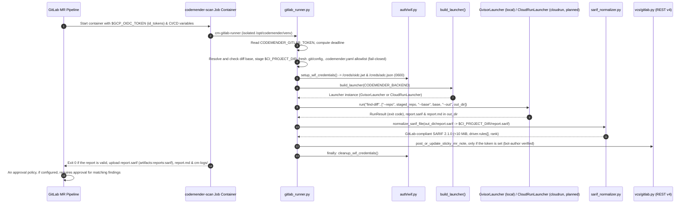

<!--*
freshness: { owner: 'codemender-maintainers', reviewed: '2026-10-06' }
*-->

<!--
sdd_spec_id: SPEC-GITLAB-CI
sdd_implements: None
sdd_extends: SPEC-FIND-DIFF, SPEC-GITLAB-SARIF
sdd_level: COMPONENT
sdd_archetype: CI_CD_WORKFLOW
sdd_cujspec_product: codemender-runner
-->

# Design: GitLab CI Orchestration & Execution Backends

## Context

The CodeMender GitLab CI integration (`gitlab-ci/`) provides automated
differential vulnerability scanning and Merge Request reporting for GitLab
repositories. While it shares the same core orchestrator (`cm-runner`) and
dual-backend model (`local` and `cloudrun`) as the GitHub Actions integration
([SPEC-GHA](../github-actions/spec.md)), GitLab CI's runner execution model
differs structurally from GitHub Actions in two key ways:

1. **In-Container Job Execution Without `dockerd`:** On GitHub Actions
   (`runs-on: ubuntu-latest`), steps run on a host VM with a local Docker daemon
   (`dockerd`) and step-scoped `env:` blocks, allowing `LocalDockerLauncher` to
   spawn a separate `docker run --runtime=runsc` container. In GitLab CI, the
   job `script:` executes *directly inside* the job image, which is built from
   `gitlab-ci/Dockerfile` on top of the `codemender-runner` image and pinned by
   digest, with no local `dockerd` daemon.
1. **Ambient Runner Credentials in `os.environ` and `.git/config`:** Unlike
   GitHub Actions (`persist-credentials: false` and step-scoped `GITHUB_TOKEN`),
   GitLab Runner injects `CI_JOB_TOKEN`, `CI_REPOSITORY_URL`, and CI/CD
   variables (`CODEMENDER_GITLAB_TOKEN`) into the job container's `os.environ`,
   plus `GCP_OIDC_TOKEN` because the template's `id_tokens:` requests it. During
   checkout, it also sets up the clone's `.git/config` to authenticate with
   `CI_JOB_TOKEN`, either in the remote URL or, with the
   `FF_GIT_URLS_WITHOUT_TOKENS` feature flag, through a credential helper.

Customers configure their pipeline to use one of two execution backends
(`CODEMENDER_BACKEND`):

- **`local` (`GvisorLauncher`)**: Runs `cm-runner` directly on the GitLab Runner
  inside a standalone gVisor (`runsc`) OCI sandbox, keeping all code execution
  local to the runner VM/container with zero external cloud compute
  infrastructure.
- **`cloudrun` (`CloudRunLauncher`, planned)**: Offloads `cm-runner` execution
  to isolated, serverless Google Cloud Run microVMs via the canonical Cloud Run
  client CLI—ideal when teams want zero compute/memory overhead on their CI
  runners, centralized execution in GCP, or are running on unprivileged
  Kubernetes/shared runners where local container sandboxing is unavailable.

Apart from the planned `cloudrun` backend, only model access ties this
integration to Google Cloud: `cm` calls Vertex AI, so every run needs Google
credentials (REQ-0005). GitLab issues the ID token that Workload Identity
Federation exchanges, so authentication works wherever the runner is hosted,
and `local` needs only a privileged Docker runner, whether that's on Google
Cloud, AWS, Azure, or on premises. A compute backend on another cloud would be
a new `Launcher` and requirement, selected through REQ-0004's factory.

Governed by [SPEC-GITLAB-CI](spec.md),
[SPEC-GITLAB-SARIF](../gitlab-sarif-report/spec.md),
[ADR-0001](../../../adr/ADR-0001-machine-readable-output-contract.md),
[ADR-0003](../../../adr/ADR-0003-environment-scrubbing.md), and
[ADR-0008](../../../adr/ADR-0008-repository-layout-and-package-structure.md),
this document defines the architecture and security design of `gitlab-ci/`.

______________________________________________________________________

## Goals / Non-Goals

### Goals

- Provide a clean `Launcher` abstraction (`GvisorLauncher` and
  `CloudRunLauncher`) selected by `CODEMENDER_BACKEND` (`'local' | 'cloudrun'`).
- Execute `local` scans inside a standalone gVisor (`runsc`) OCI bundle without
  requiring Docker-in-Docker (`services: [docker:dind]`) or duplicate container
  image pulls.
- Enforce two-layer sandboxing in `local` mode: outer gVisor (`runsc`)
  user-space kernel isolation + inner `cm` `exebox` namespace/seccomp-bpf
  isolation (`CODEMENDER_SANDBOX_ENABLED=true`, network closed), with WIF
  credentials mounted read-only at `/creds` outside the workspace.
- Build every subprocess environment from an allowlist, and stage
  `$CI_PROJECT_DIR` to an isolated workspace directory with a fresh
  `.git/config`, no `.git/hooks`, and an allowlisted `.codemender.yaml`, failing
  closed before launching `cm-runner`
  ([ADR-0003](../../../adr/ADR-0003-environment-scrubbing.md)).
- Invoke `cm-runner find-diff` in a single self-contained sandbox/microVM
  execution per [ADR-0008](../../../adr/ADR-0008-repository-layout-and-package-structure.md) and
  give `local` and `cloudrun` the same arguments and output files, so downstream
  SARIF normalization ([SPEC-GITLAB-SARIF](../gitlab-sarif-report/spec.md)) and
  sticky MR commenting remain backend-agnostic.

### Non-Goals

- Modifying core `codemender-runner/` (`CmAdapter` or `cli/`) to perform
  GitLab-specific environment scrubbing or SARIF normalization.
- Implementing the Cloud Run service or GCS transit infrastructure itself
  (managed by `terraform/modules/gcp` and the Cloud Run client CLI).
- Scanning default-branch or scheduled pipelines. GitLab marks findings that
  are missing from the latest default-branch scan as "No longer detected", so a
  diff-only scan there would mark every finding outside the diff that way.
- Scanning merge train pipelines (REQ-0008). A merge train pipeline tests the
  MR together with the MRs ahead of it in the train, so its diff would include
  their changes, and the MR was already scanned in its own pipeline.
- Scanning merge requests from forks (REQ-0008). The job would either run in
  the fork, which normally has no `codemender-gvisor` runner, so it would stay
  pending, or run in the parent project with an ID token that carries the
  fork's `project_id`, which the Workload Identity Federation setup rejects.
- Delivering fixes. Of the
  [ADR-0006](../../../adr/ADR-0006-pr-remediation-routing-and-security-gate.md)
  tiers, inline suggestions and patch comments work with a Reporter token;
  child MRs and commit statuses need the Developer role, and a Developer token
  must never be exposed to MR pipelines.

______________________________________________________________________

## Decisions

### Decision 1: Standalone `runsc` OCI Bundle Instead of Docker-in-Docker (`docker:dind`)

- **Choice:** Layer `/usr/local/bin/runsc` directly into the GitLab runner
  container image (`gitlab-ci/Dockerfile`) and have `GvisorLauncher` build an
  ephemeral OCI Runtime Specification v1.0.2 bundle that bind-mounts the
  container's system directories (`/bin`, `/etc`, `/lib*`, `/opt`, `/sbin`,
  `/usr`, `/var`) read-only and invokes `runsc run --bundle`.
- **Alternatives Considered:**
  - *Docker-in-Docker (`services: [docker:dind]` + `docker run --runtime=runsc`):*
    Needs a second Docker daemon in every job (usually reached over TLS), a
    custom `dind` image with `runsc` installed, and, without a registry mirror,
    a fresh pull of the multi-gigabyte `codemender-runner` image in every job.
    Both approaches need a privileged runner, so privilege isn't the
    difference.
- **Rationale:** Because GitLab CI already starts the job inside the
  `codemender-runner` container image, invoking `runsc` directly against a
  read-only bind-mounted rootfs provides full gVisor `Sentry` kernel isolation
  with zero image re-pull overhead.

### Decision 2: Two-Layer Sandbox Isolation (`runsc` + `exebox`) and Read-Only `/creds` Mount

- **Choice:** Grant virtualized `CAP_SYS_ADMIN` inside the `runsc` OCI bundle,
  force `CODEMENDER_SANDBOX_ENABLED="true"` and
  `CODEMENDER_SANDBOX_NETWORK_PROFILE="permissive-closed"`, and bind-mount
  `/creds` read-only at the same path, outside the staged workspace.
- **Alternatives Considered:**
  - *Drop `CAP_SYS_ADMIN` inside `runsc` and disable `cm`'s internal `exebox`
    sandbox (`CODEMENDER_SANDBOX_ENABLED=false`):* Disabling `exebox` collapses
    the boundary between the authenticated parent `cm` process and untrusted
    `cm __worker` tool executions.
- **Rationale:** Under `runsc`, `CAP_SYS_ADMIN` is virtualized entirely within
  gVisor's user-space `Sentry` kernel (never granted on the host kernel),
  enabling `cm`'s internal `exebox` sandbox (`CLONE_NEWNS`, `CLONE_NEWUSER`, and
  a network that is always closed: `permissive-closed`, fixed by REQ-0006).
  Mounting `/creds` lets the parent `cm` process authenticate to Google Cloud
  while `/creds` stays invisible to the inner `exebox` worker (`cm __worker`)
  that runs untrusted repo commands (REQ-0002 explains why).

### Decision 3: Isolated Workspace Staging & Allowlist Sanitization

- **Choice:** Before invoking the launcher, the orchestrator builds every
  subprocess environment from an allowlist, copies `$CI_PROJECT_DIR` to an
  isolated directory (keeping symbolic links as links), gives the copy a fresh
  `.git/config` and no hooks, and replaces its `.codemender.yaml` with the base
  commit's, reduced to `scan` and in-repo `project_paths`. Anything ambiguous
  fails closed (REQ-0006).
- **Alternatives Considered:**
  - *Deny lists (strip known-dangerous environment variables, `.git/config`
    keys and `.codemender.yaml` keys):* Anything the list misses gets through,
    such as a token copied into another variable, `CM_DISABLE_SANDBOX`, or a
    `diff.<driver>.textconv` command.
- **Rationale:** An allowlist fails closed: a missing name breaks the scan
  visibly instead of leaking a secret or weakening the sandbox. Staging keeps
  the sandbox from changing the checkout that post-scan steps read, and reading
  `.codemender.yaml` from the base commit keeps an MR from changing its own scan
  settings ([ADR-0003](../../../adr/ADR-0003-environment-scrubbing.md)).

### Decision 4: Reporter Bot Token in CI for MR Comments (v1, Revisit Later)

- **Choice:** For v1, the job posts the sticky MR comment itself with
  `CODEMENDER_GITLAB_TOKEN`: a Masked, not Protected, project access token or
  service account token with the Reporter role and `api` scope. The token is
  optional; without it, the scan and the SARIF report still run.
- **Alternatives Considered:**
  - *Protected variable:* GitLab passes protected variables only to pipelines
    for protected branches and tags, so ordinary feature-branch MR pipelines
    wouldn't get the token
    ([GitLab docs](https://docs.gitlab.com/ci/pipelines/merge_request_pipelines/#control-access-to-protected-variables-and-runners)).
  - *Trusted comment service:* The job only uploads `report.md`, and a service
    outside CI that holds the token posts the comment. No pipeline ever sees the
    token, but it's one more service to build and run.
- **Rationale:** No job token can write MR notes, so a separate token is
  needed. Any job in the project can read a variable that isn't protected, and
  anyone who can push a branch can add such a job
  ([CI/CD variable security](https://docs.gitlab.com/ci/variables/#cicd-variable-security));
  pipelines for fork MRs that run in the parent project can read it too. The
  Reporter role limits the damage of a leak: the token can read the project
  and comment, but it can't push code or change settings.
- **Revisit after v1:** Moving to a trusted comment service stays a small change
  as long as the comment is built only from `report.md` and only `vcs/gitlab.py`
  talks to GitLab. If the service posts as the same bot user, existing notes
  keep updating; with a new identity, each open MR gets one new note.

______________________________________________________________________

## Architecture & Data Flow

### Module Structure & Boundaries

| Module | Responsibility | Boundary Constraints |
| :--- | :--- | :--- |
| `gitlab-ci/templates/codemender-scan.yml` | Reference pipeline template defining the `codemender-scan` job (REQ-0008). | Image pinned by digest, `codemender-gvisor` runner tag, `id_tokens`, full-depth clone, job timeout, artifacts, and merge-request-only rules. |
| `gitlab-ci/bin/cm-gitlab-runner` | Entrypoint wrapper installed at `/usr/local/bin/cm-gitlab-runner`. | Executes `gitlab_runner.py` using `/opt/codemender/venv/bin/python3 -s` with `PYTHONNOUSERSITE=1`. |
| `gitlab-ci/src/gitlab_runner.py` | Orchestrates the deadline, diff base resolution, WIF setup, isolated workspace staging and sanitization, launcher factory routing, self-contained `find-diff` execution, SARIF normalization, and MR reporting. | Keeps `CODEMENDER_GITLAB_TOKEN` strictly in the outer process; never branches on backend during post-scan reporting. |
| `gitlab-ci/src/launcher/base.py` | Defines the abstract `Launcher` interface, `RunResult`, `LauncherError`, and shared environment allowlist helpers. | Canonical boundary contract shared by `GvisorLauncher` and `CloudRunLauncher`. |
| `gitlab-ci/src/launcher/gvisor.py` | Implements `GvisorLauncher` for `CODEMENDER_BACKEND="local"` using a standalone `runsc` OCI v1.0.2 bundle. | Enforces read-only rootfs, symlink validation, allowlisted env, the read-only `/creds` mount, virtualized `CAP_SYS_ADMIN`, and `runsc delete -force` cleanup. |
| `gitlab-ci/src/launcher/cloud_run.py` | Planned (REQ-0003). Implements `CloudRunLauncher` for `CODEMENDER_BACKEND="cloudrun"` via the Cloud Run client CLI. | Allowlisted subprocess environment; results come only from the files in `--out`. |
| `gitlab-ci/src/auth/wif.py` | Writes `$GCP_OIDC_TOKEN` to `/creds/oidc.jwt` and an `external_account` ADC file to `/creds/adc.json` (`0600`), and deletes both on exit. `cm` does the token exchange. | Pops `GCP_OIDC_TOKEN` immediately; validates inputs without echoing secrets. |
| `gitlab-ci/src/sarif_normalizer.py` | Normalizes SARIF 2.1.0 for native GitLab Security tab ingestion ([SPEC-GITLAB-SARIF](../gitlab-sarif-report/spec.md)). | Stdlib-only; synthesizes `driver.rules[]`, recovers `CRITICAL` rank from `report.md`, and enforces the `10 MiB` cap. |
| `gitlab-ci/src/vcs/gitlab.py` | Posts or updates the sticky Merge Request note (`<!-- codemender-summary -->`) via GitLab REST API v4, only when `CODEMENDER_GITLAB_TOKEN` is set. | Updates an existing note only if its author is the token's user, and enforces same-origin pagination. |

______________________________________________________________________

## Security Model

| Boundary | Protection Mechanism |
| :--- | :--- |
| **Runner** | A dedicated, privileged Docker-executor runner tagged `codemender-gvisor`, with no other secrets and no cloud identity that has permissions. Anyone who can push a branch can run a job on it, so the host is treated as untrusted ([README](../../../../gitlab-ci/README.md)). |
| **Network** | `cm`'s worker has no network (`permissive-closed`, fixed by REQ-0006). Egress from the job and the sandbox is limited to GitLab and the Google endpoints listed in REQ-0002, and the metadata server is blocked. |
| **Host & Container Isolation (`local`)** | `GvisorLauncher` runs `cm-runner` inside gVisor (`runsc`) with a read-only rootfs, no `CAP_SYS_PTRACE` or `CAP_NET_RAW`, and an isolated `$HOME` directory. |
| **Agent Tool Execution (`exebox`)** | Virtualized `CAP_SYS_ADMIN` inside `runsc` enables `cm`'s internal `exebox` namespace and seccomp-bpf sandbox (`CODEMENDER_SANDBOX_ENABLED=true`, fixed by REQ-0006). |
| **WIF Credential Isolation (`/creds`)** | The token file and the ADC file are mounted read-only at `/creds`, outside the workspace, so the parent `cm` process can authenticate to Google Cloud while the inner `exebox` worker (`cm __worker`) running untrusted repo commands can't see `/creds` (REQ-0002). |
| **GitLab Token Isolation** | No subprocess inherits `os.environ`: every environment is built from an allowlist, and the staged `.git/config` is a fresh file without the job token (REQ-0006). `CODEMENDER_GITLAB_TOKEN` is still readable by any job in the project's pipelines (Decision 4). |
| **Isolated Workspace Staging & Config Allowlists** | `$CI_PROJECT_DIR` is copied to an isolated directory with symbolic links kept as links. The copy gets a fresh `.git/config`, no `.git/hooks`, and a `.codemender.yaml` read from the base commit and reduced to `scan` and in-repo `project_paths` (REQ-0006). |
| **MR Comment Integrity** | Sticky MR updates require the note's author to be the token's user before `PUT`, and untrusted Markdown strings are sanitized. The author check proves only that the bot's token wrote the note, not that this pipeline did (Decision 4). |

______________________________________________________________________

## Testing & Verification Plan

Verified hermetically via `python3 -m unittest discover -s gitlab-ci/tests -v`:

1. **`test_launcher.py`**: Verifies `GvisorLauncher` OCI bundle generation,
   read-only rootfs, symlink and `/root` mount rejection, environment
   allowlisting, the read-only `/creds` mount,
   `CODEMENDER_SANDBOX_ENABLED="true"` and
   `CODEMENDER_SANDBOX_NETWORK_PROFILE="permissive-closed"` enforcement, and
   `runsc delete -force` cleanup at the deadline, plus (once `cloudrun` is
   built) `CloudRunLauncher` command construction, environment allowlisting,
   and error mapping.
1. **`test_gitlab_runner.py`**: Verifies `build_launcher` routing and fail-fast
   error handling on invalid backends, diff base resolution and the
   base-in-clone check, the deadline, isolated workspace staging (symbolic
   links kept as links), the fresh `.git/config`, the `.codemender.yaml`
   allowlist, environment allowlists, single-invocation `find-diff` execution,
   SARIF normalization staging, and exit codes.
1. **`test_wif.py`**: Verifies `GCP_OIDC_TOKEN` removal, input validation
   without secret echo, symlink rejection, `0600` file creation in `/creds`,
   the `adc.json` fields, and `finally:` cleanup.
1. **`test_vcs_gitlab.py`**: Verifies sticky MR note creation/update, bot-author
   verification, same-origin pagination, and HTTP `429`/`5xx` retry backoff.
1. **`test_sarif_normalizer.py`**: Verifies
   [SPEC-GITLAB-SARIF](../gitlab-sarif-report/spec.md) rule synthesis,
   fence-aware `CRITICAL` severity recovery from `report.md`, location
   normalization, and `10 MiB` size budgeting.

Not hermetic: the REQ-0002 `/creds` and egress scenarios and the REQ-0008
template scenario need a live run on a `codemender-gvisor` runner.
