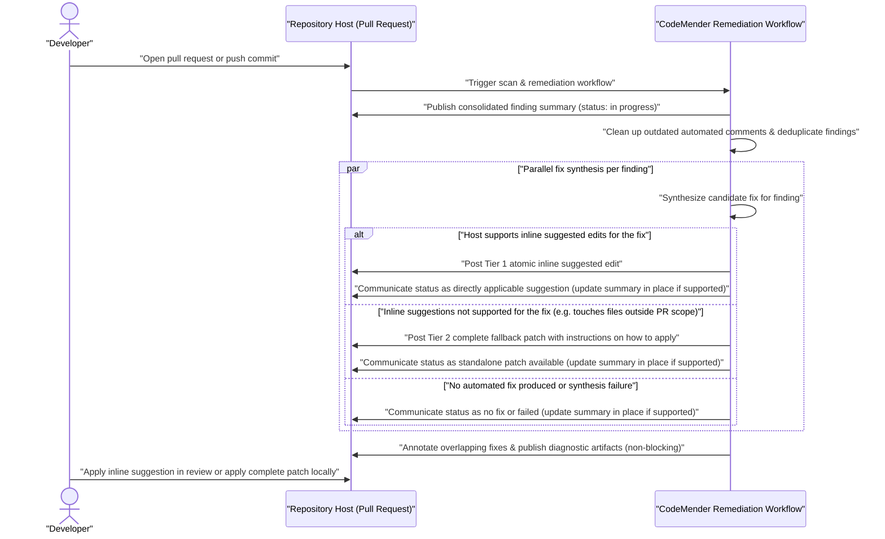

<!--
sdd_spec_id: docs/openspec/specs/journeys/pr-automated-remediation/spec.md
sdd_level: JOURNEY
sdd_implements: NONE
sdd_extends: NONE
-->

# Design: Pull Request Automated Remediation

## Context

When developers open or update a pull request on a repository host (such as a
GitHub Pull Request or a GitLab Merge Request), security scanners traditionally
either bury raw findings in CI console logs or push automated commits directly
onto the developer's branch. Console-only reports force developers to leave
their code review interface to diagnose issues, while unrequested automated
commits pushed onto an active feature branch cause push conflicts, clobber local
working trees, and fail on read-only fork pull requests.

Developers need an outside-in remediation experience across any supported
repository host that keeps the pull request conversation clean, surfaces only
findings relevant to the change, and delivers ready-to-apply fixes directly
inside the code review interface without mutating the branch behind the
developer's back.

## Goals / Non-Goals

### Goals

- Notify developers and reviewers directly in the pull request with a
  consolidated finding summary and communicate live remediation status (updating
  the summary comment in place when supported by the repository host).
- Deliver fixes as inline suggested edits whenever the repository host supports
  it.
- Gracefully fall back to providing a complete patch in the PR review when
  inline suggestions are not supported for a fix (for example, the patch is
  touching files outside the current PR scope and so inline suggestions are
  blocked). Instructions on how to apply the patch MUST be provided.
- Keep remediation strictly non-blocking for CI checks and prevent stale or
  duplicate automated comments across commits.

### Non-Goals

- Automatically committing or pushing generated fixes directly to the
  developer's branch without human review.
- Running full repository-wide remediation for pre-existing dormant findings
  unrelated to the pull request changes.
- Running long-running dynamic exploit verification automatically on every
  finding before delivering fixes (covered separately by the on-demand
  verification journey).

## Decisions

### Decision 1: Two-Tier In-Review Fix Delivery (Inline Suggested Edit vs. Complete-Patch Fallback)

**Choice**: Deliver fixes using a two-tier product flow: Tier 1 posts an atomic
(all-or-nothing) inline suggested edit whenever the repository host supports it
for the generated fix; Tier 2 posts the complete patch in the PR review with
instructions on how to apply the patch whenever inline suggestions are not
supported for a fix (for example, when the patch touches files or lines outside
the current PR scope and inline suggestions are blocked by the host).

**Rationale**: Inline suggested edits let developers accept and commit fixes
directly from the repository host's web UI without switching to a local
terminal. Conditioning Tier 1 on whether the repository host supports inline
suggested edits for the fix adapts naturally to each host's capabilities without
rewriting the journey contract. Because posting a partial inline suggestion for
a multi-location fix would apply broken, half-patched code if accepted, Tier 1
is strictly atomic and falls back to Tier 2 whenever the full fix cannot be
delivered as an inline suggestion.

**Alternatives considered**:

- *Push fix commits directly to the pull request branch*: Rejected because
  concurrent fix workers race when pushing commits, overwrite developers' local
  branches, and fail on cross-repository fork pull requests where the CI workflow
  only has read access.
- *Post inline suggested edits for supported lines and a patch comment for
  unsupported lines of the same fix*: Rejected because accepting the inline
  suggestion alone would commit an incomplete, non-compiling fix.

### Decision 2: Consolidated Summary Notification & Cross-Commit Conversation Hygiene

**Choice**: Publish a consolidated summary notification per pull request,
communicate each finding's remediation status as fixes progress (preferring
in-place updates to the summary comment when the repository host supports
comment editing), and deduplicate or clean up automated review comments across
commits so superseded feedback does not accumulate.

**Rationale**: Developers push multiple commits during code review. Updating the
consolidated summary in place when supported by the repository host—and clearing
or reusing prior automated review threads across commits—keeps the pull request
timeline concise and prevents human reviewer discussions from being buried under
obsolete bot tables.

**Alternatives considered**:

- *Always post a brand-new summary comment on every status change or commit push
  even on hosts that support editing comments in place*: Rejected because
  multi-commit pull requests rapidly accumulate repetitive automated tables.

### Decision 3: Best-Effort Non-Blocking Remediation Contract

**Choice**: Treat automated fix synthesis as best-effort assistance where
findings that cannot be fixed or whose fix generation fails are reported to the
user without cancelling sibling fixes or failing the pull request's CI check.

**Rationale**: Automated patch synthesis can legitimately fail or time out on
complex findings. Failing the CI job when a fix cannot be synthesized would block
diagnostic artifacts and sibling fixes from being published and would penalize
developers for remediation engine limitations rather than code defects.

**Alternatives considered**:

- *Fail the CI check whenever any finding cannot be automatically fixed*:
  Rejected because it conflates security policy gating with best-effort patch
  synthesis and prevents completed fixes from being published.

## User Flow

## Risks / Trade-offs

- **Conflicting fixes on adjacent or overlapping lines** -> When two independent
  fixes modify overlapping line ranges in the same file, applying both inline
  suggestions would conflict; the system explicitly warns the developer on both
  threads to apply one fix first and let the next push re-evaluate the other.
- **Large patches exceeding repository host comment limits** -> When a generated
  patch exceeds the repository host's maximum comment display size, the review
  comment summarizes the fix and links directly to the full patch in the
  workflow's build artifacts.
- **Untrusted repository source text breaking review formatting** -> All source
  snippets and patch contents rendered into pull request summaries and comments
  are escaped and safely fenced so arbitrary code in the repository cannot corrupt
  the review interface.
