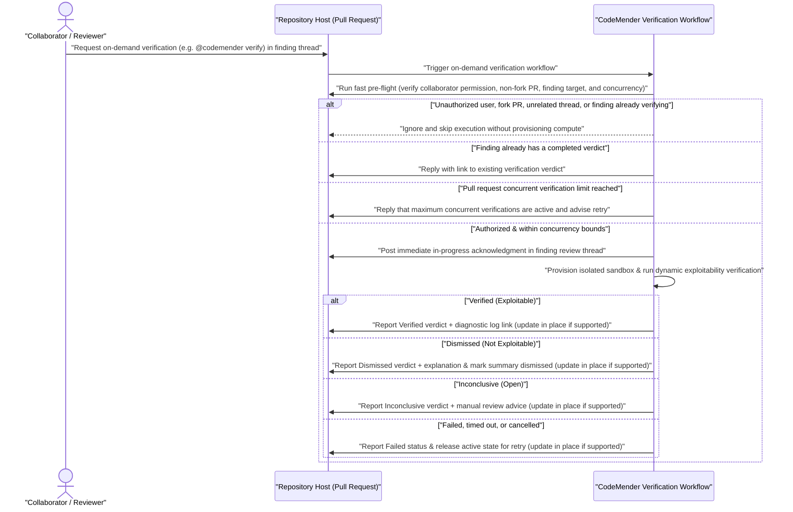

<!--
sdd_spec_id: docs/openspec/specs/journeys/pr-on-demand-verify/spec.md
sdd_level: JOURNEY
sdd_implements: NONE
sdd_extends: NONE
-->

# Design: Pull Request On-Demand Finding Verification

## Context

Dynamic exploitability verification synthesizes and executes proof-of-concept
reproducers inside an isolated sandbox, requiring substantially more time and
compute than scanning or patch generation. Running dynamic verification
automatically on every finding before posting pull request fixes would delay
initial review feedback and waste compute on straightforward findings where the
developer is happy to accept a simple fix.

At the same time, when a proposed fix is invasive or a reviewer suspects a
reported finding is a false positive, teams need a low-friction way to request
exploitability proof directly from their repository host's pull request
interface (such as a GitHub Pull Request or a GitLab Merge Request)—without
exposing privileged verification compute to unauthorized external users or
untrusted fork pull requests.

## Goals / Non-Goals

### Goals

- Enable authorized collaborators to trigger on-demand exploitability
  verification for an individual finding directly from the pull request review
  interface (for example, via `@codemender verify`) across supported repository
  hosts.
- Enforce fast pre-flight collaborator and fork authorization before
  provisioning cloud credentials, sandbox images, or verification compute.
- Provide immediate in-review acknowledgment when verification starts and report
  the final verdict (`Verified`, `Dismissed`, `Inconclusive`, or `Failed`) in
  the review thread (updating the acknowledgment in place when supported by the
  repository host).
- Prevent duplicate runs and resource exhaustion through per-finding active
  state tracking, automatic recovery from stale or cancelled runs, and a
  per-pull-request concurrency limit.

### Non-Goals

- Running dynamic exploitability verification automatically on every finding
  during the initial pull request scan.
- Allowing unauthorized external contributors or cross-repository fork pull
  requests to trigger verification runs.
- Failing the pull request's CI check when verification is inconclusive or fails
  to complete.

## Decisions

### Decision 1: On-Demand In-Review Trigger Instead of Mandatory Pre-Fix Gate

**Choice**: Decouple dynamic verification from the initial pull request scan and
run it on demand when an authorized collaborator triggers verification for a
specific finding from the pull request review interface.

**Rationale**: Most findings have localized fixes that developers can review
quickly, whereas dynamic exploitability verification requires extended sandbox
execution. Making verification on-demand per finding keeps initial pull request
feedback fast while providing deep exploitability proof whenever a finding is
disputed or high-impact.

**Alternatives considered**:

- *Automatically verify every finding before generating fixes*: Rejected because
  it adds substantial latency to every pull request scan and wastes compute on
  findings with trivial fixes.
- *Require developers to run verification manually from a local CLI checkout*:
  Rejected because it forces reviewers out of the browser-based code review
  workflow and requires local sandbox setup.

### Decision 2: Defense-in-Depth Pre-Flight Authorization & Fork Gate

**Choice**: Validate that the requester is an authorized collaborator on the
target repository, that the pull request originates from a trusted (non-fork)
branch, and that the request targets a valid CodeMender finding before
authenticating to cloud services or provisioning verification sandboxes.

**Rationale**: Pull request review events fire on all comment activity,
including comments by external users on public repositories. Enforcing
authorization and fork checks during fast pre-flight validation prevents normal
review chatter from consuming compute and blocks untrusted actors from running
fork code or exhausting verification quotas.

**Alternatives considered**:

- *Rely solely on repository host workflow trigger filters*: Rejected because
  teams frequently customize CI workflow definitions; validating permissions in
  pre-flight provides consistent protection across all repository hosts before
  any credentials or containers are initialized.

### Decision 3: Review Thread State Tracking & Concurrency Bounds

**Choice**: Post an immediate in-progress acknowledgment reply in the finding's
review thread when verification starts, report the final verdict in that review
thread when verification finishes or aborts (preferring in-place updates to the
acknowledgment comment when the repository host supports comment editing),
deduplicate concurrent requests per finding with automatic expiration for
crashed runs, and cap the number of concurrent active verifications per pull
request.

**Rationale**: Reporting progress and final results inside the finding's review
thread (and updating the reply in place when supported by the host) keeps the
discussion readable without requiring an external database across stateless CI
runs. Deduplicating per finding and bounding concurrent runs per pull request
prevent accidental comment floods from exhausting CI resources, while automatic
expiration and cancellation handling ensure a finding never stays permanently
locked if a runner terminates unexpectedly.

**Alternatives considered**:

- *Always post separate review comments for every state transition even on hosts
  that support editing comments in place*: Rejected because posting multiple
  status comments per verification run clutters the review discussion thread.

## User Flow

## Risks / Trade-offs

- **Abruptly terminated CI runner leaving a finding in an active verification state** ->
  Mitigated by handling termination signals to mark the finding's verification
  status as failed and by expiring stale in-progress states after a bounded
  timeout so reviewers can retry verification.
- **Expired scan artifacts when verification is requested long after the initial
  pull request scan** -> If the original scan's finding artifact has expired or
  is unavailable, the workflow reconstructs the finding context from the pull
  request review thread and summary metadata so on-demand verification can still
  proceed.
- **Burst of verification requests on large pull requests** -> Enforcing a
  per-pull-request concurrency cap and per-finding deduplication bounds compute
  consumption while giving reviewers clear guidance to retry once an active run
  completes.
