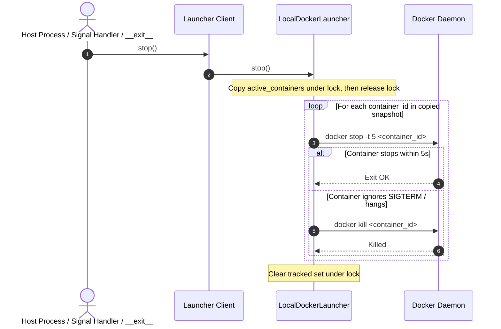

<!--
sdd_spec_id: SPEC-LAUNCHER
sdd_implements: None
sdd_extends: None
sdd_level: COMPONENT
sdd_archetype: LIBRARY
sdd_cujspec_product: codemender-runner
-->

<!--*
freshness: { owner: 'codemender-maintainers', reviewed: '2026-11-03' }
*-->

# Design: Host-Side Client & Container Orchestrator (`launcher.base`)

## Context

Governed by [SPEC-LAUNCHER](spec.md),
[CodeMender Runner System Design](../tech/systems/codemender-runner/design.md),
[Security and Trust Zones System Design](../tech/systems/security-and-trust-zones/design.md),
[ADR-0008](../../../adr/ADR-0008-repository-layout-and-package-structure.md),
the [Distributed Execution and Transit System Design](../tech/systems/distributed-execution-and-transit/design.md),
[SPEC-WORKER](../worker/spec.md), and
[SPEC-ARTIFACT-CACHE](../artifact-cache/spec.md), this design defines the technical
architecture, concrete data models, failure-recovery mechanics, and lifecycle
management for `packages/launcher/src/launcher/`.

High-level architectural decisions, including the three dependency injection seams,
phased CI execution model ($M \times K$ concurrency), container image packaging,
and transit storage layout, are established in the [CodeMender Runner System Design](../tech/systems/codemender-runner/design.md)
and the [Security and Trust Zones System Design](../tech/systems/security-and-trust-zones/design.md).
This document specifies the concrete implementation details and edge-case contracts
governing the `Launcher` component.

---

## Goals / Non-Goals

### Goals

- **Strongly Typed Domain Outcomes**: Define concrete wire and outcome models
  (`FindOutcome`, `FixOutcome`, `VerifyOutcome`, `ScanMetadata`) using `@attrs.define(frozen=True)`
  for clean consumption by CLI entrypoints (`cm-github`, `cm-gitlab`).
- **Template Method Dispatch & Fail-Closed Receipt Synthesis**: Specify `run_worker()`
  as a template method with automated fail-closed receipt synthesis whenever a
  sandbox container terminates abruptly (OOM, eviction, crash, missing receipt).
- **Deterministic Lifecycle & Lock-Free Teardown**: Implement Python's context manager
  protocol (`__enter__` / `__exit__`) and lock-free container termination in `stop()`.
- **Generator Streaming Mechanics**: Specify `run_parallel()` completion-order
  yielding (`concurrent.futures.as_completed`) for progressive PR suggestions.
- **Backend Dispatch Protocols**: Define concrete execution mechanics for
  `LocalDockerLauncher` (single `/cache` mount, optional read-only `/creds`, gated
  `runsc` capabilities) and `CloudRunLauncher` (SDK job overrides, lazy imports).

### Non-Goals

- Re-evaluating overarching architectural trade-offs established in the [CodeMender Runner System Design](../tech/systems/codemender-runner/design.md).
- Implementing container-internal worker execution (governed by [SPEC-WORKER](../worker/spec.md)).
- Implementing underlying storage drivers (governed by [SPEC-ARTIFACT-CACHE](../artifact-cache/spec.md)).
- Long-term findings database persistence (deferred to future `packages/store`).

---

## Component Architecture & Class Design

`Launcher` serves as the host-side client in the acyclic dependency structure
governed by [CodeMender Runner System Design](../tech/systems/codemender-runner/design.md) Decision 1 (`Launcher --> ArtifactCache <-- Worker`):

```mermaid
classDiagram
  direction TB

  namespace launcher_cache {
    class ArtifactCache {
      <<protocol>>
      +get_bytes(key) bytes
      +put_bytes(key, data) void
      +get_json(key) dict
      +put_json(key, data) void
      +get_file(key, dest) Path
      +put_file(key, src) void
      +get_repo_archive(dest) Path
      +put_repo_archive(src) void
      +get_task_output(task_id, filename, dest) Path
    }

    class RunManifest {
      +str command
      +str task_id
      +str base_ref
      +str finding_key
      +int diff_workers
    }

    class ExecutionReceipt {
      +str status
      +int exit_code
      +str command
      +str task_id
      +str started_at
      +str completed_at
      +float duration_seconds
      +dict artifacts
      +str error
      +bool ok
    }

    class ScanMetadata {
      +str base_ref
      +str head_sha
      +tuple~str~ finding_ids
      +dict fingerprints
    }
  }

  namespace launcher {
    class LauncherConfig {
      +int max_parallel
      +int find_timeout_seconds
      +int fix_timeout_seconds
      +int verify_timeout_seconds
    }

    class ParallelTask {
      +str task_id
      +RunManifest manifest
    }

    class Launcher {
      <<abstract>>
      #ArtifactCache cache
      #LauncherConfig config
      +ensure_repo_snapshot(repo_dir, base_ref, force) str
      +find(repo_dir, base_ref, diff_workers, timeout_seconds) FindOutcome
      +fix(finding_ids, shard, max_workers, timeout_seconds) Iterator~FixOutcome~
      +verify(finding_ids, shard, max_workers, timeout_seconds) Iterator~VerifyOutcome~
      +run_parallel(tasks, max_workers) Iterator~ParallelResult~
      +run_worker(task_id, timeout_seconds) ExecutionReceipt
      #_dispatch_worker(task_id, timeout_seconds)* int
      +stop() void
      +__enter__() Self
      +__exit__(exc_type, exc_val, exc_tb) void
    }

    class LocalDockerLauncher {
      -str docker_image
      -str runtime
      -set~str~ active_containers
      #_dispatch_worker(task_id, timeout_seconds) int
      +stop() void
    }

    class CloudRunLauncher {
      -CloudRunClient client
      -set~str~ active_executions
      #_dispatch_worker(task_id, timeout_seconds) int
      +stop() void
    }

    class FindOutcome {
      +ScanMetadata scan_meta
      +tuple~str~ finding_ids
      +dict sarif_report
      +ExecutionReceipt receipt
      +str log
    }

    class FixOutcome {
      +str finding_id
      +str diff
      +ExecutionReceipt receipt
      +str log
      +str error
      +bool ok
    }

    class VerifyOutcome {
      +str finding_id
      +str status
      +dict verified_sarif
      +ExecutionReceipt receipt
      +str log
      +str error
      +bool ok
    }
  }

  Launcher <|-- LocalDockerLauncher
  Launcher <|-- CloudRunLauncher
  Launcher --> ArtifactCache : injected with
  Launcher --> LauncherConfig : configured by
  Launcher --> ParallelTask : schedules
```



---

## Domain Outcome & Configuration Data Models

To eliminate ad-hoc dictionary parsing and raw byte handling in outer callers
(`packages/repohost`), `packages/launcher/src/launcher/base.py` defines frozen
`attrs` models encapsulating outcomes and configuration defaults:

```python
from typing import Any, Self
import attrs
from launcher.cache.models import ExecutionReceipt, RunManifest, ScanMetadata

DEFAULT_MAX_PARALLEL = 4
DEFAULT_FIND_TIMEOUT_SECONDS = 3600
DEFAULT_FIX_TIMEOUT_SECONDS = 1800
DEFAULT_VERIFY_TIMEOUT_SECONDS = 1800


@attrs.define(frozen=True)
class LauncherConfig:
  """Centralized execution limits and timeout defaults for Launcher."""
  max_parallel: int = DEFAULT_MAX_PARALLEL
  find_timeout_seconds: int = DEFAULT_FIND_TIMEOUT_SECONDS
  fix_timeout_seconds: int = DEFAULT_FIX_TIMEOUT_SECONDS
  verify_timeout_seconds: int = DEFAULT_VERIFY_TIMEOUT_SECONDS


@attrs.define(frozen=True)
class ParallelTask:
  """Unit of parallel worker execution managed by run_parallel()."""
  task_id: str
  manifest: RunManifest


@attrs.define(frozen=True)
class FindOutcome:
  """Outcome of a Launcher.find() execution."""
  scan_meta: ScanMetadata
  finding_ids: tuple[str, ...]
  sarif_report: dict[str, Any]
  receipt: ExecutionReceipt
  log: str = ""


@attrs.define(frozen=True)
class FixOutcome:
  """Outcome of one repair task yielded by Launcher.fix()."""
  finding_id: str
  diff: str
  receipt: ExecutionReceipt
  log: str = ""
  error: str = ""

  @property
  def ok(self) -> bool:
    return (
        self.receipt.status == "SUCCESS"
        and not self.error
        and bool(self.diff.strip())
    )


@attrs.define(frozen=True)
class VerifyOutcome:
  """Outcome of one verification task yielded by Launcher.verify()."""
  finding_id: str
  status: str
  verified_sarif: dict[str, Any]
  receipt: ExecutionReceipt
  log: str = ""
  error: str = ""

  @property
  def ok(self) -> bool:
    return (
        self.receipt.status == "SUCCESS"
        and not self.error
        and self.status in ("DISMISSED", "VERIFIED", "OPEN")
    )
```

---

## Template Method Dispatch & Fail-Closed Receipt Synthesis

In normal operation, the container worker (`cm-worker`, [SPEC-WORKER](../worker/spec.md))
writes `receipt.json` to `ArtifactCache` before exiting. However, when a container
terminates abruptly (killed by Linux/gVisor OOM killer with exit `137`, SIGKILL,
or Cloud Run execution eviction), `receipt.json` will not exist in the cache.

To guarantee that `run_worker(task_id)` **always returns a valid `ExecutionReceipt`**
([SPEC-LAUNCHER REQ-0007](spec.md#req-0007)), `Launcher` provides a concrete
Template Method that coordinates dispatch, receipt retrieval, and fail-closed fallback
synthesis:

```python
def run_worker(
    self,
    task_id: str,
    timeout_seconds: int | None = None,
) -> ExecutionReceipt:
  """Executes worker task and guarantees an ExecutionReceipt return."""
  start_iso = datetime.now(timezone.utc).isoformat()
  command = "unknown"
  try:
    manifest_data = self.cache.get_json(f"tasks/{task_id}/input/manifest.json")
    command = manifest_data.get("command", "unknown")
  except Exception:
    pass

  exit_code = self._dispatch_worker(task_id, timeout_seconds=timeout_seconds)

  # Check for receipt written by cm-worker
  receipt_key = f"tasks/{task_id}/output/receipt.json"
  try:
    receipt_dict = self.cache.get_json(receipt_key)
    return ExecutionReceipt.from_dict(receipt_dict)
  except Exception as exc:
    # Fail-closed: missing receipt indicates unexpected worker crash/termination
    fallback = _synthesize_fallback_receipt(
        task_id=task_id,
        exit_code=exit_code if exit_code != 0 else 1,
        error_message=(
            f"Worker terminated without writing receipt (exit code {exit_code}): {exc}"
        ),
        timestamp_start=start_iso,
        command=command,
    )
    try:
      self.cache.put_json(receipt_key, fallback.to_dict())
    except Exception:
      pass
    return fallback


def _synthesize_fallback_receipt(
    task_id: str,
    exit_code: int,
    error_message: str,
    timestamp_start: str,
    command: str = "unknown",
) -> ExecutionReceipt:
  """Synthesizes a fail-closed receipt matching ExecutionReceipt wire schema."""
  now_iso = datetime.now(timezone.utc).isoformat()
  return ExecutionReceipt(
      status="FAILURE",
      exit_code=exit_code if exit_code != 0 else 1,
      command=command,
      task_id=task_id,
      started_at=timestamp_start,
      completed_at=now_iso,
      duration_seconds=0.0,
      finding_count=0,
      artifacts={},
      error=error_message or f"Worker process terminated abnormally (exit {exit_code}).",
  )
```

---

## Lifecycle Management, Context Protocol & Teardown

`Launcher` implements Python's context manager protocol (`__enter__` / `__exit__`)
to guarantee signal safety and deterministic cleanup:

```python
class Launcher(abc.ABC):
  def __enter__(self) -> Self:
    return self

  def __exit__(self, exc_type: Any, exc_val: Any, exc_tb: Any) -> None:
    self.stop()
```

### Signal-Safe Container Termination (`LocalDockerLauncher.stop()`)



- **Lock-Free Termination**: Active container IDs (`LocalDockerLauncher`) and execution names
  (`CloudRunLauncher`) are tracked in thread-safe sets. During `stop()`, a snapshot copy of
  the set is taken under lock and the lock is released immediately before issuing external
  `docker stop` / `docker kill` commands or Cloud Run RPCs, preventing deadlocks if external
  processes block.
- **Two-Stage Docker Escalation**: To handle gVisor sandboxes that may hang during
  abnormal process aborts, `LocalDockerLauncher.stop()` issues `docker stop -t 5`
  (graceful SIGTERM with a 5-second timeout) followed immediately by `docker kill` if
  the container has not exited.
- **Idempotence**: Successive invocations of `stop()` are safe no-ops.

---

## Generator Streaming & Concurrency Engine (`run_parallel`)

`Launcher.fix()` and `Launcher.verify()` delegate worker concurrency to `run_parallel()`:

1. **Bounded Pool**: Uses `concurrent.futures.ThreadPoolExecutor(max_workers=min(len(tasks), max_workers))`.
   Threads are lightweight and suitable because worker tasks are I/O-bound (waiting on
   external Docker subprocesses or Cloud Run API polling).
2. **Completion-Order Streaming**: Yields completed results immediately via
   `concurrent.futures.as_completed(futures)` so callers (`cm-github`, `cm-gitlab`)
   can publish inline PR/MR suggestions progressively without waiting for the slowest
   task in the run.
3. **Guaranteed Interruption Teardown**: Wraps generator iteration in `try...finally`
   to ensure `self.stop()` is called if iteration stops early (e.g. `GeneratorExit`,
   cancellation, or exception).

---

## Concrete Backend Execution Mechanics

### 1. `LocalDockerLauncher` (`launcher.local.local_docker`)

- **Bind Mounts**:
  - `-v <host_cache_dir>:/cache` (read-write).
  - Optional `-v <host_creds_file>:/creds/adc.json:ro` (read-only) for `LocalWifSa`
    per [Security and Trust Zones Decision 3](../tech/systems/security-and-trust-zones/design.md#decision-3-mode-switched-least-privilege-gcp-wif-local-single-sa-vs-cloud_run-coordinatorworker-dual-sa-split).
  - Zero repository workspace bind-mounts (`-v /repo:/workspace`) are passed.
- **Capability Gating**:
  - When `runtime == "runsc"`, `--runtime=runsc --cap-add SYS_ADMIN` is passed.
  - When `runtime != "runsc"`, `--cap-add SYS_ADMIN` MUST NOT be added. Under `runc`,
    no extra capabilities are passed.
- **Forbidden Flags**:
  - MUST NOT add `--privileged`, `--security-opt ...=unconfined`, `--net=host`, or bare `-e VAR`.
- **Environment Scrubbing**: Only explicit safe runtime variables from the ADR-0003
  allowlist are passed (`GOOGLE_CLOUD_PROJECT`, `CODEMENDER_*`). Repository host
  tokens (`GITHUB_TOKEN`, `CI_JOB_TOKEN`) are strictly stripped.
- **Execution Command**:
  ```bash
  docker run --rm \
    --runtime=runsc --cap-add SYS_ADMIN \
    -v <host_cache_dir>:/cache \
    -v <host_creds_file>:/creds/adc.json:ro \
    codemender-runner:local \
    --cache-uri file:///cache \
    --task-id <task_id>
  ```

### 2. `CloudRunLauncher` (`launcher.cloudrun.cloud_run`)

- **Job Invocation**: Dispatches executions via `CloudRunClient` overriding container
  arguments:
  `args=["--cache-uri", cache.uri, "--task-id", task_id]`.
- **Two-Way Door Lazy Imports**: `packages/launcher/src/launcher/base.py` and
  `LocalDockerLauncher` contain zero imports of `google.cloud`. `CloudRunLauncher`
  isolates cloud SDK imports so local runs never fail when GCP libraries are absent.

---

## Legacy API Migration & Deprecation Delta

To transition from the legacy direct-execution launcher to the unified
worker-based architecture in the [CodeMender Runner System Design](../tech/systems/codemender-runner/design.md), the legacy methods and models are replaced as follows:

| Legacy Member | Status | Replacement in SPEC-LAUNCHER | Rationale |
| :--- | :--- | :--- | :--- |
| `Launcher.run(command, args)` | Deprecated / Removed | `Launcher.find()`, `fix()`, `verify()` | High-level domain workflows replace ad-hoc command invocations. |
| `Launcher.run_isolated(task)` | Deprecated / Removed | `Launcher.run_worker()` via `_dispatch_worker()` | Isolated folder copying is replaced by single-cache bind-mounts. |
| `Launcher.with_dirs(...)` | Removed | Replaced by `ArtifactCache` root path | Container directories are unified under `/cache`. |
| `RunResult` | Deprecated / Removed | `FindOutcome`, `FixOutcome`, `VerifyOutcome` | Typed domain outcomes replace raw byte/event streams. |
| Legacy `ParallelTask` (`src_workspace`, `/out`) | Replaced | `ParallelTask(task_id, manifest)` | Eliminates host workspace copying in favor of cache-staged manifests. |

---

## Verification & Testing Strategy

Compliance with `SPEC-LAUNCHER` is verified via hermetic unit tests in `packages/launcher`,
following 1:1 module-to-test co-location:

1. **`test_base.py` (Base Class & Workflow Tests, co-located with `base.py`)**:
   - Verify `ensure_repo_snapshot()` caching behavior, `.git/config` allowlist replacement,
     hook deletion, and sensitive file exclusion.
   - Verify `find()` orchestration, SARIF splitting via `SarifDocument.to_findings()`,
     and `FindOutcome` construction.
   - Verify `fix()` and `verify()` generator streaming, completion-order yielding,
     and dual selection modes (Explicit IDs vs. `shard=(K, N)`).
   - Verify that empty shard slices (valid `K <= N` where `K - 1 >= len(finding_ids)`)
     yield zero items and exit cleanly.
   - Verify that invalid shard slices (`K > N` or `K < 1`) raise `ValidationError`.
   - Verify context manager protocol (`__enter__` and `__exit__`).
   - Verify fail-closed fallback `ExecutionReceipt` synthesis when worker terminates
     without writing a receipt or exits with code `137`.
2. **`local/test_local_docker.py` (Local Docker Backend Tests, co-located with `local_docker.py`)**:
   - Verify `docker run` command formulation (`--cache-uri file:///cache --task-id <id>`).
   - Assert single `-v <host_cache_dir>:/cache` bind mount, optional read-only `/creds`,
     and zero repository bind mounts.
   - Assert `--cap-add SYS_ADMIN` is passed only when `runtime == "runsc"`.
   - Verify lock-free, signal-safe `stop()` container termination.
3. **`cloudrun/test_cloud_run.py` (Cloud Run Backend Tests, co-located with `cloud_run.py`)**:
   - Verify Cloud Run Job invocation arguments override.
   - Verify lazy-import invariant: dynamically block `google.cloud` in `sys.modules`
     (`mock.patch.dict(sys.modules, {"google.cloud": None})`) and assert importing
     `launcher.base` and `launcher.local` succeeds without `ImportError`.
4. **Package Boundary Invariants**:
   - Verify zero imports of `packages/repohost` and zero imports of `launcher.worker`
     from `launcher.base`.
