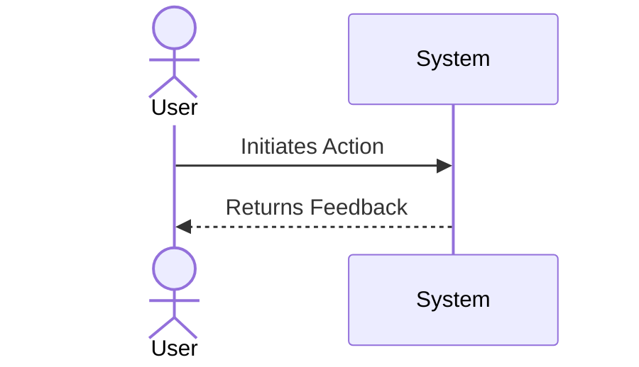

<!--
sdd_spec_id: docs/openspec/specs/journeys/{journey-name}/spec.md
sdd_implements: NONE
sdd_level: JOURNEY
-->

# Design: {User Journey Title}

## Context

{Background on the user or operator persona, their pain points, and current
workarounds. Why does this journey need to exist or be improved?}

## Goals / Non-Goals

### Goals

{What user experience or workflow outcomes are we aiming for?}

### Non-Goals

{What parts of the experience are out of scope?}

## Decisions

### {UX/Flow Decision 1 Title}

**Choice**: {what user flow or interaction pattern was decided}

**Rationale**: {why this provides the best user or operator experience}

**Alternatives considered** (omit if none is worth listing):

- {a flow a competent engineer could choose}: {main reason it lost}

## User Flow

{The main steps of the workflow, as the user or operator sees them. Include a
Mermaid diagram if it clarifies the sequence of interactions.}

## Risks / Trade-offs

- **{Material Usability Risk}** ->
  {Mitigation strategy (e.g., actionable error diagnostics, safe defaults)}
