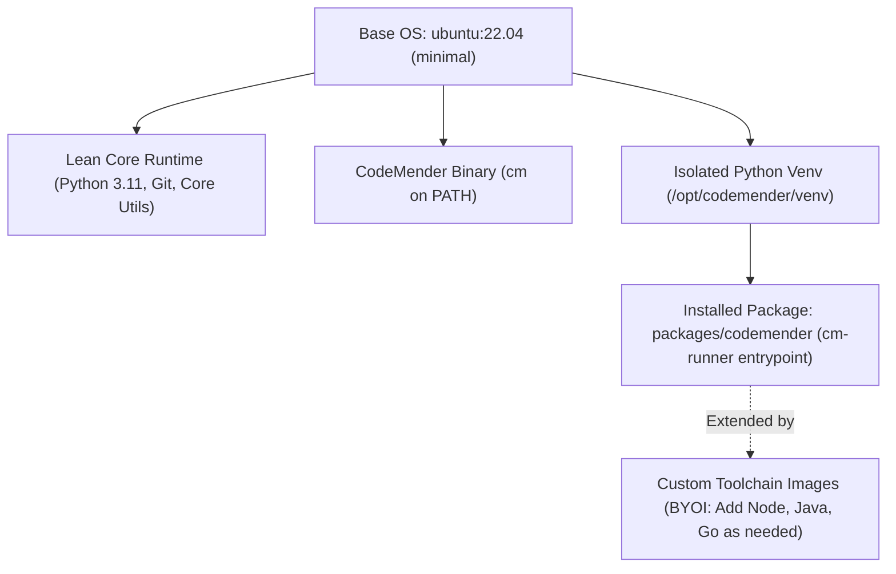

<!--*
freshness: { owner: 'brentcollier', reviewed: '2026-10-13' }
*-->

<!--
sdd_spec_id: SPEC-0003
sdd_implements: None
sdd_extends: None
sdd_level: COMPONENT
sdd_archetype: CLI_TOOL_BATCH_JOB
sdd_cujspec_product: codemender-runner
-->

# Design: Lean Runner Container & Modular BYOI Packaging

## Context

CodeMender runs in customer CI pipelines and executes untrusted code, compilers,
and test suites. Packaging every potential language runtime (Java, Go, Node.js,
Python, Rust) into a single monolithic base container results in massive images
(>1.5 GB), slow cold-start pulling in Cloud Run and GitHub Actions, and elevated
CVE vulnerability surface.

Governed by [SPEC-0003](spec.md),
[ADR-0001](../../adr/ADR-0001-machine-readable-output-contract.md), and
[ADR-0008](../../adr/ADR-0008-repository-layout-and-package-structure.md), this
design specifies a lean container packaging strategy (`docker/runner.Dockerfile`
built from the repository root context `.`) that strips the base image to core
orchestrator essentials and defers specialized toolchains to modular custom
images.

## Goals / Non-Goals

### Goals
*   Provide a lean, fast-pulling base container image packaging only what is
    necessary for runner orchestration (minimal Linux OS, Python 3.11, Git, and
    `cm`).
*   Isolate the Python orchestrator runtime inside `/opt/codemender/venv` and
    install `packages/codemender` via `pip install --no-cache-dir ./packages/codemender`.
*   Package the CodeMender binary (`cm`) on `$PATH` without rigid hardcoded path
    dependencies.
*   Support modular Bring-Your-Own-Image (BYOI) inheritance for
    language-specific build environments.
*   Automate image building and publishing via
    `.github/workflows/build_runner_image.yml`.

### Non-Goals
*   Pre-installing heavy multi-language compiler suites (JDK, Node.js, Go) into
    the initial base image (evaluated post-launch).
*   Dynamically downloading compilers at runtime over the public internet during
    CI runs.

## Decisions

### Decision 1: Lean Base Image vs. Monolithic Multi-Language Monolith
*   **Choice**: Package only Python 3.11, Git, essential utilities, and the `cm`
    binary in the base image (`docker/runner.Dockerfile`).
*   **Rationale**:
    1. Reduces base image footprint by over 80% (from ~1.5 GB to ~200 MB).
    2. Minimizes cold-start image pull latency in Cloud Run and GitHub Actions
       runner environments.
    3. Significantly reduces security patching surface by omitting hundreds of
       unnecessary OS packages.
    4. Custom/multi-language compiler toolchains are easily layered via BYOI or
       custom container images when required.

### Decision 2: Install `packages/codemender` into `/opt/codemender/venv` from Root Build Context
*   **Choice**: Build `docker/runner.Dockerfile` with the repository root (`.`)
    as context (filtered by root `.dockerignore`), copy `packages/codemender`
    into `/opt/codemender/packages/codemender`, and run
    `/opt/codemender/venv/bin/pip install --no-cache-dir ./packages/codemender`
    with `ENTRYPOINT ["cm-runner"]` and `CMD ["version"]`.
*   **Rationale**: Installs `codemender` (`codemender.runner`, `codemender.cm`,
    `codemender.sarif`, `codemender.vcs`) as a standard PEP 621 package with the
    `cm-runner` console script on `$PATH` (`/opt/codemender/venv/bin/cm-runner`),
    eliminating `sys.path` manipulation and excluding tests (`**/test_*.py`,
    `**/testdata/**`) from the installed wheel.

## Architecture

## Risks / Trade-offs

-   **Repositories Requiring Compilers** → Projects needing dynamic compilation
    or execution during verification must use extended BYOI images. Mitigated by
    straightforward `FROM` inheritance templates.

## Deployment & Rollback

-   Images built from `docker/runner.Dockerfile` (root context `.`) and
    published to GHCR with commit SHA and `:latest` tags.
-   Rollback by pinning workflow inputs (`runner_image`) to a previous verified
    tag.
