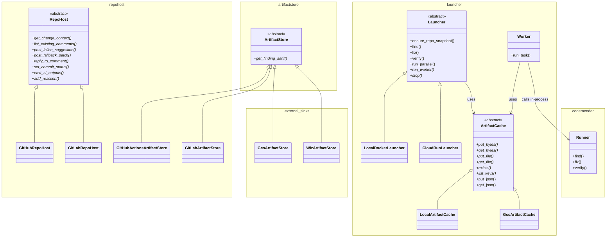
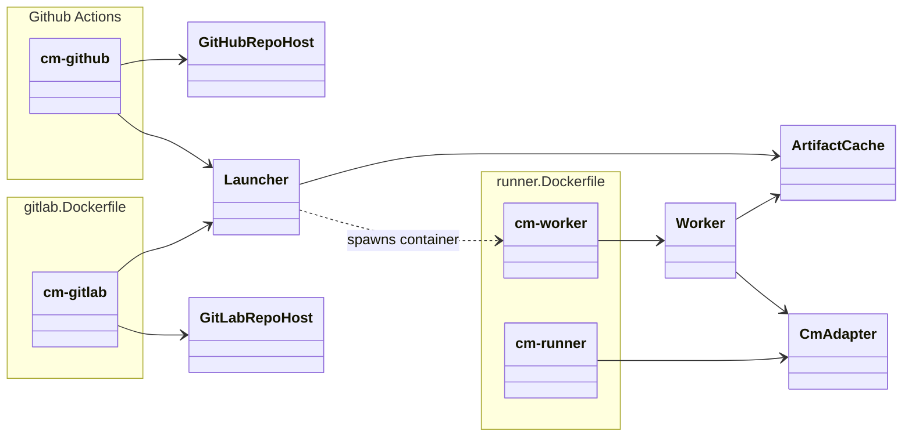
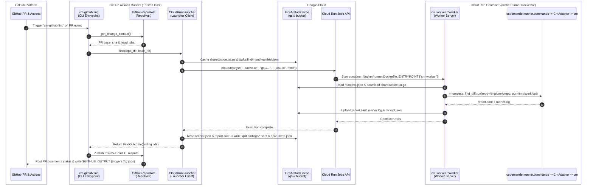
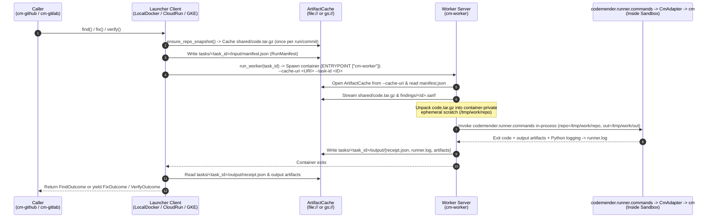

<!--
sdd_spec_id: docs/openspec/specs/tech/systems/codemender-runner/spec.md
sdd_level: SYSTEM
sdd_implements:
  - docs/openspec/specs/journeys/pr-automated-remediation/spec.md
  - docs/openspec/specs/journeys/pr-on-demand-verify/spec.md
sdd_extends: NONE
-->

# Design: CodeMender Runner System Architecture

## Context

Building upon [ADR-0008](../../../../../adr/ADR-0008-repository-layout-and-package-structure.md)'s
repository and package decomposition, we define the abstraction layers and
interactions between those layers in our overall system. Automated PR/MR CI
workflows alongside our initial GitHub/GitLab (`cm-github`, `cm-gitlab`) and
Local Docker gVisor / Cloud Run (`LocalDockerLauncher`, `CloudRunLauncher`,
`LocalArtifactCache`, `GcsArtifactCache`) adapters in the diagrams and
reference tables below serve as our **initial concrete starting point**, built
on extensible seams targeting **every customer deployment scenario** (scheduled
full-repository audits, fleet-wide batch remediation campaigns, delayed
verification, platform services, and standalone CLI runs across dogfooding,
org-wide, and single-repo adoption). Adding **any repository hosting site**
(such as Gerrit, Bitbucket, Azure DevOps, or internal Git hosts—or running with
zero host integration), sandbox compute backend (such as GKE/Kubernetes Jobs or
batch clusters), transit store (such as S3 or Blob storage), or durable
security sink requires implementing only the corresponding adapter seam.

**Design References**: Accompanies the [CodeMender Runner System Specification](spec.md)
(extended by the [Distributed Execution and Transit System Specification](../distributed-execution-and-transit/spec.md)
([Design](../distributed-execution-and-transit/design.md)) and the
[Security and Trust Zones System Specification](../security-and-trust-zones/spec.md)
([Design](../security-and-trust-zones/design.md)))
and synthesizes the system architecture governed by
[ADR-0001](../../../../../adr/ADR-0001.md),
[ADR-0002](../../../../../adr/ADR-0002.md),
[ADR-0003](../../../../../adr/ADR-0003-environment-scrubbing.md),
[ADR-0006](../../../../../adr/ADR-0006-pr-remediation-routing-and-security-gate.md),
and [ADR-0008](../../../../../adr/ADR-0008-repository-layout-and-package-structure.md).

## Goals / Non-Goals

### Goals

1. **Portable container-based CodeMender execution:** The core CodeMender
   execution should be portable to multiple container-based runtime
   environments. Whether we are running locally inside of gVisor or remotely via
   Cloud Run or GKE, we should be able to reuse the existing container with
   minimal modifications and no duplication of orchestration code.
1. **Asynchronous, Multi-Stage & On-Demand Workflows:** Support workflows
   (`find`, `fix`, `verify`, and future workflows) that can execute
   synchronously in a single CI job, fan out across parallel CI matrix jobs, or
   run hours later in response to an on-demand trigger (such as a
   `@codemender verify` PR review comment) without reinventing an
   in-memory DAG or workgraph engine.
1. **100% Decoupling of Core Workflows from `RepoHost`:** Keep core CodeMender
   operations (`Launcher.find()`, `Launcher.fix()`, `Launcher.verify()`)
   completely independent of repository hosting platforms (`GitHubRepoHost`,
   `GitLabRepoHost`) so the exact same `Launcher` methods power both interactive
   PR/MR remediation (with live inline suggestions) and headless non-PR
   execution (quarterly full-repo vulnerability scans, scheduled branch audits,
   and local developer CLI runs).
1. **Cross-CI Fan-Out Portability (GitHub Actions vs. GitLab CI):** Support
   high-throughput parallel remediation across CI platforms with different
   fan-out primitives—specifically GitHub Actions' dynamic `fromJSON()` job
   matrices versus GitLab CI's static `parallel: N` node sharding
   (`$CI_NODE_INDEX / $CI_NODE_TOTAL`) and extensible CI/batch schedulers—with
   conflict-free artifact cache directory merging.

### Non-Goals

- Coupling core `codemender` or `launcher` execution to any repository hosting
  API, CI vendor workflow runtime, or durable external findings database.
- Replacing CI/batch schedulers with an in-memory multi-machine DAG orchestrator.
- Mutating caller repository checkouts in place outside isolated container scratch.

---

## Architecture

### Package & Abstraction Layer Map

We illustrate our abstraction layers and domain objects below using a class
diagram. Each domain object is represented as an Abstract class with the concrete
instantiations shown with inheritance relationships (hollow arrow). Dependencies
between domain objects are shown using association relationships (standard
arrow). The namespace containing each class represents the
[ADR-0008](../../../../../adr/ADR-0008-repository-layout-and-package-structure.md) package the
object is a part of.

> [!NOTE] 
> All method names shown in the diagrams below are **illustrative
> only**. They are included to convey component responsibilities and data flow
> rather than to lock in exact Python method signatures, which will be finalized
> in the governing OpenSpecs and source code.

How these objects are used and relate to each other will be discussed in the
next section.



1. **`RepoHost` (`repohost.base`) and Concrete Implementations
   (`GitHubRepoHost`, `GitLabRepoHost` in `packages/repohost`):**
   - **Role:** Handles interactions with the repo hosting platform. Abstracts
     the APIs for interacting with the PR, the code, comments, etc.
   - **Boundary & Security Invariant:** Runs exclusively on the outer CI host
     where repository tokens (`$GITHUB_TOKEN`, `$CI_JOB_TOKEN`) reside. Consumes
     domain outcomes returned or yielded by `Launcher`, and is **never**
     installed inside the untrusted sandbox container.
1. **`ArtifactStore` (`artifactstore.base`) and Concrete Implementations
   (`GitHubActionsArtifactStore` in `packages/repohost`, future
   `GcsArtifactStore`, `WizArtifactStore`):**
   - **Role:** Handles durable, cross-workflow artifact persistence and
     retrieval (finding SARIF slices, full scan reports, patches, and
     verification receipts). Decouples artifact storage from PR code review
     interactions (`RepoHost`) and short-lived container transit
     (`ArtifactCache`).
   - **Host-Side Hydration for `verify`:** In asynchronous on-demand `verify`
     workflows, the outer host runner uses `ArtifactStore.get_finding_sarif()`
     to fetch the target finding SARIF from previous scan run artifacts, writing
     it into the short-lived `ArtifactCache` (or container input directory)
     before launching the worker container (`cm-worker` executing a `verify` task). The worker
     container only reads from `ArtifactCache`, ensuring untrusted sandbox
     processes never touch external artifact stores or host tokens.
   - **Boundary & Security Invariant:** Runs exclusively on the outer CI host
     where platform or cloud storage credentials reside.
1. **`Launcher` (`launcher.base`) and Concrete Backends (`LocalDockerLauncher`,
   `CloudRunLauncher` in `packages/launcher`):**
   - **Role:** Acts as the **host-side client** of the sandbox worker. Owns the
     high-level, repo-host-agnostic workflow methods (`find`, `fix`, `verify`,
     `ensure_repo_snapshot`, and `run_parallel`) as concrete methods on the base
     class, while delegating container/job creation and cancellation to the
     abstract `run_worker` and `stop` methods implemented by
     `LocalDockerLauncher` (local Docker with gVisor `runsc`) and
     `CloudRunLauncher` (Google Cloud Run Jobs).
   - **Dependency Injection:** Receives an `ArtifactCache` instance in its
     constructor (`Launcher(cache: ArtifactCache)`), staging task inputs into
     the cache before invoking `run_worker` and reading structured results back
     from the cache after the container exits.
1. **`Worker` (`launcher.worker` in `packages/launcher`):**
   - **Role:** Acts as the **inside-container server/executor** (invoked via the
     `cm-worker` CLI entrypoint). It is a distinct class from `Launcher`, but
     lives in the same `packages/launcher` package because `Launcher` (client)
     and `Worker` (server) implement the two halves of the same container
     execution protocol.
   - **Dependency Injection:** Receives an `ArtifactCache` instance in its
     constructor (`Worker(cache: ArtifactCache)`). When a container starts,
     `Worker.run_task(task_id)` reads `tasks/<task_id>/input/manifest.json` and
     `shared/code.tar.gz` from `ArtifactCache`, extracts the repository into
     container-private ephemeral scratch disk (`/tmp/work/repo`), invokes the
     `codemender.runner.commands` handlers (`init.run`, `find_diff.run`,
     `fix.run`, `verify.run`) in-process using `CmAdapter`, and writes
     `receipt.json`, `runner.log`, and output artifacts (`report.sarif`,
     `<finding>.diff`, or updated `<finding>.sarif`) back to `ArtifactCache`.
1. **`ArtifactCache` (`launcher.cache` in `packages/launcher`) and Concrete
   Backends (`LocalArtifactCache`, `GcsArtifactCache`):**
   - **Role:** Provides the short-lived, PR/run-scoped key/file cache shared
     between `Launcher` (on the outer CI host) and `Worker` (inside the sandbox
     container). `LocalArtifactCache` backs `file://` URIs using a local host
     directory (bind-mounted into local gVisor containers at `/cache`), while
     `GcsArtifactCache` backs `gs://` URIs using a Google Cloud Storage bucket
     prefix.
   - **Boundary Invariant:** Opened via `open_artifact_cache(uri)`, which lazily
     imports `GcsArtifactCache` only when `uri` starts with `gs://` so local
     `file://` executions never import `google.cloud` libraries.
1. **`Runner`  (`packages/codemender`):**
   - **Role:** The innermost package containing the `codemender.runner.commands`
     handlers (`init`, `find_diff`, `fix`, `verify`), the standalone `cm-runner`
     CLI wrapper, and `CmAdapter` (which invokes the underlying native `cm`
     binary and emits
     [ADR-0002](../../../../../adr/ADR-0002.md) NDJSON events),
     deterministic SARIF 2.1.0 parsing/splitting (`codemender.sarif`), local Git
     archive/diff operations (`codemender.vcs`), and shared data models.
   - **Boundary Invariant:** Bottom of the dependency stack: **never** imports 
     `launcher` or `repohost`.

### Long-Term `ArtifactStore` & Pluggable Sinks

This design separates **short-lived run/PR artifact caching**
(`ArtifactCache` in `packages/launcher/src/launcher/cache/`) from
**cross-workflow artifact persistence and external security platform
integrations** (`ArtifactStore` in `artifactstore.base`):

| Dimension                      | `ArtifactCache` (`launcher.cache` — Ephemeral)                                                                                                            | `ArtifactStore` (`artifactstore` — Durable)                                                                                                                                                                                                                            |
| :----------------------------- | :-------------------------------------------------------------------------------------------------------------------------------------------------------- | :--------------------------------------------------------------------------------------------------------------------------------------------------------------------------------------------------------------------------------------------------------------------- |
| **Primary Purpose**            | Ephemeral client $\leftrightarrow$ worker file exchange (`shared/code.tar.gz`, `RunManifest`, `ExecutionReceipt`, `runner.log`, candidate `.diff` files). | Durable persistence of confirmed findings, SARIF reports, verified patches, cross-workflow `verify` hydration context, and audit trails across repositories and time.                                                                                                  |
| **Lifecycle & Retention**      | Short-lived, scoped to a single PR commit or CI pipeline run (e.g., 1–3 day CI artifact expiry or GCS lifecycle rule).                                    | Long-lived (days to years), indexed across workflow runs, branches, repositories, and quarterly security campaigns.                                                                                                                                                    |
| **Implementations & Coupling** | `LocalArtifactCache` (`file://`) and `GcsArtifactCache` (`gs://`), naturally paired with `LocalDockerLauncher` and `CloudRunLauncher`.                    | Initial CI-native implementations (`GitHubActionsArtifactStore`), with future pluggable enterprise sinks (Wiz, SCC, BigQuery, dedicated findings databases) swappable across any `Launcher`.                                                                             |

**Current Upload Mechanism vs. Future `put` Extensions:**
In GitHub Actions today, initial scan artifact bundles (`report.sarif`,
`findings/*.sarif`, and `fixes/*.diff`) are uploaded directly by the workflow
step via `actions/upload-artifact@v4` targeting `$CODEMENDER_OUT_DIR`. Because
the CI action natively bundles and uploads the directory output, the initial
`ArtifactStore` interface focuses on retrieval (`get_finding_sarif`). Future
work will extend `ArtifactStore` with explicit write/persistence operations
(`put_finding_sarif`, `put_report`, `put_patch`) to allow headless execution,
container runtimes, and non-GitHub CI platforms to store artifacts directly into
swappable enterprise sinks without relying on platform-specific CI upload steps.

### CLI Entrypoints & Runtime Environments

We illustrate the CLI entrypoints below along with the environment they are
meant to run in and which domain objects they interact with. When the cli is
meant to run in a docker container, we've annotated it with the name of the
Dockerfile that contains it.

A key distinction to note is the client / server division between `Launcher` and
`Worker`. The **Launcher** is the "client" that runs in the outer CI Host
Process (e.g. in GitHub Actions) and is responsible for preparing the artifact
cache and launching the configured worker. The **Worker** is the "server" that 
actually executes CodeMender using the artifacts in the cache and writes results
back to the cache for the launcher to consume. 

Together, these two classes provide a generic way to run CodeMender across many
different runtimes.  The worker is a general process that can be run in any
container environment as long as it can access the artifact cache. To add a new
runtime environment, we only need to add the terraform configs to install worker
and add a new Launcher class for kicking off the new container environment.




1. **`cm-github` (`repohost.github.__main__:main` in `packages/repohost`) — Runs
   on `GitHubActionsRunner`:**
   - **Runtime Environment:** Executes directly on the trusted GitHub Actions
     runner VM (where `$GITHUB_TOKEN`, `$GITHUB_EVENT_PATH`, and cloud/Docker
     credentials live).
   - **First-Level Components Invoked:** Instantiates **`GitHubRepoHost`** (for
     PR diff context discovery, inline review suggestions, fallback patch
     comments, commit statuses, and `$GITHUB_OUTPUT`) and **`Launcher`**
     (`LocalDockerLauncher` or `CloudRunLauncher`, injected with
     `ArtifactCache`) to run `find()`, `fix()`, and `verify()`.
1. **`cm-gitlab` (`repohost.gitlab.__main__:main` in `packages/repohost`) — Runs
   in `docker/gitlab.Dockerfile` (`gitlab.Dockerfile`):**
   - **Runtime Environment:** Executes inside the outer GitLab CI job container
     built from `docker/gitlab.Dockerfile` (which installs
     `packages/artifactstore`, `packages/codemender`,
     `packages/launcher[cloudrun]`, and `packages/repohost[gitlab]` in the outer
     CI job where `$CI_JOB_TOKEN` / GitLab API tokens reside; dispatches via
     `CloudRunLauncher` without Docker-in-Docker).
   - **First-Level Components Invoked:** Instantiates **`GitLabRepoHost`** (for
     MR diff context discovery, inline diff discussion suggestions, fallback MR
     notes, commit statuses, and CI output artifacts) and **`Launcher`**
     (`LocalDockerLauncher` or `CloudRunLauncher`, injected with
     `ArtifactCache`) to run `find()`, `fix()`, and `verify()`.
1. **`cm-worker` (`launcher.worker:main` in `packages/launcher`) — Runs in
   `docker/runner.Dockerfile` (`runner.Dockerfile`):**
   - **Runtime Environment:** Executes inside the isolated sandbox container
     (`docker/runner.Dockerfile`, running under local Docker/gVisor `runsc`,
     Google Cloud Run Jobs, or GKE) with zero repo-host credentials
     (`packages/repohost` is never installed in this image). On the host,
     `packages/launcher` is imported as a Python library (`Launcher` +
     `ArtifactCache`); `cm-worker` is its **only** CLI console script
     entrypoint.
   - **First-Level Components Invoked:** Instantiates **`Worker`** injected with
     **`ArtifactCache`** (opened via `open_artifact_cache(--cache-uri)`) to read
     `tasks/<id>/input/manifest.json`, unpack `shared/code.tar.gz` into
     `/tmp/work/repo`, call **`codemender.runner.commands`** (`init.run`,
     `find_diff.run`, `fix.run`, `verify.run`) in-process using **`CmAdapter`**,
     and upload `ExecutionReceipt` + output artifacts back to `ArtifactCache`.
1. **`cm-runner` (`codemender.runner.__main__:main` in `packages/codemender`) —
   Runs in `docker/runner.Dockerfile` (`runner.Dockerfile`):**
   - **Runtime Environment:** Executes inside the same sandbox container
     (`docker/runner.Dockerfile`) when invoked directly via
     `docker run --entrypoint cm-runner` for standalone local single-container
     execution (whereas orchestrated `Launcher` runs invoke `cm-worker`, which
     calls the `codemender.runner.commands` Python modules directly in-process).
   - **First-Level Components Invoked:** Invokes **`CmAdapter`**, which wraps
     the underlying `cm` Go binary and emits structured
     [ADR-0002](../../../../../adr/ADR-0002.md) NDJSON events.

### Example CUJ: GitHub Actions + Cloud Run (`cm-github find`)

To make the static architecture and entrypoint diagrams above concrete, the
sequence diagram below traces a **single example Critical User Journey (CUJ)**:
running `cm-github find` on a GitHub Pull Request backed by `CloudRunLauncher`,
`GcsArtifactCache`, and `cm-worker` (`Worker`) inside a Cloud Run Job container.

> [!NOTE]
> **Illustrative Scope:** This sequence diagram is one representative example
> rather than an exhaustive catalog of system flows. Other CUJs—such as parallel
> `fix` fan-out (`cm-github fix` / `cm-gitlab fix`), comment-triggered `verify`
> (`cm-github verify`), local gVisor execution (`LocalDockerLauncher` +
> `LocalArtifactCache`), and headless non-PR full-repo scans—recombine these
> exact same building blocks (`RepoHost`, `Launcher`, `ArtifactCache`, `Worker`,
> and `codemender`).



---

## Decisions

### Decision 1: Four Dependency Injection Seams (Cache, Launcher, Host, Store)

**Implements:** [REQ-0001](spec.md#req-0001), [REQ-0002](spec.md#req-0002), [REQ-0003](spec.md#req-0003)

- **Design:** Structure the runtime around four explicit Abstract Base Classes
  (ABCs)—`ArtifactCache`, `Launcher`, `RepoHost`, and `ArtifactStore`—plus the
  inside-container `Worker` server class, wired together at the CLI entrypoint
  (composition root). Concrete class and method signatures are implementation
  details governed by the package OpenSpecs; at the architectural level, each
  component fulfills the following responsibilities and requirements:
  1. **`ArtifactCache` (`launcher.cache`):**
     - **What It Does:** Provides a uniform, run/PR-scoped key/file cache
       interface (supporting byte, file, and JSON reads/writes, key existence
       checks, and prefix listing rooted at a canonical `uri`) shared between
       `Launcher` on the host and `Worker` inside the sandbox container. Two
       concrete implementations are provided: `LocalArtifactCache` (backed by a
       local filesystem directory via `file://`) and `GcsArtifactCache` (backed
       by a commit/run-scoped GCS bucket prefix via `gs://`).
     - **Key Requirements & How It Meets Them:**
       - _Symmetric Local & Cloud Transit:_ Both `Launcher` and `Worker` read
         and write relative cache paths (`shared/code.tar.gz`,
         `tasks/<id>/input/manifest.json`, `tasks/<id>/output/receipt.json`)
         through `ArtifactCache` without branching on whether storage is a local
         directory or a GCS bucket.
       - _Zero Cloud SDK Leakage in Local Runs:_ The factory function
         `open_artifact_cache(uri)` inspects the URI scheme and lazily imports
         `GcsArtifactCache` only for `gs://` URIs, ensuring `file://` runs never
         import `google.cloud`.
     - **Naming Rationale & Alternatives Considered (Why `ArtifactCache` Instead
       of `StagingArea`):** Earlier drafts of this design used the name
       `StagingArea`. During review, we identified that "Staging" is overloaded
       in infrastructure and CI/CD contexts and is easily confused with a
       deployment _Staging Environment_ (as opposed to a _Production
       Environment_). We evaluated four candidate names before adopting
       `ArtifactCache`:
       - **`ArtifactCache`** _(Adopted in this design)_: Clearly conveys a
         short-lived cache of input and output build/scan artifacts
         (`code.tar.gz`, `manifest.json`, split `.sarif` files, `.diff` patches,
         `receipt.json`) scoped to a workflow run or PR, while remaining
         distinct from long-term findings persistence (`ArtifactStore`).
       - **`TransitCache` / `TransitStore`**: Aligns with the
         [Distributed Execution and Transit](../distributed-execution-and-transit/design.md)
         "transit storage" terminology, emphasizing cross-boundary data transit
         between host and container, though less descriptive of what is stored.
       - **`RunWorkspace` / `SharedWorkspace`**: Emphasizes a run-scoped shared
         directory tree, but "workspace" is overloaded by `uv` workspaces and
         the target Git working tree (`/tmp/work/repo`).
       - **`TaskExchange`**: Emphasizes the client-to-worker request/response
         handoff (`input/manifest.json` $\leftrightarrow$
         `output/receipt.json`), but understates its role in caching run-wide
         artifacts (`shared/code.tar.gz`, `findings/*.sarif`) across multi-stage
         CI jobs.

  1. **`Launcher` (`launcher.base`, with `LocalDockerLauncher` and
     `CloudRunLauncher`):**
     - **What It Does:** Serves as the **host-side client** that orchestrates
       CodeMender workflows (`find`, `fix`, `verify`), packages the target
       repository into `ArtifactCache` (`ensure_repo_snapshot`), coordinates
       bounded multi-worker concurrency (`run_parallel`), and dispatches or
       cancels container executions via backend-specific methods (`run_worker`
       and `stop`).
     - **Key Requirements & How It Meets Them:**
       - _Constructor-Injected `ArtifactCache`:_ `Launcher` accepts its
         `ArtifactCache` instance via constructor injection. In normal
         production runs, `LocalDockerLauncher` pairs with `LocalArtifactCache`
         and `CloudRunLauncher` pairs with `GcsArtifactCache`, while constructor
         injection lets unit tests inject a hermetic
         `LocalArtifactCache(tmp_path)` into any launcher without
         over-engineering cross-product combinations (YAGNI).
       - _Shared Orchestration Across Backends:_ High-level workflow logic
         (staging the archive, writing `RunManifest`, splitting SARIF findings,
         fanning out parallel worker tasks, and reading back `ExecutionReceipt`
         and `.diff` artifacts) is implemented once on the `Launcher` base
         class. Concrete subclasses (`LocalDockerLauncher`, `CloudRunLauncher`,
         and future GKE launchers) only implement container invocation
         (`run_worker`) and thread/signal-safe termination (`stop`).

  1. **`RepoHost` (`repohost.base`, with `GitHubRepoHost` and
     `GitLabRepoHost`):**
     - **What It Does:** Abstracts all interactions with the repository hosting
       platform: discovering the PR/MR diff context (base/head SHAs and
       identifiers), listing existing CodeMender comments for deduplication,
       posting inline diff suggestions or fallback patch comments, replying to
       review threads, setting the `CodeMender / Security Gate` commit status,
       and writing CI step outputs (`$GITHUB_OUTPUT` or GitLab CI artifacts).
     - **Key Requirements & How It Meets Them:**
       - _Strict Credential & Package Isolation:_ `RepoHost` lives in
         `packages/repohost` and runs exclusively on the trusted outer CI host.
         It consumes the structured outcomes returned by `Launcher` and
         translates them into GitHub or GitLab API calls, keeping `Launcher` and
         the sandbox container completely agnostic of PR/MR hosting APIs.

  1. **`ArtifactStore` (`artifactstore.base`, with `GitHubActionsArtifactStore`,
     future `GcsArtifactStore`, `WizArtifactStore`):**
     - **What It Does:** Abstracts durable, cross-workflow artifact retrieval
       and persistence (`get_finding_sarif`), isolating long-term scan artifacts
       from short-lived container transit (`ArtifactCache`) and PR code review
       APIs (`RepoHost`).
     - **Key Requirements & How It Meets Them:**
       - _Host-Side Hydration for `verify`:_ In asynchronous on-demand `verify`
         runs, the outer host runner injects `ArtifactStore` to fetch finding
         slices from prior scan artifacts and hydrates `ArtifactCache` (or
         container input directory) before invoking `Launcher.verify()`.
       - _Zero-Dependency Boundary:_ Lives in `packages/artifactstore` with zero
         dependencies on `launcher` or `repohost`. Dedicated test doubles
         (`InMemoryArtifactStore`) enable full offline testing of runners
         without real platform credentials or network access.

- **Why:**
  - **Clear Separation Between Short-Lived Container Caching (`ArtifactCache`)
    and Long-Term Persistence (`ArtifactStore`):** Naming the client-to-worker
    transit seam `ArtifactCache` makes its lifecycle and purpose explicit: it is
    short-lived, run/PR-scoped cache storage for exchanging `code.tar.gz`,
    manifests, receipts, and diffs with sandbox containers, not a long-term
    findings database or external security sink (which is modeled separately as
    `ArtifactStore` in `packages/artifactstore`; see Architecture above).
  - **Loose Coupling Without Over-Engineering (YAGNI):** While
    `LocalDockerLauncher` naturally pairs with `LocalArtifactCache` and
    `CloudRunLauncher` naturally pairs with `GcsArtifactCache`, injecting
    `ArtifactCache` into both `Launcher` and `Worker` allows all execution
    backends to share a single manifest/receipt contract and lets unit tests run
    entirely in memory or on a temporary local directory.

- **Alternatives Rejected:**
  - _Hardcoding local filesystem paths in `LocalDockerLauncher` and GCS calls in
    `CloudRunLauncher` without `ArtifactCache`:_ Duplicates manifest/receipt
    serialization and prevents multi-job CI pipelines from sharing one directory
    layout across local CI artifacts and GCS.
  - _Conflating ephemeral worker artifact caching with long-term findings
    storage under a single `ArtifactStore` class:_ Blurs short-lived container
    IPC (`code.tar.gz`, `manifest.json`, `receipt.json`) with long-term
    enterprise reporting integrations (such as Wiz or compliance archives).
  - _Passing `RepoHost` into `Launcher`:_ Violates [ADR-0008](../../../../../adr/ADR-0008-repository-layout-and-package-structure.md) package boundaries
    and couples sandbox execution to PR/MR hosting APIs.

### Decision 2: Portable Container-Based Execution via `Worker` (`cm-worker`) & Unified Two-Way Door Container Packaging

**Implements:** [REQ-0001](spec.md#req-0001), [REQ-0002](spec.md#req-0002), [REQ-0005](spec.md#req-0005), [REQ-0006](spec.md#req-0006)

- **Design:** To achieve **Goal 1 (Portable container-based CodeMender
  execution)**—reusing the existing sandbox container across local gVisor, Cloud
  Run Jobs, and GKE with minimal modifications and zero duplication of
  orchestration code—we standardize on an explicit **`Worker`** class
  (`launcher.worker.Worker`, exposed via the `cm-worker` CLI entrypoint) and a
  single unified sandbox container image (`docker/runner.Dockerfile`) structured
  as a **two-way door**:
  1. **Dedicated `Worker` Class & `cm-worker` Console Script in
     `packages/launcher`:**
     - **What It Does:** While `Launcher` is imported on the outer CI host as a
       client library, `packages/launcher` also defines the **`Worker`** class
       (`launcher.worker.Worker`) and exposes a single console script entrypoint
       (`cm-worker = "launcher.worker:main"`) in
       `packages/launcher/pyproject.toml`.
     - **Why Co-Located in `packages/launcher`:** `Launcher` (client) and
       `Worker` (server) are the two endpoints of the sandbox execution
       protocol. Co-locating them in `packages/launcher` guarantees that any
       change to the `ArtifactCache` layout, `RunManifest`, or
       `ExecutionReceipt` is validated across both client and server in one
       package.
  1. **Uniform 4-Step `Worker` Execution Protocol Across All Container
     Runtimes:** Whether a container is started locally by `LocalDockerLauncher`
     (under Docker + gVisor `runsc`), remotely by `CloudRunLauncher` (as a Cloud
     Run Job), or in a future GKE Job, the container runs
     `cm-worker --cache-uri <URI> --task-id <ID>` and `Worker` executes the
     exact same four steps:
     1. **Connect to `ArtifactCache`:** Open the `ArtifactCache` from
        `--cache-uri` (`file:///cache` in local gVisor via a single
        `-v <host_cache_dir>:/cache` bind mount, or `gs://...` in Cloud Run /
        GKE).
     1. **Materialize Inputs on Container-Private Ephemeral Scratch Disk:** Read
        `tasks/<task_id>/input/manifest.json` (`RunManifest`, defined in
        [SPEC-ARTIFACT-CACHE](../../../artifact-cache/spec.md) and
        [SPEC-WORKER](../../../worker/spec.md))
        and stream/extract `shared/code.tar.gz` into container-private ephemeral
        scratch disk (`/tmp/work/repo`), following the bounded-history archive
        transit and container-local extraction model defined in the
        [Distributed Execution and Transit System Design](../distributed-execution-and-transit/design.md)
        and [SPEC-ARTIFACT-CACHE](../../../artifact-cache/spec.md).
     1. **Execute `codemender` In-Process:** Invoke the
        `codemender.runner.commands` handler (`init.run`, `find_diff.run`,
        `fix.run`, `verify.run`) in-process against `/tmp/work/repo` with
        `out=/tmp/work/out` using `CmAdapter`, capturing `codemender` log
        records into `/tmp/work/out/runner.log` via a `logging.FileHandler`
        and isolating duplicate `stdout` payloads via a discard `EventEmitter`
        (per
        [SPEC-WORKER](../../../worker/spec.md)).
     1. **Publish Receipt & Outputs to `ArtifactCache`:** Write `receipt.json`
        (`ExecutionReceipt`, defined in
        [SPEC-ARTIFACT-CACHE](../../../artifact-cache/spec.md) and
        [SPEC-WORKER](../../../worker/spec.md), per the
        [Distributed Execution and Transit System Design](../distributed-execution-and-transit/design.md)),
        `runner.log`, and output artifacts (`report.sarif`, `finding-NNN.diff`,
        or updated `finding-NNN.sarif`) back to `tasks/<task_id>/output/` via
        `ArtifactCache`.
  1. **Single Unified Sandbox Container Image (`docker/runner.Dockerfile`) as a
     Two-Way Door (Synchronized with `ADR-0008`):** We build and publish a
     single sandbox container image (`docker/runner.Dockerfile`) that installs
     both `packages/codemender` and `packages/launcher[cloudrun]` into
     `/opt/codemender/venv` and sets `ENTRYPOINT ["cm-worker"]` as the default
     container entrypoint. Because Google Cloud Run Jobs'
     `RunJobRequest.Overrides.ContainerOverride` only supports overriding `args`
     and `env` (and does **not** support overriding the container `command` /
     `ENTRYPOINT`), setting `ENTRYPOINT ["cm-worker"]` in
     `docker/runner.Dockerfile` allows both `CloudRunLauncher` and
     `LocalDockerLauncher` to pass `args=["--cache-uri", "<URI>", "--task-id",
     "<ID>"]` directly without entrypoint overrides, while standalone local
     callers can still invoke `cm-runner` via
     `docker run --entrypoint cm-runner`. Together with
     [ADR-0008](../../../../../adr/ADR-0008-repository-layout-and-package-structure.md), this design enforces unified container packaging and the
     security invariant that **`packages/repohost` is never installed in the
     sandbox image**.
  1. **Three Two-Way Door Invariants for Zero-Code-Change Image Splitting:** To
     guarantee that splitting into separate local (`docker/runner.Dockerfile`)
     and cloud (`docker/cloudrun.Dockerfile`) images later remains a
     zero-code-change **two-way door**, the design enforces three invariants:
     - _Invariant 1 — Package & Optional-Extra Isolation (`pyproject.toml`):_
       `packages/codemender` carries only minimal `PyYAML` (zero cloud, network,
       or repo-host SDKs; `packages/artifactstore` has `dependencies = []`), and
       `packages/launcher` (base: `codemender`, `attrs`, `fsspec`) isolates
       `gcsfs`, `google-cloud-storage`, and `google-cloud-run` inside `[cloudrun]`.
     - _Invariant 2 — Lazy `gs://` Cache Imports (`open_artifact_cache`):_
       `launcher.cache.open_artifact_cache(uri)` lazily imports
       `GcsArtifactCache` only when `uri.startswith("gs://")`. Running with
       `file:///cache` never imports `google.cloud`, so a slim local image built
       without `[cloudrun]` runs `cm-worker --cache-uri file:///cache` with zero
       code changes.
     - _Invariant 3 — Distinct Logical `Makefile` Targets:_ `Makefile` exposes
       both `make build-runner` and `make build-cloudrun` from day one
       (initially aliasing the same unified Dockerfile), so splitting the
       Dockerfile later requires zero changes to Python code or CI callers.

- **Why:**
  - **True Container Portability Across Local gVisor, Cloud Run, and GKE:** By
    packaging `Worker` (`cm-worker`) and `codemender` in a single container image
    with `ENTRYPOINT ["cm-worker"]` and speaking a single `ArtifactCache`
    protocol, moving workloads between local gVisor, Cloud Run Jobs, and GKE
    requires zero changes to the container or workflow orchestration code.
  - **Eliminates Host/Container UID/GID Collisions & `shutil.copytree`
    Overhead:** Unpacking `shared/code.tar.gz` into container-private
    `/tmp/work/repo` inside each gVisor container avoids copying the repository
    tree on the host per parallel task and eliminates permission mismatches
    between the host runner UID and the container UID.
  - **Zero Environment Drift Across Local & Cloud Workers:** Running the exact
    same `cm-worker` code path and container image in local gVisor and Cloud Run
    guarantees that local tests faithfully reproduce cloud behavior.

- **Alternatives Rejected:**
  - _Host-managed bind mounts (`-v /host/repo:/workspace`, `-v /host/out:/out`)
    for Local Docker + separate GCS protocol for Cloud Run:_ Requires
    maintaining two divergent worker protocols, suffers from UID/GID permission
    errors on bind-mounted host directories in gVisor, and requires slow host
    `shutil.copytree` operations for parallel `fix` tasks.
  - _Cloud Storage FUSE volume mounts for Cloud Run:_ Introduces severe POSIX
    file-stat latency during compilation and differential Git analysis (see the
    [Distributed Execution and Transit System Design](../distributed-execution-and-transit/design.md)).
  - _Immediately maintaining separate `runner.Dockerfile` and
    `cloudrun.Dockerfile` builds:_ Doubles CI container build times and image
    management overhead today to save ~40 MB of compressed layers, when the
    Two-Way Door invariants let us split later at zero code cost if needed.

### Decision 3: Asynchronous, Generator-Streaming Workflow Operations on `Launcher` Decoupled from `RepoHost`

**Implements:** [REQ-0003](spec.md#req-0003), [REQ-0004](spec.md#req-0004)

- **Design:** Implement the high-level domain workflows (`find`, `fix`, and
  `verify`) directly as concrete methods on `Launcher` in
  `packages/launcher/src/launcher/base.py`. Rather than coupling `Launcher` to
  repository hosting APIs or introducing an in-memory workflow engine, these
  methods satisfy three architectural requirements:
  1. **Complete Independence from `RepoHost`:**
     - **Requirement:** Core CodeMender workflows (`find`, `fix`, `verify`) must
       be usable in both interactive PR/MR reviews and headless non-PR contexts
       (such as scheduled full-repository security audits, release branch scans,
       or local CLI runs) without requiring PR/MR metadata or dummy host
       adapters.
     - **How the Design Meets It:** `Launcher` depends exclusively on its
       injected `ArtifactCache` and `codemender` domain models. It never imports
       or accepts a `RepoHost` instance. In PR/MR CI runs, the outer CLI
       (`cm-github` or `cm-gitlab`) calls `Launcher` methods and passes the
       resulting domain outcomes to `RepoHost` methods; in headless runs, the
       caller invokes the exact same `Launcher` methods directly and consumes
       the returned/yielded outcomes or cached artifacts.
  1. **Stateless-Process Execution Anchored in `ArtifactCache`:**
     - **Requirement:** Workflow stages (`find`, `fix`, and on-demand `verify`
       requests) must be able to run either back-to-back in a single CI job
       ("find-then-fix") or across separate CI jobs and webhook events hours
       apart.
     - **How the Design Meets It:** Every `Launcher` operation is stateless in
       memory and uses `ArtifactCache` as its durable state boundary. `find`
       writes `shared/code.tar.gz`, `shared/scan-meta.json`, and split
       `findings/finding-NNN.sarif` files into `ArtifactCache`. Subsequent `fix`
       and `verify` calls—whether invoked immediately in the same Python process
       (Phase 1 single-job "find-then-fix"), fanned out across parallel CI
       compute shards followed by a fan-in `report` job (Phase 2 multi-job
       extension), or triggered later by a `@codemender verify` review comment—read
       `shared/scan-meta.json` and `findings/finding-NNN.sarif` from
       `ArtifactCache` (hydrated via `ArtifactStore.get_finding_sarif()` or
       review-comment reconstruction per [SPEC-GHA-VERIFY](../../../github-actions-verify/spec.md)) and write their outputs to
       disjoint `tasks/<task_id>/output/` subdirectories.
  1. **Real-Time Progressive Result Streaming via Python Generators:**
     - **Requirement:** When a single CI job owns `RepoHost` and runs multiple
       findings in parallel via `Launcher.run_parallel()` (such as in the Phase
       1 single-job "find-then-fix" workflow), the caller (`cm-github` /
       `cm-gitlab`) must be able to publish each inline PR/MR suggestion to the
       developer as soon as that individual worker finishes, rather than waiting
       for the slowest finding in the run, before updating the sticky summary
       comment and final `CodeMender / Security Gate` commit status at the end
       of the job.
     - **How the Design Meets It:** `Launcher.fix()` and `Launcher.verify()` are
       implemented as Python generators (`Iterator[FixOutcome]` and
       `Iterator[VerifyOutcome]`) backed by `Launcher.run_parallel()`, which
       executes worker tasks concurrently via a thread pool and yields each
       outcome in completion order (`as_completed`). In single-job mode, the
       outer CLI iterates over the generator in a standard `for` loop to post
       inline suggestions progressively and then writes the sticky summary and
       commit status once the loop completes; in multi-job fan-out mode,
       parallel `fix` compute shards simply consume the generator to populate
       `ArtifactCache` while a single downstream `report` fan-in job performs
       all `RepoHost` mutations (see Decision 4).

- **Why:**
  - **Universal Reusability Across PR and Non-PR Contexts:** Quarterly full-repo
    scans, scheduled branch audits, and non-PR callers invoke the exact same
    `Launcher.find()`, `Launcher.fix()`, and `Launcher.verify()` methods as
    PR/MR reviews without dummy `NoOpRepoHost` adapters.
  - **Supports Both Single-Job Streaming and Multi-Job Fan-Out/Fan-In:** Keeping
    `Launcher` decoupled from `RepoHost` lets a single-job workflow stream
    comments live during the generator loop, while allowing multi-job pipelines
    to run pure-compute `fix` shards followed by a single race-free `report`
    aggregation stage.

- **Alternatives Rejected:**
  - _Per-operation wrapper classes (`FindWorkflow`, `FixWorkflow`,
    `VerifyWorkflow`) inside `packages/launcher`:_ Because `find`, `fix`, and
    `verify` have zero polymorphism per operation inside `packages/launcher`
    (distinct from the outer host's `repohost.workflow.Workflow` engine in
    [SPEC-WORKFLOW](../../../workflow/spec.md)), per-operation wrapper classes only add boilerplate
    over `Launcher`, which is already the cohesive host-side client of `Worker`.
  - _Passing `RepoHost` directly into `Launcher`:_ Couples core scan/fix/verify
    logic to PR/MR comment APIs, breaks headless/quarterly scan composition, and
    prevents running pure-compute `fix` shards without repo-host tokens.
  - _Generic in-memory DAG / workgraph engine:_ Over-engineered for workflows
    whose stages (`find`, parallel `fix` matrix batches, `report`, and on-demand
    `verify`) frequently execute in separate OS processes across separate CI
    jobs.

### Decision 4: Phased CI Execution Model (Single-Job "Find-Then-Fix" $\rightarrow$ 3-Stage Multi-Job Fan-Out/Fan-In), Dual Selection Modes, and Dedicated Per-Host CLI Entrypoints (`cm-github`, `cm-gitlab`)

**Implements:** [REQ-0002](spec.md#req-0002), [REQ-0004](spec.md#req-0004)

- **Design:** To support both simple initial adoption and high-throughput
  multi-job scaling across CI platforms (**Goal 4**) without cross-job race
  conditions on PR/MR state, we structure CI execution around a **two-phase
  execution model**, a two-tier concurrency model ($M \times K$), dual finding
  selection modes on `Launcher`, and dedicated per-host CLI binaries in
  `packages/repohost` (note: concrete default values for batch size $M$, worker
  concurrency $K$, and timeouts are defined in implementation code rather than
  hardcoded in this design):
  1. **Phased CI Execution Topology (Single-Job "Find-Then-Fix" First, Extending
     Cleanly to 3-Stage Multi-Job Fan-Out / Fan-In):**
     - **Phase 1 (Initial Default) — Single-Job "Find-Then-Fix" + Separate
       On-Demand `verify`:**
       - We implement and ship the **single-job "find-then-fix" workflow first**,
         where a single CI job executes `Launcher.find()`, immediately runs
         parallel `Launcher.fix()` across up to $K$ workers via
         `Launcher.run_parallel()`, streams inline PR/MR suggestions as workers
         finish, and updates the single sticky summary comment and final
         `CodeMender / Security Gate` commit status
         ([ADR-0006](../../../../../adr/ADR-0006-pr-remediation-routing-and-security-gate.md))
         before exiting.
       - With `CloudRunLauncher`, heavy sandbox execution already runs remotely
         across parallel Cloud Run Job containers, so a single lightweight CI
         runner VM can coordinate $K$ parallel executions without needing
         multi-VM CI matrix fan-out. With `LocalDockerLauncher`, running
         "find-then-fix" inside a single CI job keeps `LocalArtifactCache`
         (`file://`) on that single VM's local disk for the entire `find`
         $\rightarrow$ `fix` $\rightarrow$ reporting flow, and because one
         process owns `RepoHost`, there are zero cross-job race conditions on
         the sticky summary comment or commit status gate.
       - On-demand **`verify`** (`@codemender verify` in a PR review thread or
         host chatops/manual trigger) always runs asynchronously in a **separate
         CI job on a fresh VM**, hydrating prior scan/fix context via cross-VM
         `ArtifactStore` persistence or comment fallback (see Runtime Contracts below).
     - **Phase 2 (Multi-Job Scaling Extension) — 3-Stage Fan-Out / Fan-In
       (`Stage 1: find` $\rightarrow$ `Stage 2: fix` Shards $\rightarrow$
       `Stage 3: report` Aggregator):**
       - When a pipeline scales out across **multiple CI jobs per run** (for
         example, using a GitHub Actions `matrix` or GitLab CI `parallel: N` to
         distribute local gVisor containers across multiple CI runner VMs),
         concurrent `fix` jobs must **never** independently mutate shared PR/MR
         state. If parallel CI jobs posted directly to the PR/MR, they would
         race on read-modify-write updates to the single sticky summary comment
         (`<!-- codemender-sticky-summary -->`) and no single shard would own
         computing the final aggregate `CodeMender / Security Gate` commit
         status (`success` vs. `failure`/`error`) across all shards.
       - Therefore, multi-job pipelines extend Phase 1 into a **3-stage Fan-Out
         / Fan-In topology**:
         - **Stage 1 (`find`):** Runs `Launcher.find()`, writes
           `shared/code.tar.gz`, `shared/scan-meta.json`, and
           `findings/*.sarif` to `ArtifactCache`, sets the initial `pending`
           commit status, and emits fan-out metadata (`has_findings`,
           `batches_json`).
         - **Stage 2 (`fix` — Parallel Compute Shards):** Each matrix/parallel
           job runs `Launcher.fix()` for its assigned batch or shard (using up
           to $K$ in-job workers) and writes its results (`receipt.json`,
           `runner.log`, `finding-NNN.diff`) strictly to its disjoint
           `tasks/fix-finding-NNN/output/` path in `ArtifactCache`. Compute
           shards do **not** invoke `RepoHost` and do not require PR/MR write
           tokens.
         - **Stage 3 (`report` — Single Fan-In Aggregator):** A single job runs
           after all `Stage 2` shards finish (`if: always()` in GitHub Actions /
           `when: always` in GitLab CI), reads the merged `ArtifactCache` across
           all shards, deduplicates against existing bot-authored CodeMender review comments,
           posts inline suggestions and fallback patches, updates the single
           sticky summary comment once, and sets the final
           `CodeMender / Security Gate` commit status.

  1. **Two-Tier Concurrency Model ($M \times K$):**
     - **Tier 1 — CI Job Fan-Out (Batch Size $M$):** In Phase 2 multi-job mode,
       findings discovered during `find` are partitioned into batches of up to
       $M$ findings per CI job (whereas Phase 1 single-job mode processes all
       findings in one CI job) so a scan with many findings spawns a bounded
       number of CI jobs rather than one CI VM per finding.
     - **Tier 2 — In-Job Worker Parallelism (Max Workers $K$):** Inside both
       Phase 1 single-job runs and Phase 2 `fix` shards, `Launcher.fix()` and
       `Launcher.verify()` use `Launcher.run_parallel()` to run up to $K$ local
       gVisor containers or Cloud Run Job executions concurrently.

  1. **Dual Selection Modes on `Launcher.fix()` & `Launcher.verify()`:**
     - **Mode A — Explicit ID Selection (`--findings finding-001,finding-002` or
       `--all`):** Used by Phase 1 single-job runs (`--all`), GitHub Actions
       dynamic `fromJSON()` job matrices, and on-demand single-finding triggers
       (`@codemender verify` on `finding-001`).
     - **Mode B — Deterministic Shard Slicing (`--shard K/N`, 1-indexed):** Used
       by GitLab CI static `parallel: N` jobs
       (`--shard "${CI_NODE_INDEX}/${CI_NODE_TOTAL}"`). Reads the
       deterministically sorted `finding_ids` list from `shared/scan-meta.json`,
       selects every $N$-th finding starting at index $K - 1$
       (`finding_ids[K - 1 :: N]`), and **exits `0` cleanly (no-op)** if the
       slice is empty (for example, when fewer than $N$ findings were
       discovered).

  1. **Dedicated Per-Host CLI Entrypoints (`cm-github`, `cm-gitlab`)
     (Synchronized with `ADR-0008` Decision 2):**
     - **What They Do:** Rather than exposing a single multiplexed
       `cm-repohost --host github|gitlab` binary, `packages/repohost` defines
       dedicated per-host console script entrypoints (`cm-github` pointing to
       `repohost.github.__main__:main` and `cm-gitlab` pointing to
       `repohost.gitlab.__main__:main`). Each entrypoint wires its specific
       `RepoHost` implementation (`GitHubRepoHost` or `GitLabRepoHost`) and the
       selected `Launcher` / `ArtifactCache` (plus optional `ArtifactStore`) to
       the shared host-agnostic `repohost.workflow.Workflow` orchestration
       engine ([SPEC-WORKFLOW](../../../workflow/spec.md); reusable GitHub
       composite actions live in `.github/actions/codemender/action.yml` and
       `.github/actions/codemender-local/action.yml`).

- **Why:**
  - **Pragmatic Rollout with Zero Architectural Throwaway:** Shipping Phase 1
    (single-job "find-then-fix" + separate `verify`) first delivers immediate
    end-to-end value with minimal CI workflow complexity, while the exact same
    `Launcher`, `ArtifactCache`, and `RepoHost` abstractions power Phase 2's
    3-stage multi-job fan-out/fan-in topology without refactoring core classes.
  - **Eliminates Cross-Job PR/MR Race Conditions:** Isolating `RepoHost` writes
    to a single process—either the single job in Phase 1 or the fan-in `report`
    job in Phase 2—guarantees race-free sticky summary updates and deterministic
    `CodeMender / Security Gate` status evaluation.
  - **Bounds CI Queue & Cold-Start Overhead:** Batching $M$ findings per CI job
    and running $K$ parallel workers per job avoids spinning up dozens of
    separate CI runner VMs while keeping wall-clock latency low.
  - **Native Fit for Both GitHub Actions and GitLab CI:** GitHub Actions can
    compute exact dynamic batches (`fromJSON(needs.find.outputs.batches_json)`),
    while GitLab CI requires a static integer `parallel: N` at pipeline creation
    time. Supporting both `--findings` and `--shard K/N` in `Launcher.fix()` /
    `Launcher.verify()` keeps `.github/` and `templates/` thin and declarative.
  - **1-to-1 Alignment with Optional Extras & Future Package Split:** Dedicated
    `cm-github` and `cm-gitlab` entrypoints match the `[github]` and `[gitlab]`
    optional extras in `packages/repohost`, eliminate repetitive `--host` flags
    in `.github/` and `templates/`, and preserve [ADR-0008](../../../../../adr/ADR-0008-repository-layout-and-package-structure.md)'s
    zero-refactor escape hatch if `repohost.github` or `repohost.gitlab` is ever
    extracted into a standalone package.

- **Alternatives Rejected:**
  - _Concurrent `Stage 2: fix` CI shards directly updating sticky PR/MR summaries
    and commit statuses without a fan-in `report` stage:_ Causes lost-update
    races on the sticky summary comment and leaves no job responsible for
    computing the final aggregate `CodeMender / Security Gate` status when some
    shards succeed and others fail.
  - _1-CI-Job-Per-Finding Fan-Out Only:_ Causes severe CI runner queue
    contention and redundant VM/container cold starts when a scan reports many
    findings.
  - _Generating dynamic child pipeline YAML in GitLab CI just to mimic GitHub's
    `fromJSON()` matrix:_ Adds fragile YAML-generation scripts and extra child
    pipeline latency when deterministic `--shard K/N` slicing over
    `shared/scan-meta.json` works natively with GitLab `parallel: N`.
  - _Single multiplexed `cm-repohost --host github|gitlab` binary:_ Requires
    redundant `--host` flags on every invocation inside already
    platform-specific `.github/` and `templates/` configurations and couples all
    host entrypoints to a single root `__main__.py`.

### Decision 5: Repository Boundary Layout, Package Extensibility Conventions & Split-Stream CLI Contract

**Implements:** [REQ-0001](spec.md#req-0001), [REQ-0002](spec.md#req-0002), [REQ-0005](spec.md#req-0005), [REQ-0007](spec.md#req-0007)

- **Design:** Consolidate CI workflows/templates (`.github/`, `templates/`),
  container and GCP WIF/Cloud Run IaC definitions (`docker/`, `terraform/`
  [[SPEC-WIF](../../../wif/spec.md)], `scripts/`, `docs/`, `Makefile`), and four
  independently installable `src/`-layout Python packages
  (`packages/{artifactstore,codemender,launcher,repohost}`, separating local VCS
  inspection in `codemender.vcs` from remote host APIs in `repohost`) into one
  `uv` workspace
  ([ADR-0008](../../../../../adr/ADR-0008-repository-layout-and-package-structure.md),
  [ADR-0001](../../../../../adr/ADR-0001.md)) supporting self-dogfooding,
  org-wide shared execution, and single-repository adoption
  ([SPEC-DIST](../../../distribute/spec.md)):
  - _Package Extensibility & No Grab-Bags:_ Omit `common/`/`utils/` modules; map
    optional vendor SDKs 1-to-1 onto subpackages and extras (`repohost[github]`,
    `launcher[cloudrun]`) behind lazy root `__init__.py` modules with a PEP 420
    standalone-package split escape hatch; run automatic `.cm_project` `init`
    solely inside container-private `/tmp/work/repo` scratch.
  - _Split-Stream CLI Contract ([ADR-0002](../../../../../adr/ADR-0002.md)):_
    Entrypoints reserve `stdout` strictly for structured NDJSON events (routing
    library calls inside `cm-worker` via `redirect_stdout(sys.stderr)` and logs
    to `stderr` / `runner.log`), exchange SARIF 2.1.0 and unified `.diff` files
    via `--out` / `ArtifactCache`, and map termination onto exit codes `0`
    (completed, including findings reported), `2` (configuration/usage error),
    and `3` (execution/infrastructure error; plus `130`/`143` signal interrupts).

---

## Runtime Contracts & Execution Flows

### `ArtifactCache` Conflict-Free Union Directory Layout

Both `LocalArtifactCache` (`file://`) and `GcsArtifactCache` (`gs://`) enforce
the same relative path hierarchy, unifying the artifact and transit contracts
established across our governing ADRs, OpenSpecs, and proposals
([SPEC-GHA REQ-0008](../../../github-actions/spec.md#req-0008)
symmetric workspace file parity across `local` and `cloudrun` backends):

```text
<cache_root>/                                  # e.g. .codemender-cache/ or gs://<bucket>/.../prs/<pr>/<sha> | .../branches/<branch>/<sha>
├── shared/
│   ├── code.tar.gz                        # Bounded-history git archive (cached once per run/commit)
│   └── scan-meta.json                     # ScanMetadata: base/head SHAs, deterministic finding list & fingerprints
├── findings/
│   ├── finding-001.sarif                  # Deterministically sorted 1-finding SARIF 2.1.0 files
│   └── finding-002.sarif
└── tasks/
    ├── find/
    │   ├── input/manifest.json            # RunManifest for `find` / `find-diff`
    │   └── output/
    │       ├── receipt.json               # ExecutionReceipt (status, exit_code, duration, timestamps)
    │       ├── runner.log                 # Raw stderr / diagnostic log from cm-runner
    │       └── report.sarif               # Raw full SARIF output from cm
    ├── fix-finding-001/
    │   ├── input/manifest.json            # RunManifest for `fix` on finding-001
    │   └── output/
    │       ├── receipt.json
    │       ├── runner.log
    │       └── finding-001.diff           # Synthesized unified diff patch
    └── verify-finding-001/
        ├── input/manifest.json            # RunManifest for `verify` on finding-001
        └── output/
            ├── receipt.json
            ├── runner.log
            └── finding-001.sarif          # Updated 1-finding SARIF 2.1.0 report (DISMISSED / VERIFIED / OPEN)
```

- **Traceability to Governing ADRs, Specs & Proposals:**
  - **`shared/code.tar.gz` & Security Exclusions:** Governed by the
    [Distributed Execution and Transit System Specification](../distributed-execution-and-transit/spec.md#req-0001)
    ([Design](../distributed-execution-and-transit/design.md)),
    [ADR-0003](../../../../../adr/ADR-0003-environment-scrubbing.md),
    [Security and Trust Zones Decision 4](../security-and-trust-zones/design.md#decision-4-boundary-enforced-workspace-gitconfig-and-environment-sanitization-in-launcher),
    [SPEC-GHA-FIX REQ-0005](../../../github-actions-fix/spec.md#req-0005),
    and [SPEC-LAUNCHER REQ-0002](../../../launcher/spec.md#req-0002).
    When `Launcher.ensure_repo_snapshot()` packages the target repository into
    `shared/code.tar.gz`, it replaces `.git/config` from a minimal structural
    key allowlist (eliminating `http.extraheader`, credential helpers, userinfo
    URLs, `core.fsmonitor`, `core.sshCommand`, `diff.*.textconv`, and
    `include`/`includeIf`), removes `.git/hooks`, pins `.codemender.yaml` to
    `base_ref` while excluding `.codemender/command_policy.yaml`, contains
    symlinks while failing closed on unmaterialized submodules or partial
    clones, and excludes `.cm_project`, `.exploit`, `gha-creds-*.json`, and
    `.codemender-cache/`.
  - **`shared/scan-meta.json` & `findings/finding-NNN.sarif`:** Governed by
    [SPEC-GHA-FIX REQ-0004](../../../github-actions-fix/spec.md#req-0004)
    (splitting `report.sarif` into deterministically sorted 1-finding SARIF
    2.1.0 files) and
    [SPEC-GHA-FIX REQ-0009](../../../github-actions-fix/spec.md#req-0009)
    (recording deterministic finding fingerprints and scan metadata in
    `scan-meta.json` for intra-run deduplication and on-demand verification correlation).
  - **`tasks/<task_id>/input/manifest.json` (`RunManifest`) &
    `tasks/<task_id>/output/{receipt.json, runner.log}` (`ExecutionReceipt`):**
    Governed by the
    [Distributed Execution and Transit System Specification](../distributed-execution-and-transit/spec.md#req-0004)
    ([Design](../distributed-execution-and-transit/design.md)),
    [SPEC-ARTIFACT-CACHE](../../../artifact-cache/spec.md), and
    [SPEC-WORKER](../../../worker/spec.md),
    running identically via `ArtifactCache` across both local
    gVisor (`LocalArtifactCache`) and Cloud Run Jobs (`GcsArtifactCache`).
  - **`report.sarif`, `<finding>.diff` & Updated `<finding>.sarif` Output Artifacts:** Governed by
    [ADR-0002](../../../../../adr/ADR-0002.md) and [SPEC-VERIFY](../../../verify/spec.md)
    (cross-boundary `--out` file artifacts produced by `cm-runner`).
- **Conflict-Free Parallel Union & Cross-VM Storage Semantics (`file://` vs.
  `gs://` and Bridge to `ArtifactStore`):** Because every parallel `fix` and
  `verify` task writes strictly to its own disjoint `tasks/<task_id>/output/`
  path and treats `shared/` and `findings/` as read-only inputs, outputs from
  concurrent workers and shards form a conflict-free directory union with zero
  file overwrites. How those files cross CI runner VM boundaries depends on the
  cache backend and execution phase:
  - **`GcsArtifactCache` (`gs://`):** Natively shared across VMs over the
    network. Single-job runs, multi-job stages (`find` $\rightarrow$ `fix`
    shards $\rightarrow$ `report`), and separate `verify` jobs read and write
    directly to the same PR/branch commit-scoped `gs://` prefix without extra CI
    artifact transfer steps.
  - **`LocalArtifactCache` (`file://`):** Backed by a local directory
    (`.codemender-cache/`) on a CI runner VM's disk. In **Phase 1 (Single-Job
    "Find-Then-Fix")**, `find`, parallel `fix` containers, and `RepoHost`
    reporting all execute on the **same VM** and share `.codemender-cache/`
    directly on local disk. In **Phase 2 (Multi-Job Fan-Out / Fan-In)**, because
    each CI job (`find`, each `fix` shard, and `report`) executes on a **fresh
    VM with an empty disk**, the CI workflow explicitly transfers
    `.codemender-cache/` between stages using native CI platform artifacts
    (`actions/upload-artifact@v4` and `actions/download-artifact@v4` with
    `merge-multiple: true` in GitHub Actions, or
    `artifacts: paths: [.codemender-cache/]` in GitLab CI), relying on the
    conflict-free union layout so `Stage 3: report` merges all shard outputs into
    one local directory without file collisions.
  - **Cross-Workflow `verify` & Bridge to `ArtifactStore`
    (`packages/artifactstore`):** When on-demand
    `@codemender verify` is triggered hours or days later in a PR review thread
    (`pull_request_review_comment`, [SPEC-GHA-VERIFY](../../../github-actions-verify/spec.md))
    or host chatops/manual trigger, it runs in a separate CI workflow execution
    on a fresh VM. The outer host resolves the target single-finding SARIF via
    `ArtifactStore.get_finding_sarif()` first—falling back to deterministic
    review-comment SARIF reconstruction when durable scan artifacts have
    expired—and stages it alongside `shared/code.tar.gz` into `ArtifactCache`
    before spawning `cm-worker`.

### Unified Sandbox Worker Sequence (`Launcher` Client $\leftrightarrow$ `Worker` Server)



### `RepoHost` Platform Adaptation Matrix (`GitHubRepoHost` vs. `GitLabRepoHost` — Initial Reference Adapters)

| Capability                      | `GitHubRepoHost` (`cm-github` / `repohost.github`)                                                                     | `GitLabRepoHost` (`cm-gitlab` / `repohost.gitlab`)                                                                                                          |
| :------------------------------ | :--------------------------------------------------------------------------------------------------------------------- | :---------------------------------------------------------------------------------------------------------------------------------------------------------- |
| **Change Context Discovery**    | Reads `$GITHUB_EVENT_PATH`, `$GITHUB_REPOSITORY`, `$GITHUB_SHA`, and PR base/head refs.                                | Reads `$CI_MERGE_REQUEST_IID`, `$CI_PROJECT_ID`, `$CI_COMMIT_SHA`, and `$CI_MERGE_REQUEST_DIFF_BASE_SHA`.                                                   |
| **Inline Code Suggestion**      | Pull Request Review comment with `line`, optional `start_line`, `side: "RIGHT"`, and ` ```suggestion ` block.          | Merge Request Diff Discussion with `position` (`base_sha`, `start_sha`, `head_sha`, `new_path`, `new_line`) and ` ```suggestion:-N+0 ` range offset syntax. |
| **Out-of-Hunk / Fork Fallback** | Tier 2 Child PR or Tier 3 Markdown patch comment per [ADR-0006](../../../../../adr/ADR-0006-pr-remediation-routing-and-security-gate.md). | Collapsible Markdown `<details>` patch note on the Merge Request with `git apply` instructions.                                                             |
| **Security Quality Gate**       | `POST /repos/{owner}/{repo}/statuses/{sha}` (`CodeMender / Security Gate`).                                            | `POST /projects/{id}/statuses/{sha}` (`name="CodeMender / Security Gate"`).                                                                                 |
| **CI Output Plumbing**          | Appends key-values to `$GITHUB_OUTPUT`.                                                                                | Writes `.codemender-cache/ci-outputs.json` (and optional dotenv artifact) for downstream jobs.                                                              |

### End-to-End CI & CLI Execution Flows (Illustrative Building-Block Invocations — Initial Reference Adapters)

| Pipeline Mode / Stage                                                   | GitHub Actions (`.github/workflows/`)                                                                                                                                                                                                                                                                  | GitLab CI (`templates/codemender.yml`)                                                                                                                                                                                                                               |
| :---------------------------------------------------------------------- | :----------------------------------------------------------------------------------------------------------------------------------------------------------------------------------------------------------------------------------------------------------------------------------------------------- | :------------------------------------------------------------------------------------------------------------------------------------------------------------------------------------------------------------------------------------------------------------------- |
| **Phase 1 (Initial Default): Single-Job "Find-Then-Fix"**               | Single CI job runs `find` $\rightarrow$ parallel `fix` (`--max-workers K`) on one VM (using local `.codemender-cache/` or `gs://`). Streams inline PR suggestions as workers complete, updates the sticky summary comment, and sets the final `CodeMender / Security Gate` status at job end.        | Single CI job runs `find` $\rightarrow$ parallel `fix` (`--max-workers K`) in one container/VM. Streams inline MR discussions as workers complete, updates the sticky MR summary note, and sets the final `CodeMender / Security Gate` status at job end.             |
| **Phase 2 (Multi-Job Extension) — Stage 1: `find`**                     | `cm-github find --backend <local\|cloudrun> --cache-uri <URI> --batch-size M`<br/>Writes `shared/code.tar.gz`, `shared/scan-meta.json`, and `findings/*.sarif` to `ArtifactCache` (uploading `.codemender-cache/` artifact if `file://`), and emits `has_findings` + `batches_json` to `$GITHUB_OUTPUT`. | `cm-gitlab find --backend <local\|cloudrun> --cache-uri <URI>`<br/>Writes `shared/code.tar.gz`, `shared/scan-meta.json`, and `findings/*.sarif`, and exports `.codemender-cache/` via `artifacts: paths:` (or `gs://`).                                               |
| **Phase 2 (Multi-Job Extension) — Stage 2: `fix` (Compute Shards)**     | Conditional on `needs.find.outputs.has_findings == 'true'`. Matrix `batch: ${{ fromJson(needs.find.outputs.batches_json) }}` runs `cm-github fix --findings "${{ matrix.batch }}" --max-workers K` (no `RepoHost` writes) and uploads shard `.codemender-cache/` output (if `file://`).                | Uses `parallel: N` and runs `cm-gitlab fix --shard "${CI_NODE_INDEX}/${CI_NODE_TOTAL}" --max-workers K` (no `RepoHost` writes; exits `0` if shard is empty) and exports shard `.codemender-cache/` via `artifacts: paths:` (if `file://`).                           |
| **Phase 2 (Multi-Job Extension) — Stage 3: `report` (Fan-In Aggregator)** | Runs once with `if: always()` after `fix` matrix completes. Merges `.codemender-cache/` via `actions/download-artifact@v4` (`merge-multiple: true`, or reads `gs://`), posts inline suggestions/fallbacks, updates the single sticky summary, and sets the final `CodeMender / Security Gate` status.  | Runs once with `when: always` (`needs: [find, fix]`). Reads merged `.codemender-cache/` (or `gs://`), posts inline MR suggestions/fallbacks, updates the single sticky summary note, and sets the final `CodeMender / Security Gate` status.                             |
| **Separate On-Demand `verify`**                                         | Triggered in a separate job by `@codemender verify` on `pull_request_review_comment` ([SPEC-GHA-VERIFY](../../../github-actions-verify/spec.md)). Resolves finding via `ArtifactStore.get_finding_sarif()` (with review-comment fallback), stages `ArtifactCache`, runs `cm-github verify`, and replies in-thread. | Triggered in a separate job by MR discussion webhook or `CODEMENDER_VERIFY_FINDING=finding-001`. Hydrates finding/archive via `ArtifactStore` into `ArtifactCache`, runs `cm-gitlab verify --findings "$CODEMENDER_VERIFY_FINDING"`, and replies to the discussion. |

## Risks / Trade-offs

- **Archive Packaging & Scratch Extraction Overhead vs. Direct Bind Mounts** ->
  Creating `shared/code.tar.gz` once per run and unpacking into container-private
  `/tmp/work/repo` adds modest archive I/O compared to raw host bind mounts,
  accepted so caller checkouts stay clean, host UID/GID collisions disappear, and
  local gVisor and Cloud Run Jobs share one worker protocol.
- **Extra `ArtifactCache` Indirection vs. Direct Subprocess Calls** -> Routing
  manifests, receipts, logs, SARIF slices, and diffs through `ArtifactCache` adds
  a thin serialization seam over direct subprocess invocation, mitigated by shared
  helpers on `Launcher`/`Worker` and in-memory/local-directory test execution.
- **Unified Sandbox Image Size vs. Two Separate Dockerfiles** -> Installing
  `packages/launcher[cloudrun]` alongside `packages/codemender` in
  `docker/runner.Dockerfile` adds Google Cloud client wheels locally, mitigated
  by the three Two-Way Door invariants enabling a zero-code-change Dockerfile
  split whenever image size outweighs single-build simplicity.
