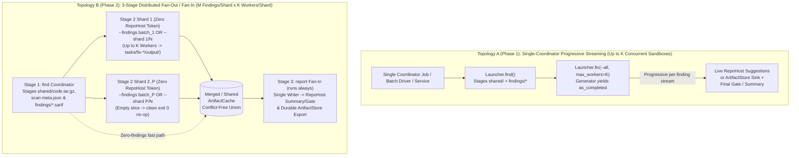

<!--
sdd_spec_id: docs/openspec/specs/tech/systems/distributed-execution-and-transit/spec.md
sdd_level: SYSTEM
sdd_implements:
  - docs/openspec/specs/journeys/pr-automated-remediation/spec.md
  - docs/openspec/specs/journeys/pr-on-demand-verify/spec.md
sdd_extends: docs/openspec/specs/tech/systems/codemender-runner/spec.md
-->

# Design: Distributed Execution and Transit Architecture

## Context

Extending the top-level client/server seams defined in the [CodeMender Runner System Design](../codemender-runner/design.md), this design specifies how `codemender-runner` packages bounded-history snapshots, exchanges task state across local and remote storage, dispatches and cancels remote sandbox jobs via typed SDKs, and scales execution from single-host progressive streaming to multi-node fan-out/fan-in topologies across CI matrices, static worker pools, scheduled audits, and fleet-wide batch schedulers.

Local Docker with gVisor paired with `LocalArtifactCache` (`file://`) and Google Cloud Run Jobs paired with `GcsArtifactCache` (`gs://`)—together with GitHub Actions dynamic matrices and GitLab CI static `parallel: N` pipelines—serve as our **initial reference implementations** validating extensible compute, transit, and distributed scheduling seams that generalize to GKE/Kubernetes Jobs, enterprise batch clusters, S3/Blob object stores, and any repository host or host-less campaign runner.

**Design References**: Accompanies the [Distributed Execution and Transit System Specification](spec.md), extends the [CodeMender Runner System Specification](../codemender-runner/spec.md) and [System Design](../codemender-runner/design.md), and aligns with [ADR-0002](../../../../../adr/ADR-0002.md), [ADR-0006](../../../../../adr/ADR-0006-pr-remediation-routing-and-security-gate.md), and the [Security and Trust Zones System Specification](../security-and-trust-zones/spec.md) ([Design](../security-and-trust-zones/design.md)) alongside component specs [SPEC-LAUNCHER](../../../launcher/spec.md), [SPEC-WORKER](../../../worker/spec.md), [SPEC-ARTIFACT-CACHE](../../../artifact-cache/spec.md), and [SPEC-VERIFY](../../../verify/spec.md).

## Goals / Non-Goals

### Goals

- Amortize sanitized, bounded-history repository packaging into a single archive per run/commit unpacked onto fast container-private scratch disk (`/tmp/work/repo`) inside every sandbox.
- Preserve symmetric key/file behavior across `LocalArtifactCache` (`file://`), `GcsArtifactCache` (`gs://`), and future `fsspec`/object-store adapters while gating provider SDKs behind lazy scheme resolution.
- Orchestrate remote job submission, concurrent execution polling, failure-spill diagnostics (`runner.log` + execution logs), and cooperative `SIGTERM`/API cancellation through in-process typed SDKs.
- Guarantee conflict-free directory unions across concurrent workers and cross-machine artifact merges while supporting both single-coordinator streaming (Phase 1) and credential-less shard fan-out / single-aggregator fan-in (Phase 2) at $M \times K$ concurrency.

### Non-Goals

- Compiling target code over network FUSE mounts or bind-mounted live caller checkouts.
- Using `ArtifactCache` as a long-term multi-campaign findings repository (handled on the outer host by `ArtifactStore` in `packages/artifactstore`).

## Decisions

### Decision 1: Atomic `fsspec` Archive Transit, Fail-Fast Scheme Resolution & Safe `/tmp` Scratch Hydration

**Implements:** [REQ-0001](spec.md#req-0001), [REQ-0002](spec.md#req-0002), [REQ-0003](spec.md#req-0003)

**Choice**: `Launcher.ensure_repo_snapshot()` builds a sanitized, bounded-history Git archive (`shared/code.tar.gz`—bounded commit depth for diff-aware `find-diff`, excluding `.cm_project`, `.exploit`, and tool caches) at most once per run into `ArtifactCache` ([SPEC-ARTIFACT-CACHE](../../../artifact-cache/spec.md)). Transit URIs resolve lazily via `fsspec`-backed adapters (`file://` $\rightarrow$ `LocalArtifactCache` using staging temp files + atomic `os.replace`; `gs://` $\rightarrow$ `GcsArtifactCache` using atomic object finalization; extensible to S3 or Azure Blob) and fail immediately on unknown schemes, auth errors, or unreachable stores with zero silent fallback. Inside each container ([SPEC-WORKER](../../../worker/spec.md)), `cm-worker` validates every tar entry before extraction to reject `..` segments, absolute paths, and out-of-root symbolic/hard links, and unpacks into container-private `/tmp/work/repo` with executable file modes preserved for repository build scripts.

**Rationale**: Compiler and test workloads require native container-local filesystem latency while diff-aware analysis requires bounded Git ancestry. Atomic staging plus strict archive validation avoids live-checkout mutation, host `copytree` overhead, UID/GID bind-mount mismatches, network FUSE stat amplification, tar-slip escapes, and replayable presigned URLs.

**Alternatives considered**:

- Cloud Storage / S3 FUSE mounts or live host bind mounts: Degrades build/test throughput over network metadata round-trips and risks mutating caller checkouts.
- Presigned upload/download URLs in job overrides (`args`/`env`): Exposes replayable bearer credentials across execution status APIs, job metadata, and audit logs while imposing fixed URL expiry ceilings on long-running compilations (whereas remote workers authenticate via keyless workload identities per [Security and Trust Zones Decision 3](../security-and-trust-zones/design.md#decision-3-mode-switched-least-privilege-gcp-wif-local-single-sa-vs-cloud_run-coordinatorworker-dual-sa-split)).

### Decision 2: Typed In-Process SDK Job Dispatch, Crash-Spill Log Recovery & Cooperative Cancellation

**Implements:** [REQ-0004](spec.md#req-0004), [REQ-0005](spec.md#req-0005)

**Choice**: Implement remote sandbox execution (`CloudRunLauncher` today via `google-cloud-run` v2 `JobsClient`/`ExecutionsClient`; extensible to Kubernetes `batch/v1` Jobs and enterprise batch APIs) using native in-process Python SDKs inside `packages/launcher` ([SPEC-LAUNCHER](../../../launcher/spec.md)): submit per-task `RunJobRequest.Overrides` (`--cache-uri`, `--task-id`) over bounded thread pools, enforce dual-channel failure recovery (reading `tasks/<task_id>/output/receipt.json` and spilling bounded tails of `runner.log` to outer `stderr` when present, or querying container exit codes and Cloud Logging execution entries when an OOM kill, preemption, or runtime crash prevents receipt upload), and propagate cooperative `SIGTERM`/`SIGINT` cancellation through `Launcher.stop()` (stopping active local containers and invoking remote execution `cancel` RPCs while workers trap `SIGTERM`/`SIGINT` to flush a cancelled `ExecutionReceipt` exiting `143`/`130`).

**Rationale**: Typed in-process SDK control gated behind optional extras (such as `packages/launcher[cloudrun]`) isolates provider imports without installing `gcloud`/`kubectl` CLIs, enables hermetic mocked-transport unit tests, preserves [ADR-0002](../../../../../adr/ADR-0002.md) `stdout` purity without child-CLI interactive prompts, update banners, or JSON-flag skew, and trades subprocess fragility for tracking provider SDK major versions and mapping LRO/transport faults into domain errors.

**Alternatives considered**:

- Subprocess calls to `gcloud run jobs execute` or standalone `cm-cloudrun` wrapper CLIs: Bloats caller images, forces re-serializing progressive streaming outcomes and cancellation signals across a child CLI hop, and couples concurrent polling and failure recovery to unstable CLI text/JSON output.

### Decision 3: Write-Disjoint Union Invariants & Delayed Cross-Workflow Hydration

**Implements:** [REQ-0001](spec.md#req-0001), [REQ-0006](spec.md#req-0006)

**Choice**: Enforce strict write-disjoint invariants over the canonical `<cache_root>/` directory hierarchy defined in [CodeMender Runner System Design — `ArtifactCache` Conflict-Free Union Directory Layout](../codemender-runner/design.md#artifactcache-conflict-free-union-directory-layout) (and worker lifecycle in its Unified Sandbox Worker Sequence): `shared/` and `findings/` remain read-only after initial staging or outer-host hydration, while every concurrent `find`, `fix-<finding_id>`, and `verify-<finding_id>` worker writes exclusively beneath `tasks/<task_id>/output/` (emitting raw binary `<finding_id>.diff` patches on `fix` and updated single-finding `<finding_id>.sarif` reports recording `DISMISSED`/`VERIFIED`/`OPEN` status on `verify` per [SPEC-WORKER](../../../worker/spec.md) and [SPEC-VERIFY](../../../verify/spec.md)). For delayed or cross-workflow `verify` runs triggered after ephemeral `ArtifactCache` TTL expiry, the outer host resolves the target finding via `ArtifactStore.get_finding_sarif()` first—falling back to deterministic review-comment SARIF reconstruction when durable scan artifacts are absent or expired—and stages `shared/code.tar.gz` plus the single finding into a fresh run namespace before invoking `cm-worker`.

**Rationale**: Disjoint task output prefixes let object stores (`gs://`, future S3/Blob) coordinate concurrent workers with zero locking and let `file://` caches (`.codemender-cache/`) merge across separate CI VMs via native union artifact downloads (`merge-multiple: true` or CI artifact paths) without overwriting sibling receipts, logs, patches, or verified SARIF outputs.

**Alternatives considered**:

- Updating `findings/<finding_id>.sarif` or a shared aggregate `report.sarif` in place from parallel workers: Introduces lost-update races across concurrent threads and multi-VM directory merges.

### Decision 4: Deterministic Shard Partitioning & Single-Aggregator Fan-In Mechanics

**Implements:** [REQ-0007](spec.md#req-0007), [REQ-0008](spec.md#req-0008)

**Choice**: Building on the phased single-coordinator (Phase 1) and 3-stage fan-out/fan-in (Phase 2) model in [CodeMender Runner System Design](../codemender-runner/design.md), persist deterministic sorted `finding_ids` and fingerprints in `shared/scan-meta.json` during Stage 1 so credential-less Stage 2 compute shards support both explicit batch lists (`--findings id1,id2` / `--all`, capped at $M$ findings per shard $\times$ $K$ concurrent workers for dynamic matrices and queues) and 1-indexed static modulo slicing (`--shard K/N` selecting `finding_ids[K-1::N]` and returning exit `0` as a clean no-op when empty or when Stage 1 found zero findings). Stage 3 (`report`) runs unconditionally (`if: always()` / `when: always`) over the merged `ArtifactCache` union as the sole writer permitted to update host review summaries, compute fail-closed merge gates ([ADR-0006](../../../../../adr/ADR-0006-pr-remediation-routing-and-security-gate.md)) when any upstream shard fails, or export aggregate campaign findings to `ArtifactStore`.

**Rationale**: Deterministic `scan-meta.json` ordering plus dual `--findings` / `--shard K/N` targeting adapts identical transit state to dynamic matrices, static CI worker pools, and fleet batch schedulers without dynamic YAML generation, host-token exposure in shards, or concurrent comment/gate update races.

**Alternatives considered**:

- Direct PR/MR summary and commit-status writes from parallel Stage 2 shards: Causes read-modify-write comment races and drops fail-closed gate updates when a sibling shard crashes.
- Dynamic child-pipeline YAML generation for static-parallelism CI runners: Adds fragile template generation where deterministic `--shard K/N` modulo slicing suffices cleanly.

## Architecture

For the canonical `<cache_root>/` directory layout (`shared/`, `findings/`, and write-disjoint `tasks/<task_id>/{input,output}/` paths) and the `Launcher` $\leftrightarrow$ `Worker` container lifecycle sequence, see [CodeMender Runner System Design — Runtime Contracts & Execution Flows](../codemender-runner/design.md#artifactcache-conflict-free-union-directory-layout). The diagram below contrasts how both orchestration topologies compose over that shared union namespace:

### Phase 1 Streaming vs. Phase 2 Fan-Out / Fan-In Topology ($M \times K$)

## Risks / Trade-offs

- **Container Ephemeral Disk Sizing on Large Monorepos** -> Unpacking `shared/code.tar.gz` and compiling inside `/tmp/work` consumes container memory/scratch disk; mitigated by bounded Git commit depth, excluding `.cm_project`/`.exploit`/cache directories from snapshots, and configurable remote job memory/CPU sizing.
- **Worker Crash or Preemption Before Receipt Upload** -> An OOM kill or spot/timeout preemption can terminate `cm-worker` before writing `receipt.json`; mitigated by terminal `SIGTERM` signal traps exiting `143` with a cancelled receipt when grace time allows, plus `Launcher` fallback inspection of container exit codes and remote Cloud/cluster execution logs when `receipt.json` is absent.
- **Cross-VM Artifact Transfer Size on File-Backed Multi-Stage Pipelines** -> Passing `.codemender-cache/` across CI VMs re-uploads `shared/code.tar.gz` between Stage 1 and Stage 2 when using `file://`; mitigated by defaulting local setups to Phase 1 single-VM streaming and pairing large multi-stage fan-out runs with shared object-store caches (`gs://`, future S3/Blob).
