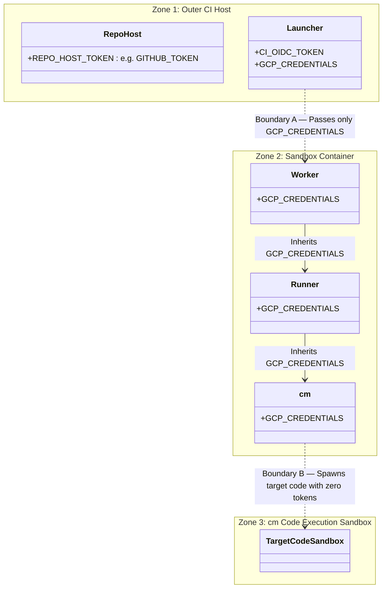
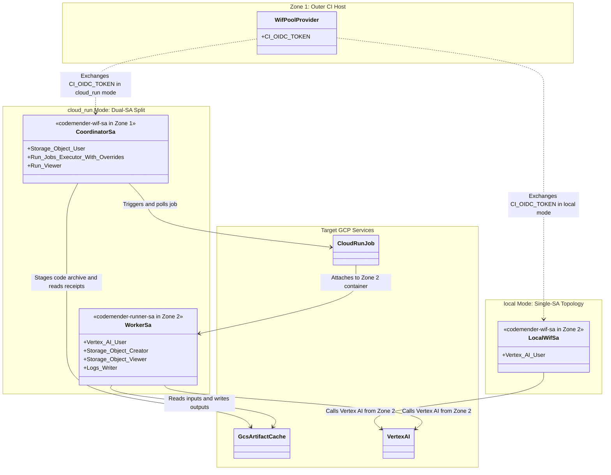
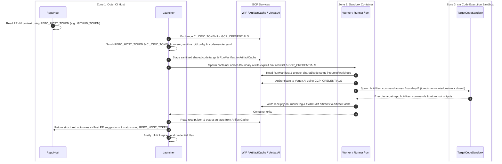

<!--
sdd_spec_id: docs/openspec/specs/tech/systems/security-and-trust-zones/spec.md
sdd_level: SYSTEM
sdd_implements:
  - docs/openspec/specs/journeys/pr-automated-remediation/spec.md
  - docs/openspec/specs/journeys/pr-on-demand-verify/spec.md
sdd_extends: docs/openspec/specs/tech/systems/codemender-runner/spec.md
-->

# Design: Security and Trust Zones Architecture

## Context

This design defines the permission isolation model and runtime AuthN/AuthZ split
across the packages and classes defined in
[ADR-0008](../../../../../adr/ADR-0008-repository-layout-and-package-structure.md)
and the [CodeMender Runner System Design](../codemender-runner/design.md).

**Design References**: Accompanies the [Security and Trust Zones System Specification](spec.md), extends the [CodeMender Runner System Specification](../codemender-runner/spec.md) ([Design](../codemender-runner/design.md)) alongside the [Distributed Execution and Transit System Specification](../distributed-execution-and-transit/spec.md) ([Design](../distributed-execution-and-transit/design.md)), builds on [ADR-0003](../../../../../adr/ADR-0003-environment-scrubbing.md), [ADR-0006](../../../../../adr/ADR-0006-pr-remediation-routing-and-security-gate.md), and [ADR-0008](../../../../../adr/ADR-0008-repository-layout-and-package-structure.md), and governs [SPEC-WIF](../../../wif/spec.md), [SPEC-LAUNCHER](../../../launcher/spec.md), [SPEC-WORKER](../../../worker/spec.md), [SPEC-ARTIFACT-CACHE](../../../artifact-cache/spec.md), [SPEC-0003](../../../runner-container-packaging/spec.md), [SPEC-WORKFLOW](../../../workflow/spec.md), [SPEC-GHA](../../../github-actions/spec.md), [SPEC-GHA-FIX](../../../github-actions-fix/spec.md), [SPEC-GHA-VERIFY](../../../github-actions-verify/spec.md), [SPEC-GITLAB-CI](../../../gitlab-ci/spec.md), and [SPEC-GITLAB-CI-FIX](../../../gitlab-ci-fix/spec.md).

## Goals / Non-Goals

### Goals

1. **Zero Repository Host Credentials in the Sandbox Container:** The sandbox
   container (`Worker` and `Runner`) must have zero access to repository hosting
   credentials or APIs. If untrusted repository code or a compromised agent
   escapes inside the container, it must not be able to push branches, read
   private repositories, or modify Pull/Merge Requests. All repository host
   credentials and API calls are therefore restricted to `RepoHost` on the outer
   CI host.
1. **Zero Cloud Credentials and Network Access When Executing Target Code:** The
   sandbox where the `cm` agent executes code (for example, running repository
   builds and tests during `fix` or `verify`) must have zero access to cloud
   credentials and no outbound network access. While `cm` itself requires GCP
   credentials to call Vertex AI models, untrusted build scripts and tests run
   by the agent must not be able to read those cloud credentials, query cloud
   metadata servers, or exfiltrate code over the network.
1. **Least-Privilege Cloud Identity Separation Between Orchestration and
   Execution:** Each runtime environment must hold only the GCP permissions
   required for its role, authenticated via short-lived keyless credentials
   (Workload Identity Federation). When compute is offloaded to Cloud Run, the
   outer CI host (`Launcher`) must only have permission to stage artifacts in
   `ArtifactCache` and trigger/monitor the Cloud Run Job (never to call Vertex
   AI directly), while the Cloud Run sandbox container (`Worker`) must only have
   permission to call Vertex AI and read/write `ArtifactCache` (never to trigger
   jobs or manage cloud resources).
1. **Boundary-Enforced Isolation Over In-Process Scrubbing
   ([ADR-0003](../../../../../adr/ADR-0003-environment-scrubbing.md)):** Credential isolation must
   be enforced at the container boundary before `Worker` starts rather than via
   subprocess environment denylisting inside `Runner`. Per
   [ADR-0003](../../../../../adr/ADR-0003-environment-scrubbing.md), `CmAdapter` passes its
   container environment directly and unmodified to `cm` so `cm` can authenticate
   to Vertex AI and run repository toolchains; `Launcher` is therefore
   responsible for stripping checkout credentials from `shared/code.tar.gz` and
   launching the sandbox container with only an explicit configuration allowlist
   and scoped GCP identity.

### Non-Goals

- Filtering environment variables via subprocess denylists or redirecting tool caches inside the repository workspace above `cm` in Zone 2 ([ADR-0003](../../../../../adr/ADR-0003-environment-scrubbing.md)).
- Passing replayable presigned storage URLs or raw downscoped OAuth2 bearer tokens through remote job override arguments or environment metadata ([Distributed Execution and Transit System Design](../distributed-execution-and-transit/design.md)).
- Installing `packages/repohost` or durable `ArtifactStore` credentials inside `docker/runner.Dockerfile`.

---

## Architecture

> [!NOTE]
> The diagrams below depict a CI + GCP Workload Identity Federation (WIF) reference run; host-less deployments (scheduled repository audits, fleet batch remediation campaigns, enterprise platform services, and standalone CLI runs) omit `RepoHost` and `REPO_HOST_TOKEN` while preserving identical three-zone and workload-identity boundaries. Optional `ArtifactStore` durable-sink credentials (`packages/artifactstore`) likewise terminate strictly in Zone 1 (omitted from `docker/runner.Dockerfile` alongside `packages/repohost`), and the Coordinator/Worker keyless identity split generalizes directly to GKE/Kubernetes Workload Identity, AWS IRSA, and Azure Workload Identity.

### Three-Zone Token & Trust Boundary Map

The diagram below groups the runtime components by **execution environment** and
shows **where credentials live and are used** across **Boundary A** (Container /
MicroVM Sandbox Boundary) and **Boundary B** (`cm` Code Execution Sandbox
Boundary):

> [!IMPORTANT]
> **Foundational Security Invariant:** No single zone possesses both **repository
> host credentials** (`REPO_HOST_TOKEN`) and **target repository code
> execution**. Zone 1 holds `REPO_HOST_TOKEN` (e.g., `GITHUB_TOKEN`) and
> exchanges `CI_OIDC_TOKEN` for `GCP_CREDENTIALS`, but never runs `cm`; Zone 2
> holds only `GCP_CREDENTIALS` for Vertex AI inference (and `ArtifactCache`
> access); Zone 3 (`TargetCodeSandbox`) executes target repository builds and
> tests with zero tokens and a closed network.

1. **Zone 1 (Trusted Outer Host / Orchestrator — `OuterCIHost`):**
   - **Tokens Held:**
     - **`REPO_HOST_TOKEN` (e.g., `GITHUB_TOKEN`):** Held exclusively by
       `RepoHost` to read pull request diffs, post review comments/suggestions,
       and report merge-gate status (see
       [SPEC-GHA](../../../github-actions/spec.md) and
       [SPEC-GITLAB-CI](../../../gitlab-ci/spec.md) for platform-specific
       token scopes).
     - **`CI_OIDC_TOKEN` & `GCP_CREDENTIALS`:** `Launcher` exchanges the CI
       platform's short-lived `CI_OIDC_TOKEN` via Workload Identity Federation
       for `GCP_CREDENTIALS` (`codemender-wif-sa`).
   - **How Tokens Travel Across Boundary A:** `RepoHost` consumes
     `REPO_HOST_TOKEN` strictly on the outer CI host. Before `Launcher` starts
     the Zone 2 container, it strips checkout credentials from
     `shared/code.tar.gz`, excludes `REPO_HOST_TOKEN` and `CI_OIDC_TOKEN` from
     the container environment, and provides only `GCP_CREDENTIALS` (via a
     read-only `/creds/adc.json` mount in `local` mode or the attached
     `WorkerSa` in `cloud_run` mode).
1. **Zone 2 (Worker / Sandbox Container — `SandboxContainer` in
   `docker/runner.Dockerfile`: `Worker` $\rightarrow$ `Runner` $\rightarrow$
   `cm`):**
   - **Tokens Held:** Holds only `GCP_CREDENTIALS` (`packages/repohost` is never
     installed in `docker/runner.Dockerfile`).
   - **How Tokens Travel Inside Zone 2:** `Worker` (`cm-worker`) uses
     `GCP_CREDENTIALS` to read/write `ArtifactCache` (when backed by GCS) and
     spawns `Runner` (`cm-runner`), which passes the container environment
     unmodified to `cm` (per
     [ADR-0003](../../../../../adr/ADR-0003-environment-scrubbing.md)) so `cm` can authenticate to
     Vertex AI Gemini models over gRPC.
1. **Zone 3 (CodeMender Native Sandbox — `CmCodeSandbox`:
   `TargetCodeSandbox`):**
   - **Tokens Held:** None (`TargetCodeSandbox` has zero tokens).
   - **How Tokens Are Isolated at Boundary B:** When the `cm` agent executes
     target repository code (such as compiler invocations, build scripts, and
     test suites during `fix` or `verify`), `cm` spawns those commands inside an
     isolated sandbox that mounts only the unpacked repository workspace
     (`/tmp/work/repo`) and scratch directories—omitting `/creds`—and disables
     outbound network access.

---

### Mode-Switched GCP WIF & Service Account Topology (`local` vs. `cloud_run`)

The diagram below groups the GCP identities by execution mode
([SPEC-WIF](../../../wif/spec.md)) and shows the IAM roles granted to
each Service Account in `local` mode (single Service Account) versus `cloud_run`
mode (Coordinator SA and Worker SA split):

1. **`local` Mode (Single-SA Topology):**
   - `LocalDockerLauncher` runs the sandbox container on the CI host using
     `LocalArtifactCache` (`file:///cache`), requiring no GCS bucket or Cloud
     Run Job.
   - `LocalWifSa` (`codemender-wif-sa`) is granted **only
     `roles/aiplatform.user` (`Vertex_AI_User`)**
     ([SPEC-WIF REQ-0003](../../../wif/spec.md#req-0003)) and mounted
     read-only into Zone 2 at `/creds/adc.json`.
1. **`cloud_run` Mode (Dual-SA Split):**
   - `CloudRunLauncher` stages artifacts through `GcsArtifactCache` (`gs://`)
     and dispatches remote Cloud Run Job executions, splitting permissions
     across two Service Accounts
     ([SPEC-WIF REQ-0004](../../../wif/spec.md#req-0004),
     [REQ-0005](../../../wif/spec.md#req-0005)):
     - **`CoordinatorSa` (`codemender-wif-sa` in Zone 1):** Held by `Launcher`
       on the outer CI host. Granted `roles/storage.objectUser`
       (`Storage_Object_User`) on the transit bucket (to stage
       `shared/code.tar.gz`, read output artifacts, and delete staged run
       objects) and job-scoped `roles/run.jobsExecutorWithOverrides`
       (`Run_Jobs_Executor_With_Overrides`) plus `roles/run.viewer`
       (`Run_Viewer`) to trigger (`run.jobs.runWithOverrides`), poll
       (`run.executions.get`), and cancel (`run.executions.cancel`) the
       pre-provisioned Cloud Run Job, without `roles/aiplatform.user`,
       `roles/run.developer`, or `roles/iam.serviceAccountUser` (`actAs`) on
       `WorkerSa` (`WorkerSa` is bound to `google_cloud_run_v2_job` at Terraform
       deploy time, and `RunJob` at runtime neither checks
       `iam.serviceAccounts.actAs` nor permits overriding `service_account`).
     - **`WorkerSa` (`codemender-runner-sa` in Zone 2):** Attached to the Cloud
       Run Job container at deploy time. Granted `roles/aiplatform.user`
       (`Vertex_AI_User`), `roles/storage.objectCreator`
       (`Storage_Object_Creator`) and `roles/storage.objectViewer`
       (`Storage_Object_Viewer`) on the transit bucket, and
       `roles/logging.logWriter` (`Logs_Writer`). Because all Cloud Run Job
       executions run as the same `WorkerSa` principal and access GCS via
       in-container `GcsArtifactCache` SDK calls, static IAM on `WorkerSa` is
       **bucket-wide across the short-lived transit bucket** rather than per-run
       prefix-isolated by IAM (`<run_prefix>` provides namespace partitioning
       against path collisions across runs, while `objectCreator` +
       `objectViewer` denies `storage.objects.update` and
       `storage.objects.delete` so a compromised worker cannot overwrite or
       delete already-staged inputs, sibling task outputs, or receipts).

---

### Runtime AuthN/AuthZ & Credential Lifecycle Sequence

The sequence diagram below traces how credentials are acquired, isolated, used,
and cleaned up across the three zones during a workflow run:

---

## Decisions

### Decision 1: Three-Zone Privilege Separation & Outer-Host VCS Termination

**Implements:** [REQ-0001](spec.md#req-0001)

- **Design:** Partition runtime execution into three nested zones—**Zone 1 (Trusted Outer Host / Orchestrator)**
  (running `RepoHost` and `Launcher`), **Zone 2 (Worker / Sandbox Container)**
  (running `Worker`, `Runner`, and `cm`), and **Zone 3 (CodeMender Native Sandbox)**
  (the sandbox where the `cm` agent executes target repository builds and tests)—and
  terminate all repository host API calls and `REPO_HOST_TOKEN` credentials
  (e.g., `GITHUB_TOKEN`) exclusively in Zone 1. `docker/runner.Dockerfile`
  installs only `packages/codemender` and `packages/launcher[cloudrun]`,
  omitting `packages/repohost`
  ([ADR-0008](../../../../../adr/ADR-0008-repository-layout-and-package-structure.md),
  [CodeMender Runner System Design](../codemender-runner/design.md)).
- **Why:**
  - **Zero VCS Blast Radius Inside the Sandbox:** `Worker` and `Runner` only
    transform a staged repository archive (`shared/code.tar.gz`) into output
    artifacts (`report.sarif`, `<finding>.diff`, `receipt.json`) in
    `ArtifactCache`, so Zone 2 and Zone 3 never require `REPO_HOST_TOKEN`.
  - **Defense-in-Depth Across Boundary A and Boundary B:** Even if an untrusted
    build script escapes Zone 3 (Boundary B) or a step in `cm` executes directly
    in Zone 2, **Boundary A** (gVisor container or Cloud Run microVM) confines
    execution to an environment with **zero `REPO_HOST_TOKEN` access**, no
    `packages/repohost` code, and `GCP_CREDENTIALS` restricted to
    `roles/aiplatform.user` (plus write-once/read transit storage access in
    `cloud_run` mode).
- **Alternatives Rejected:**
  - *Monolithic runner with subprocess environment denylisting:* Rejected in
    [ADR-0003](../../../../../adr/ADR-0003-environment-scrubbing.md); denylists miss ambient
    CI tokens, custom repository secrets, and file-based credentials, and
    provide zero protection if a process reads `/proc/<ppid>/environ` without a
    container boundary.
  - *Sandbox-accessible token broker / proxy sidecar:* Exposes whatever VCS or
    cloud operations the proxy permits to any compromised process inside the
    sandbox that can reach the proxy socket, while adding sidecar deployment
    complexity across local containers and Cloud Run Jobs.

### Decision 2: Isolating Cloud Credentials and Network When `cm` Executes Target Code

**Implements:** [REQ-0001](spec.md#req-0001), [REQ-0002](spec.md#req-0002)

- **Design:** In `local` mode, `Launcher` stages short-lived WIF credentials
  (`GCP_CREDENTIALS`—either as a single read-only `/creds/adc.json` file mount as
  in `LocalDockerLauncher` or as an atomic `/creds/oidc.jwt` + `/creds/adc.json`
  directory pair written with `0600` permissions inside a `0700` directory),
  bind-mounts them read-only and non-executable (`ro,nosuid,nodev,noexec`) under
  `/creds` into the Zone 2 container **outside** the unpacked repository
  workspace (`/tmp/work/repo`), and unlinks temporary host credential files in a
  `finally` block upon termination. When the `cm` agent executes
  target repository code in Zone 3 across **Boundary B**, that sandbox mounts
  only the unpacked repository workspace, validated relative `project_paths`,
  and isolated scratch directories, omitting `/creds` and disabling outbound
  network access.
- **Why:**
  - **Separates Authenticated Model Inference from Target Code Execution:** `cm`
    requires `GCP_CREDENTIALS` (`/creds/adc.json` in `local` mode or `WorkerSa`
    in `cloud_run` mode) to call Vertex AI over gRPC, whereas untrusted
    repository compilers and test suites run by the agent have no legitimate
    need for cloud credentials or network access.
  - **Blocks Symlink & Metadata Server Exfiltration:** Omitting `/creds` from
    Zone 3's filesystem mounts and closing its network prevents untrusted build
    scripts from reading `/creds` (even via a repository symlink) or querying
    `169.254.169.254`.
- **Alternatives Rejected:**
  - *Mounting WIF credentials inside the repository workspace or `$HOME/.config`:*
    Exposes credentials to target code execution because the workspace and
    selected `$HOME` subdirectories are mounted inside Zone 3.
  - *Enforcing an environment variable allowlist inside `CmAdapter`
    ([ADR-0003](../../../../../adr/ADR-0003-environment-scrubbing.md)):* `CmAdapter` sits above
    `cm` in Zone 2 and therefore cannot strip `GCP_CREDENTIALS` that `cm` needs
    to call Vertex AI; isolating Zone 3 from Zone 2 must happen at Boundary B
    inside `cm`.

### Decision 3: Mode-Switched Least-Privilege GCP WIF (`local` Single-SA vs. `cloud_run` Coordinator/Worker Dual-SA Split)

**Implements:** [REQ-0004](spec.md#req-0004), [REQ-0005](spec.md#req-0005)

- **Design:** Provision keyless OIDC Workload Identity Federation in
  `terraform/` ([SPEC-WIF](../../../wif/spec.md)) with two mode-specific
  IAM topologies:
  1. **`local` Mode (`execution_mode = "local"`):** Provisions a single WIF
     Service Account (`LocalWifSa` / `codemender-wif-sa`) granted **only
     `roles/aiplatform.user`**, with zero GCS or Cloud Run permissions.
  1. **`cloud_run` Mode (`execution_mode = "cloud_run"`):** Splits permissions
     across two Service Accounts:
     - **`CoordinatorSa` (`codemender-wif-sa` in Zone 1):** Granted
       `roles/storage.objectUser` on the transit bucket and job-scoped
       `roles/run.jobsExecutorWithOverrides` plus `roles/run.viewer` on the
       Cloud Run Job, while **omitting `roles/aiplatform.user`,
       `roles/run.developer`, and `roles/iam.serviceAccountUser` (`actAs` on
       `WorkerSa`)**.
     - **`WorkerSa` (`codemender-runner-sa` in Zone 2):** Bound to
       `google_cloud_run_v2_job` at Terraform deploy time and granted
       `roles/aiplatform.user`, bucket-wide `roles/storage.objectCreator` +
       `roles/storage.objectViewer` on the short-lived transit bucket, and
       `roles/logging.logWriter`.

> [!NOTE]
> Live infrastructure configurations in `terraform/modules/{wif,gcp}/iam.tf`, [SPEC-WIF REQ-0004](../../../wif/spec.md#req-0004), and [SPEC-ARTIFACT-CACHE REQ-0005](../../../artifact-cache/spec.md#req-0005) currently provision broader legacy roles (`roles/run.developer` plus `roles/iam.serviceAccountUser` `actAs` on `CoordinatorSa`, and `roles/storage.objectUser` on `WorkerSa`). Those modules and component specifications are tracked to converge onto Decision 3's hardened `roles/run.jobsExecutorWithOverrides` and write-once `roles/storage.objectCreator` + `roles/storage.objectViewer` least-privilege split.

- **Why:**
  - **Zero Unnecessary Cloud Services in `local` Mode:** Local deployments never
    enable `run.googleapis.com` or `storage.googleapis.com` and grant zero
    storage or compute roles.
  - **Prevents Job Mutation and Transitive `WorkerSa` Escalation
    (`CoordinatorSa`):** Binding `WorkerSa` to the Cloud Run Job definition at
    Terraform deploy time and granting `CoordinatorSa` only
    `roles/run.jobsExecutorWithOverrides` + `roles/run.viewer` (without
    `run.jobs.update` or `iam.serviceAccounts.actAs`) ensures `Launcher` on the
    CI host can trigger, poll, and cancel executions with per-run `args`/`env`
    overrides, but cannot invoke Vertex AI directly, modify the job's container
    image, or attach `WorkerSa` to new resources to transitively assume
    `WorkerSa`'s permissions.
  - **Write-Once Transit Storage and Bounded Blast Radius (`WorkerSa`):**
    `Worker` inside Cloud Run authenticates via identity-bound IAM (avoiding
    replayable GCS signed URL bearer tokens per
    [Distributed Execution and Transit](../distributed-execution-and-transit/design.md)) and
    cannot trigger new Cloud Run Jobs. Because all Cloud Run Job executions
    share `WorkerSa` and call GCS via `GcsArtifactCache`, static IAM on
    `WorkerSa` is bucket-wide across the dedicated transit bucket
    (`<run_prefix>` partitions object paths across runs rather than enforcing a
    per-run IAM boundary). Granting `WorkerSa` `roles/storage.objectCreator` +
    `roles/storage.objectViewer` instead of `roles/storage.objectUser` denies
    `storage.objects.update` and `storage.objects.delete`, preventing a
    compromised worker from overwriting or deleting staged inputs, sibling task
    outputs, or receipts, while the transit bucket's short lifecycle TTL and
    zero stored credentials bound the exposure of objects within that bucket.
- **Alternatives Rejected:**
  - *Sharing a single GCP Service Account between the CI host and the Cloud Run
    Job in `cloud_run` mode:* Violates least privilege by granting the CI host
    unnecessary Vertex AI access and granting the untrusted Cloud Run container
    Cloud Run job-execution permissions.
  - *Granting `CoordinatorSa` project-wide `roles/run.developer` and
    `roles/iam.serviceAccountUser` (`actAs`) on `WorkerSa`:*
    `roles/run.developer` includes `run.jobs.update`, which—combined with
    `iam.serviceAccounts.actAs` on `WorkerSa`—would allow a caller holding
    `CoordinatorSa` (including across repositories when `CoordinatorSa` is
    shared at the organization level) to replace the Cloud Run Job's container
    image and execute arbitrary workloads as `WorkerSa`.
  - *Passing GCS V4 Signed URLs into the Cloud Run container:* Rejected in
    [Distributed Execution and Transit](../distributed-execution-and-transit/design.md) because
    signed URLs act as bearer tokens if leaked in logs or environment variables.
  - *Minting per-execution GCP Credential Access Boundary (CAB) downscoped
    OAuth2 tokens for prefix-scoped GCS access:* Rejected for three reasons: (1)
    Cloud Run's metadata server cannot attach a per-execution CAB via
    `RunJobRequest.Overrides`, requiring `Launcher` to pass a raw OAuth2 bearer
    token in job `env`/`args` overrides where it persists in
    `run.executions.get` metadata and Cloud Audit Logs (violating
    [Distributed Execution and Transit](../distributed-execution-and-transit/design.md)); (2)
    minting a downscoped token from Zone 1 requires either downscoping
    `CoordinatorSa` itself or granting `CoordinatorSa`
    `roles/iam.serviceAccountTokenCreator` on `WorkerSa` (defeating the
    `CoordinatorSa`/`WorkerSa` privilege split); and (3) downscoped OAuth2
    access tokens have a hard 1-hour lifetime with no metadata-server
    auto-refresh inside the container.

### Decision 4: Boundary-Enforced Workspace, `.git/config`, and Environment Sanitization in `Launcher`

**Implements:** [REQ-0002](spec.md#req-0002), [REQ-0003](spec.md#req-0003)

- **Design:** Consistent with [ADR-0003](../../../../../adr/ADR-0003-environment-scrubbing.md)
  (`Runner` / `CmAdapter` performs zero in-process env scrubbing and passes
  the container environment unmodified to `cm`), `Launcher` enforces four sanitization gates in Zone 1
  before staging `shared/code.tar.gz` or starting the Zone 2 container
  ([SPEC-LAUNCHER REQ-0002](../../../launcher/spec.md#req-0002),
  [SPEC-GHA REQ-0006](../../../github-actions/spec.md#req-0006),
  [SPEC-GHA-FIX REQ-0005](../../../github-actions-fix/spec.md#req-0005),
  [SPEC-GITLAB-CI REQ-0006](../../../gitlab-ci/spec.md#req-0006)):
  1. **Explicit Container Environment Allowlist:** `Launcher` constructs the
     Zone 2 container environment strictly from an allowlist (never inheriting
     the ambient host process environment) and scrubs `REPO_HOST_TOKEN` (e.g.,
     `GITHUB_TOKEN`) and `CI_OIDC_TOKEN` from the host process environment after
     reading them.
  1. **Clean `.git/config` Replacement & Hook Deletion:** `Launcher` replaces
     `.git/config` in the staged snapshot with a minimal allowlist
     (`core.repositoryformatversion`, `core.bare = false`, and optional
     `extensions.objectFormat` / `extensions.refStorage`), deletes `.git/hooks`,
     and fails closed before staging or launching Zone 2 on unmaterialized Git
     submodules or partial clones.
  1. **Base-Commit `.codemender.yaml` Pinning & Policy Removal:** `Launcher`
     reads `.codemender.yaml` strictly from the diff base commit (ignoring
     unmerged PR changes), retains only `scan` and validated workspace-relative
     `project_paths` (rejecting `..` and symlinks), and deletes
     `.codemender/command_policy.yaml`.
  1. **Symlink Preservation Without Dereferencing:** `Launcher` preserves
     symbolic links without dereferencing during workspace staging while
     rejecting escaping link targets and symlinked mount or credential paths.
- **Why:**
  - **Enforces Isolation at Boundary A While Preserving Toolchain Compatibility
    Inside Zone 2 ([ADR-0003](../../../../../adr/ADR-0003-environment-scrubbing.md)):** Filtering
    environment variables and stripping checkout secrets when `Launcher` creates
    the container prevents `REPO_HOST_TOKEN` and `CI_OIDC_TOKEN` from entering
    Zone 2, while allowing `Runner` (`CmAdapter`) inside Zone 2 to pass its
    clean container environment directly to `cm` unmodified.
  - **Prevents Git Config Command Execution in Zone 2:** `cm` and
    `codemender.vcs` run `git` commands inside Zone 2 where `/creds` is mounted;
    replacing `.git/config` from a strict allowlist blocks command execution
    hooks such as `diff.<driver>.textconv`, `core.fsmonitor`, and `includeIf`,
    as well as embedded `http.extraheader` checkout tokens.
  - **Prevents PR Self-Modification of Sandbox Rules:** Pinning
    `.codemender.yaml` to the base commit prevents an untrusted PR from adding
    `/creds` to `project_paths` or overriding `.codemender/command_policy.yaml`.
- **Alternatives Rejected:**
  - *In-process env denylisting in `CmAdapter`:* Rejected
    in [ADR-0003](../../../../../adr/ADR-0003-environment-scrubbing.md) as incomplete and at the
    wrong architectural boundary.
  - *Denylist-stripping specific `.git/config` keys:* Misses execution hooks
    such as `diff.<driver>.textconv` or `includeIf.<condition>.path`.
  - *Reading `.codemender.yaml` from the PR `HEAD` checkout:* Allows an
    untrusted PR to alter its own scan exclusions or sandbox mount paths before
    merge.

### Decision 5: Pre-Execution Caller Authorization and Trusted Pipeline Definition Integrity

**Implements:** [REQ-0006](spec.md#req-0006), [REQ-0007](spec.md#req-0007)

- **Design:** Enforce three fail-closed Zone 1 orchestrator controls before cloud
  credential exchange, during runner invocation, and before remediation comment
  publication:
  1. **Pre-WIF Caller & Fork Authorization (`REQ-0006`):** On interactive review
     triggers and untrusted external changes, Zone 1 orchestration (`Workflow` /
     `RepoHost`) verifies maintainer or collaborator authorization before
     exchanging `CI_OIDC_TOKEN` for `GCP_CREDENTIALS` or invoking `Launcher`
     ([SPEC-GHA-VERIFY](../../../github-actions-verify/spec.md),
     [SPEC-GITLAB-CI](../../../gitlab-ci/spec.md),
     [SPEC-WORKFLOW](../../../workflow/spec.md)), and rejects cross-repository
     fork triggers fail-closed unless explicitly configured in a token-forfeited
     read-only fork mode.
  1. **Trusted Base-Revision & Digest-Pinned Runner Execution (`REQ-0007`):**
     Zone 1 runs exclusively trusted base-branch or immutable SHA-/digest-pinned
     workflows, reusable composite actions, and pre-built
     `docker/runner.Dockerfile` sandbox images, never executing or building
     candidate-revision runner workflows, container definitions, or `terraform/`
     configurations from an untrusted change.
  1. **Protected CI/Pipeline Remediation Patch Downgrade (`REQ-0007`):** Before
     publishing generated `fix` patches
     ([ADR-0006](../../../../../adr/ADR-0006-pr-remediation-routing-and-security-gate.md),
     [SPEC-WORKFLOW](../../../workflow/spec.md),
     [SPEC-GHA-FIX](../../../github-actions-fix/spec.md),
     [SPEC-GITLAB-CI-FIX](../../../gitlab-ci-fix/spec.md)), Zone 1 inspects
     modified paths and patch payloads and downgrades any remediation touching
     protected CI/pipeline paths (`.github/`, `.gitlab-ci.yml`, `.gitlab/`,
     `templates/`), targeting symlinks, or containing Markdown code-fence
     breakout markers from committable inline suggestions to plain
     non-committable patch comments.
- **Why:**
  - **Prevents Unauthorized Quota Spend and Sandbox Probing:** Gatekeeping
    interactive and fork triggers prior to OIDC token exchange stops arbitrary
    public commenters or unauthorized forks from minting cloud credentials,
    consuming Vertex AI quota, or dispatching Zone 2 containers.
  - **Neutralizes Self-Modifying Pipeline Escalation Without Scan Blind Spots:**
    Executing immutable base-revision workflows and pre-built container images
    allows untrusted changes touching `.github/`, Dockerfiles, or `terraform/`
    to be scanned safely as passive archive files in `shared/code.tar.gz`, while
    downgrading CI-path patches prevents 1-click inline suggestions from landing
    workflow or pipeline privilege modifications without explicit manual application.
- **Alternatives Rejected:**
  - *Running privileged `pull_request_target` workflows that check out and
    execute candidate `HEAD` actions/containers or mint WIF credentials before
    checking caller association:* Exposes Zone 1 `REPO_HOST_TOKEN` and cloud
    identity exchange directly to untrusted fork or commenter payloads.
  - *Aborting scans pre-flight whenever an untrusted diff modifies workflow,
    `Dockerfile`, or `terraform/` files:* Leaves infrastructure and CI edits
    unscanned while providing no extra isolation once runner workflows and
    sandbox images are already pinned to trusted base revisions.
  - *Offering committable inline suggestions on `.github/workflows/*` or
    `.gitlab-ci.yml`:* Converts a single reviewer click on a generated diff into
    immediate CI configuration mutation and privileged runner execution.
