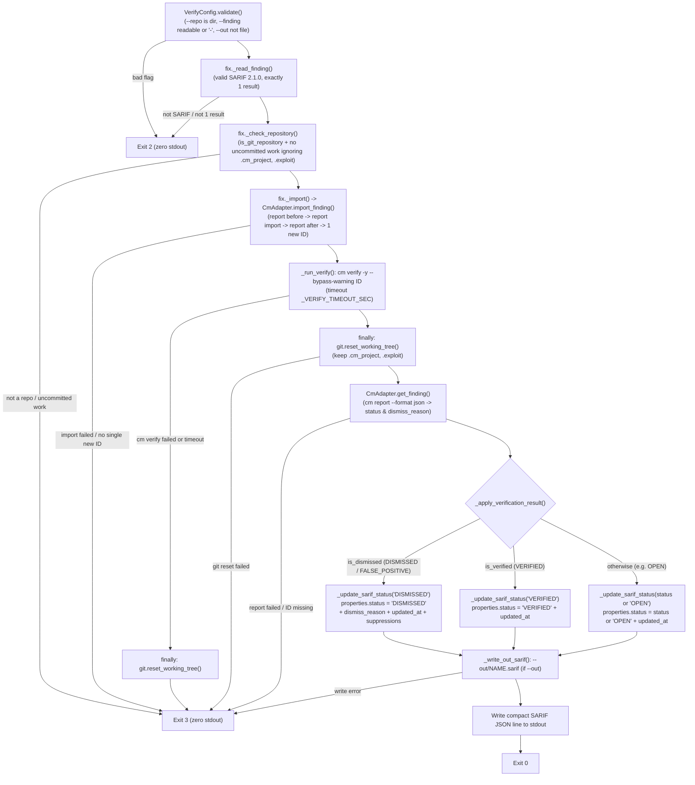

<!--
sdd_spec_id: SPEC-VERIFY
sdd_implements: None
sdd_extends: None
sdd_level: COMPONENT
sdd_archetype: CLI_TOOL_BATCH_JOB
sdd_cujspec_product: codemender-runner
-->

# Design: Verify One Finding (`cm-runner verify`)

## Context

`find-diff` ([SPEC-FIND-DIFF](../find-diff/spec.md)) writes the findings for a
pull request or scan as a SARIF 2.1.0 document, which the outer orchestrator
(GitHub Actions, GitLab CI, or Cloud Run) splits into one SARIF file per
finding. Before
spending time and model tokens on patching (`cm-runner fix`,
[SPEC-FIX](../fix/spec.md)), E4 of the project plan asks for a verification
step: given a repository and one local finding SARIF file (the same input that
`cm-runner fix` consumes), run `cm-runner verify` to check whether the finding
can be demonstrated to be non-exploitable (a false positive) or confirmed as a
real issue.

Like `cm-runner find-diff` and `cm-runner fix`, **`cm-runner verify` is a
generic, storage-agnostic local runner**—it is not GCS-aware. The outer
orchestration layer in GitHub Actions, GitLab CI, or Cloud Run fetches the
finding file to a
local path before invoking `cm-runner verify`, and `cm-runner verify` emits the
updated finding SARIF JSON to `stdout` and (when `--out DIR` is given) writes a
**new** file `DIR/<finding-name>.sarif` rather than overwriting the input file
in place. The orchestration layer then decides whether to run `cm-runner fix`
and how to synchronize the resulting artifacts back to GCS or artifact storage.

Like `cm fix`, `cm verify` does not take a SARIF file directly. It takes the ID
of a finding already in `cm`'s local SQLite database (`~/.codemender/state.db`).
So `verify` has to validate the input SARIF, import it into `cm` with
`cm report import`, find its newly assigned ID, run `cm verify`, reset any
working-tree edits made during verification, inspect the resulting status in
`cm report --format json`, and emit a new SARIF document reflecting the
verification outcome.

Governed by [SPEC-VERIFY](spec.md),
[ADR-0002](../../../adr/ADR-0002.md),
[ADR-0008](../../../adr/ADR-0008-repository-layout-and-package-structure.md), and
[ADR-0003](../../../adr/ADR-0003-environment-scrubbing.md).

### Verification Outcomes & Expected Downstream (`fix`) Behaviour

A key design invariant is that **`fix` is skipped *only* when `verify`
successfully demonstrates that the finding is not exploitable (`DISMISSED`)**.
If verification confirms the vulnerability (`VERIFIED`), is inconclusive
(`OPEN`), or fails to run for any reason (timeout, `cm` error, infrastructure
failure), the pipeline **fails open toward fixing** and continues to
`cm-runner fix` so a real vulnerability is never silently dropped.

To support this, `cm-runner verify` emits the updated single-finding SARIF 2.1.0
JSON on `stdout` (and writes a new file to `--out DIR` when given). The
orchestrator inspects the emitted JSON (`runs[0].results[0].properties.status`)
to decide whether to skip `fix`:

| # | Verification Outcome | What `cm verify` & `cm report --format json` Report | `cm-runner verify` Exit Code | Output SARIF (`stdout` & `--out/<name>.sarif`) | Expected Orchestrator Action for `cm-runner fix` |
| :- | :--- | :--- | :-: | :--- | :--- |
| 1 | **Demonstrated Not Exploitable (False Positive)** | `cm verify` exits `0` and refutes the finding (`status` in `cm report --format json` is `DISMISSED` or `FALSE_POSITIVE`). | `0` (`OK`) | `runs[0].results[0].properties.status = "DISMISSED"`, plus `dismiss_reason`, `updated_at`, and `suppressions`. | **Skip `fix`** — the *only* case where `fix` is skipped. |
| 2 | **Confirmed Exploitable (True Positive)** | `cm verify` exits `0` and reproduces the vulnerability (`status` is `VERIFIED`). | `0` (`OK`) | `runs[0].results[0].properties.status = "VERIFIED"`, plus `updated_at`. | **Continue to `fix`**. |
| 3 | **Inconclusive Verification** | `cm verify` exits `0`, but could neither prove nor refute exploitability (e.g. an internal model turn or sandbox step failed, leaving `status` as `OPEN`). | `0` (`OK`) | `runs[0].results[0].properties.status = "OPEN"` (preserved), plus `updated_at`. | **Continue to `fix`** (fail-open: do not drop unrefuted findings). |
| 4 | **Verification Execution / Infrastructure Failure** | Pre-flight check fails, `cm report import` fails, `cm verify` crashes/exits non-zero/times out, or working-tree reset fails. | `3` (`FAILED`) | Empty (`0` bytes on `stdout`; no `--out` file written). | **Continue to `fix`** using the original input finding file. |
| 5 | **Invalid CLI Usage / Malformed Input** | Bad CLI flags, unreadable `--finding` path, or input is not a 1-result SARIF document. | `2` (`USAGE`) | Empty (`0` bytes on `stdout`; no `--out` file written). | Surface caller configuration error (or continue to `fix` if the orchestrator treats any non-`DISMISSED` result as fail-open). |

### Verified `cm` Behaviour

Based on `cm` 0.11.0 behaviour verified on 2026-09-30 (see
[SPEC-FIX design.md](../fix/design.md#verified-cm-behaviour)) and empirical
validation against `~/.codemender/state.db`:

| # | Fact | Consequence for `verify` |
| :- | :--- | :--- |
| 1 | `cm verify` accepts only a finding ID (`cm verify -y --bypass-warning <ID>`). `cm report import -f FILE -p REPO` accepts a local SARIF file and assigns a **new** ID on every import without printing it (ignoring any `finding_id` embedded in the SARIF). | Import the local SARIF file (or a temporary file when reading from `stdin`) via `fix._import()`, which calls `CmAdapter.import_finding()` and diffs `cm report --format json` before and after to find the newly assigned ID. |
| 2 | Both `cm verify` and `cm fix` prompt for the pre-GA interactive responsibility disclaimer unless `--bypass-warning` and `-y` are passed. | Pass `-y --bypass-warning` to `cm verify`. |
| 3 | `cm verify` exits `0` whatever the verification outcome. When confirmed, `cm` sets the finding's `status` in `cm report --format json` to `VERIFIED`. When refuted as not exploitable, `cm` sets `status` to `DISMISSED` (or `FALSE_POSITIVE`) with a `dismiss_reason`. When an internal step fails inconclusively, `status` remains `OPEN`. | Never trust `cm verify`'s exit code alone. Read the finding's `status` and `dismiss_reason` via `CmAdapter.get_finding()` (`cm report --format json`) after `cm verify` finishes. |
| 4 | **`cm verify` first runs `git checkout HEAD -- . && git clean -fd`** in the target repository before executing its verification agent. | Refuse to run on a repository with uncommitted work (`fix._check_repository()`), just like `fix`. |
| 5 | `cm verify` writes `.cm_project` and reproduction artifacts under `.exploit/` in the repository working tree, and may modify tracked files or create untracked files while probing. | Ignore `.cm_project` and `.exploit/` in the pre-flight dirty check, and always call `git.reset_working_tree(repo, exclude=fix._CM_OWN_PATHS)` in a `finally` block after `cm verify` so a subsequent `cm-runner fix` starts from a clean tree. |
| 6 | `cm report --format sarif` exports all findings in `state.db` and does not preserve the caller's original single-finding SARIF metadata in place. | Parse the input SARIF into a `sarif.SarifDocument`, update its result properties (`_apply_verification_result()` / `_update_sarif_status()`), and write the updated SARIF document to `--out` and `stdout`. |

## Goals / Non-Goals

### Goals

- Verify exactly one finding per run, given as a local SARIF file or on `stdin`
  (`--finding -`)—the exact same `--finding`, `--repo`, and `--out` interface
  as `cm-runner fix` (`VerifyConfig(fix.FixConfig)`).
- Share the finding SARIF validation (`fix._read_finding()`), repository
  pre-flight check (`fix._check_repository()`), and `cm report import`
  ID-discovery logic (`fix._import()`) with `cm-runner fix`.
- Use only `cm`'s own commands (`report`, `report import`, `verify`) through
  `CmAdapter`, with `env=None` (ADR-0003).
- Emit the resulting single-finding SARIF 2.1.0 JSON on `stdout` and write a
  **new** file `<out>/<finding-name>.sarif` when `--out` is given, without
  mutating or overwriting the input `--finding` file in place.
- Never destroy uncommitted work in the caller's repository, always reset
  verification side effects in the working tree afterwards, and never mark a
  finding `DISMISSED` when `cm verify` failed, timed out, or was inconclusive.

### Non-Goals

- **GCS awareness or remote file synchronization.** `cm-runner verify` does not
  download from or upload to GCS (`gs://`). Fetching finding files from GCS (or
  GitHub Actions artifacts) before `verify` and synchronizing updated files back
  afterwards—including handling race conditions or duplicate runs—is the
  responsibility of the outer orchestration layer (GitHub Actions or Cloud Run),
  not this CLI spec.
- Verifying several findings in one run. The caller fans out across per-finding
  SARIF files.
- Retrying a failed verification or freeing local TCP ports inside `verify`
  (callers or container sandboxes isolate each run).
- Fixing the finding (`cm-runner fix`, SPEC-FIX), committing changes, or posting
  to a pull request (the CI job, per ADR-0008).
- Querying or mutating `cm`'s SQLite `state.db` directly from
  `codemender.runner`.

## Decisions

### Decision 1: Inherit `FixConfig` and Reuse `fix` Pre-Flight & Import Helpers {#decision-1}

- **Choice:** `VerifyConfig` subclasses `fix.FixConfig`, inheriting `finding`,
  `repo`, `out`, `Path(...).expanduser().resolve()` normalization, and
  `validate()`, while adding `sarif_file_name` (`<stem>.sarif`, or
  `finding.sarif` when reading from `stdin`). `verify.run()` reuses
  `fix._read_finding(cfg, command="verify")`,
  `fix._check_repository(cfg.repo, command="verify")`, and
  `fix._import(cfg, finding_text, adapter)`.
- **Alternatives Considered:**
  - *Make `cm-runner verify` accept `gs://<bucket>/<object>` URIs and overwrite
    objects in GCS directly:* couples the generic local CLI runner to Cloud
    Storage credentials and forces `verify` to solve distributed
    overwrite/synchronization problems that belong to the workflow orchestrator.
  - *Duplicate config validation, SARIF parsing, git pre-flight, and import
    helpers across `fix.py` and `verify.py`:* risks drift between the two
    single-finding commands.
- **Rationale:** Separating the generic `cm-runner` CLI commands from cloud
  storage orchestration keeps `find-diff`, `verify`, and `fix` composable in
  any environment (local developer runs, GitHub Actions, or Cloud Run), and
  sharing `FixConfig` plus the pre-flight/import helpers guarantees identical
  input semantics between `verify` and `fix`.

### Decision 2: Map `cm` Status to SARIF Metadata & Only Mark `DISMISSED` When Refuted {#decision-2}

- **Choice:** Implemented in `_apply_verification_result()` and
  `_update_sarif_status()`:
  1. When `cm verify` runs to completion (`result.ok` is `True`) and
     `verified.is_dismissed` is `True` (`status` in `cm report --format json` is
     `DISMISSED` or `FALSE_POSITIVE`, meaning `cm` demonstrated the finding is
     not exploitable), update a copy of the input SARIF document's result
     (`sarif_doc.results`):
     - Set `properties["status"] = "DISMISSED"`.
     - Set `properties["dismiss_reason"]` to `verified.dismiss_reason` (or
       `_DEFAULT_DISMISS_REASON`:
       `"Finding was demonstrated not exploitable by cm verify"` when empty).
     - Set `properties["updated_at"]` to the ISO-8601 UTC timestamp
       (`%Y-%m-%dT%H:%M:%SZ`).
     - Append a standard SARIF 2.1.0 external suppression entry
       (`{"kind": "external", "status": "accepted", "justification": reason}`)
       to `result["suppressions"]`.
  2. When `cm verify` runs to completion and `verified.is_verified` is `True`
     (`status == "VERIFIED"`), set `properties["status"] = "VERIFIED"` and
     `properties["updated_at"]` in the emitted SARIF document.
  3. When `cm verify` runs to completion with any other status (e.g. `OPEN` when
     inconclusive), set `properties["status"] = verified.status or "OPEN"` and
     update `properties["updated_at"]` in the emitted SARIF document so the
     downstream orchestrator still runs `cm-runner fix`.
  4. When `cm verify` fails to start, exits non-zero, or hits
     `_VERIFY_TIMEOUT_SEC` (`result.ok` is `False`), or when resetting the
     working tree fails, exit `3` with zero bytes on `stdout` and without
     writing to `--out`. The orchestrator treats exit `3` as an incomplete
     verification and continues to `cm-runner fix` with the original input
     finding file.
- **Alternatives Considered:**
  - *Treat an inconclusive `OPEN` status (or a timeout) as `DISMISSED`:* would
    cause the orchestrator to skip `fix` whenever verification fails or cannot
    build the exploit environment, silently dropping real vulnerabilities.
  - *Overwrite the input `--finding` file in place:* mutates the caller's input
    file and complicates synchronization if multiple runs or retries read the
    same input path. Writing to `stdout` and `--out DIR/<name>.sarif` leaves the
    input file untouched.
- **Rationale:** Only a finding that `cm verify` actively refutes (`DISMISSED` /
  `FALSE_POSITIVE`) should cause the pipeline to skip `fix`. Producing a new
  SARIF output artifact with an explicit `properties.status` and standard SARIF
  `suppressions` gives both CodeMender's orchestrator and SARIF consumers (such
  as GitHub Code Scanning) a single, self-contained JSON document.

#### Concrete SARIF 2.1.0 Examples

In OASIS SARIF 2.1.0, a document has a top-level `runs` array. Each run contains
`tool.driver` (describing the scanner and rule definitions) and `results` (an
array of individual findings). Because SARIF 2.1.0 reserves a free-form
`properties` object (`propertyBag`) on each result for tool-specific metadata,
CodeMender stores lifecycle fields (`finding_id`, `status`, `dismiss_reason`,
`updated_at`) inside `runs[0].results[0].properties`. In addition, SARIF 2.1.0
defines a standard `runs[0].results[0].suppressions` array that code-scanning
consumers use to recognize dismissed results.

**1. Input single-finding SARIF file (`finding-00.sarif`, before `verify`):**

```json
{
  "$schema": "https://docs.oasis-open.org/sarif/sarif/v2.1.0/errata01/os/schemas/sarif-schema-2.1.0.json",
  "version": "2.1.0",
  "runs": [
    {
      "tool": {
        "driver": {
          "name": "CodeMender",
          "version": "0.11.0",
          "rules": [
            {
              "id": "CWE-94",
              "name": "Injection",
              "shortDescription": {
                "text": "Remote Code Execution via Sandbox Escape in B2B Orders"
              }
            }
          ]
        }
      },
      "results": [
        {
          "ruleId": "CWE-94",
          "level": "error",
          "message": {
            "text": "Remote Code Execution via Sandbox Escape in B2B Orders"
          },
          "locations": [
            {
              "physicalLocation": {
                "artifactLocation": {
                  "uri": "routes/b2bOrder.ts"
                },
                "region": {
                  "startLine": 21,
                  "endLine": 23
                }
              }
            }
          ],
          "properties": {
            "finding_id": "9f7b066a-0d33-5ced-b834-9ad42e83aa40",
            "confidence": 100,
            "status": "OPEN"
          }
        }
      ]
    }
  ]
}
```

**2. Output SARIF when `verify` demonstrates the finding is NOT exploitable (`DISMISSED` — orchestrator skips `fix`):**

```json
{
  "$schema": "https://docs.oasis-open.org/sarif/sarif/v2.1.0/errata01/os/schemas/sarif-schema-2.1.0.json",
  "version": "2.1.0",
  "runs": [
    {
      "tool": {
        "driver": {
          "name": "CodeMender",
          "version": "0.11.0",
          "rules": [
            {
              "id": "CWE-94",
              "name": "Injection",
              "shortDescription": {
                "text": "Remote Code Execution via Sandbox Escape in B2B Orders"
              }
            }
          ]
        }
      },
      "results": [
        {
          "ruleId": "CWE-94",
          "level": "error",
          "message": {
            "text": "Remote Code Execution via Sandbox Escape in B2B Orders"
          },
          "locations": [
            {
              "physicalLocation": {
                "artifactLocation": {
                  "uri": "routes/b2bOrder.ts"
                },
                "region": {
                  "startLine": 21,
                  "endLine": 23
                }
              }
            }
          ],
          "suppressions": [
            {
              "kind": "external",
              "status": "accepted",
              "justification": "Input is strictly validated as an integer before reaching safeEval."
            }
          ],
          "properties": {
            "finding_id": "9f7b066a-0d33-5ced-b834-9ad42e83aa40",
            "confidence": 100,
            "status": "DISMISSED",
            "dismiss_reason": "Input is strictly validated as an integer before reaching safeEval.",
            "updated_at": "2026-10-01T18:00:00Z"
          }
        }
      ]
    }
  ]
}
```

*(Note on `suppressions`: in SARIF 2.1.0 §3.35, `kind: "external"` means the
suppression was added by an external tool rather than an in-source comment, and
`status: "accepted"` means the suppression itself is active/accepted so the
alert is suppressed; `properties.status = "DISMISSED"` is what CodeMender's own
orchestrator and `runners/aggregate.py` read.)*

**3. Output SARIF when `verify` confirms the finding is exploitable (`VERIFIED` — orchestrator continues to `fix`):**

```diff
           "properties": {
             "finding_id": "9f7b066a-0d33-5ced-b834-9ad42e83aa40",
             "confidence": 100,
-            "status": "OPEN"
+            "status": "VERIFIED",
+            "updated_at": "2026-10-01T18:00:00Z"
           }
```

### Decision 3: Emit Updated SARIF 2.1.0 JSON on `stdout` and Write a New File to `--out` {#decision-3}

- **Choice:**
  - **`stdout`:** Write the updated single-finding SARIF 2.1.0 document as a
    single-line compact JSON object (`sarif_doc.to_json() + "\n"`), matching
    `cm-runner find-diff` ([SPEC-FIND-DIFF](../find-diff/spec.md)).
  - **`--out DIR` (`_write_out_sarif`):** When `--out DIR` is passed, write the
    updated SARIF document to a new file `DIR/<finding-stem>.sarif` (or
    `DIR/finding.sarif` when `--finding -` was used) before writing to `stdout`.
    The input `--finding` file is never modified in place.
  - **Exit code:** Exit `0` whenever `cm verify` runs to completion, the working
    tree is reset, and the updated SARIF is written (whether the resulting
    status is `VERIFIED`, `DISMISSED`, or `OPEN`). Exit `2` on invalid CLI flags
    or malformed SARIF input, and exit `3` when verification could not be
    completed (pre-flight failure, `cm report import` failure, `cm verify`
    crash/timeout, working-tree reset failure, or `--out` write failure).
- **Alternatives Considered:**
  - *Overwrite the input `--finding` file in place:* requires the input path to
    be writable, destroys the original input on disk, and pushes file
    synchronization assumptions into `cm-runner`.
  - *Emit a custom NDJSON wrapper event (`{"event": "verify", "status": ...}`):*
    requires the orchestrator to separately patch the SARIF file anyway when
    persisting the updated finding status for downstream reporting. Emitting the
    updated SARIF document directly gives the orchestrator both the new file and
    the machine-readable status (`jq -r '.runs[0].results[0].properties.status'`)
    in one output.
  - *Exit `3` when `DISMISSED`:* conflates a successful false-positive dismissal
    with an infrastructure/timeout failure; since infrastructure failures must
    **continue** to `fix` whereas `DISMISSED` must **skip** `fix`, the
    orchestrator must distinguish the two via the emitted JSON anyway.
- **Rationale:** Emitting the updated SARIF JSON on `stdout` and writing a new
  file to `--out` matches `find-diff` and `fix`, keeps the input finding
  immutable, and lets the orchestrator decide whether to run `fix` with a single
  `jq` check:
  ```bash
  # Run verify and write the updated SARIF to verified/finding-00.sarif
  cm-runner verify --repo . --finding findings/finding-00.sarif --out verified/ || true

  # Only skip fix when verify produced a SARIF explicitly marked DISMISSED.
  # If verify confirmed it (VERIFIED), was inconclusive (OPEN), or failed (no output file), continue to fix.
  status=$(jq -r '.runs[0].results[0].properties.status // "OPEN"' verified/finding-00.sarif 2>/dev/null || echo "OPEN")
  if [ "$status" != "DISMISSED" ]; then
    cm-runner fix --repo . --finding findings/finding-00.sarif --out patches/
  fi
  ```

### Decision 4: Refuse to Run on Uncommitted Work, Reset Working Tree in `finally` Afterwards

- **Choice:** Same pre-flight check as `SPEC-FIX` (`fix._check_repository`):
  exit `3` before calling `cm` if `--repo` has any modified, staged, or
  untracked file other than `.cm_project` and `.exploit/`. Inside `_run_verify`,
  always call `git.reset_working_tree(repo.as_posix(), exclude=fix._CM_OWN_PATHS)`
  in a `finally` block after `cm verify` finishes (whether `cm verify` succeeded
  or failed) to run `git checkout HEAD -- .` and `git clean -fd` outside
  `.cm_project` and `.exploit/`.
- **Rationale:** `cm verify` runs `git checkout HEAD -- . && git clean -fd` on
  startup (fact 4), which would destroy uncommitted developer work. And while
  probing an exploit, the verification agent may edit tracked files or create
  untracked files in the working tree; resetting those in `finally` guarantees
  that a subsequent `cm-runner fix` does not fail its own pre-flight dirty check
  when run in the same checkout.

### Decision 5: One Attempt with a Bounded Timeout

- **Choice:** Bound `cm verify` by `_VERIFY_TIMEOUT_SEC`; no internal retries.
- **Rationale:** Matches `SPEC-FIX` (`_FIX_TIMEOUT_SEC`). Exploit
  verification builds and runs the target project inside `cm`'s sandbox across
  multiple agent turns. Callers or CI job definitions control retries.

## Architecture

### Execution Flow



### Module Structure & Boundaries

| Module | Responsibility | Boundary Constraints |
| :--- | :--- | :--- |
| `packages/codemender/src/codemender/runner/__main__.py` | Registers `verify` (`--finding`, `--repo`, `--out`), builds `VerifyConfig` via `verify.config_from_args()`, calls `verify.run(cfg, adapter, emitter)`. | Redirects stray `stdout` writes to `stderr` while a command runs; runs `init` automatically unless `--no-init` is passed. |
| `packages/codemender/src/codemender/runner/commands/verify.py` | `VerifyConfig(fix.FixConfig)`, `config_from_args()`, `run()`, `_run_verify()`, `_apply_verification_result()`, `_update_sarif_status()`, `_write_out_sarif()`. Reuses `fix._read_finding`, `fix._check_repository`, `fix._import`, and `fix._CM_OWN_PATHS`. | **MUST NOT** import `subprocess`, `utils`, `vcs.github`, `storage`, or `get_scrubbed_env`. `cm` only through `CmAdapter` (`env=None`). |
| `packages/codemender/src/codemender/sarif/__init__.py` | `SarifDocument` (`from_json()`, `results`, `result_count`, `to_json()`). | Shared across `find-diff`, `fix`, and `verify`. |
| `packages/codemender/src/codemender/cm.py` | `Finding` dataclass (`finding_id`, `status`, `dismiss_reason`, `is_fixed`, `is_verified`, `is_dismissed`) and `CmAdapter` (`list_findings`, `import_finding`, `get_finding`). | Shared with `cm-runner fix` ([SPEC-FIX](../fix/spec.md)), so both commands import findings and inspect statuses identically. |
| `packages/codemender/src/codemender/vcs/git.py` | `is_git_repository`, `list_uncommitted_paths`, and `reset_working_tree` (excluding `.cm_project` and `.exploit/`). | Git subprocesses stay here, run directly with `subprocess`, not `utils.run_command`. Diagnostics go to `stderr`. |

## Risks / Trade-offs

- **Inconclusive or failed `cm verify` vs. confirmed false positive** → `cm verify`
  exits `0` even when an internal model turn errors out, leaving the finding
  status `OPEN`.
  - *Mitigation:* Only findings where `verified.is_dismissed` is `True` (`status`
    in `cm report --format json` is `DISMISSED` or `FALSE_POSITIVE`) are marked
    `DISMISSED` in the emitted SARIF. If `cm verify` leaves the status `OPEN` or
    fails/times out (exit `3`), the finding is not marked `DISMISSED` and the
    orchestrator continues to `cm-runner fix`.
- **Orchestrator synchronization across concurrent or duplicate runs** → in
  GitHub Actions, GitLab CI, or Cloud Run, if multiple workflow runs are
  triggered concurrently and sync updated SARIF files back to shared storage
  (such as GCS), concurrent writes could race.
  - *Mitigation:* `cm-runner verify` never overwrites its input file in place
    and is not GCS-aware; it writes a new output file (`--out`) and emits to
    `stdout`. Storage synchronization, run-scoped prefixes, or conditional
    writes are handled by the outer orchestration spec rather than
    `SPEC-VERIFY`.
- **Working tree dirtied by exploit probers** → `cm verify` may leave modified
  tracked files or untracked reproduction files outside `.exploit/` if a prober
  partially fails.
  - *Mitigation:* Always reset tracked files and clean untracked files (excluding
    `.cm_project` and `.exploit/`) via `git.reset_working_tree` in a `finally`
    block inside `_run_verify`.
- **The responsibility warning is accepted automatically** (`--bypass-warning`),
  as in `SPEC-FIX` and the legacy pipeline.
  - *Mitigation:* Tracked in Open Questions alongside `SPEC-FIX`.

## Deployment & Rollback

- **Deployment:** `packages/codemender/src/codemender/runner/commands/verify.py`,
  registered in `packages/codemender/src/codemender/runner/__main__.py`,
  `Finding.is_verified` and `Finding.is_dismissed` in
  `packages/codemender/src/codemender/cm.py`, `git.reset_working_tree` in
  `packages/codemender/src/codemender/vcs/git.py`, caller guide in
  `packages/codemender/README.md`, and unit tests in
  `packages/codemender/src/codemender/runner/commands/test_verify.py`.
- **`cm` version:** relies on `cm` 0.11.0+ behaviour (`cm verify -y
  --bypass-warning <ID>` and `cm report import`), same as `SPEC-FIX`.
- **Verification:** `make test`.
- **Rollback:** revert the `verify` commit(s).

## Open Questions

1. ~~**SARIF `suppressions` alongside `properties.status`**~~ — **Resolved:**
   `_update_sarif_status` populates both `properties.status = "DISMISSED"` (plus
   `properties.dismiss_reason` and `properties.updated_at`) and a SARIF 2.1.0
   external suppression entry in `result["suppressions"]`.
2. **Responsibility warning:** Is it acceptable for `cm-runner verify` to pass
   `--bypass-warning` on every run, matching `SPEC-FIX` and the legacy pipeline,
   or should callers have to opt in? Product decision.
