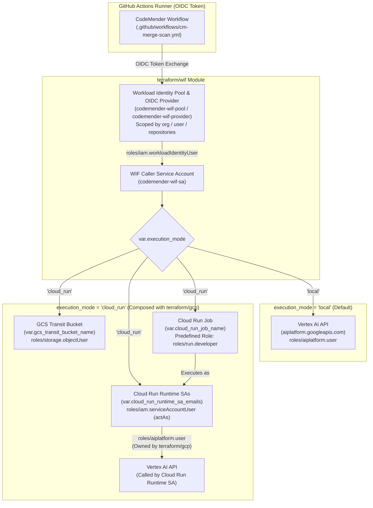
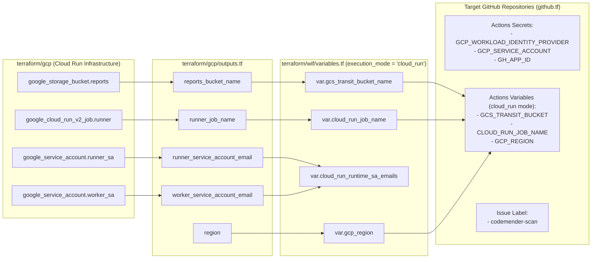

<!--*
freshness: { owner: 'codemender-maintainers', reviewed: '2026-10-01' }
*-->

<!--
sdd_spec_id: SPEC-WIF
sdd_implements: None
sdd_extends: None
sdd_level: COMPONENT
sdd_archetype: INFRASTRUCTURE_TERRAFORM_MODULE
sdd_cujspec_product: codemender-runner
-->

# Design: Composable Mode-Aware Workload Identity Federation Module (`terraform/wif`)

## Context

CodeMender supports two primary GitHub Actions execution topologies as defined
in [ADR-0004](../../../adr/ADR-0004-project-tech-stack-and-repo-architecture.md)
and
[ADR-0005](../../../adr/ADR-0005-multi-platform-transit-storage-and-isolation.md):

1. **Local Execution on the GitHub Actions Runner
   (`execution_mode = "local"`):** The composite action runs `cm-runner`
   (`LocalDockerLauncher`) directly on the GitHub Actions runner and
   authenticates to Google Cloud via Workload Identity Federation (WIF) to
   invoke Vertex AI Gemini models (`roles/aiplatform.user`).
1. **Remote Execution via Cloud Run Jobs (`execution_mode = "cloud_run"`):** The
   composite action packages the repository snapshot, uploads it to a GCS
   transit bucket (`gs://<bucket>/<run_id>/`), executes the isolated Cloud Run
   Job (`gcloud run jobs execute --args ... --wait`), and downloads the
   resulting execution receipt and SARIF/patch artifacts.

Previously, `terraform/gha_wif/` was named and structured exclusively around the
first topology: it hardcoded `codemender-gha-*` resource IDs, unconditionally
enabled `aiplatform.googleapis.com`, and unconditionally granted
`roles/aiplatform.user` to the WIF Service Account while lacking the IAM
bindings required for GitHub Actions to stage objects to a GCS transit bucket or
trigger Cloud Run Jobs provisioned by `terraform/gcp/`.

Governed by [SPEC-WIF](spec.md),
[ADR-0004](../../../adr/ADR-0004-project-tech-stack-and-repo-architecture.md),
and
[ADR-0005](../../../adr/ADR-0005-multi-platform-transit-storage-and-isolation.md),
this design renames `terraform/gha_wif/` to `terraform/wif/` and evolves it into
a composable, mode-aware identity and access module
(`var.execution_mode = "local" | "cloud_run"`) that pairs cleanly with
`terraform/gcp/`.

## Goals / Non-Goals

### Goals

- Rename `terraform/gha_wif/` to `terraform/wif/` and standardize default GCP
  resource identifiers on `codemender-wif-sa`, `codemender-wif-pool`, and
  `codemender-wif-provider`.
- Support both `"local"` (default) and `"cloud_run"` execution modes via
  `var.execution_mode`, provisioning strictly the APIs and least-privilege IAM
  roles required for the selected mode.
- Enforce
  [ADR-0005](../../../adr/ADR-0005-multi-platform-transit-storage-and-isolation.md)
  least-privilege separation in `cloud_run` mode: the WIF caller Service Account
  receives GCS transit bucket access, Cloud Run Job execution/polling
  permissions, and `roles/iam.serviceAccountUser` (`actAs`) on the Cloud Run
  runtime Service Accounts, while `roles/aiplatform.user` remains exclusively on
  the Cloud Run Job's runtime Service Accounts.
- Establish a clean, unidirectional composition boundary where `terraform/gcp/`
  outputs (`reports_bucket_name`, `runner_service_account_email`,
  `worker_service_account_email`, `runner_job_name`) feed directly into
  `terraform/wif/` inputs with zero circular dependencies.
- Automatically bootstrap target GitHub repositories with both core WIF secrets
  (`GCP_WORKLOAD_IDENTITY_PROVIDER`, `GCP_SERVICE_ACCOUNT`, `GH_APP_ID`, and the
  `codemender-scan` label) and mode-specific Cloud Run repository variables
  (`GCS_TRANSIT_BUCKET`, `CLOUD_RUN_JOB_NAME`, `GCP_REGION`).
- Verify all execution modes, repository scoping rules, and variable validation
  failures offline via `terraform test`.

### Non-Goals

- Moving Cloud Run Job, GCS bucket, or Cloud Workflows resource definitions out
  of `terraform/gcp/` into `terraform/wif/`.
- Storing long-lived GCP Service Account JSON keys or GitHub App private keys
  (`GH_APP_PRIVATE_KEY`) in Terraform state.

## Decisions

### Decision 1: Module Rename (`terraform/wif`) & Neutral Resource Defaults (`codemender-wif-*`) {#decision-1}

- **Choice:** Rename `terraform/gha_wif/` to `terraform/wif/` and update default
  variable values to `codemender-wif-sa`, `codemender-wif-pool`, and
  `codemender-wif-provider`.
- **Alternatives Considered:**
  - *Keep `terraform/gha_wif/` and add a separate `terraform/cloud_run_wif/`
    module:* Duplicates 90% of the OIDC pool, provider attribute mapping,
    scoping conditions, and GitHub secret/label bootstrap resources across two
    directories.
- **Rationale:** Workload Identity Federation is the single keyless
  authentication bridge between external CI runners and GCP across both local
  and Cloud Run execution modes. Consolidating into `terraform/wif/` eliminates
  duplication while keeping `variables.tf` overrides backward-compatible for any
  deployment that explicitly sets `gcp_service_account_id`, `gcp_wif_pool_id`,
  or `gcp_wif_provider_id`.

### Decision 2: Mode-Switched Least-Privilege IAM (`var.execution_mode = "local" | "cloud_run"`) {#decision-2}

- **Choice:** Gate API enablement and IAM bindings on `var.execution_mode`:
  - In `"local"` mode: enable `aiplatform.googleapis.com` and bind
    `roles/aiplatform.user` to `google_service_account.runner_sa`.
  - In `"cloud_run"` mode: enable `run.googleapis.com` and
    `storage.googleapis.com` (omitting `aiplatform.googleapis.com` and
    `roles/aiplatform.user` on `runner_sa`), and bind:
    1. Predefined `roles/run.developer` at the project level so the caller can
       execute Cloud Run Jobs with argument/volume overrides and poll execution
       completion.
    1. `roles/storage.objectUser` on `var.gcs_transit_bucket_name`.
    1. `roles/iam.serviceAccountUser` (`iam.serviceAccounts.actAs`) on each
       email in `var.cloud_run_runtime_sa_emails`.
- **Alternatives Considered:**
  - *Grant union of all permissions (`roles/aiplatform.user` + `roles/run.admin`
    \+ `roles/storage.admin`) unconditionally:* Violates least privilege
    ([ADR-0005](../../../adr/ADR-0005-multi-platform-transit-storage-and-isolation.md)).
    In `cloud_run` mode, the CI caller only dispatches jobs and transfers
    transit archives; it never invokes Vertex AI directly.
- **Rationale:** Aligning IAM bindings with `var.execution_mode` guarantees that
  a CI workflow token in `cloud_run` mode cannot access unrelated GCS buckets or
  make direct Vertex AI calls, while `local` mode users do not enable unused
  Cloud Run or Cloud Storage APIs.

### Decision 3: Unidirectional Composability Between `terraform/gcp` and `terraform/wif` {#decision-3}

- **Choice:** Keep Cloud Run infrastructure (`google_cloud_run_v2_job.runner`,
  `google_storage_bucket.reports`, and runtime Service Accounts `runner_sa` /
  `worker_sa`) inside `terraform/gcp/`, export `runner_service_account_email`
  and `worker_service_account_email` from `terraform/gcp/outputs.tf`, and pass
  those resource identifiers into `terraform/wif/` via plain input variables
  (`var.gcs_transit_bucket_name`, `var.cloud_run_runtime_sa_emails`,
  `var.cloud_run_job_name`).
- **Alternatives Considered:**
  - *Have `terraform/gcp/` create the WIF pool and GitHub secrets directly:*
    Forces `terraform/gcp/` to depend on the `integrations/github` provider even
    for GCP-only Cloud Scheduler / Cloud Workflows deployments.
  - *Use `terraform_remote_state` inside `terraform/wif/`:* Tightly couples
    `terraform/wif/` to a specific state backend layout.
- **Rationale:** Accepting plain string/list inputs in `terraform/wif/` allows
  operators to either apply `terraform/gcp/` first and pass its outputs via
  `terraform.tfvars`, or compose both modules inside a single root module with
  zero circular dependencies.

### Decision 4: Predefined `roles/run.developer` Role Over Custom IAM Roles {#decision-4}

- **Choice:** Bind the predefined `roles/run.developer` role in `cloud_run` mode
  rather than creating a `google_project_iam_custom_role`.
- **Alternatives Considered:**
  - *Custom IAM role (`run.jobs.run`, `run.jobs.runWithOverrides`,
    `run.jobs.get`, `run.operations.get`, `run.executions.get`,
    `run.executions.list`):* Requires `iam.roles.create` permissions on the
    deploying principal, introduces 7-day GCP custom role deletion tombstones,
    and can break if Cloud Run CLI/API adds new read/poll permissions.
  - *Predefined `roles/run.invoker` role:* Does not include
    `run.jobs.runWithOverrides` (required when passing per-run container
    `--args` / volume overrides) or `run.executions.get` / `run.operations.get`
    (required by `--wait`).
- **Rationale:** Using predefined roles (`roles/run.developer`,
  `roles/storage.objectUser`, `roles/iam.serviceAccountUser`) provides better
  operational reliability across customer environments without requiring custom
  role management or `random_id` tombstone workarounds.

### Decision 5: Cross-Variable Validation for `gcs_transit_bucket_name` in `cloud_run` Mode {#decision-5}

- **Choice:** Validate directly inside `variable "gcs_transit_bucket_name"` in
  `terraform/wif/variables.tf` that
  `var.execution_mode != "cloud_run" || length(trimspace(var.gcs_transit_bucket_name)) > 0`.
- **Rationale:** Terraform supports cross-variable references in variable
  `validation` blocks, allowing `terraform validate`, `terraform plan`, and
  `terraform test` (`expect_failures = [var.gcs_transit_bucket_name]`) to catch
  a missing transit bucket immediately before any provider API calls are made.

## Architecture

### Mode-Aware WIF Identity & Access Topology (`local` vs. `cloud_run`)

### Unidirectional Module Composition (`terraform/gcp` -> `terraform/wif`)

### Module & File Inventory

| File Path                                 | Responsibility                                                                                                                                                                                                                                                                                                                                                                         |
| :---------------------------------------- | :------------------------------------------------------------------------------------------------------------------------------------------------------------------------------------------------------------------------------------------------------------------------------------------------------------------------------------------------------------------------------------- |
| `terraform/wif/provider.tf`               | Declares required Terraform version (`>= 1.5.0`) and `hashicorp/google` (`>= 5.0.0`) and `integrations/github` (`>= 6.0.0`) providers.                                                                                                                                                                                                                                                 |
| `terraform/wif/variables.tf`              | Defines `gcp_project_id`, `gcp_region`, `gcp_service_account_id` (`"codemender-wif-sa"`), `gcp_wif_pool_id` (`"codemender-wif-pool"`), `gcp_wif_provider_id` (`"codemender-wif-provider"`), `execution_mode` (`"local"` \| `"cloud_run"`), `gcs_transit_bucket_name`, `cloud_run_runtime_sa_emails`, `cloud_run_job_name`, and GitHub scoping/target variables with validation blocks. |
| `terraform/wif/apis.tf`                   | Organizes function-specific API lists (`baseline_apis`, `codemender_apis`, `gcp_cloud_run_apis`) and enables baseline plus mode-specific APIs.                                                                                                                                                                                                                                         |
| `terraform/wif/iam.tf`                    | Provisions `google_service_account.runner_sa`, WIF Pool & OIDC Provider, org/repo WIF principal bindings, conditional `"local"` mode `roles/aiplatform.user` binding, and conditional `"cloud_run"` mode predefined `roles/run.developer`, GCS transit bucket `roles/storage.objectUser`, and runtime SA `roles/iam.serviceAccountUser` bindings.                                      |
| `terraform/wif/github.tf`                 | Provisions `codemender-scan` label, `GCP_WORKLOAD_IDENTITY_PROVIDER`, `GCP_SERVICE_ACCOUNT`, and `GH_APP_ID` secrets across both modes, plus `GCS_TRANSIT_BUCKET`, `CLOUD_RUN_JOB_NAME`, and `GCP_REGION` repository variables in `"cloud_run"` mode.                                                                                                                                  |
| `terraform/wif/outputs.tf`                | Exports `gcp_workload_identity_provider`, `gcp_service_account`, `execution_mode`, and `next_step_private_key_injection`.                                                                                                                                                                                                                                                              |
| `terraform/wif/terraform.tfvars.example`  | Annotated example configuration illustrating both `"local"` and `"cloud_run"` execution mode setups.                                                                                                                                                                                                                                                                                   |
| `terraform/wif/tests/wif_test.tftest.hcl` | Hermetic `terraform test` suite covering default `"local"` mode, `"cloud_run"` mode, `"repositories"` list scoping, and validation failure when `gcs_transit_bucket_name` is empty in `"cloud_run"` mode.                                                                                                                                                                              |
| `terraform/gcp/outputs.tf`                | Adds `runner_service_account_email` and `worker_service_account_email` outputs for seamless composition with `terraform/wif`.                                                                                                                                                                                                                                                          |

## Risks / Trade-offs

- **Existing Deployments Referencing `terraform/gha_wif` or `codemender-gha-*`
  Defaults** → Moving the directory and updating default resource IDs changes
  default resource names for new deployments.
  - *Mitigation:* Existing state users can explicitly set
    `gcp_service_account_id = "codemender-gha-sa"`,
    `gcp_wif_pool_id = "codemender-gha-pool"`, and
    `gcp_wif_provider_id = "codemender-gha-provider"` in `terraform.tfvars` to
    retain existing resources in-place without recreation. All repository
    documentation (`codemender-runner/README.md`,
    `docs/adr/ADR-0004-project-tech-stack-and-repo-architecture.md`,
    `docs/guides/github_actions_guide.md`) is updated in tandem.

## Deployment & Rollback

- **Deployment:** Rename `terraform/gha_wif/` to `terraform/wif/`, update
  Terraform configurations, add `runner_service_account_email` and
  `worker_service_account_email` outputs to `terraform/gcp/outputs.tf`, update
  documentation references, and verify via `terraform test` in both
  `terraform/wif/` and `terraform/gcp/`.
- **Verification:**
  - `terraform -chdir=terraform/wif init -backend=false && terraform -chdir=terraform/wif test`
  - `terraform -chdir=terraform/gcp init -backend=false && terraform -chdir=terraform/gcp test`
- **Rollback:** Revert the commit to restore `terraform/gha_wif/`.

## Open Questions

- None.
