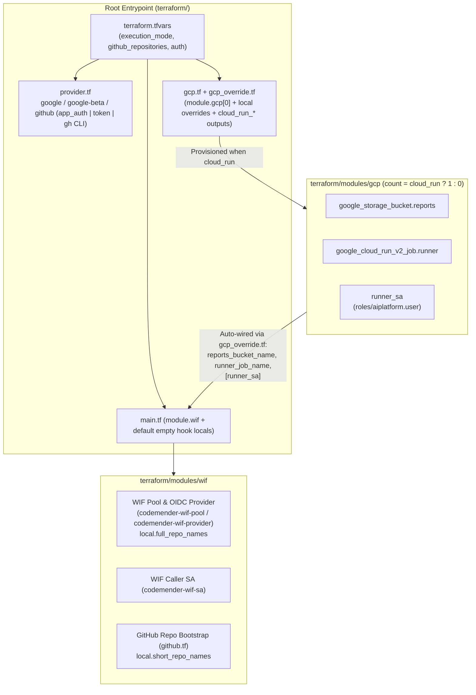
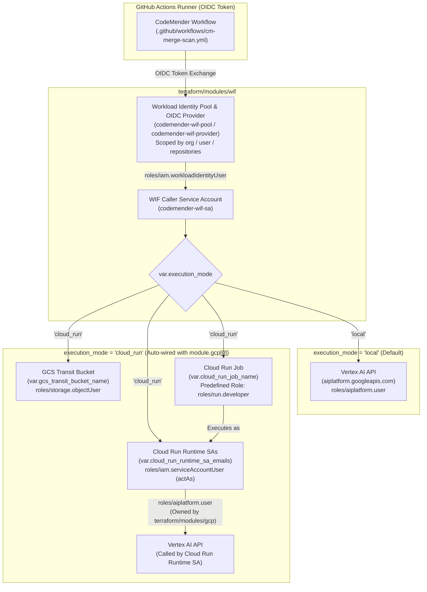

<!--*
freshness: { owner: 'codemender-maintainers', reviewed: '2026-10-02' }
*-->

<!--
sdd_spec_id: SPEC-WIF
sdd_implements: None
sdd_extends: None
sdd_level: COMPONENT
sdd_archetype: INFRASTRUCTURE_TERRAFORM_MODULE
sdd_cujspec_product: codemender-runner
-->

# Design: Unified Terraform Root & Composable Mode-Aware WIF Module (`terraform/` & `terraform/modules/{wif,gcp}`)

## Context

CodeMender supports two primary GitHub Actions execution topologies as defined
in [ADR-0008](../../../adr/ADR-0008-repository-layout-and-package-structure.md)
and the
[Distributed Execution and Transit System Design](../tech/systems/distributed-execution-and-transit/design.md):

1. **Local Execution on the GitHub Actions Runner
   (`execution_mode = "local"`):** The composite action runs `cm-runner`
   (`LocalDockerLauncher`) directly on the GitHub Actions runner and
   authenticates to Google Cloud via Workload Identity Federation (WIF) to
   invoke Vertex AI Gemini models (`roles/aiplatform.user`).
1. **Remote Execution via Cloud Run Jobs (`execution_mode = "cloud_run"`):** The
   composite action packages the repository snapshot, uploads it to a GCS
   transit bucket (`gs://<bucket>/<run_id>/`), executes the isolated Cloud Run
   Job (`gcloud run jobs execute --args ... --wait`), and downloads the
   resulting execution receipt and SARIF/patch artifacts.

Summary: Rather than forcing operators to run `terraform apply` across two
separate directories (`terraform/gcp/` and `terraform/wif/`) and manually copy
output values between them, this design establishes `terraform/` as the single
root Terraform entrypoint composing `terraform/modules/wif/` and
`terraform/modules/gcp/`. It also unifies repository configuration into a
single `var.github_repositories` list with zero fallback ambiguity and adds
first-class GitHub App authentication (`app_auth`) alongside token and ambient
CLI authentication.

Governed by [SPEC-WIF](spec.md),
[ADR-0008](../../../adr/ADR-0008-repository-layout-and-package-structure.md),
and the
[Distributed Execution and Transit System Design](../tech/systems/distributed-execution-and-transit/design.md).

## Goals / Non-Goals

### Goals

- Provide a single root Terraform entrypoint at `terraform/` (with
  `terraform/terraform.tfvars.example`) that composes child modules under
  `terraform/modules/wif/` and `terraform/modules/gcp/`, standardizing default
  GCP WIF resource identifiers on `codemender-wif-sa`, `codemender-wif-pool`,
  and `codemender-wif-provider`.
- Support both `"local"` (default) and `"cloud_run"` execution modes via
  `var.execution_mode`:
  - In `"local"` mode, only `module.wif` is provisioned (`module.gcp` has
    `count = 0`).
  - In `"cloud_run"` mode, root `terraform/` automatically provisions
    `module.gcp[0]` and wires its outputs (`reports_bucket_name`,
    `runner_job_name`, `runner_service_account_email`) into `module.wif`.
- Isolate `module "gcp"`, its local overrides, and its outputs in
  `terraform/gcp.tf`, `terraform/gcp_override.tf`, and
  `terraform/tests/root_gcp_test.tftest.hcl` so `scripts/distribute.sh`
  (`SPEC-DIST`) can strip Cloud Run files cleanly for local-mode customer
  distribution with zero dangling local, module, or output references.
- Enforce transit and execution
  ([Distributed Execution & Transit](../tech/systems/distributed-execution-and-transit/design.md))
  least-privilege separation in `cloud_run` mode: the WIF caller Service
  Account receives GCS transit bucket access (`roles/storage.objectUser`),
  Cloud Run Job execution/polling permissions (`roles/run.developer`), and
  `roles/iam.serviceAccountUser` (`actAs`) on the Cloud Run runtime Service
  Accounts, while `roles/aiplatform.user` remains exclusively on the Cloud Run
  Job's runtime Service Accounts.
- Replace dual repository lists with a single `var.github_repositories` list
  with no fallback logic, automatically normalizing entries into
  `owner/repo` for GCP WIF conditions/IAM and `repo` for GitHub repository
  secrets, variables, and labels.
- Support 3 GitHub provider authentication methods in root
  `terraform/provider.tf`: GitHub App (`app_auth`), explicit
  `github_mgmt_token`, or ambient `gh auth login` / `GITHUB_TOKEN`.
- Verify root and child modules offline via `terraform test`.

### Non-Goals

- Storing long-lived GCP Service Account JSON keys or GitHub Actions runtime
  private keys (`GH_APP_PRIVATE_KEY`) in Terraform state.

## Decisions

### Decision 1: Single Root `terraform/` Entrypoint & `terraform/modules/{wif,gcp}` Hierarchy {#decision-1}

- **Choice:** Make `terraform/` the single root module where operators run
  `terraform init`, `terraform plan`, `terraform apply`, and `terraform test`,
  and place the WIF and GCP Cloud Run modules under `terraform/modules/wif/`
  and `terraform/modules/gcp/`. Remove concrete `provider "..." {}` blocks from
  both child modules so they only declare `required_providers` and inherit
  providers from root `terraform/provider.tf`.
- **Alternatives Considered:**
  - *Separate sibling root directories (`terraform/wif/` and `terraform/gcp/`):*
    Forces `cloud_run` operators to run `terraform apply` twice in separate
    directories and manually copy `reports_bucket_name`, `runner_job_name`, and
    runtime Service Account emails from `terraform/gcp` outputs into
    `terraform/wif/terraform.tfvars`.
  - *Keep concrete `provider "google"` blocks inside child modules:* Prevents
    Terraform from using `count` or `for_each` on `module "gcp"` in root
    `terraform/gcp.tf`.
- **Rationale:** A single root `terraform/` directory gives operators a single
  `terraform.tfvars` file and a single `terraform apply` command for both
  `"local"` and `"cloud_run"` modes, while keeping `terraform/modules/wif` and
  `terraform/modules/gcp` cleanly separated and independently testable via
  `terraform test`.

### Decision 2: Isolating `module "gcp"` in `terraform/gcp.tf` & `terraform/gcp_override.tf` for Zero-Dangling-Reference Distribution Stripping {#decision-2}

- **Choice:**
  1. In `terraform/main.tf`, declare default empty hook locals
     (`gcp_module_bucket_name = ""`, `gcp_module_job_name = ""`,
     `gcp_module_runtime_sa_emails = []`) and instantiate `module "wif"`
     referencing those locals.
  1. In `terraform/outputs.tf`, export only the `module.wif` outputs.
  1. In `terraform/gcp.tf`, instantiate `module "gcp"`
     (`source = "./modules/gcp"`, `count = var.execution_mode == "cloud_run" ? 1 : 0`)
     and export the conditional Cloud Run outputs
     (`cloud_run_reports_bucket_name`, `cloud_run_job_name`).
  1. In `terraform/gcp_override.tf`, use Terraform's native `_override.tf`
     merging to override `local.gcp_module_bucket_name`,
     `local.gcp_module_job_name`, and `local.gcp_module_runtime_sa_emails` with
     `module.gcp[0]`'s outputs when `var.execution_mode == "cloud_run"`.
  1. Split root tests into `terraform/tests/root_test.tftest.hcl` (no
     `module.gcp` references) and `terraform/tests/root_gcp_test.tftest.hcl`
     (Cloud Run wiring tests).
- **Alternatives Considered:**
  - *Hardcoding `module.gcp[0]` references directly inside `terraform/main.tf`
    or `terraform/outputs.tf`:* If `scripts/distribute.sh` excludes
    `terraform/modules/gcp/` and `terraform/gcp.tf`, `terraform validate` and
    `terraform test` in the distributed repo would fail with `Reference to
    undeclared local value` or `Reference to undeclared module`.
- **Rationale:** Using Terraform's native `_override.tf` merging in
  `terraform/gcp_override.tf` alongside `terraform/gcp.tf` and
  `terraform/tests/root_gcp_test.tftest.hcl` allows `scripts/distribute.sh` to
  simply exclude `terraform/modules/gcp/`, `terraform/gcp.tf`,
  `terraform/gcp_override.tf`, and `terraform/tests/root_gcp_test.tftest.hcl`
  with zero file rewriting, while leaving `terraform/` in the distributed
  repository 100% valid for `terraform init`, `terraform validate`, and
  `terraform test`.

### Decision 3: Single `var.github_repositories` List With Zero Fallbacks {#decision-3}

- **Choice:** Replace `wif_allowed_repositories` and
  `target_github_repositories` with a single `var.github_repositories`
  (`list(string)`, `default = []`) variable with no fallback logic. Normalize
  each entry `r` in `terraform/modules/wif` using `var.github_owner` into:
  - `local.full_repo_names`:
    `strcontains(trimspace(r), "/") ? trimspace(r) : "${var.github_owner}/${trimspace(r)}"`
    (used for GCP WIF OIDC `attribute_condition` and per-repo IAM bindings when
    `github_scope_type == "repositories"`).
  - `local.short_repo_names`:
    `element(reverse(split("/", trimspace(r))), 0)` (used for GitHub repository
    secrets, variables, and labels in `github.tf`).
- **Alternatives Considered:**
  - *Two separate list variables (`wif_allowed_repositories` and
    `target_github_repositories`) with fallback logic:* Confuses operators who
    have to specify the same repositories twice (once as `"owner/repo"` and
    once as `"repo"`).
- **Rationale:** A single `github_repositories` list that accepts either
  `"repo"` or `"owner/repo"` eliminates configuration drift:
  - When `github_scope_type = "repositories"`, `github_repositories` defines
    both the WIF OIDC trust perimeter (`local.full_repo_names`) and the repos
    bootstrapped with secrets/variables/labels (`local.short_repo_names`), and
    validation enforces `length(var.github_repositories) > 0`.
  - When `github_scope_type = "org"` or `"user"`, WIF trusts the entire
    org/user while `github_repositories` optionally lists specific repos to
    bootstrap with GitHub secrets/variables/labels (or `[]` to skip GitHub API
    calls entirely).

### Decision 4: Mode-Switched Least-Privilege IAM & Predefined `roles/run.developer` {#decision-4}

- **Choice:** Gate API enablement and IAM bindings on `var.execution_mode`:
  - In `"local"` mode: enable `aiplatform.googleapis.com` and bind
    `roles/aiplatform.user` to `google_service_account.runner_sa`.
  - In `"cloud_run"` mode: enable `run.googleapis.com` and
    `storage.googleapis.com` (omitting `aiplatform.googleapis.com` and
    `roles/aiplatform.user` on `runner_sa`), and bind:
    1. Predefined `roles/run.developer` at the project level so the caller can
       execute Cloud Run Jobs with argument/volume overrides and poll execution
       completion without custom IAM role tombstones.
    1. `roles/storage.objectUser` on `var.gcs_transit_bucket_name`.
    1. `roles/iam.serviceAccountUser` (`iam.serviceAccounts.actAs`) on each
       email in `var.cloud_run_runtime_sa_emails`.
- **Rationale:** Aligns IAM bindings strictly with the
  [Distributed Execution and Transit System Design](../tech/systems/distributed-execution-and-transit/design.md)
  while avoiding custom role creation/deletion tombstones.

### Decision 5: Three-Tier GitHub Provider Authentication (`app_auth`, Token, Ambient CLI) {#decision-5}

- **Choice:** Configure `provider "github"` in root `terraform/provider.tf`
  using `local.use_github_app_auth = (var.github_app_id != "" && var.github_app_installation_id != "" && var.github_app_pem_file != "")`
  with a conditional `dynamic "app_auth"` block that accepts either a file path
  (`fileexists(pathexpand(...)) ? file(...) : ...`) or raw PEM content in
  `var.github_app_pem_file`.
- **Rationale:** Supports automated CI/production Terraform pipelines that
  authenticate via a GitHub App installation (`app_auth`), token-based
  automation (`github_mgmt_token`), and local interactive developer workflows
  (`gh auth login` or `GITHUB_TOKEN` environment variable) without requiring
  code edits to `provider.tf`.

## Architecture

### Unified Root & Child Module Composition (`local` vs. `cloud_run`)

### Mode-Aware WIF Identity & Access Topology

### Module & File Inventory

| File Path                                         | Responsibility                                                                                                                                                                                                                   |
| :------------------------------------------------ | :------------------------------------------------------------------------------------------------------------------------------------------------------------------------------------------------------------------------------- |
| `terraform/provider.tf`                           | Root Terraform version/provider requirements and concrete `google`, `google-beta`, and `github` (`app_auth` / `github_mgmt_token` / ambient CLI) provider blocks.                                                                |
| `terraform/main.tf`                               | Declares default empty Cloud Run hook locals (`gcp_module_bucket_name = ""`, `gcp_module_job_name = ""`, `gcp_module_runtime_sa_emails = []`) and instantiates `module "wif"` (`source = "./modules/wif"`).                      |
| `terraform/gcp.tf`                                | Instantiates `module "gcp"` (`source = "./modules/gcp"`, `count = var.execution_mode == "cloud_run" ? 1 : 0`) and exports conditional Cloud Run outputs (`cloud_run_reports_bucket_name`, `cloud_run_job_name`). Stripped in dist. |
| `terraform/gcp_override.tf`                       | Uses native `_override.tf` merging to override `local.gcp_module_*` in `main.tf` with `module.gcp[0]` outputs when `execution_mode == "cloud_run"`. Stripped by `scripts/distribute.sh` for local-mode customer repos.           |
| `terraform/variables.tf`                          | Root input variables covering GCP project/naming, `execution_mode`, Cloud Run parameters, single `github_repositories` list, and GitHub App / token authentication variables.                                                    |
| `terraform/outputs.tf`                            | Re-exports WIF outputs (`gcp_workload_identity_provider`, `gcp_service_account`, `execution_mode`, `next_step_private_key_injection`) with zero `module.gcp` references.                                                         |
| `terraform/terraform.tfvars.example`              | Self-documenting 4-section configuration guide for `local` and `cloud_run` modes, `github_repositories`, and GitHub provider authentication.                                                                                     |
| `terraform/tests/root_test.tftest.hcl`            | Hermetic `terraform test` suite (retained in dist) verifying root `local` mode and `local.use_github_app_auth` without referencing `module.gcp`.                                                                                 |
| `terraform/tests/root_gcp_test.tftest.hcl`        | Hermetic `terraform test` suite (stripped in dist) verifying root `cloud_run` automatic output wiring from `module.gcp[0]` to `module.wif`.                                                                                      |
| `terraform/modules/wif/provider.tf`               | Child module `required_providers` declaration (`hashicorp/google` and `integrations/github`) with no concrete `provider` blocks.                                                                                                 |
| `terraform/modules/wif/variables.tf`              | Child module inputs and validation rules (`execution_mode`, `gcs_transit_bucket_name` required when `cloud_run`, single `github_repositories` required when `github_scope_type == "repositories"`).                              |
| `terraform/modules/wif/apis.tf`                   | Enables baseline IAM/STS APIs plus mode-specific APIs (`aiplatform.googleapis.com` in `local` mode; `run.googleapis.com` and `storage.googleapis.com` in `cloud_run` mode).                                                      |
| `terraform/modules/wif/iam.tf`                    | Provisions `runner_sa`, WIF Pool & OIDC Provider, `local.full_repo_names` normalization, org/repo WIF bindings, and mode-specific `local` vs. `cloud_run` IAM bindings.                                                          |
| `terraform/modules/wif/github.tf`                 | Normalizes `var.github_repositories` into `local.short_repo_names` and provisions `codemender-scan` label, `CODEMENDER_WORKLOAD_IDENTITY_PROVIDER` and `CODEMENDER_SERVICE_ACCOUNT` secrets, `CODEMENDER_GCP_PROJECT_ID` variable, and (in `cloud_run` mode) `CODEMENDER_GCS_TRANSIT_BUCKET`, `CODEMENDER_CLOUD_RUN_JOB_NAME`, and `CODEMENDER_GCP_REGION` variables. |
| `terraform/modules/wif/outputs.tf`                | Exports `gcp_workload_identity_provider`, `gcp_service_account`, `execution_mode`, and `next_step_private_key_injection`.                                                                                                        |
| `terraform/modules/wif/tests/wif_test.tftest.hcl` | Hermetic `terraform test` suite for `terraform/modules/wif`.                                                                                                                                                                     |
| `terraform/modules/gcp/`                          | Child module (`apis.tf`, `compute.tf`, `iam.tf`, `outputs.tf`, `provider.tf`, `storage.tf`, `variables.tf`, `vpc.tf`, `tests/*.tftest.hcl`) exporting `runner_service_account_email`. |

## Risks / Trade-offs

- **Existing Deployments Referencing `terraform/gha_wif` or Standalone Module
  Paths** → Moving resources under `terraform/modules/{wif,gcp}` with a root
  `terraform/` entrypoint changes module addresses in state (`module.wif.*`,
  `module.gcp[0].*`) for new root deployments.
  - *Mitigation:* Operators who want to invoke `terraform/modules/wif` or
    `terraform/modules/gcp` directly as standalone modules can still do so, or
    use `moved` blocks / `terraform state mv` when migrating to the unified
    root `terraform/`. Architecture documentation
    (`docs/adr/ADR-0008-repository-layout-and-package-structure.md`) is
    updated in tandem.

## Deployment & Rollback

- **Deployment:** Create root `terraform/` files (`main.tf`, `gcp.tf`,
  `gcp_override.tf`, `variables.tf`, `outputs.tf`, `provider.tf`,
  `terraform.tfvars.example`, `tests/root_test.tftest.hcl`,
  `tests/root_gcp_test.tftest.hcl`), relocate child modules to
  `terraform/modules/wif/` and `terraform/modules/gcp/`, update documentation
  and `scripts/distribute.sh` (`SPEC-DIST`), and verify all three test suites
  via `terraform test`.
- **Verification:**
  - `terraform -chdir=terraform init -backend=false && terraform -chdir=terraform test`
  - `terraform -chdir=terraform/modules/wif init -backend=false && terraform -chdir=terraform/modules/wif test`
  - `terraform -chdir=terraform/modules/gcp init -backend=false && terraform -chdir=terraform/modules/gcp test`
- **Rollback:** Revert the commit.

## Open Questions

- None.
