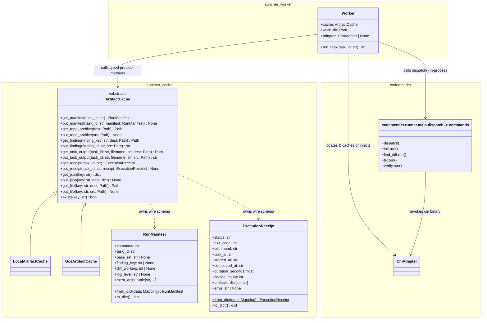
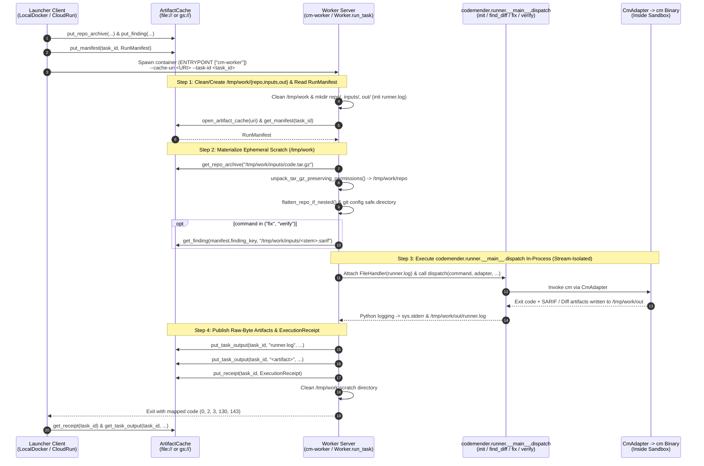

<!--
sdd_spec_id: SPEC-WORKER
sdd_implements: SPEC-0003
sdd_extends: None
sdd_level: COMPONENT
sdd_archetype: CLI_TOOL_BATCH_JOB
sdd_cujspec_product: codemender-runner
-->

<!--*
freshness: { owner: 'codemender-maintainers', reviewed: '2026-10-20' }
*-->

# Design: Unified Sandbox Container Worker (`launcher.worker` / `cm-worker`)

## Context

CodeMender executes untrusted target repository code, build systems, and exploit
verification harnesses inside sandboxed containers—either locally on a CI runner
VM via Docker + gVisor (`runsc`) or remotely on Google Cloud Run Jobs. Earlier
iterations maintained divergent container entrypoints and ad-hoc transit helpers
across local Docker bind mounts and Cloud Run GCS scripts, risking behavioral
drift, UID/GID permission collisions on bind-mounted host repositories, and
duplicated manifest/receipt handling.

Governed by [SPEC-WORKER](spec.md),
[SPEC-0003](../runner-container-packaging/spec.md),
the [CodeMender Runner System Design](../tech/systems/codemender-runner/design.md)
(Decision 2 and Runtime Contracts),
[ADR-0008](../../../adr/ADR-0008-repository-layout-and-package-structure.md),
the [Distributed Execution and Transit System Design](../tech/systems/distributed-execution-and-transit/design.md),
[ADR-0003](../../../adr/ADR-0003-environment-scrubbing.md),
[ADR-0002](../../../adr/ADR-0002.md),
[Proposal: cloudrun-job-bootstrapper](../../proposals/cloudrun-job-bootstrapper/proposal.md),
and
[Proposal: vcs-cloudrun-comms](../../proposals/vcs-cloudrun-comms/proposal.md),
this design specifies `launcher.worker.Worker` and its console script entrypoint
`cm-worker = "launcher.worker:main"` in `packages/launcher`. `Worker` acts as
the inside-container server counterpart to the host-side `Launcher` client,
communicating exclusively through `ArtifactCache` (`SPEC-ARTIFACT-CACHE`:
`launcher.cache.ArtifactCache`, `open_artifact_cache`, and
`launcher.cache.errors.ArtifactCacheError`).

## Goals / Non-Goals

### Goals

- Provide a single, runtime-agnostic inside-container worker (`Worker` /
  `cm-worker`) that executes identically under `LocalDockerLauncher`
  (`file:///cache`) and `CloudRunLauncher` (`gs://<bucket>/<prefix>`).
- Co-locate `Worker` (`launcher.worker`) with `Launcher` and `ArtifactCache`
  (`launcher.cache`) inside `packages/launcher` in a clean hub-and-spoke
  dependency hierarchy (`Launcher --> ArtifactCache <-- Worker`), where
  `launcher.cache` owns the shared wire models (`RunManifest`,
  `ExecutionReceipt`, `ScanMetadata`) and typed protocol methods so neither
  `Launcher` nor `Worker` imports the other.
- Enforce strict security isolation: zero `packages/repohost` imports,
  tar-slip-safe archive unpacking into container-private ephemeral scratch disk
  (`/tmp/work`), and clean preemption handling on `SIGTERM` (`143`) and `SIGINT`
  (`130`).
- Preserve the Two-Way Door lazy-import invariant so `cm-worker` with a
  `file://` cache URI never imports `gcsfs` or `google.cloud`.

### Non-Goals

- Implementing host-side container/job dispatch (`LocalDockerLauncher` and
  `CloudRunLauncher` are governed by `SPEC-LAUNCHER`).
- Implementing `ArtifactCache` storage drivers (`LocalArtifactCache` and
  `GcsArtifactCache` are governed by `SPEC-ARTIFACT-CACHE`).
- Maintaining separate standalone bootstrapper scripts outside
  `packages/launcher`.
- Interacting with GitHub or GitLab PR/MR APIs (`packages/repohost` is never
  installed or imported inside the sandbox container).

## Decisions

### Decision 1: Co-Locate `Worker` (`cm-worker`) in `packages/launcher` With Acyclic `Launcher --> ArtifactCache <-- Worker` Dependencies

- **Choice**: Implement `Worker` and the `cm-worker` CLI entrypoint
  (`cm-worker = "launcher.worker:main"`) inside
  `packages/launcher/src/launcher/worker.py`, while placing the shared wire
  models (`RunManifest`, `ExecutionReceipt`, `ScanMetadata`) and typed protocol
  methods in `launcher.cache` (`SPEC-ARTIFACT-CACHE`).
- **Rationale**:
  1. `Launcher` (host-side client) and `Worker` (inside-container server)
     implement the two halves of the same container execution protocol over
     `ArtifactCache`. Having both depend downward on `launcher.cache`
     (`Launcher --> ArtifactCache <-- Worker`) prevents the host-side `Launcher`
     from having to import the inside-container `launcher.worker` module while
     keeping client, server, and protocol verified together in one package.
  2. `docker/runner.Dockerfile`
     ([SPEC-0003](../runner-container-packaging/spec.md)) installs
     `packages/codemender` and `packages/launcher[cloudrun]` into
     `/opt/codemender/venv` with `ENTRYPOINT ["cm-worker"]`, while omitting
     `packages/repohost`. The same worker container image speaks the
     file/object-based `ArtifactCache` protocol everywhere (local Docker/gVisor,
     Cloud Run Jobs, and GKE), while standalone local runs outside of a CI/CD
     pipeline can still invoke `cm-runner` directly on the same image by
     overriding the entrypoint (`docker run --entrypoint cm-runner`).
- **Alternatives Considered**:
  - *Standalone script outside `packages/launcher`*: Duplicates manifest,
    receipt, and storage code and cannot share typed dataclasses with
    `Launcher`.
  - *Placing `RunManifest` and `ExecutionReceipt` only in `launcher.worker`*:
    Forces the host-side `Launcher` client to import the inside-container server
    module (`from launcher.worker import ...`), inverting the peer boundary.
  - *Placing `Worker` inside `packages/codemender`*: Violates
    [ADR-0008](../../../adr/ADR-0008-repository-layout-and-package-structure.md)
    by coupling the dependency-free inner `cm-runner` package to `ArtifactCache`
    and optional cloud storage dependencies.

### Decision 2: Pure `ArtifactCache` Protocol DI & Two-Way Door Lazy Cloud Imports

- **Choice**: `Worker.__init__` accepts an `ArtifactCache` instance and an
  optional `CmAdapter` (`Worker(cache, work_dir=Path("/tmp/work"), adapter=None)`)
  rather than raw `fsspec` filesystems or ad-hoc cloud SDK clients, and
  `cm-worker` resolves `--cache-uri` via
  `launcher.cache.open_artifact_cache(uri)`.
- **Rationale & Boundary Between `fsspec`, `ArtifactCache`, and `Worker`**:
  1. **`fsspec` (Storage Transport Layer):** Handles scheme-specific byte I/O
     (`file://` for local Docker/gVisor, `gs://` via `gcsfs` for Cloud Run/GKE,
     and extensible to `s3://` or `az://`).
  2. **`ArtifactCache` (`SPEC-ARTIFACT-CACHE` — Typed `vcs-cloudrun-comms`
     Protocol & Security Seam over `fsspec`):** Scopes all reads and writes to
     the commit/run `--cache-uri` root prefix; enforces path-traversal (`..`),
     absolute-path, and symlink-escape confinement inside `<cache_root>`;
     provides atomic local file replacement and uncached GCS visibility
     (`cache_timeout=0`, `retries=3`); translates low-level `fsspec`/`gcsfs`
     errors into typed `ArtifactCacheError` domain exceptions; and exposes the
     typed `vcs-cloudrun-comms` protocol models (`RunManifest`,
     `ExecutionReceipt`, `ScanMetadata`) and domain methods (`get_manifest` /
     `put_manifest`, `get_repo_archive` / `put_repo_archive`, `get_scan_meta` /
     `put_scan_meta`, `get_finding` / `put_finding`, `get_task_output` /
     `put_task_output`, `get_receipt` / `put_receipt`) built on top of the
     low-level `get_*` / `put_*` primitives.
  3. **`Worker` (`SPEC-WORKER` — Container Execution & Protocol Server):** Owns
     the 4-step inside-container execution lifecycle—cleaning and initializing
     `/tmp/work/{repo,inputs,out}`, reading `RunManifest` via `ArtifactCache`,
     unpacking `shared/code.tar.gz` into `/tmp/work/repo` with tar-slip
     validation, POSIX mode restoration, and single-folder flattening, calling
     `codemender.runner.__main__.dispatch` (which delegates to `init.run`,
     `find_diff.run`, `fix.run`, and `verify.run`) in-process using `CmAdapter`
     with `logging.FileHandler` log capture and stream isolation, trapping
     `SIGTERM`/`SIGINT` preemption signals, and publishing `ExecutionReceipt`,
     `runner.log`, and output artifacts with fallback `stderr` log spill.
  4. **Two-Way Door Lazy Cloud Imports:** Because `open_artifact_cache(uri)`
     lazily imports `GcsArtifactCache` (`gcsfs` and `google.cloud`) only when
     `uri.startswith("gs://")`, local Docker/gVisor runs (`file:///cache`) and
     hermetic unit tests execute with zero `gcsfs` or `google.cloud` imports.

### Decision 3: Scratch Extraction (`/tmp/work`) & Tar-Slip Defense

- **Choice**: Clean and initialize `/tmp/work/{repo,inputs,out}` at the very
  start of `Worker.run_task(task_id)` (before Step 1 reads `manifest.json`),
  extract `shared/code.tar.gz` into `/tmp/work/repo`, keep `/tmp/work/inputs`
  and `/tmp/work/out` strictly outside `/tmp/work/repo`, and validate every tar
  member before extraction.
- **Rationale**:
  1. Initializing `/tmp/work/out` and `/tmp/work/out/runner.log` before Step 1
     reads `manifest.json` guarantees that even a Step 1 manifest lookup or
     validation error can write to `/tmp/work/out/runner.log` and upload it
     cleanly without hitting `FileNotFoundError` or uploading stale files from a
     prior run.
  2. Keeping `/tmp/work/inputs` and `/tmp/work/out` strictly outside
     `/tmp/work/repo` preserves the clean working tree invariant mandated by
     [SPEC-FIX](../fix/spec.md) (`REQ-0003`) and
     [SPEC-VERIFY](../verify/spec.md) (`REQ-0003`), which abort with exit code
     `3` if `git status --porcelain` detects any untracked files inside `--repo`
     outside `.cm_project` and `.exploit/`.
  3. Unpacking into `/tmp/work/repo` inside each container eliminates host-side
     `shutil.copytree` overhead during parallel `fix`/`verify` fan-out and
     prevents UID/GID permission mismatches between the host CI user and the
     gVisor container user.
  4. Pre-extraction member inspection blocks path traversal (`..`), absolute
     paths, escaping symlinks/hardlinks, and special device files before any
     filesystem mutation occurs, while post-extraction
     `chmod(member.mode & 0o777)` preserves executable build scripts and
     `flatten_repo_if_nested` normalizes archives wrapped in a single top-level
     directory so `.git` (with its bounded commit history back to `base_ref` per
     [SPEC-FIND-DIFF](../find-diff/spec.md) `REQ-0002.2`) resides at
     `/tmp/work/repo/.git`.

### Decision 4: Direct In-Process `codemender.runner.__main__.dispatch` Execution, Stream Isolation & Preemption Receipt Flush

- **Choice**: Invoke `codemender.runner.__main__.dispatch` (which delegates to
  `init.run`, `find_diff.run`, `fix.run`, and `verify.run` in
  `codemender.runner.commands`) directly in-process using `CmAdapter` (caching
  the resolved adapter on `self.adapter` rather than spawning a redundant
  `cm-runner` Python subprocess), attach a `logging.FileHandler` for
  `/tmp/work/out/runner.log` on the root logger, use a discard
  `EventEmitter(stream=io.StringIO())` for artifact-producing commands
  (`find-diff`, `fix`, `verify`; `emitter=None` for `init`) while emitting zero
  bytes to `cm-worker`'s own `sys.stdout`, and trap `SIGTERM` (`143`) and
  `SIGINT` (`130`) via `_PreemptionSignal` to unwind execution and flush a
  failure `ExecutionReceipt` before exit.
- **Rationale**:
  1. Both `packages/launcher` and `packages/codemender` are installed in the same
     Python virtual environment inside the sandbox container. Calling
     `codemender.runner.__main__.dispatch` (which constructs `InitConfig`,
     `FindDiffConfig`, `FixConfig`, and `VerifyConfig` and calls `init.run`,
     `find_diff.run`, `fix.run`, and `verify.run`) shares command dispatch logic
     with the CLI while eliminating CLI argument serialization (`build_argv`)
     and avoiding an extra Python interpreter startup and pipe-reading loop.
  2. When `SIGTERM` or `SIGINT` raises `_PreemptionSignal`, Python unwinds the
     call stack through `CmAdapter.run`, whose `subprocess.run` context
     automatically kills (`process.kill()`) and reaps (`process.wait()`) any
     active child `cm` binary process without needing custom process-group
     locks or `os.killpg` escalation in `Worker`.
  3. Per [ADR-0002](../../../adr/ADR-0002.md),
     [SPEC-FIND-DIFF](../find-diff/spec.md) (`REQ-0005`),
     [SPEC-FIX](../fix/spec.md) (`REQ-0005`), and
     [SPEC-VERIFY](../verify/spec.md) (`REQ-0006`), `find-diff`, `fix`, and
     `verify` write their primary payloads (full SARIF JSON or raw binary
     `git diff --binary HEAD` bytes) to `emitter.stream` even when
     `out=Path("/tmp/work/out")` is passed, while auto-`init` (`emitter=None`)
     and command diagnostics go through Python `logging`. Calling `dispatch`
     with `emitter=None` uses `EventEmitter(stream=io.StringIO())` for
     artifact-producing commands to discard duplicate `stdout` payloads while
     the `logging.FileHandler` captures all `codemender` log records into
     `/tmp/work/out/runner.log` alongside `sys.stderr`.
  4. Flushing `receipt.json` and `runner.log` to `ArtifactCache` when
     `_PreemptionSignal` is caught (with a `sys.stderr` fallback log spill if
     cache upload fails) ensures the outer `Launcher` always observes a
     deterministic failure receipt and diagnostic log.

## Architecture & Execution Flow

### Component Class Diagram



### Sequence Diagram (`Launcher` <-> `ArtifactCache` <-> `Worker` <-> `codemender` <-> `cm`)



### Realization of the 5-Phase `vcs-cloudrun-comms` Protocol & Proposal Supersessions

Together, `Launcher`, `ArtifactCache`, and `Worker` realize the 5-phase
communication architecture defined in
[Proposal: vcs-cloudrun-comms](../../proposals/vcs-cloudrun-comms/proposal.md)
and
[Proposal: cloudrun-job-bootstrapper](../../proposals/cloudrun-job-bootstrapper/proposal.md),
as refined in
the [CodeMender Runner System Design](../tech/systems/codemender-runner/design.md)
Runtime Contracts:

1. **`Launcher` Owns Host-Side Phases 1, 2, & 5 (Staging, Dispatch, and
   Retrieval):** `Launcher` resolves the multi-tenant, commit-scoped cache root
   URI in Cloud Run
   (`gs://<bucket>/<owner>/<repo>/[prs/<pr_number>|branches/<sanitized_branch>]/<commit_sha>/`)
   or `file:///cache` in local Docker/gVisor, stages `shared/code.tar.gz` and
   `tasks/<task_id>/input/manifest.json` via `ArtifactCache` (Phase 1),
   dispatches the container with `--cache-uri <URI> --task-id <task_id>` passed
   to `cm-worker` (Phase 2), and reads back `ExecutionReceipt` and output
   artifacts upon completion (Phase 5).
2. **`ArtifactCache` Owns the Typed Protocol & Relative Key Layout
   (`SPEC-ARTIFACT-CACHE`):** Encapsulates the relative cache paths
   (`shared/code.tar.gz`, `shared/scan-meta.json`, `findings/<id>.sarif`,
   `tasks/<task_id>/input/manifest.json`, and
   `tasks/<task_id>/output/{receipt.json, runner.log, ...}`) and wire schemas
   (`RunManifest`, `ExecutionReceipt`, `ScanMetadata`) on top of `fsspec`.
3. **`Worker` Owns Inside-Container Phases 3 & 4 (Workspace Ingestion, Local
   Execution, and Output/Receipt Persistence):** `Worker` consumes
   `ArtifactCache`'s typed protocol methods within `--cache-uri`, keeping
   `Worker` 100% agnostic of `<owner>/<repo>`, PR numbers, branch sanitization
   (`sanitize_branch_name`), or bucket prefixes across GitHub Actions
   ([SPEC-GHA](../github-actions/spec.md),
   [SPEC-GHA-FIX](../github-actions-fix/spec.md)), GitLab CI
   ([SPEC-GITLAB-CI](../gitlab-ci/spec.md)), and future VCS integrations.
4. **Supersession of Draft Proposal Paths & Legacy Bootstrapper Mechanics:**
   - **Unified Per-Task Key Layout (`vcs-cloudrun-comms`):** The earlier draft
     paths (`shared/manifest.json` and `find-diff/output/findings.json`) are
     superseded by the conflict-free per-task layout
     (`tasks/<task_id>/input/manifest.json` and
     `tasks/<task_id>/output/report.sarif`).
   - **Consolidation of `cloudrun-job-bootstrapper`:** The earlier draft
     bootstrapper proposal (`cloud-run-jobs/entrypoint.py`, `/workspace` paths,
     `version` subcommand, dual `findings.json` staging, and 4-tier
     `gcloud`/`gsutil` CLI fallbacks) is superseded by `launcher.worker`
     (`cm-worker`), `/tmp/work/{repo,inputs,out}`, and `ArtifactCache` over
     `fsspec`.
   - **Verification Output Extension ([CodeMender Runner System Design](../tech/systems/codemender-runner/design.md)):** Per
     [SPEC-VERIFY](../verify/spec.md) (`REQ-0006`), `cm-runner verify` writes
     `<finding-stem>.sarif` (e.g.,
     `tasks/verify-finding-001/output/finding-001.sarif` mapped to
     `receipt.artifacts["sarif"]`), matching the Runtime Contracts directory tree
     in the [CodeMender Runner System Design](../tech/systems/codemender-runner/design.md).

## Data Models & JSON Schemas

### 1. `RunManifest` (`tasks/<task_id>/input/manifest.json`)

`RunManifest` is a frozen `attrs` class (`@attrs.define(frozen=True)`) defined
in `launcher.cache` (`SPEC-ARTIFACT-CACHE`) representing the task input
parameters staged by `Launcher` and consumed by `Worker.run_task`.

| Field | Python Type | Required | Description |
| :--- | :--- | :--- | :--- |
| `command` | `str` | Yes | Canonical `cm-runner` subcommand: `"init"`, `"find-diff"`, `"fix"`, or `"verify"`. |
| `task_id` | `str` | Yes | Logical task identifier (e.g., `"find"`, `"fix-finding-001"`). Must be a single safe path segment (`""`, `"."`, `".."`, `/`, and `\` rejected). |
| `base_ref` | `str \| None` | Required when `command == "find-diff"` | Target Git base ref or commit SHA passed as `--base <base_ref>` to `cm-runner find-diff` (`None` for `"init"`, `"fix"`, and `"verify"`). |
| `finding_key` | `str \| None` | Required when `command in ("fix", "verify")` | Relative `ArtifactCache` key for the single-finding SARIF input (e.g., `"findings/finding-001.sarif"`). Must be a safe relative key without `..` or leading `/`. |
| `diff_workers` | `int \| None` | No | Optional integer in `1..16` ([SPEC-FIND-DIFF](../find-diff/spec.md) `REQ-0002`) passed as `--diff-workers <N>` to `cm-runner find-diff`. |
| `log_level` | `str \| None` | No | Optional log verbosity (`"debug"`, `"info"`, `"warning"`, `"error"`) passed as top-level `--log-level <level>` to `cm-runner`. |
| `extra_args` | `tuple[str, ...]` | No | Optional sequence of additional CLI flags appended to the `cm-runner` invocation (default: `()`). |

#### `RunManifest` Serialization Semantics (`from_dict` / `to_dict`, `from_json` / `to_json`)

- `RunManifest.from_dict(data: Mapping[str, Any]) -> RunManifest` &
  `RunManifest.from_json(raw_json: str | bytes) -> RunManifest`:
  - Validates that `data` is a mapping and delegates directly to `RunManifest(**data)`
    so `attrs` field converters and validators enforce all invariants in one
    place (raising `ValidationError` on invalid fields).
- `RunManifest.to_dict() -> dict[str, Any]` & `RunManifest.to_json() -> str`:
  - Serializes `command`, `task_id`, and all non-`None` optional fields
    (`base_ref`, `finding_key`, `diff_workers`, `log_level`, and `extra_args`).

#### Example `manifest.json` (`fix` Task)

```json
{
  "command": "fix",
  "task_id": "fix-finding-001",
  "finding_key": "findings/finding-001.sarif",
  "log_level": "info"
}
```

### 2. `ExecutionReceipt` (`tasks/<task_id>/output/receipt.json`)

`ExecutionReceipt` is a frozen `attrs` class (`@attrs.define(frozen=True)`)
defined in `launcher.cache` (`SPEC-ARTIFACT-CACHE`, and used as
`cache.ExecutionReceipt` by `launcher.worker`) representing the structured task
completion record written by `Worker` to `tasks/<task_id>/output/receipt.json`.

| Field | Python Type | Required | Description |
| :--- | :--- | :--- | :--- |
| `status` | `str` | Yes | `"SUCCESS"` when `exit_code == 0`; `"FAILURE"` for all non-zero exit codes (`2`, `3`, `130`, `143`). |
| `exit_code` | `int` | Yes | Numeric worker exit code (`0`, `2`, `3`, `130`, or `143`). |
| `command` | `str` | Yes | Canonical `cm-runner` command executed (or `"unknown"` if manifest parsing failed before command resolution). |
| `task_id` | `str` | Yes | Task identifier matching `--task-id`. |
| `started_at` | `str` | Yes | ISO 8601 UTC start timestamp (`YYYY-MM-DDTHH:MM:SSZ`). |
| `completed_at` | `str` | Yes | ISO 8601 UTC completion timestamp (`YYYY-MM-DDTHH:MM:SSZ`). |
| `duration_seconds` | `float` | Yes | Non-negative elapsed wall-clock execution time in seconds (rounded to 3 decimal places). |
| `finding_count` | `int` | Yes | Number of non-dismissed findings in `runs[0].results` of the emitted SARIF artifact (`properties.status != "DISMISSED"` and not suppressed per [SPEC-VERIFY](../verify/spec.md) `REQ-0005`; `0` when dismissed, when no SARIF artifact is produced, or on failure). |
| `artifacts` | `dict[str, str]` | Yes | Deterministic mapping of logical artifact roles (`runner.log` -> `"log"`, `*.sarif` -> `"sarif"`, `*.md` -> `"report"`, `*.diff` -> `"patch"`) to relative `ArtifactCache` keys under `tasks/<task_id>/output/`. |
| `error` | `str \| None` | Yes (`null` on success or normal `cm-runner` exit `3`) | `None` (`null`) when `status == "SUCCESS"` or when `cm-runner` itself runs normally and returns exit code `3` (e.g., `cm-runner fix` producing no patch, where diagnostics are in `runner.log`); non-empty string when `Worker` encounters a manifest/archive validation error (`2`), `cm-runner` usage error (`2`), missing binary (`FileNotFoundError`), `ArtifactCacheError`/IO error, or preemption signal (`130`/`143`). |

#### `ExecutionReceipt` Serialization Semantics (`from_dict` / `to_dict`, `from_json` / `to_json`)

- `ExecutionReceipt.from_dict(data: Mapping[str, Any]) -> ExecutionReceipt` &
  `ExecutionReceipt.from_json(raw_json: str | bytes) -> ExecutionReceipt`:
  - Validates that `data` is a mapping and delegates directly to
    `ExecutionReceipt(**data)` so `attrs` field converters and validators
    enforce all invariants (raising `ValidationError` on invalid fields).
- `ExecutionReceipt.to_dict() -> dict[str, Any]` &
  `ExecutionReceipt.to_json() -> str`:
  - Returns a JSON-serializable dictionary or deterministic JSON string with all
    fields above.

#### Example `receipt.json` (`find-diff` Task)

```json
{
  "status": "SUCCESS",
  "exit_code": 0,
  "command": "find-diff",
  "task_id": "find",
  "started_at": "2026-10-20T21:00:00Z",
  "completed_at": "2026-10-20T21:00:42Z",
  "duration_seconds": 42.125,
  "finding_count": 2,
  "artifacts": {
    "log": "tasks/find/output/runner.log",
    "sarif": "tasks/find/output/report.sarif",
    "report": "tasks/find/output/report.md"
  },
  "error": null
}
```

## Error & Exit-Code Mapping Table

In compliance with
[ADR-0002](../../../adr/ADR-0002.md),
the [Distributed Execution and Transit System Specification](../tech/systems/distributed-execution-and-transit/spec.md#req-0004),
and `SPEC-ARTIFACT-CACHE` (`launcher.cache.errors.ArtifactCacheError`),
`Worker.run_task` and `cm-worker` map all outcomes to five deterministic exit
codes:

| Exit Code | Constant / Signal | Receipt `status` | Triggering Conditions & `ArtifactCacheError` Mapping |
| :--- | :--- | :--- | :--- |
| `0` | `EXIT_OK` | `"SUCCESS"` | `codemender` command completed with exit code `0` (regardless of whether `finding_count` is `0` or `> 0`) and required output artifacts were published to `ArtifactCache`. |
| `2` | `EXIT_USAGE_ERROR` | `"FAILURE"` (or no receipt if `--cache-uri`/`--task-id` CLI flags are missing/invalid) | CLI argument error (`--cache-uri` or `--task-id` missing/invalid); `ArtifactNotFoundError`, `ArtifactIntegrityError`, or `InvalidCacheKeyError` when reading `tasks/<task_id>/input/manifest.json`, `shared/code.tar.gz`, or `finding_key` in Steps 1–2; `manifest.json` failing `RunManifest` validation (`ValidationError`, `ValueError`); tar archive failing tar-slip or format validation (`ValueError`, `tarfile.TarError`); or `codemender` command returning exit code `2`. |
| `3` | `EXIT_EXECUTION_FAILURE` | `"FAILURE"` | Normal `codemender` exit code `3` (e.g., `fix.run` producing no patch, recorded with `receipt.error = None` and diagnostics in `runner.log`); OR worker/infrastructure failures recorded with a non-empty `receipt.error`: `CacheConfigurationError`, `CachePermissionError`, or `CacheTransientError` when opening `--cache-uri` or accessing `ArtifactCache`; `cm` binary not found (`FileNotFoundError`); `codemender` returning any unexpected non-zero exit code (`!= 2` and `!= 3`); or an unexpected storage/IO exception (`ArtifactCacheError`, `OSError`) during execution or Step 4 output publishing. |
| `130` | `SIGINT` (`128 + 2`) | `"FAILURE"` | Worker received `SIGINT`; active task interrupted and preemption receipt flushed. |
| `143` | `SIGTERM` (`128 + 15`) | `"FAILURE"` | Worker received `SIGTERM` (e.g., Cloud Run Job task timeout/preemption or `docker stop`); active task interrupted and preemption receipt flushed. |

## Security, Signal Handling & Failure-Spill Details

### Tar-Slip Security Validation (`launcher.cache.unpack_tar_gz_preserving_permissions`)

Before extracting any file from `shared/code.tar.gz`,
`unpack_tar_gz_preserving_permissions(archive_path: Path, dest_dir: Path)` in
`launcher.cache.archive` resolves `abs_dest = dest_dir.resolve()` and validates
all members returned by `tar.getmembers()` prior to extraction:
1. **Absolute Path Check:** Rejects any member where
   `PurePosixPath(member.name).is_absolute()` is `True` or `member.name`
   contains backslashes.
2. **Path Traversal Check:** Rejects any member containing `".."` in
   `PurePosixPath(member.name).parts` or whose resolved target path
   `target_path.resolve()` is not relative to `abs_dest`
   (`target_path.is_relative_to(abs_dest)`).
3. **Symlink & Hardlink Escape Check:** For any member where `member.issym()` or
   `member.islnk()` is `True`, rejects the member if `member.linkname` is
   absolute, traverses another archive link, forms a cycle, or resolves outside
   `abs_dest`.
4. **Device / Special File Rejection:** Rejects character devices, block
   devices, and FIFOs (`member.ischr()`, `member.isblk()`, `member.isfifo()`).
5. **Permission Restoration:** Extracts members with PEP 706 `filter="tar"` and
   applies `target_path.chmod(member.mode & 0o777)` on regular files and
   directories (skipping symlinks).

### Preemption Signal Handling & Child `cm` Cleanup

When `Worker.run_task(task_id)` executes, it registers handlers for
`signal.SIGTERM` and `signal.SIGINT` (restoring previous signal handlers in a
`finally` block when `run_task` returns):
- On `SIGTERM` (`exit_code = 143`) or `SIGINT` (`exit_code = 130`), the signal
  handler raises `_PreemptionSignal(signum)`.
- As `_PreemptionSignal` unwinds the call stack through `CmAdapter.run`,
  `subprocess.run`'s built-in exception handler automatically kills and reaps any
  active child `cm` process.
- `_stage_and_run_command` catches `_PreemptionSignal`, appends the signal notice
  to `runner.log`, and returns `(command_name, sig_exc.exit_code, str(sig_exc))`
  so `_publish_results` uploads `tasks/<task_id>/output/runner.log` and
  `tasks/<task_id>/output/receipt.json` (`status="FAILURE"`, `exit_code=143` or
  `130`) to `ArtifactCache` before returning `exit_code`.

### Fallback `stderr` Log Spill

If a task finishes with `exit_code != 0` (including preemption `130`/`143`) and
uploading `runner.log` or `receipt.json` to `ArtifactCache` raises
`CacheConfigurationError`, `CachePermissionError`, `CacheTransientError`, or any
`ArtifactCacheError` / `OSError` (for example, due to transient network loss or
revoked credentials during preemption), `Worker` writes the captured
`runner.log` content directly to `sys.stderr`:

```text
=== [FALLBACK LOG SPILL: ArtifactCache sync failed] ===
<contents of /tmp/work/out/runner.log>
=== [END FALLBACK LOG SPILL] ===
```

This guarantees that operators inspecting container `stderr` streams in Cloud
Logging or CI job logs always see the underlying `codemender` failure output.

## Verification Strategy (`packages/launcher/src/launcher/test_worker.py`)

Compliance with [SPEC-WORKER](spec.md) and this design is verified via hermetic
co-located unit tests in `packages/launcher/src/launcher/test_worker.py`
executed by `make test`:

1. **CLI & Argument Validation Tests:**
   - Test `WorkerConfig`, `WorkerConfig.from_cli()`, and `main()` with valid flags,
     missing `--cache-uri` / `--task-id`, and path-traversal `--task-id ../bad`
     (asserting exit code `2` and empty `stdout`).
2. **Package Boundary & Lazy-Import Tests:**
   - Block `repohost`, `gcsfs`, and `google.cloud` in `sys.modules`
     (`sys.modules["repohost"] = None`, `sys.modules["gcsfs"] = None`, and
     `sys.modules["google.cloud"] = None`) during task execution to verify
     runtime package isolation and Two-Way Door lazy-import compliance.
3. **`RunManifest`, `ExecutionReceipt` & `ArtifactCacheError` Mapping Tests:**
   - Test `from_dict` / `to_dict` and `from_json` / `to_json` round-trips and
     validation failures (missing `base_ref` for `find-diff`, missing or unsafe
     `finding_key` for `fix`/`verify`, unknown command) producing exit code `2`
     and failure receipts.
   - Verify that `ArtifactNotFoundError`, `ArtifactIntegrityError`, and
     `InvalidCacheKeyError` during input staging map to exit code `2`, while
     `CacheConfigurationError`, `CachePermissionError`, and
     `CacheTransientError` map to exit code `3`.
4. **Tar-Slip Defense, Permission Preservation & Flattening Tests:**
   - Construct in-memory/temp `.tar.gz` archives containing absolute paths,
     `../` traversal segments, and escaping symlinks/hardlinks; assert
     `unpack_tar_gz_preserving_permissions` raises `ValueError` and `Worker`
     records a failure receipt with exit code `2`.
   - Verify `0o755` executable mode preservation and single-directory wrapper
     flattening (`my-repo/.git` -> `/tmp/work/repo/.git`).
5. **End-to-End 4-Step Task Execution Tests (`find-diff`, `fix`, `verify`):**
   - Using `LocalArtifactCache(self.cache_dir)`, an injected
     `CmAdapter`, and mocked `codemender.runner.commands.{init,find_diff,fix,verify}.run`
     handlers, verify that `Worker.run_task` stages `shared/code.tar.gz` and
     `findings/finding-001.sarif`, invokes the command handlers with the expected
     typed config objects, uploads `report.sarif` / `finding-001.diff` /
     `finding-001.sarif`, `runner.log`, and `receipt.json` (with accurate
     `finding_count`), and cleans `work_dir`.
6. **Preemption Signal (`SIGTERM` / `SIGINT`) & Fallback Log Spill Tests:**
   - Run `Worker.run_task` with a slow mocked command handler, send `SIGTERM` /
     `SIGINT`, and verify task interruption and `receipt.json` publication with
     exit codes `143` and `130`.
   - Simulate `ArtifactCache` upload failure on a non-zero exit and assert
     that `FALLBACK LOG SPILL` is written to `sys.stderr`.
