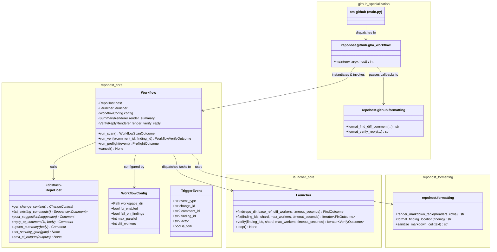
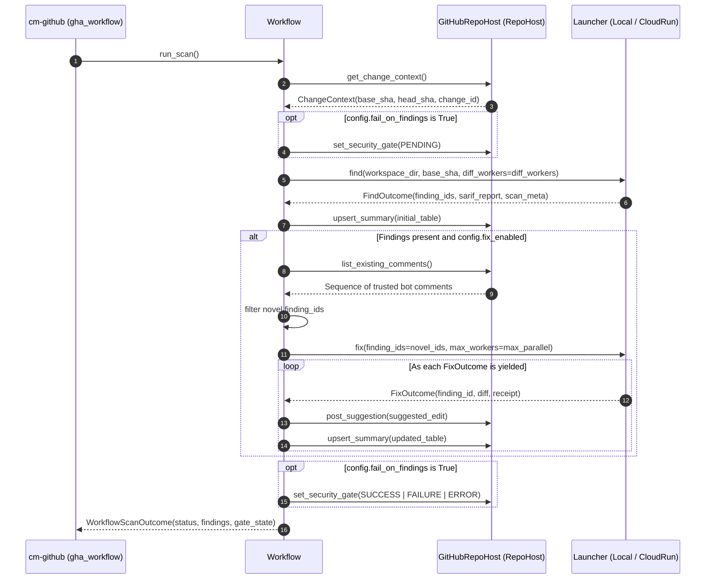

<!--
sdd_spec_id: docs/openspec/specs/workflow/spec.md
sdd_legacy_id: SPEC-WORKFLOW
sdd_implements: None
sdd_extends: docs/openspec/specs/find-diff/spec.md
sdd_level: COMPONENT
sdd_archetype: CI_CD_WORKFLOW
sdd_cujspec_product: codemender-runner
-->

<!--*
freshness: { owner: 'codemender-maintainers', reviewed: '2026-11-03' }
*-->

# Design: Generic CI Workflow Orchestrator & Dependency Injection Engine

## Context

Prior to this specification, host-side CI orchestration was implemented in a monolithic script ([`gha_runner.py`](../../../../packages/repohost/src/repohost/github/gha_runner.py), 1,713 lines). This script conflated multiple distinct responsibilities:
1. Parsing GitHub Actions environment variables (`GITHUB_EVENT_PATH`, `GITHUB_OUTPUT`, `RUNNER_TEMP`) and deserializing webhook payloads.
2. Rendering GitHub-flavored Markdown strings with collapsible `<details><summary>` blocks and GitHub Action run links.
3. Orchestrating the core CodeMender lifecycle: change context resolution, differential scanning via `Launcher.find()`, fix deduplication, bounded parallel remediation via `Launcher.fix()`, in-flight comment updates, on-demand verification via `Launcher.verify()`, and security gate evaluation.

The [CodeMender Runner System Design](../tech/systems/codemender-runner/design.md) establishes the foundational three-tier abstraction:
- `ArtifactCache` for data transit between host and sandbox container.
- `Launcher` as the host-side client managing container execution.
- `RepoHost` as the host-side client managing PR/MR interactions and commit statuses.

### Architectural Alignment with CodeMender Runner System Design (Decisions 3 & 4)
In [CodeMender Runner System Design](../tech/systems/codemender-runner/design.md) Decision 3, the architecture rejects per-operation wrapper classes or an in-memory DAG / workgraph engine inside `packages/launcher`, keeping `Launcher` as the focused domain execution client (`find`, `fix`, `verify`, `stop`) per [SPEC-LAUNCHER / PR #93](https://github.com/cloud-gtm/codemender-runner/pull/93). Meanwhile, PR review deduplication, in-flight table updates, and commit status checks require an outer-host orchestrator coordinating between `RepoHost` and `Launcher`.

[CodeMender Runner System Design](../tech/systems/codemender-runner/design.md) Decision 4 reflects this separation, specifying that dedicated per-host CLI binaries (`cm-github`, `cm-gitlab`) wire `RepoHost` and `Launcher` to:
> *"shared CLI orchestration helpers in `repohost.cli` [now `repohost.workflow`]"*.

This design extracts that coordination state machine out of `gha_runner.py` and into `packages/repohost/src/repohost/workflow.py`. `Workflow` serves as the host-side orchestrator that wires `RepoHost` and `Launcher` together via composition, without wrapping `Launcher`'s execution methods or creating a DAG engine.

---

## Goals / Non-Goals

### Goals
- **100% Platform Independence:** The core `Workflow` engine has zero dependencies on GitHub or GitLab SDKs, environment variables, or proprietary CLI annotations.
- **Dependency Injection Seams:** Wire `RepoHost` and `Launcher` at the composition root (`cm-github` or `cm-gitlab`), passing them cleanly into `Workflow`.
- **Decoupled Pure Functional Formatting:** Extract table and comment generation into functional modules (`repohost.formatting` and `repohost.github.formatting`), keeping the orchestrator focused on task coordination.
- **SPEC-VERIFY Semantic Alignment:** Align verification outcomes with `SPEC-VERIFY` and `SPEC-LAUNCHER` (`DISMISSED` = remediated, `VERIFIED` = exploitable).
- **Fail-Closed Security Gate Semantics:** Enforce deterministic `SecurityGateState` calculations across both platforms, fully adhering to [ADR-0006](../../../adr/ADR-0006-pr-remediation-routing-and-security-gate.md) and [Security and Trust Zones](../tech/systems/security-and-trust-zones/design.md).
- **Process-Level Signal Safety:** Trap signals at the CLI process boundary (`main()`) and provide safe cancellation in `Workflow.cancel()`.

### Non-Goals
- **In-Memory DAG / Workgraph Engine:** Explicitly rejected in [CodeMender Runner System Design](../tech/systems/codemender-runner/design.md) Decision 3; CI workflows execute in separate OS processes and CI stages rather than complex in-memory DAGs.
- **Modifying Core ABCs:** `RepoHost` and `Launcher` ABCs are already established; this design builds on top of them without modifying their core contracts.
- **Maintaining `gha_runner.py` Shim:** As decided during exploration, `gha_runner.py` will not be preserved as a legacy wrapper. Callers (`action.yml` and `cm-github`) will point directly to `repohost.github.gha_workflow`.

---

## Decisions

### Decision 1: Composition-First `Workflow` Engine in `repohost.workflow`

- **Choice:** Implement `Workflow` as a concrete class in `packages/repohost/src/repohost/workflow.py` initialized with:
  ```python
  @dataclasses.dataclass(frozen=True)
  class WorkflowConfig:
    workspace_dir: Path
    fix_enabled: bool = True
    fail_on_findings: bool = True
    max_parallel: int = 4
    diff_workers: int = 8

  class Workflow:
    def __init__(
        self,
        host: RepoHost,
        launcher: Launcher,
        config: WorkflowConfig,
        render_summary: SummaryRenderer | None = None,
        render_verify_reply: VerifyReplyRenderer | None = None,
    ): ...

    def run_scan(self) -> WorkflowScanOutcome: ...
    def run_verify(self, comment_id: str, finding_id: str) -> WorkflowVerifyOutcome: ...
    def run_preflight(self, event: TriggerEvent) -> PreflightOutcome: ...
    def cancel(self) -> None: ...
  ```
- **Rationale:** 
  1. Passing collaborators into `Workflow` makes it trivial to test using mock `RepoHost` and `Launcher` instances.
  2. Typed outcome objects (`WorkflowScanOutcome`, `WorkflowVerifyOutcome`, `PreflightOutcome`) preserve clean separation between domain outcomes and process exit codes, leaving exit-code mapping to `main()`. Return types are named `WorkflowScanOutcome` and `WorkflowVerifyOutcome` to avoid name collisions with `launcher.base.VerifyOutcome` and `FindOutcome`.
  3. Signal trapping is handled in `main()` via try/finally and signal handlers that invoke `workflow.cancel()`, preventing process-global signal mutations inside library code.
- **Alternatives Considered:**
  - *Template Method Pattern (`BaseWorkflow` subclassed by `GitHubWorkflow`):* Rejected because subclassing binds event parsing and lifecycle execution into the same inheritance tree, making unit testing more cumbersome than pure composition.

### Decision 2: SPEC-VERIFY Exploitability Semantics Alignment

- **Choice:** Align `run_verify` outcome interpretation directly with [`SPEC-VERIFY`](../verify/spec.md):
  - When `status == "DISMISSED"`, `cm verify` demonstrated that the finding is not exploitable (successfully remediated). Post confirmation reply and emit `verified=true`.
  - When `status == "VERIFIED"`, `cm verify` confirmed that the finding is still exploitable (unremediated). Post warning reply and emit `verified=false`.
  - When `status == "OPEN"`, verification is inconclusive. Post notification reply and emit `verified=false`.
- **Rationale:** Corrects the inverted logic present in early drafts and aligns with CodeMender core domain definitions.
- **Alternatives Considered:**
  - *Custom boolean verify return:* Rejected because `cm verify` outputs rich triage states (`DISMISSED`, `VERIFIED`, `OPEN`) that must be communicated clearly to the developer.

### Decision 3: Functional Formatting Modules over OOP Presenter Hierarchy

- **Choice:** Decouple Markdown comment and summary generation into pure functional modules:
  - `repohost.formatting`: Generic helpers for Markdown tables, finding location summaries, cell state representations, and content sanitization (escaping pipe characters `\|`, dynamic backtick code fences, and escaping leading `/` or `@` tokens).
  - `repohost.github.formatting`: GitHub-specific Markdown rendering, including `<details><summary>` collapsibles, badge formatting, and GitHub Action run links.
- **Rationale:** Over 450 lines of `gha_runner.py` are pure string manipulation. Converting these into pure functions allows 100% test coverage without mocking containers or API clients. A full OOP `Presenter` class hierarchy is unnecessary overhead (YAGNI) when simple pure functions passed as defaults or callbacks fulfill the requirement.
- **Alternatives Considered:**
  - *Inlining formatting inside `Workflow`:* Violates Single Responsibility Principle and pollutes the orchestrator with HTML/Markdown parsing.
  - *OOP `WorkflowPresenter` abstract base class:* Introduces excessive boilerplate and class hierarchies for simple string generation functions.

### Decision 4: Clean Break from `gha_runner.py`

- **Choice:** Delete `gha_runner.py` and replace it with `repohost/github/gha_workflow.py`. Update `.github/actions/codemender/action.yml`, `.github/actions/codemender-local/action.yml`, and `cm-github` (`repohost.github.__main__`) to call `gha_workflow.main()`.
- **Rationale:** A compatibility shim incurs technical debt and confusion. Since `codemender-runner` controls its own action entrypoints and console scripts, a clean cutover ensures there is only one source of truth.

### Decision 5: Domain-Level Launcher Dispatch (`SPEC-LAUNCHER` Alignment)

- **Choice:** `Workflow` delegates container dispatch, workspace snapshotting, SARIF splitting, and parallel worker management directly to `Launcher`'s domain methods:
  - Differential scan: `Launcher.find(repo_dir=config.workspace_dir, base_ref=base_sha, diff_workers=config.diff_workers)` returning `FindOutcome`.
  - Parallel remediation: `Launcher.fix(finding_ids=novel_ids, max_workers=config.max_parallel)` yielding `FixOutcome`.
  - On-demand verification: `Launcher.verify(finding_ids=[finding_id], max_workers=1)` yielding `VerifyOutcome`.
- **Rationale:** Aligns with `SPEC-LAUNCHER` (PR #93). `Launcher` internally encapsulates archive transit (`ArtifactCache`), worker staging (`tasks/{task_id}/input/manifest.json`), container execution (`run_parallel`), and receipt processing. By relying on high-level `Launcher` methods, `Workflow` eliminates duplicated SARIF parsing, diff extraction, and directory copying logic.
- **Alternatives Considered:**
  - *Invoking low-level `Launcher.run()` or `run_parallel()`:* Rejected as `Launcher.run()` and `ParallelTask` are deprecated and removed in `SPEC-LAUNCHER`.

---

## Architecture

### Component & Class Diagram



### Scan & Parallel Fix Sequence Flow



---

## Security Architecture & Defense in Depth

1. **Strict Hex SHA Validation:** Both `base_sha` and `head_sha` are strictly validated against `^[0-9a-fA-F]{40,64}$`, completely mitigating Git argument injection attacks (e.g. `--upload-pack`).
2. **Bot-Only Deduplication:** Finding deduplication checks author identity to ensure third-party comments containing fingerprint tokens cannot suppress vulnerability remediation.
3. **Symlink & CI Config Downgrade:** Remediation patches affecting `.github/workflows/*` or `.gitlab-ci.yml`, targeting symlinks, or containing code fences are downgraded to non-committable plain patch comments to prevent CI privilege escalation.
4. **Content Sanitization:** Markdown output sanitizes table delimiter pipes (`\|`), escapes GitLab quick action triggers (`\/`), and uses dynamic 4+ backtick fences to prevent prompt injection and formatting breakouts.
5. **Three-Zone Credential Isolation ([Security and Trust Zones](../tech/systems/security-and-trust-zones/design.md)):** Zone 1 host tokens (`$GITHUB_TOKEN`, `$CI_JOB_TOKEN`, GitLab API tokens) remain in Zone 1 (host runner process) and are never passed into `Launcher` methods or placed inside the staged repository workspace. Archive sanitization and Zone 2 WIF credentials are governed exclusively by [SPEC-LAUNCHER / PR #93](https://github.com/cloud-gtm/codemender-runner/pull/93) REQ-0002 and REQ-0008.

---

## Rollout & Migration Plan

1. **Step 1:** Author and approve `SPEC-WORKFLOW` (`spec.md` and `design.md`).
2. **Step 2:** Extract `GitHubRepoHost` in `packages/repohost/src/repohost/github/repo_host.py` from `client.py` and `fix_comments.py`.
3. **Step 3:** Implement `repohost.formatting` and `repohost.github.formatting`.
4. **Step 4:** Implement `repohost.workflow.Workflow` and unit tests.
5. **Step 5:** Implement `repohost.github.gha_workflow`, update `cm-github` and `action.yml`, and delete `gha_runner.py`.
6. **Step 6:** Run presubmit and integration test suites.
