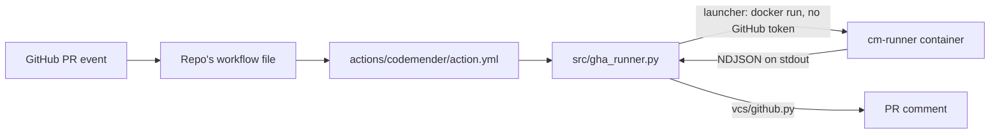

# CodeMender GitHub Actions Integration (Workstream 2)

A GitHub Action that runs CodeMender (`cm-runner`) on pull requests and reports
the results back on the PR.

> **Status: M0 (walking skeleton).** On every pull request the action runs
> `cm-runner version` in a `docker run` sandbox and posts one PR comment with
> the result. `find-diff`, `fix`, and `verify` will be wired in once those
> `cm-runner` commands exist (see [Roadmap](#roadmap)).

## How it fits together



- **cm-runner** (`codemender-runner/`) is environment-agnostic. It runs
  CodeMender and never talks to GitHub (ADR-0002).
- **This action** decides *where* cm-runner runs (the launcher), and it's the
  only part that holds the GitHub token and posts to the PR.

## Directory structure

Follows the `.github/` convention: workflows in `workflows/`, actions in
`actions/<name>/` (GitHub requires the file to be named `action.yml`). The
action's source lives with the action, so the directory is self-contained.

```text
github-actions/
├── actions/
│   └── codemender/
│       ├── action.yml             # Composite action: pulls the image, runs src/gha_runner.py
│       ├── requirements.txt       # Dependencies of this action (not of cm-runner)
│       ├── src/
│       │   ├── gha_runner.py      # Entry point: reads the GitHub event, runs cm-runner, posts the result
│       │   ├── launcher/
│       │   │   ├── base.py        # Launcher interface + ADR-0001 output contract (NDJSON, exit codes)
│       │   │   └── local_docker.py  # Vanilla launcher: `docker run` on the GitHub Actions VM
│       │   └── vcs/
│       │       └── github.py      # GitHub REST API: create/update the CodeMender PR comment
│       └── tests/                 # Unit tests (no network, no Docker needed)
└── workflows/
    └── cm-merge-scan.yml          # Workflow template to copy into a repo's .github/workflows/
```

## Distribution model

`codemender-runner` is a private repository, so customer repositories can't
reference this action (`uses: cloud-gtm/codemender-runner/...`), and we can't
change settings on their behalf. Instead, we **send customers a tarball of this
directory**; they copy it into their repository and run it from there. Nothing
in the action depends on access to this repository.

A published, versioned action may follow later (see [Roadmap](#roadmap)).

## Packaging for a customer (maintainers)

Build the tarball from a committed ref with `git archive`, so only tracked files
are included (no local notes, caches, or uncommitted changes):

```bash
# From the root of codemender-runner
git archive --format=tar.gz --prefix=codemender-action/ \
  -o codemender-action.tar.gz HEAD:github-actions
```

The package mirrors a repository's `.github/` directory:

| Path | Copy to | Needed at runtime? |
| :--- | :--- | :--- |
| `actions/codemender/` (`action.yml`, `requirements.txt`, `src/`) | `.github/actions/codemender/` | Yes: this is the action |
| `actions/codemender/tests/` | — | No: included for transparency |
| `workflows/cm-merge-scan.yml` | `.github/workflows/cm-merge-scan.yml` | Yes: the workflow that calls the action |
| `README.md` | — | Setup only: these instructions |

The customer also needs a **cm-runner image they can pull** (see step 3
below). The image is not part of the tarball.

## Using it in a repository (customers)

### 1. Copy the action into your repository

Extract the package and copy the action to `.github/actions/codemender/`:

```bash
tar -xzf codemender-action.tar.gz          # creates ./codemender-action/

# From the root of your repository
mkdir -p .github/actions/codemender
rsync -a --delete --exclude tests --exclude __pycache__ \
  /path/to/codemender-action/actions/codemender/ .github/actions/codemender/
```

Result:

```text
.github/actions/codemender/
├── action.yml
├── requirements.txt
└── src/
    ├── gha_runner.py
    ├── launcher/
    │   ├── __init__.py
    │   ├── base.py
    │   └── local_docker.py
    └── vcs/
        ├── __init__.py
        └── github.py
```

To upgrade, extract the new package, re-run the same command, and commit.

### 2. Add the workflow

```bash
mkdir -p .github/workflows
cp /path/to/codemender-action/workflows/cm-merge-scan.yml .github/workflows/
```

It checks out the repository (required, so the local action exists on the
runner) and then runs `uses: ./.github/actions/codemender`. It runs only on
PRs targeting `main` or `master`; edit `branches:` if your default branch is
named differently.

### 3. Point the workflow at a cm-runner image

`runner_image` is **required**. Set it to a cm-runner image your repository can
pull, pinned to a commit SHA tag (not `:latest`).

No tokens or secrets are needed. The action uses the workflow's automatic
token (scoped by `permissions:`) to pull the image and to post the comment,
as `github-actions[bot]`. This works when the image is in your org's GHCR with
Actions access granted to the repository, or is public.

Only if the image is in a registry the repository's token can't read (e.g.
another org), pass a token with `registry_token: ${{ secrets.<NAME> }}`. It is
used only for `docker pull`.

> [!NOTE]
> How customers build and host their own cm-runner image (e.g. in their own
> registry) is still to be documented (see `docs/guides/calling_cm_runner.md`).

### 4. Open a pull request

A **CodeMender** comment appears, showing the cm-runner and `cm` versions.
Later pushes update the same comment.

### Inputs

| Input | Default | Description |
| :--- | :--- | :--- |
| `runner_image` | — (**required**) | cm-runner image. Pin a commit SHA tag, not `:latest`. |
| `registry_token` | *(workflow token)* | Optional. Used **only** to pull the image, when the repository's token can't read it. |
| `log_level` | `info` | cm-runner log level. Logs appear in the job log. |

### Required workflow permissions

| Permission | Why |
| :--- | :--- |
| `contents: read` | Check out the repository (the action lives in it) |
| `packages: read` | Pull the cm-runner image from GHCR with the workflow token |
| `pull-requests: write` | Post / update the CodeMender comment |

## Internal testing (cloud-gtm)

To test with the upstream development image from a repository that can't read
`cloud-gtm` packages (e.g. a personal sandbox):

1. Set `runner_image` to a commit tag of
   `ghcr.io/cloud-gtm/codemender-runner` that has been published, e.g.
   `ghcr.io/cloud-gtm/codemender-runner:465f1ca4382de8113acbb3378d5da96f46d6cb44`.
2. Create a classic PAT with only the `read:packages` scope and authorize it
   for `cloud-gtm` SSO (Settings → Developer settings → Tokens (classic) →
   Configure SSO).
3. Save it as a repository secret (e.g. `CM_REGISTRY_TOKEN`) and add
   `registry_token: ${{ secrets.CM_REGISTRY_TOKEN }}` to the workflow.

## Security model

There are two sandbox layers:

| Layer | Owner | Protects against |
| :--- | :--- | :--- |
| **Outer**: the container (`docker run`) | This action (the launcher) | cm-runner reaching the GitHub token, the host, or other jobs |
| **Inner**: `cm`'s own process sandbox | cm-runner (configures `cm`) | The agent's tool calls (builds, PoCs) escaping the workspace or network |

- `docker run` is started **without any `-e`/`--env` flags**, so no host
  environment variable (in particular `GITHUB_TOKEN`) reaches the container.
- The token is used only on the host: to pull the image (followed by
  `docker logout`) and to post the comment.
- cm-runner output is treated as untrusted. Values are escaped before being
  rendered, and comments are truncated to GitHub's limit.
- Fork PRs run only if the repository allows it (see below).

### Fork pull requests

By default, GitHub gives fork PR workflows a read-only token and no secrets,
so the image pull or the PR comment fails. For **private or internal**
repositories, an org (or repo) admin can allow them:

Settings → Actions → General → *Fork pull request workflows in private
repositories*, then tick:

- Run workflows from fork pull requests
- Send write tokens to workflows from pull requests
- Send secrets and variables to workflows from pull requests
- (Optional) Require approval for fork pull request workflows

Without these settings, the job fails and the log names the setting to enable.

- **Trust:** a fork author can edit the workflow or the copied action, and it
  runs with the write token and secrets. This is fine only when forks come from
  trusted people (for example, employees in a corporate org).
- **Public repositories** don't have these settings. They would need a
  `pull_request` + `workflow_run` split (see [Roadmap](#roadmap)). Don't use
  `pull_request_target` with a checkout of the fork's code.
- **To check at M1:** whether GCP Workload Identity Federation tokens are
  issued to fork workflows under these settings.

> **Open item for cm-runner:** `cm`'s inner sandbox uses Linux user namespaces,
> which Docker's default profile may block. cm-runner should check this (e.g.
> in `init`) and offer an explicit "outer boundary only" mode. Not relevant to
> M0, since `version` doesn't start the sandbox.

## Running the tests

```bash
cd github-actions/actions/codemender
python3 -m unittest discover -s tests -v
```

## Roadmap

| Milestone | What it adds | Blocked on |
| :--- | :--- | :--- |
| **M0** (this) | `cm-runner version` via `docker run`, PR comment | — |
| M1 | Real findings posted to the PR, SARIF artifacts, GCP auth (WIF) | `cm-runner find-diff` |
| M2 | One-click fix suggestions on the PR | `cm-runner fix` |
| M3 | `@codemender verify <id>` and the Security Gate status check | `cm-runner verify` |
| Later | Cloud Run / GKE launchers | Workstream 3 |
| Later | Official release as a published, versioned action (`uses: <org>/<action>@v1`) instead of copying the code in | A public home for the action; the copy-in version working end to end |
| Later | Fork PRs in **public** repos: split into an unprivileged `pull_request` job and a privileged `workflow_run` job that posts results | A customer need for public repos |
