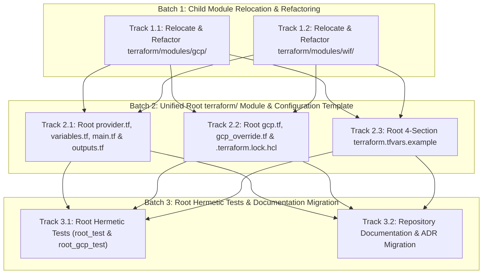

<!--*
freshness: { owner: 'ledoux', reviewed: '2026-10-02' }
*-->

# Local Backlog Plan: Unified Terraform Root & Composable Mode-Aware WIF Module (`SPEC-WIF`)

This local task plan decomposes [SPEC-WIF](docs/openspec/specs/wif/spec.md) and its accompanying [Design](docs/openspec/specs/wif/design.md) into sequential batches and fork-join parallel tracks with zero file collisions.

> **Scope Note:** This plan covers only `SPEC-WIF` (`terraform/` and `terraform/modules/{wif,gcp}` plus repository documentation updates). Tasks for `SPEC-DIST` (`scripts/distribute.sh` and `dist/README.md`) are tracked separately.

## Execution DAG

---

## Batch 1: Child Module Relocation & Refactoring

### Track 1.1: Relocate & Refactor `terraform/modules/gcp/`

- [x] **Task 1.1.1: Relocate `terraform/gcp/` to `terraform/modules/gcp/` and remove legacy directory**
  * **Description**: Move all files (`apis.tf`, `compute.tf`, `iam.tf`, `outputs.tf`, `provider.tf`, `scheduler.tf`, `secret.tf`, `storage.tf`, `variables.tf`, `vpc.tf`, `.terraform.lock.hcl`, and `tests/*.tftest.hcl`) from `terraform/gcp/` to `terraform/modules/gcp/` using `git mv` and ensure the legacy `terraform/gcp/` directory no longer exists.
  * **Verification**: `test -d terraform/modules/gcp && test ! -e terraform/gcp && test -f terraform/modules/gcp/tests/iam_test.tftest.hcl`
  * **Source**: `docs/openspec/specs/wif/spec.md#req-0001 (SPEC-WIF/REQ-0001)`

- [x] **Task 1.1.2: Strip concrete provider blocks from `terraform/modules/gcp/provider.tf`, update relative workflow path in `compute.tf`, and verify runtime SA outputs in `terraform/modules/gcp/outputs.tf`**
  * **Description**: Update `terraform/modules/gcp/provider.tf` so that `required_version = ">= 1.5.0"` is set and all concrete `provider "google" {}` and `provider "google-beta" {}` blocks are removed (retaining only the `terraform { required_version ... required_providers { google ... google-beta ... } }` block so the root module can compose `module "gcp"` with `count`). Update `terraform/modules/gcp/compute.tf` so `google_workflows_workflow.orchestrator` references `file("${path.module}/../../../workflows/gcp_parallel_workflow.yaml")` (accounting for the new `terraform/modules/gcp/` depth). Confirm `terraform/modules/gcp/outputs.tf` exports `runner_service_account_email` (`google_service_account.runner_sa.email`), `worker_service_account_email` (`google_service_account.worker_sa.email`), `reports_bucket_name`, `runner_job_name`, and `region`, and run `terraform test` in `terraform/modules/gcp/`.
  * **Verification**: `! grep -E '^provider "(google|google-beta)"' terraform/modules/gcp/provider.tf && terraform -chdir=terraform/modules/gcp init -backend=false && terraform -chdir=terraform/modules/gcp validate && terraform -chdir=terraform/modules/gcp test`
  * **Source**: `docs/openspec/specs/wif/spec.md#req-0001 (SPEC-WIF/REQ-0001)`, `docs/openspec/specs/wif/spec.md#req-0005 (SPEC-WIF/REQ-0005)`, `docs/openspec/specs/wif/spec.md#req-0007 (SPEC-WIF/REQ-0007)`

### Track 1.2: Relocate & Refactor `terraform/modules/wif/`

- [x] **Task 1.2.1: Relocate `terraform/wif/` to `terraform/modules/wif/`, strip concrete providers, and remove legacy `terraform.tfvars.example`**
  * **Description**: Move `apis.tf`, `github.tf`, `iam.tf`, `outputs.tf`, `provider.tf`, `variables.tf`, `.terraform.lock.hcl`, and `tests/wif_test.tftest.hcl` from `terraform/wif/` to `terraform/modules/wif/`, remove `terraform/wif/terraform.tfvars.example` (which is replaced by the root `terraform/terraform.tfvars.example` in Batch 2), and ensure the legacy `terraform/wif/` directory no longer exists. Strip the concrete `provider "google" {}` and `provider "github" {}` blocks from `terraform/modules/wif/provider.tf`, retaining only `terraform { required_version = ">= 1.5.0" required_providers { google ... github ... } }`.
  * **Verification**: `test -d terraform/modules/wif && test ! -e terraform/wif && test ! -e terraform/modules/wif/terraform.tfvars.example && ! grep -E '^provider "(google|github)"' terraform/modules/wif/provider.tf`
  * **Source**: `docs/openspec/specs/wif/spec.md#req-0001 (SPEC-WIF/REQ-0001)`

- [x] **Task 1.2.2: Unify repository list into `var.github_repositories` with validation in `terraform/modules/wif/variables.tf`**
  * **Description**: In `terraform/modules/wif/variables.tf`, remove `wif_allowed_repositories`, `target_github_repositories`, and `github_mgmt_token`. Define the single `var.github_repositories` (`type = list(string)`, `default = []`) variable with a validation block enforcing `var.github_scope_type != "repositories" || length(var.github_repositories) > 0` (error message indicating `github_repositories` must contain at least one repository when `github_scope_type` is `"repositories"`). Retain `var.execution_mode` (`"local"` or `"cloud_run"`), `var.gcs_transit_bucket_name` (validated non-empty when `execution_mode == "cloud_run"`), `var.cloud_run_runtime_sa_emails`, `var.cloud_run_job_name`, and default IDs (`codemender-wif-sa`, `codemender-wif-pool`, `codemender-wif-provider`).
  * **Verification**: `! grep -E 'wif_allowed_repositories|target_github_repositories' terraform/modules/wif/variables.tf && grep -q 'variable "github_repositories"' terraform/modules/wif/variables.tf`
  * **Source**: `docs/openspec/specs/wif/spec.md#req-0001 (SPEC-WIF/REQ-0001)`, `docs/openspec/specs/wif/spec.md#req-0002 (SPEC-WIF/REQ-0002)`

- [x] **Task 1.2.3: Implement `local.full_repo_names` and `local.short_repo_names` normalization across `iam.tf` and `github.tf` and verify mode-switched APIs/IAM**
  * **Description**: In `terraform/modules/wif/iam.tf`, define `local.full_repo_names = [for r in var.github_repositories : strcontains(trimspace(r), "/") ? trimspace(r) : "${var.github_owner}/${trimspace(r)}"]` and use `local.full_repo_names` in `local.attribute_condition` (`assertion.repository in ${jsonencode(local.full_repo_names)}`) and `google_service_account_iam_member.wif_repo_binding` (`for_each = var.github_scope_type == "repositories" ? toset(local.full_repo_names) : toset([])`). Verify mode-switched APIs (`apis.tf`) and IAM bindings (`iam.tf`) match `REQ-0003` (`local` mode enables `aiplatform.googleapis.com` and binds `roles/aiplatform.user`) and `REQ-0004` (`cloud_run` mode enables `run.googleapis.com` and `storage.googleapis.com`, omits `roles/aiplatform.user`, and binds `roles/run.developer`, `roles/storage.objectUser` on `var.gcs_transit_bucket_name`, and `roles/iam.serviceAccountUser` on `var.cloud_run_runtime_sa_emails`). In `terraform/modules/wif/github.tf`, replace `raw_repo_list` / `target_repos` with `local.short_repo_names = toset([for r in var.github_repositories : element(reverse(split("/", trimspace(r))), 0)])` and key all `github_issue_label`, `github_actions_secret`, and `github_actions_variable` resources on `local.short_repo_names`.
  * **Verification**: `! grep -E 'wif_allowed_repositories|target_github_repositories' terraform/modules/wif/iam.tf terraform/modules/wif/github.tf && grep -q 'full_repo_names' terraform/modules/wif/iam.tf && grep -q 'short_repo_names' terraform/modules/wif/github.tf`
  * **Source**: `docs/openspec/specs/wif/spec.md#req-0001 (SPEC-WIF/REQ-0001)`, `docs/openspec/specs/wif/spec.md#req-0003 (SPEC-WIF/REQ-0003)`, `docs/openspec/specs/wif/spec.md#req-0004 (SPEC-WIF/REQ-0004)`, `docs/openspec/specs/wif/spec.md#req-0006 (SPEC-WIF/REQ-0006)`

- [x] **Task 1.2.4: Update and run hermetic tests in `terraform/modules/wif/tests/wif_test.tftest.hcl`**
  * **Description**: Update `terraform/modules/wif/tests/wif_test.tftest.hcl` to pass `github_repositories = ["repo-a", "test-org/repo-b"]` (replacing `target_github_repositories` and `wif_allowed_repositories`), assert mixed `"repo"` and `"owner/repo"` normalization in `repository_list_scoping` (`assertion.repository in ["test-org/repo-a","test-org/repo-b"]`, 2 `wif_repo_binding` resources, and 2 `codemender_scan` labels keyed by `"repo-a"` and `"repo-b"`), and add a test run `repositories_scope_requires_non_empty_github_repositories` with `github_scope_type = "repositories"`, `github_repositories = []`, and `expect_failures = [var.github_repositories]`. Execute `terraform init -backend=false`, `terraform validate`, and `terraform test` in `terraform/modules/wif/`.
  * **Verification**: `terraform -chdir=terraform/modules/wif init -backend=false && terraform -chdir=terraform/modules/wif validate && terraform -chdir=terraform/modules/wif test`
  * **Source**: `docs/openspec/specs/wif/spec.md#req-0001 (SPEC-WIF/REQ-0001)`, `docs/openspec/specs/wif/spec.md#req-0002 (SPEC-WIF/REQ-0002)`, `docs/openspec/specs/wif/spec.md#req-0007 (SPEC-WIF/REQ-0007)`

---

## Batch 2: Unified Root `terraform/` Module & Configuration Template

### Track 2.1: Root `provider.tf`, `variables.tf`, `main.tf` & `outputs.tf`

- [x] **Task 2.1.1: Create root `terraform/provider.tf` with Google and 3-tier GitHub provider authentication**
  * **Description**: Create `terraform/provider.tf` declaring `required_version = ">= 1.5.0"` and `required_providers` for `google` (`hashicorp/google`, `>= 5.0.0`), `google-beta` (`hashicorp/google-beta`, `>= 5.0.0`), and `github` (`integrations/github`, `>= 6.0.0`). Define `local.use_github_app_auth = (var.github_app_id != "" && var.github_app_installation_id != "" && var.github_app_pem_file != "")`. Configure `provider "google"` and `provider "google-beta"` (`project = var.gcp_project_id`, `region = var.gcp_region`), and configure `provider "github"` with `owner = var.github_owner != "" ? var.github_owner : null`, `token = !local.use_github_app_auth && var.github_mgmt_token != null && var.github_mgmt_token != "" ? var.github_mgmt_token : null`, and a conditional `dynamic "app_auth"` block (`for_each = local.use_github_app_auth ? [1] : []`) setting `id = var.github_app_id`, `installation_id = var.github_app_installation_id`, and `pem_file = fileexists(pathexpand(trimspace(var.github_app_pem_file))) ? file(pathexpand(trimspace(var.github_app_pem_file))) : var.github_app_pem_file`.
  * **Verification**: `test -f terraform/provider.tf && grep -q 'use_github_app_auth' terraform/provider.tf && grep -q 'dynamic "app_auth"' terraform/provider.tf`
  * **Source**: `docs/openspec/specs/wif/spec.md#req-0001 (SPEC-WIF/REQ-0001)`, `docs/openspec/specs/wif/spec.md#req-0002 (SPEC-WIF/REQ-0002)`

- [x] **Task 2.1.2: Create root `terraform/variables.tf` with WIF, Cloud Run, and GitHub App auth inputs**
  * **Description**: Create `terraform/variables.tf` defining all root inputs and validation rules required by `SPEC-WIF`:
    - GCP project & identity naming: `gcp_project_id` (`string`), `gcp_region` (`string`, `default = "us-central1"`), `gcp_service_account_id` (`default = "codemender-wif-sa"`), `gcp_wif_pool_id` (`default = "codemender-wif-pool"`), `gcp_wif_provider_id` (`default = "codemender-wif-provider"`).
    - Execution mode & optional Cloud Run overrides: `execution_mode` (`string`, `default = "local"`, validated in `["local", "cloud_run"]`), `gcs_transit_bucket_name` (`string`, `default = ""`), `cloud_run_job_name` (`string`, `default = ""`), `cloud_run_runtime_sa_emails` (`list(string)`, `default = []`), plus Cloud Run module parameters (`resource_prefix`, `reports_bucket_name`, `runner_cpu`, `runner_memory`, `create_vpc_and_nat`, `existing_vpc_connector_id`, `vpc_connector_cidr`, `vpc_connector_min_instances`, `vpc_connector_max_instances`, `vpc_connector_machine_type`, `scheduler_cron`).
    - WIF scoping & single repository list: `github_owner` (`string`, `default = ""`), `github_scope_type` (`string`, `default = "org"`, validated in `["org", "user", "repositories"]`), and `github_repositories` (`list(string)`, `default = []`, validated with `var.github_scope_type != "repositories" || length(var.github_repositories) > 0`).
    - GitHub App & token authentication: `github_app_id` (`string`, `default = ""`), `github_app_installation_id` (`string`, `default = ""`), `github_app_pem_file` (`string`, `default = ""`, `sensitive = true`), and `github_mgmt_token` (`string`, `default = null`, `sensitive = true`).
  * **Verification**: `test -f terraform/variables.tf && ! grep -E 'wif_allowed_repositories|target_github_repositories' terraform/variables.tf && grep -q 'github_app_installation_id' terraform/variables.tf`
  * **Source**: `docs/openspec/specs/wif/spec.md#req-0001 (SPEC-WIF/REQ-0001)`, `docs/openspec/specs/wif/spec.md#req-0002 (SPEC-WIF/REQ-0002)`, `docs/openspec/specs/wif/spec.md#req-0005 (SPEC-WIF/REQ-0005)`

- [x] **Task 2.1.3: Create root `terraform/main.tf` and `terraform/outputs.tf` with distribution-safe hook locals**
  * **Description**: Create `terraform/main.tf` declaring the default empty Cloud Run hook locals (`gcp_module_bucket_name = ""`, `gcp_module_job_name = ""`, `gcp_module_runtime_sa_emails = []`) and instantiating `module "wif"` (`source = "./modules/wif"`) passing all WIF variables along with `gcs_transit_bucket_name = var.gcs_transit_bucket_name != "" ? var.gcs_transit_bucket_name : local.gcp_module_bucket_name`, `cloud_run_job_name = var.cloud_run_job_name != "" ? var.cloud_run_job_name : local.gcp_module_job_name`, and `cloud_run_runtime_sa_emails = length(var.cloud_run_runtime_sa_emails) > 0 ? var.cloud_run_runtime_sa_emails : local.gcp_module_runtime_sa_emails`. Create `terraform/outputs.tf` re-exporting `gcp_workload_identity_provider`, `gcp_service_account`, `execution_mode`, and `next_step_private_key_injection` from `module.wif` with zero references to `module.gcp`.
  * **Verification**: `test -f terraform/main.tf && test -f terraform/outputs.tf && ! grep -q 'module\.gcp' terraform/main.tf terraform/outputs.tf`
  * **Source**: `docs/openspec/specs/wif/spec.md#req-0001 (SPEC-WIF/REQ-0001)`, `docs/openspec/specs/wif/spec.md#req-0005 (SPEC-WIF/REQ-0005)`

### Track 2.2: Root `gcp.tf`, `gcp_override.tf` & `.terraform.lock.hcl`

- [x] **Task 2.2.1: Create `terraform/gcp.tf`, `terraform/gcp_override.tf`, and root `terraform/.terraform.lock.hcl`**
  * **Description**: Create `terraform/gcp.tf` instantiating `module "gcp"` (`source = "./modules/gcp"`, `count = var.execution_mode == "cloud_run" ? 1 : 0`) passing `project_id = var.gcp_project_id`, `region = var.gcp_region`, `resource_prefix`, `reports_bucket_name`, `runner_cpu`, `runner_memory`, `create_vpc_and_nat`, `existing_vpc_connector_id`, `vpc_connector_cidr`, `vpc_connector_min_instances`, `vpc_connector_max_instances`, `vpc_connector_machine_type`, and `scheduler_cron`, and exporting conditional Cloud Run outputs `cloud_run_reports_bucket_name` (`var.execution_mode == "cloud_run" ? module.gcp[0].reports_bucket_name : null`) and `cloud_run_job_name` (`var.execution_mode == "cloud_run" ? module.gcp[0].runner_job_name : null`). Create `terraform/gcp_override.tf` using Terraform's native `_override.tf` merging to override `local.gcp_module_bucket_name`, `local.gcp_module_job_name`, and `local.gcp_module_runtime_sa_emails` (`[module.gcp[0].runner_service_account_email, module.gcp[0].worker_service_account_email]`) when `var.execution_mode == "cloud_run"`. Create `terraform/.terraform.lock.hcl` combining the locked provider hashes for `hashicorp/google`, `hashicorp/google-beta`, `hashicorp/random`, `hashicorp/time`, and `integrations/github`.
  * **Verification**: `test -f terraform/gcp.tf && test -f terraform/gcp_override.tf && test -f terraform/.terraform.lock.hcl && grep -q 'module "gcp"' terraform/gcp.tf && grep -q 'gcp_module_runtime_sa_emails' terraform/gcp_override.tf`
  * **Source**: `docs/openspec/specs/wif/spec.md#req-0001 (SPEC-WIF/REQ-0001)`, `docs/openspec/specs/wif/spec.md#req-0005 (SPEC-WIF/REQ-0005)`

### Track 2.3: Root 4-Section `terraform.tfvars.example`

- [x] **Task 2.3.1: Create self-documenting 4-section `terraform/terraform.tfvars.example`**
  * **Description**: Create `terraform/terraform.tfvars.example` organized into the 4 required sections defined in `REQ-0006`:
    1. **Section 1: GCP Project & Identity Naming** (`gcp_project_id`, `gcp_region`, `gcp_service_account_id`, `gcp_wif_pool_id`, `gcp_wif_provider_id`).
    2. **Section 2: Execution Mode & Cloud Run Infrastructure** (`execution_mode = "local" | "cloud_run"`, explaining that `"cloud_run"` automatically provisions `terraform/modules/gcp` and wires its outputs into `terraform/modules/wif`, plus optional overrides and Cloud Run sizing settings).
    3. **Section 3: GCP WIF OIDC Trust Perimeter & Target Repositories** (`github_owner`, `github_scope_type = "org" | "user" | "repositories"`, and the single `github_repositories` list accepting `"repo"` or `"owner/repo"`).
    4. **Section 4: Optional GitHub Repository Bootstrap & Provider Auth** (explaining how `github_repositories = []` skips GitHub API calls in `"org"`/`"user"` mode, and documenting the 3 authentication options: ambient `gh auth login` / `GITHUB_TOKEN`, GitHub App `app_auth` via `github_app_id` + `github_app_installation_id` + `github_app_pem_file`, or explicit `github_mgmt_token`).
  * **Verification**: `test -f terraform/terraform.tfvars.example && ! grep -E 'wif_allowed_repositories|target_github_repositories' terraform/terraform.tfvars.example && grep -q 'github_repositories' terraform/terraform.tfvars.example && grep -q 'github_app_installation_id' terraform/terraform.tfvars.example`
  * **Source**: `docs/openspec/specs/wif/spec.md#req-0001 (SPEC-WIF/REQ-0001)`, `docs/openspec/specs/wif/spec.md#req-0006 (SPEC-WIF/REQ-0006)`

---

## Batch 3: Root Hermetic Tests & Documentation Migration

### Track 3.1: Root Hermetic Tests (`root_test.tftest.hcl` & `root_gcp_test.tftest.hcl`)

- [x] **Task 3.1.1: Create `terraform/tests/root_test.tftest.hcl` and `terraform/tests/root_gcp_test.tftest.hcl` and verify root and stripped-distribution test execution**
  * **Description**: Create `terraform/tests/root_test.tftest.hcl` using `mock_provider "google"`, `mock_provider "google-beta"`, and `mock_provider "github"` (with zero references to `module.gcp`) testing:
    1. Default `execution_mode = "local"` (`output.execution_mode == "local"`, `module.wif` provisions `roles/aiplatform.user`, and `local.use_github_app_auth == false`).
    2. GitHub App provider authentication (`local.use_github_app_auth == true` when `github_app_id`, `github_app_installation_id`, and `github_app_pem_file` are provided).
    Create `terraform/tests/root_gcp_test.tftest.hcl` (including `override_resource` blocks for `module.gcp[0].google_service_account.runner_sa`, `module.gcp[0].google_service_account.worker_sa`, and `module.wif.google_service_account.runner_sa` so `.email` values are known at plan time for `for_each`) testing `execution_mode = "cloud_run"` where `module.gcp` has count `1` and its `reports_bucket_name`, `runner_job_name`, and `[runner_service_account_email, worker_service_account_email]` outputs are automatically wired into `module.wif` via `terraform/gcp_override.tf` without manual variable overrides. Verify `terraform init -backend=false && terraform validate && terraform test` passes in `terraform/`, and also verify in an isolated temporary directory that removing `modules/gcp`, `gcp.tf`, `gcp_override.tf`, and `tests/root_gcp_test.tftest.hcl` still passes `terraform init -backend=false && terraform validate && terraform test` cleanly (`REQ-0005`).
  * **Verification**: `! grep -q 'module\.gcp' terraform/tests/root_test.tftest.hcl && terraform -chdir=terraform init -backend=false && terraform -chdir=terraform validate && terraform -chdir=terraform test`
  * **Source**: `docs/openspec/specs/wif/spec.md#req-0002 (SPEC-WIF/REQ-0002)`, `docs/openspec/specs/wif/spec.md#req-0005 (SPEC-WIF/REQ-0005)`, `docs/openspec/specs/wif/spec.md#req-0007 (SPEC-WIF/REQ-0007)`

### Track 3.2: Repository Documentation & ADR Migration

- [x] **Task 3.2.1: Update `codemender-runner/README.md`, `ADR-0004`, `github_actions_guide.md`, and `terraform_deployment_guide.md`**
  * **Description**: Update all Terraform module path, variable, and authentication references across:
    1. `codemender-runner/README.md`: Update references and directory tree from standalone `terraform/wif/` and `terraform/gcp/` to the unified root `terraform/` entrypoint and `terraform/modules/{wif,gcp}` child module hierarchy, and update the Terraform test commands section to include root `terraform` alongside `terraform/modules/wif` and `terraform/modules/gcp`.
    2. `docs/adr/ADR-0004-project-tech-stack-and-repo-architecture.md`: Update the repo directory tree comment under `terraform/` to reflect the unified root `terraform/` entrypoint and `terraform/modules/{wif,gcp}` child modules.
    3. `docs/guides/github_actions_guide.md`: Update Path A Terraform instructions to run from `terraform/` using the 4-section `terraform.tfvars` format (`github_repositories`, `execution_mode`, and 3-tier GitHub provider authentication via `gh auth login`/`GITHUB_TOKEN`, GitHub App `app_auth`, or `github_mgmt_token`), removing all legacy references to `terraform/gha_wif`, standalone `terraform/wif`, `wif_allowed_repositories`, and `target_github_repositories`.
    4. `docs/guides/terraform_deployment_guide.md`: Update deployment instructions to reflect the unified root `terraform/` entrypoint (with `execution_mode = "cloud_run"`) and `terraform/modules/gcp` child module structure.
  * **Verification**: `! grep -En 'terraform/gha_wif|wif_allowed_repositories|target_github_repositories' codemender-runner/README.md docs/adr/ADR-0004-project-tech-stack-and-repo-architecture.md docs/guides/github_actions_guide.md docs/guides/terraform_deployment_guide.md && grep -q 'terraform/modules/wif' codemender-runner/README.md`
  * **Source**: `docs/openspec/specs/wif/spec.md#req-0007 (SPEC-WIF/REQ-0007)`
